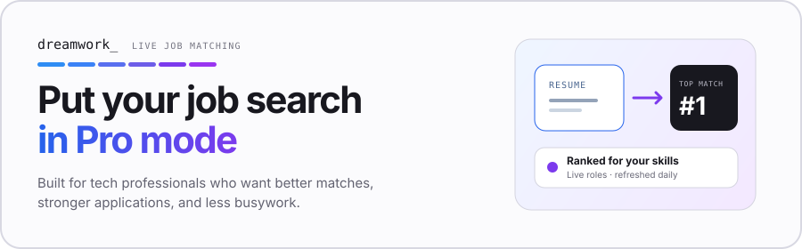

<a href="https://www.dreamworkhq.com/?utm_source=github&utm_medium=readme_cta&utm_campaign=gh-senior-swe">
  <picture>
    <source media="(prefers-color-scheme: dark)" srcset="./static/img/banner-dark.svg">
    <source media="(prefers-color-scheme: light)" srcset="./static/img/banner-light.svg">
    
  </picture>
</a>

<h1 align="center">Senior Software Engineer Jobs</h1>

Senior, staff, principal, and lead software engineering roles in the United States. No management, junior, new-grad, or internship listings.

  
  

  <a href="https://www.dreamworkhq.com/?utm_source=github&utm_medium=readme_cta&utm_campaign=gh-senior-swe">
    <picture>
      <source media="(prefers-color-scheme: dark)" srcset="./static/img/btn-matches-dark.svg">
      <source media="(prefers-color-scheme: light)" srcset="./static/img/btn-matches-light.svg">
      
    </picture>
  </a>

  <a href="https://www.dreamworkhq.com/?utm_source=github&utm_medium=link_row&utm_campaign=gh-senior-swe">dreamworkhq.com</a>
  ·
  <a href="https://www.dreamworkhq.com/blog?utm_source=github&utm_medium=link_row&utm_campaign=gh-senior-swe">Blog</a>
  ·
  <a href="https://www.dreamworkhq.com/research?utm_source=github&utm_medium=link_row&utm_campaign=gh-senior-swe">Hiring research</a>
  ·
  <a href="../../issues">Report a listing</a>

Star this repo and new roles land in your GitHub feed every day. Listings come from [Dreamwork](https://www.dreamworkhq.com/?utm_source=github&utm_medium=readme_cta&utm_campaign=gh-senior-swe), which crawls 2.5M+ live jobs directly from company career pages.

Last updated: **2026-11-15**. Showing the **600** most recently indexed roles, curated from **3,000+** open listings on Dreamwork. Salary shows when the posting discloses it. Click a role to see details and apply.

- [Senior](#senior-259) · 259 roles
- [Staff and lead](#staff-and-lead-217) · 217 roles
- [Principal](#principal-124) · 124 roles

<!-- TABLE_START (auto-generated: do not edit by hand; edits are overwritten daily) -->

### Senior (259)

| Company | Role | Location | Pay | Added |
| --- | --- | --- | --- | --- |
| **[Baseten](https://www.dreamworkhq.com/c/baseten.co?utm_source=github&utm_campaign=gh-senior-swe)** | [Software Engineer, Cloud Platform](https://www.dreamworkhq.com/job/181d0bcc-eeb5-4738-8329-8b6dc93532ca?utm_source=github&utm_campaign=gh-senior-swe) | San Francisco (Hybrid) | $165K–$330K | 0d |
| **[Curri](https://www.dreamworkhq.com/c/curri.com?utm_source=github&utm_campaign=gh-senior-swe)** | [Senior Software Engineer, Finance](https://www.dreamworkhq.com/job/7fae4001-d9f0-40b7-9171-06df05af61c7?utm_source=github&utm_campaign=gh-senior-swe) | Remote (Remote - United States) | $185K–$215K | 0d |
| **[Bedrock Robotics](https://www.dreamworkhq.com/c/bedrockrobotics.com?utm_source=github&utm_campaign=gh-senior-swe)** | [Software Engineer, Calibration](https://www.dreamworkhq.com/job/cb81cad7-a80d-430e-961b-0476681cb5cf?utm_source=github&utm_campaign=gh-senior-swe) | San Francisco, CA (Hybrid) |  | 0d |
| **[Airwallex](https://www.dreamworkhq.com/c/airwallex.com?utm_source=github&utm_campaign=gh-senior-swe)** | [Senior Software Engineer, Data Platform & AI Enablement](https://www.dreamworkhq.com/job/bc98be6e-9d67-4863-bbb9-9ea26a3864d9?utm_source=github&utm_campaign=gh-senior-swe) | Remote (US - Seattle) | $180K–$240K | 0d |
| **[Beaconbiosignals](https://www.dreamworkhq.com/c/beaconbiosignals.com?utm_source=github&utm_campaign=gh-senior-swe)** | [Senior Site Reliability Engineer](https://www.dreamworkhq.com/job/436b5ac7-c5c6-4ceb-8dcc-b27f6903caf2?utm_source=github&utm_campaign=gh-senior-swe) | Remote (Boston, MA / Remote) | $170K–$190K | 0d |
| **[540](https://www.dreamworkhq.com/c/540.dev?utm_source=github&utm_campaign=gh-senior-swe)** | [Senior Platform Engineer](https://www.dreamworkhq.com/job/f0e86a15-61e9-47eb-9edf-575302759aad?utm_source=github&utm_campaign=gh-senior-swe) | Arlington, VA (Hybrid) |  | 0d |
| **[Booz Allen Hamilton](https://www.dreamworkhq.com/c/boozallen.com?utm_source=github&utm_campaign=gh-senior-swe)** | [Software Engineer, Senior](https://www.dreamworkhq.com/job/8479a621-c051-42e9-9698-994e60a11f59?utm_source=github&utm_campaign=gh-senior-swe) | Lexington Park, MD (Hybrid) | $87K–$198K | 0d |
| **[Booz Allen Hamilton](https://www.dreamworkhq.com/c/boozallen.com?utm_source=github&utm_campaign=gh-senior-swe)** | [Databricks Data Engineer, Senior](https://www.dreamworkhq.com/job/3f0dbdaf-90b8-48a1-bc25-fb2c4621363e?utm_source=github&utm_campaign=gh-senior-swe) | Bethesda, MD (Hybrid) | $78K–$176K | 0d |
| **[Aresmgmt](https://www.dreamworkhq.com/c/aresmgmt.com?utm_source=github&utm_campaign=gh-senior-swe)** | [Senior Associate, AI Engineering](https://www.dreamworkhq.com/job/0b29fb25-6fa8-4a1c-8fc5-5699c0099e7a?utm_source=github&utm_campaign=gh-senior-swe) | Los Angeles, CA - Century City (Hybrid) | $150K–$170K | 0d |
| **[Aresmgmt](https://www.dreamworkhq.com/c/aresmgmt.com?utm_source=github&utm_campaign=gh-senior-swe)** | [Senior Associate, AI Engineering](https://www.dreamworkhq.com/job/8e505c2c-b1c3-4a43-9e01-ebeda75c9928?utm_source=github&utm_campaign=gh-senior-swe) | New York, NY (Hybrid) | $150K–$175K | 0d |
| **[ServiceTitan](https://www.dreamworkhq.com/c/servicetitan.com?utm_source=github&utm_campaign=gh-senior-swe)** | [Senior Full Stack Software Engineer](https://www.dreamworkhq.com/job/a40b9a05-9e71-42db-8335-616f6c113b14?utm_source=github&utm_campaign=gh-senior-swe) | Remote (US Remote) | $153K–$245K | 0d |
| **[Hatchit](https://www.dreamworkhq.com/c/babelstreet.com?utm_source=github&utm_campaign=gh-senior-swe)** | [Senior Software Engineer](https://www.dreamworkhq.com/job/4fd2805f-d791-479b-a473-aff349d9765c?utm_source=github&utm_campaign=gh-senior-swe) | Remote (Reston, Virginia, United States; Somerv…) | $150K–$160K | 0d |
| **[Oxman](https://www.dreamworkhq.com/c/oxman.com?utm_source=github&utm_campaign=gh-senior-swe)** | [Senior Full-Stack Software Engineer](https://www.dreamworkhq.com/job/2bd1442d-426d-4d9e-a197-f30fa6a84d0e?utm_source=github&utm_campaign=gh-senior-swe) | NYC Office | $142K–$177K | 0d |
| **[Abbott](https://www.dreamworkhq.com/c/lingo.com?utm_source=github&utm_campaign=gh-senior-swe)** | [Sr. Software Engineer](https://www.dreamworkhq.com/job/b718b2b2-60a2-48e4-95a9-efc0f1511064?utm_source=github&utm_campaign=gh-senior-swe) | United States - Wisconsin - Madison | $78K–$156K | 0d |
| **[Thomson Reuters](https://www.dreamworkhq.com/c/thomsonreuters.com?utm_source=github&utm_campaign=gh-senior-swe)** | [Senior Software Engineer AI](https://www.dreamworkhq.com/job/41336203-ca7e-47cc-a6f9-0b60ae7e4c63?utm_source=github&utm_campaign=gh-senior-swe) | United States of America, Eagan, Minnesota (Hybrid) | $118K–$220K | 0d |
| **[Wellington](https://www.dreamworkhq.com/c/wellington.com?utm_source=github&utm_campaign=gh-senior-swe)** | [Senior Software Engineer](https://www.dreamworkhq.com/job/5b40e908-fe90-4069-abf5-961cadbd97d6?utm_source=github&utm_campaign=gh-senior-swe) | Remote (Needham) | $90K–$180K | 0d |
| **[Ditto](https://www.dreamworkhq.com/c/ditto.live?utm_source=github&utm_campaign=gh-senior-swe)** | [Senior Software Engineer, Data Sync](https://www.dreamworkhq.com/job/6202ce88-610f-488f-ba78-aa16b21c8358?utm_source=github&utm_campaign=gh-senior-swe) | Remote (Remote (Atlanta, Washington DC, San Fra…) | $188K–$259K | 0d |
| **[Swbccareers](https://www.dreamworkhq.com/c/swivel.tech?utm_source=github&utm_campaign=gh-senior-swe)** | [Senior Platform Engineer](https://www.dreamworkhq.com/job/67acbd16-0b36-4b7a-ae73-d33bc17895ad?utm_source=github&utm_campaign=gh-senior-swe) | San Antonio, TX |  | 0d |
| **[Nextgenfed](https://www.dreamworkhq.com/c/nextgenfed.com?utm_source=github&utm_campaign=gh-senior-swe)** | [Senior Software Engineer](https://www.dreamworkhq.com/job/a127d3fa-3bac-4eb7-8d23-ffdd70f8c5f1?utm_source=github&utm_campaign=gh-senior-swe) | Remote |  | 0d |
| **[Doma](https://www.dreamworkhq.com/c/doma.com?utm_source=github&utm_campaign=gh-senior-swe)** | [Senior Platform Engineer](https://www.dreamworkhq.com/job/63e9517f-1a47-4eac-a329-c0a300e03310?utm_source=github&utm_campaign=gh-senior-swe) | Remote (Remote USA) | $160K–$190K | 0d |
| **[Exponent](https://www.dreamworkhq.com/c/exponent.com?utm_source=github&utm_campaign=gh-senior-swe)** | [Senior Enterprise Application Developer (Full Stack)](https://www.dreamworkhq.com/job/40d660de-bef0-4885-88ee-c189af439b1e?utm_source=github&utm_campaign=gh-senior-swe) | Remote (Menlo Park, CA, US) | $135K–$180K | 0d |
| **[Stackav](https://www.dreamworkhq.com/c/stackav.com?utm_source=github&utm_campaign=gh-senior-swe)** | [Senior Software Engineer, ML Platform](https://www.dreamworkhq.com/job/bea19e1f-fb5a-4e51-9da1-a3bcbfb21e55?utm_source=github&utm_campaign=gh-senior-swe) | Remote (Pittsburgh, PA or Remote) |  | 0d |
| **[Flyzipline](https://www.dreamworkhq.com/c/zipline.com?utm_source=github&utm_campaign=gh-senior-swe)** | [Senior Full Stack Software Engineer, Data](https://www.dreamworkhq.com/job/ab04473a-82f6-490d-984d-30b235e4e117?utm_source=github&utm_campaign=gh-senior-swe) | South San Francisco, California, USA | $155K–$210K | 0d |
| **[Troweprice](https://www.dreamworkhq.com/c/troweprice.com?utm_source=github&utm_campaign=gh-senior-swe)** | [Senior Full Stack Software Engineer](https://www.dreamworkhq.com/job/978ff94f-8364-469a-a0a9-b1d3fa79cd3f?utm_source=github&utm_campaign=gh-senior-swe) | Owings Mills, MD (Hybrid) | $121K–$206K | 0d |
| **[Tcenergy](https://www.dreamworkhq.com/c/tcenergy.com?utm_source=github&utm_campaign=gh-senior-swe)** | [Interconnects Project Developer](https://www.dreamworkhq.com/job/a4b6e750-d698-4674-85b8-049c5a71b5f5?utm_source=github&utm_campaign=gh-senior-swe) | Houston Office TC Energy Center (Hybrid) |  | 0d |
| **[Tmhcc](https://www.dreamworkhq.com/c/tmhcc.com?utm_source=github&utm_campaign=gh-senior-swe)** | [Senior Developer - Intelligent Automation Team](https://www.dreamworkhq.com/job/03a299e8-731d-4a57-a19a-05cff1ec67d7?utm_source=github&utm_campaign=gh-senior-swe) | Texas - Houston (Corporate Office) (Hybrid) |  | 0d |
| **[NHA](https://www.dreamworkhq.com/c/nhaschoolsitesprod.blob.core.windows.net?utm_source=github&utm_campaign=gh-senior-swe)** | [Senior Software Engineer I](https://www.dreamworkhq.com/job/adbdb66b-cda3-40ce-a401-b67968b5d418?utm_source=github&utm_campaign=gh-senior-swe) | Grand Rapids, MI, United States |  | 0d |
| **[Arena](https://www.dreamworkhq.com/c/arenaai.org?utm_source=github&utm_campaign=gh-senior-swe)** | [Machine Learning Engineer](https://www.dreamworkhq.com/job/317edfa9-9b7f-490d-9a56-d6936c1bb1ad?utm_source=github&utm_campaign=gh-senior-swe) | SF Bay Area (Hybrid) |  | 0d |
| **[Compassx](https://www.dreamworkhq.com/c/compassx.com?utm_source=github&utm_campaign=gh-senior-swe)** | [Senior Software Developer (3+ months contract)](https://www.dreamworkhq.com/job/bb106cbc-1f92-4cbd-84bd-ff2c5c66e241?utm_source=github&utm_campaign=gh-senior-swe) | Irvine, CA |  | 0d |
| **[Evolutioniq](https://www.dreamworkhq.com/c/evolutioniq.com?utm_source=github&utm_campaign=gh-senior-swe)** | [Senior Software Engineer (Python / AI Insurance SaaS)](https://www.dreamworkhq.com/job/b1f0bf48-c6a3-43e6-a7bb-137aad72aab2?utm_source=github&utm_campaign=gh-senior-swe) | Remote (New York, NY or Remote) | $180K–$210K | 0d |
| **[Evolutioniq](https://www.dreamworkhq.com/c/evolutioniq.com?utm_source=github&utm_campaign=gh-senior-swe)** | [Senior Software Engineer (Medhub / AI Insurance SaaS)](https://www.dreamworkhq.com/job/fe15ce5e-8aee-4144-b850-d7b31484a6d2?utm_source=github&utm_campaign=gh-senior-swe) | Remote (New York, NY or Remote) | $190K–$225K | 0d |
| **[Axiado](https://www.dreamworkhq.com/c/axiado.com?utm_source=github&utm_campaign=gh-senior-swe)** | [Senior QA Engineer – Performance & Reliability](https://www.dreamworkhq.com/job/5606e808-a684-4f59-ad6d-84afb4a8b40d?utm_source=github&utm_campaign=gh-senior-swe) | San Jose, CA, United States | $100K–$160K | 0d |
| **[MTB](https://www.dreamworkhq.com/c/mtb.com?utm_source=github&utm_campaign=gh-senior-swe)** | [Site Reliability Engineer – DevOps, Azure](https://www.dreamworkhq.com/job/8bc7a149-9095-404c-a69d-1f62a3436cc0?utm_source=github&utm_campaign=gh-senior-swe) | Buffalo, NY (Hybrid) | $116K–$194K | 0d |
| **[MTB](https://www.dreamworkhq.com/c/mtb.com?utm_source=github&utm_campaign=gh-senior-swe)** | [Senior/Lead Forward Design AI Engineer – Genesys Cloud](https://www.dreamworkhq.com/job/254fda86-fbb8-40b3-9d72-a6fc831fc629?utm_source=github&utm_campaign=gh-senior-swe) | Buffalo, NY (Hybrid) | $116K–$194K | 0d |
| **[MTB](https://www.dreamworkhq.com/c/mtb.com?utm_source=github&utm_campaign=gh-senior-swe)** | [OpenShift Platform Engineer](https://www.dreamworkhq.com/job/301840fd-e1b0-4767-9e65-d42595dbc16e?utm_source=github&utm_campaign=gh-senior-swe) | Remote (Remote, USA) | $97K–$162K | 0d |
| **[Meijer](https://www.dreamworkhq.com/c/meijer.com?utm_source=github&utm_campaign=gh-senior-swe)** | [Senior Software Engineer - .NET](https://www.dreamworkhq.com/job/70eddd00-dded-47d8-a850-699da132e32e?utm_source=github&utm_campaign=gh-senior-swe) | Remote (Michigan) | $103K–$161K | 0d |
| **[OSUCareers](https://www.dreamworkhq.com/c/osu.edu?utm_source=github&utm_campaign=gh-senior-swe)** | [Enterprise Applications Senior Developer](https://www.dreamworkhq.com/job/a823d32f-0e59-443f-b43d-bd22123b2c12?utm_source=github&utm_campaign=gh-senior-swe) | Columbus Campus (Hybrid) | $97K | 0d |
| **[Tessera Labs](https://www.dreamworkhq.com/c/tesseralabs.com?utm_source=github&utm_campaign=gh-senior-swe)** | [AI Infrastructure Engineer \[Tooling\]](https://www.dreamworkhq.com/job/e1d8cd16-9a77-4bf9-8360-761398f7e357?utm_source=github&utm_campaign=gh-senior-swe) | Remote (Remote in the U.S.) | $200K–$230K | 0d |
| **[Tessera Labs](https://www.dreamworkhq.com/c/tesseralabs.com?utm_source=github&utm_campaign=gh-senior-swe)** | [Data Forward Deployed Engineer – Applied Data & ML Engineering](https://www.dreamworkhq.com/job/07814b3c-659e-4a90-b637-55f466c06163?utm_source=github&utm_campaign=gh-senior-swe) | Remote (Remote in the U.S.) | $180K–$233K | 0d |
| **[True Talent Solutions Partners](https://www.dreamworkhq.com/c/truetalentsolutionspartners.com?utm_source=github&utm_campaign=gh-senior-swe)** | [Senior Software Engineer, Design](https://www.dreamworkhq.com/job/c9bc9142-879d-4097-880d-20531fbc817a?utm_source=github&utm_campaign=gh-senior-swe) | Remote | $150K–$350K | 0d |
| **[Life360](https://www.dreamworkhq.com/c/life360.com?utm_source=github&utm_campaign=gh-senior-swe)** | [Senior Software Engineer, Verticals (AI Native)](https://www.dreamworkhq.com/job/7161a0ea-bac5-4b9a-820f-b262e0976753?utm_source=github&utm_campaign=gh-senior-swe) | Remote | $104K–$192K | 0d |
| **[Solvd](https://www.dreamworkhq.com/c/solvd.com?utm_source=github&utm_campaign=gh-senior-swe)** | [Senior Data Engineer — Knowledge Ingestion](https://www.dreamworkhq.com/job/150443dd-06ce-4e24-b7d3-024bd3299b1c?utm_source=github&utm_campaign=gh-senior-swe) | Remote (USA) |  | 0d |
| **[Solvd](https://www.dreamworkhq.com/c/solvd.com?utm_source=github&utm_campaign=gh-senior-swe)** | [Senior Data Engineer — Retrieval & RAG Platform](https://www.dreamworkhq.com/job/d85ae976-66fc-4c41-96c5-1a4251d7b988?utm_source=github&utm_campaign=gh-senior-swe) | Remote (USA) |  | 0d |
| **[Diamondfoundry](https://www.dreamworkhq.com/c/diamondfoundry.com?utm_source=github&utm_campaign=gh-senior-swe)** | [Senior Software Engineer – Python Backend & Manufacturing Systems](https://www.dreamworkhq.com/job/2f5da854-d5cc-424f-888d-e37f1c03c6c6?utm_source=github&utm_campaign=gh-senior-swe) | Bay Area, California | $150K–$175K | 0d |
| **[Capital One](https://www.dreamworkhq.com/c/capitalone.com?utm_source=github&utm_campaign=gh-senior-swe)** | [Data Engineer 4](https://www.dreamworkhq.com/job/d7518737-121b-486c-8935-e97f139b3d0a?utm_source=github&utm_campaign=gh-senior-swe) | Plano, TX | $179K–$205K | 0d |
| **[Capital One](https://www.dreamworkhq.com/c/capitalone.com?utm_source=github&utm_campaign=gh-senior-swe)** | [Full-Stack Engineer 4 (Java, Spring Boot, AWS) (Enterprise Platforms Te…](https://www.dreamworkhq.com/job/4e0ffa11-6a52-400f-a0db-aa688a4d6a7d?utm_source=github&utm_campaign=gh-senior-swe) | Plano, TX (Hybrid) | $179K–$205K | 0d |
| **[Sewer Ai](https://www.dreamworkhq.com/c/sewera.ai?utm_source=github&utm_campaign=gh-senior-swe)** | [Senior Site Reliability Engineer, Agentic Automation](https://www.dreamworkhq.com/job/2edfff40-7310-43f8-a77a-4367a6ee391e?utm_source=github&utm_campaign=gh-senior-swe) | Remote | $150K–$190K | 0d |
| **[Consensys](https://www.dreamworkhq.com/c/consensys.io?utm_source=github&utm_campaign=gh-senior-swe)** | [Senior Software Engineer: Assets](https://www.dreamworkhq.com/job/0471c6d4-bda4-4005-be8c-0f5acdda15b6?utm_source=github&utm_campaign=gh-senior-swe) | Remote (United States - Remote) | $139K–$210K | 0d |
| **[Canals](https://www.dreamworkhq.com/c/canals.ai?utm_source=github&utm_campaign=gh-senior-swe)** | [Senior Software Engineer - USA](https://www.dreamworkhq.com/job/2cf6a2c2-8a19-4af6-a8b8-8f6ef89702d9?utm_source=github&utm_campaign=gh-senior-swe) | Remote (San Francisco) |  | 0d |
| **[Claylabs](https://www.dreamworkhq.com/c/clay.com?utm_source=github&utm_campaign=gh-senior-swe)** | [Machine Learning Engineer](https://www.dreamworkhq.com/job/27924a28-75d8-4ef6-9e91-9d2e4d22fe46?utm_source=github&utm_campaign=gh-senior-swe) | San Francisco (Hybrid) | $170K–$300K | 0d |
| **[Mizuho](https://www.dreamworkhq.com/c/mizuhogroup.com?utm_source=github&utm_campaign=gh-senior-swe)** | [Lead Data Engineer](https://www.dreamworkhq.com/job/421ef171-63cc-48e0-8617-a1a134d5be62?utm_source=github&utm_campaign=gh-senior-swe) | New York, NY (1271 AOA/6th Ave) (Hybrid) | $112K–$200K | 0d |
| **[Etsy](https://www.dreamworkhq.com/c/etsy.com?utm_source=github&utm_campaign=gh-senior-swe)** | [Machine Learning Engineer IC3.1. Ads Recommendations](https://www.dreamworkhq.com/job/59571b4e-78a3-4a38-8f04-5784b65ffc36?utm_source=github&utm_campaign=gh-senior-swe) | Remote (Brooklyn, New York) | $182K–$246K | 0d |
| **[Lambda](https://www.dreamworkhq.com/c/lambda.ai?utm_source=github&utm_campaign=gh-senior-swe)** | [Software Engineer - Data Center Tooling](https://www.dreamworkhq.com/job/042d7397-6ae3-4590-aa45-e5c05a18471a?utm_source=github&utm_campaign=gh-senior-swe) | San Francisco Office (Fremont St) (Hybrid) | $230K–$340K | 0d |
| **[Lambda](https://www.dreamworkhq.com/c/lambda.ai?utm_source=github&utm_campaign=gh-senior-swe)** | [Senior Software Engineer](https://www.dreamworkhq.com/job/a0d1d20c-65d3-4984-8af1-d6bb00a74b3b?utm_source=github&utm_campaign=gh-senior-swe) | San Francisco Office (Fremont St) (Hybrid) | $230K–$383K | 0d |
| **[Elementscience](https://www.dreamworkhq.com/c/elementscience.com?utm_source=github&utm_campaign=gh-senior-swe)** | [Senior Software QA Engineer (Consultant)](https://www.dreamworkhq.com/job/80cabb4b-64f9-46ef-8e97-db838a88f583?utm_source=github&utm_campaign=gh-senior-swe) | Redwood City |  | 0d |
| **[OCLC Careers](https://www.dreamworkhq.com/c/oclc.org?utm_source=github&utm_campaign=gh-senior-swe)** | [Senior Software Engineer](https://www.dreamworkhq.com/job/72ebb831-607a-47cf-ba35-d7292b1b912a?utm_source=github&utm_campaign=gh-senior-swe) | Dublin, OH / Hybrid (Hybrid) |  | 0d |
| **[Simspace Corporation](https://www.dreamworkhq.com/c/simspace.com?utm_source=github&utm_campaign=gh-senior-swe)** | [Senior Software Engineer - Networking](https://www.dreamworkhq.com/job/1146e179-ed31-4cc1-8d8f-83151e92b444?utm_source=github&utm_campaign=gh-senior-swe) | Remote (Remote - U.S.) | $160K–$225K | 0d |
| **[Gdit](https://www.dreamworkhq.com/c/gdit.com?utm_source=github&utm_campaign=gh-senior-swe)** | [Software/Web Developer (SharePoint) – TS/SCI required](https://www.dreamworkhq.com/job/5bb952db-2f4c-43d9-b502-d1cfe8da14ef?utm_source=github&utm_campaign=gh-senior-swe) | USA MD Columbia | $98K–$132K | 0d |
| **[Gdit](https://www.dreamworkhq.com/c/gdit.com?utm_source=github&utm_campaign=gh-senior-swe)** | [Gatling Test Automation Engineer – API & UI Integration](https://www.dreamworkhq.com/job/46dbe9cc-c4b6-41c5-a448-04c5a4ac3572?utm_source=github&utm_campaign=gh-senior-swe) | Remote (Any Location / Remote) | $106K–$144K | 0d |
| **[Rocket Companies](https://www.dreamworkhq.com/c/rocketcompanies.com?utm_source=github&utm_campaign=gh-senior-swe)** | [Senior Data Engineering](https://www.dreamworkhq.com/job/3b86dff7-b6cd-435b-92d3-59df60fe7ea1?utm_source=github&utm_campaign=gh-senior-swe) | Remote (Detroit, MI) |  | 0d |
| **[Usa Cecoenviro](https://www.dreamworkhq.com/c/cecoenviro.com?utm_source=github&utm_campaign=gh-senior-swe)** | [Senior Developer, IT ERP](https://www.dreamworkhq.com/job/7b130147-bf28-4d07-8613-adad61e678ec?utm_source=github&utm_campaign=gh-senior-swe) | Addison, TX, US (Hybrid) |  | 0d |
| **[Fluidstack](https://www.dreamworkhq.com/c/fluidstack.io?utm_source=github&utm_campaign=gh-senior-swe)** | [Controls and Firmware Engineer, Power Electronics](https://www.dreamworkhq.com/job/cd608096-f426-4724-9891-270a3a746e91?utm_source=github&utm_campaign=gh-senior-swe) | Austin, TX | $210K–$270K | 0d |
| **[Ercot](https://www.dreamworkhq.com/c/ercot.com?utm_source=github&utm_campaign=gh-senior-swe)** | [Senior MMS Application Developer - Markets & UI](https://www.dreamworkhq.com/job/ee64bd8d-b14e-4ba2-b7f8-da8eab79d233?utm_source=github&utm_campaign=gh-senior-swe) | Austin, TX (Hybrid) | $121K–$167K | 0d |
| **[Socure](https://www.dreamworkhq.com/c/socure.com?utm_source=github&utm_campaign=gh-senior-swe)** | [Senior Software Engineer – Backend Platforms and Agentic & ML Systems](https://www.dreamworkhq.com/job/79013e6b-a226-4412-bc74-0b0dc777da89?utm_source=github&utm_campaign=gh-senior-swe) | Hub - San Francisco (Hybrid) | $230K–$270K | 0d |
| **[Cisco](https://www.dreamworkhq.com/c/cisco.com?utm_source=github&utm_campaign=gh-senior-swe)** | [Software Engineer (Hybrid)](https://www.dreamworkhq.com/job/49d730ae-eff4-4166-a08e-10941aa18173?utm_source=github&utm_campaign=gh-senior-swe) | RTP, North Carolina, US (Hybrid) | $139K–$204K | 0d |
| **[Cisco](https://www.dreamworkhq.com/c/cisco.com?utm_source=github&utm_campaign=gh-senior-swe)** | [Software Engineer](https://www.dreamworkhq.com/job/89e1ed1c-1e3d-4e1d-894e-c6f6c8a48050?utm_source=github&utm_campaign=gh-senior-swe) | Milpitas, California, US (Hybrid) | $155K–$223K | 0d |
| **[Nisc](https://www.dreamworkhq.com/c/nisc.coop?utm_source=github&utm_campaign=gh-senior-swe)** | [Sr Data Engineer](https://www.dreamworkhq.com/job/18cffa10-e830-405e-99bd-57f7938959db?utm_source=github&utm_campaign=gh-senior-swe) | Any NISC Location (Hybrid) |  | 0d |
| **[Dimensional](https://www.dreamworkhq.com/c/dimensional.com?utm_source=github&utm_campaign=gh-senior-swe)** | [Senior Full Stack Software Engineer](https://www.dreamworkhq.com/job/7dd851fa-3b3e-4a62-b4b5-f9dac9640312?utm_source=github&utm_campaign=gh-senior-swe) | Remote (Remote - Texas) |  | 0d |
| **[Obviant](https://www.dreamworkhq.com/c/obviant.com?utm_source=github&utm_campaign=gh-senior-swe)** | [Senior Software Engineer](https://www.dreamworkhq.com/job/fe2e4f9f-5c93-4cf8-9b15-f88e2ff3e619?utm_source=github&utm_campaign=gh-senior-swe) | Remote (Tampa) | $150K–$200K | 0d |
| **[Obviant](https://www.dreamworkhq.com/c/obviant.com?utm_source=github&utm_campaign=gh-senior-swe)** | [Senior Software Engineer](https://www.dreamworkhq.com/job/a7a8c425-b3a1-4555-aa6c-564bc591c264?utm_source=github&utm_campaign=gh-senior-swe) | Arlington (Hybrid) | $160K–$210K | 0d |
| **[Ultra](https://www.dreamworkhq.com/c/ultra.group?utm_source=github&utm_campaign=gh-senior-swe)** | [Senior Embedded Software Engineer (clearance required)](https://www.dreamworkhq.com/job/63978816-079a-4f6d-848b-6e3dce352135?utm_source=github&utm_campaign=gh-senior-swe) | Tampa, FL, United States |  | 0d |
| **[Buzzsolutions](https://www.dreamworkhq.com/c/buzzsolutions.com?utm_source=github&utm_campaign=gh-senior-swe)** | [Senior Systems & Infrastructure Engineer](https://www.dreamworkhq.com/job/e200acce-70f6-48ee-a355-d0d2713fe383?utm_source=github&utm_campaign=gh-senior-swe) | Remote |  | 0d |
| **[Buzzsolutions](https://www.dreamworkhq.com/c/buzzsolutions.com?utm_source=github&utm_campaign=gh-senior-swe)** | [Senior Backend Engineer, Data & Integrations](https://www.dreamworkhq.com/job/23b21a90-9b58-45ee-8f07-f690ccc059c1?utm_source=github&utm_campaign=gh-senior-swe) | Remote |  | 0d |
| **[Revealtech](https://www.dreamworkhq.com/c/revealtech.io?utm_source=github&utm_campaign=gh-senior-swe)** | [Forward Deployed Software Engineer](https://www.dreamworkhq.com/job/241c5f8d-a28a-4d8b-8970-745932092145?utm_source=github&utm_campaign=gh-senior-swe) | Remote (Remote, USA) |  | 0d |
| **[Comptechcomputertechnologies](https://www.dreamworkhq.com/c/comptechcomputertechnologies.com?utm_source=github&utm_campaign=gh-senior-swe)** | [Senior Application Developer/ Application Programmer - Level III](https://www.dreamworkhq.com/job/c1beb01f-95ba-4ea4-9c7a-e99f78eac438?utm_source=github&utm_campaign=gh-senior-swe) | Redstone Arsenal (FAHC), Huntsville, Alabama | $95K–$99K | 0d |
| **[Alcon](https://www.dreamworkhq.com/c/alcon.com?utm_source=github&utm_campaign=gh-senior-swe)** | [Sr. Associate, Quality Assurance Engineering](https://www.dreamworkhq.com/job/c580d811-233a-4e5d-b975-d381da45fec3?utm_source=github&utm_campaign=gh-senior-swe) | Fort Worth, Texas |  | 0d |
| **[Uber](https://www.dreamworkhq.com/c/uber.com?utm_source=github&utm_campaign=gh-senior-swe)** | [Sr Software Engineer - Data Infrastructure](https://www.dreamworkhq.com/job/98750cb6-1d25-4912-9be1-854119aea978?utm_source=github&utm_campaign=gh-senior-swe) | San Francisco, CA, United States (Hybrid) | $202K–$224K | 0d |
| **[Uber](https://www.dreamworkhq.com/c/uber.com?utm_source=github&utm_campaign=gh-senior-swe)** | [Sr Software Engineer - ML Infrastructure](https://www.dreamworkhq.com/job/aad22b28-17b3-47be-8a98-11b8c1e62eb3?utm_source=github&utm_campaign=gh-senior-swe) | San Francisco, CA, United States (Hybrid) | $202K–$224K | 0d |
| **[Uber](https://www.dreamworkhq.com/c/uber.com?utm_source=github&utm_campaign=gh-senior-swe)** | [Sr Machine Learning Engineer](https://www.dreamworkhq.com/job/6458c156-5818-4c36-a755-2e162caa11c5?utm_source=github&utm_campaign=gh-senior-swe) | San Francisco, CA, United States (Hybrid) | $202K–$224K | 0d |
| **[WellmarkInc](https://www.dreamworkhq.com/c/wellmark.com?utm_source=github&utm_campaign=gh-senior-swe)** | [Senior Software Engineer – Data Quality Management (Open to hiring at t…](https://www.dreamworkhq.com/job/14ab368e-8eb4-413b-805a-b39a0a80cde9?utm_source=github&utm_campaign=gh-senior-swe) | Des Moines, IA, United States (Hybrid) |  | 0d |
| **[Adtran](https://www.dreamworkhq.com/c/adtran.com?utm_source=github&utm_campaign=gh-senior-swe)** | [Data Engineer](https://www.dreamworkhq.com/job/d22443ee-9945-4ccc-95fe-b5b5c831692c?utm_source=github&utm_campaign=gh-senior-swe) | Adtran Huntsville HQ |  | 0d |
| **[WJCompany](https://www.dreamworkhq.com/c/wjcompany.org?utm_source=github&utm_campaign=gh-senior-swe)** | [Sr. Backend Java Developer](https://www.dreamworkhq.com/job/1aae919a-21d1-4bc2-b052-985f40a2f4cb?utm_source=github&utm_campaign=gh-senior-swe) | Plano, TX, United States | $100K–$108K | 0d |
| **[Lithic](https://www.dreamworkhq.com/c/lithic.com?utm_source=github&utm_campaign=gh-senior-swe)** | [Senior Software Engineer, Issuing](https://www.dreamworkhq.com/job/cc423177-5cac-4815-8bd0-ed2963acd163?utm_source=github&utm_campaign=gh-senior-swe) | Remote | $160K–$200K | 0d |
| **[Caterpillar](https://www.dreamworkhq.com/c/caterpillar.com?utm_source=github&utm_campaign=gh-senior-swe)** | [Software Engineer- Automation Testing](https://www.dreamworkhq.com/job/9c735e10-a02d-42b4-a4d8-59fd931a31cf?utm_source=github&utm_campaign=gh-senior-swe) | 2 Locations |  | 0d |
| **[Clinicalarchitecture](https://www.dreamworkhq.com/c/clinicalarchitecture.com?utm_source=github&utm_campaign=gh-senior-swe)** | [Software Test Engineer Lead](https://www.dreamworkhq.com/job/a0a68f50-10e9-4e12-8679-c3af16dc988f?utm_source=github&utm_campaign=gh-senior-swe) | Indianapolis, Indiana, United States |  | 0d |
| **[Quantumsky](https://www.dreamworkhq.com/c/quantumskyinfo.com?utm_source=github&utm_campaign=gh-senior-swe)** | [Senior Quantum Algorithm Developer](https://www.dreamworkhq.com/job/f5fcd286-d10d-47ab-b563-5315ae2c8cbb?utm_source=github&utm_campaign=gh-senior-swe) | Reston, VA, US (Hybrid) | $185K–$215K | 0d |
| **[Lgads](https://www.dreamworkhq.com/c/lgads.com?utm_source=github&utm_campaign=gh-senior-swe)** | [Senior Software Engineer I (Fullstack)](https://www.dreamworkhq.com/job/d1a005f7-a0dc-4f0a-b394-b01e9fb0b4bf?utm_source=github&utm_campaign=gh-senior-swe) | Denver, CO (Hybrid) | $154K–$220K | 0d |
| **[Conduct](https://www.dreamworkhq.com/c/conduct.com?utm_source=github&utm_campaign=gh-senior-swe)** | [Platform Engineer](https://www.dreamworkhq.com/job/81042407-06ab-44b8-ace6-a7f060f82d89?utm_source=github&utm_campaign=gh-senior-swe) | NYC, US |  | 0d |
| **[Rb](https://www.dreamworkhq.com/c/rbglobal.com?utm_source=github&utm_campaign=gh-senior-swe)** | [Sr. Application Developer](https://www.dreamworkhq.com/job/142ba75a-4af4-4c4a-89c8-9574cd2e0132?utm_source=github&utm_campaign=gh-senior-swe) | San Francisco, CA | $120K–$192K | 0d |
| **[Parsons Corporation](https://www.dreamworkhq.com/c/parsons.com?utm_source=github&utm_campaign=gh-senior-swe)** | [UX/UI Software Engineer](https://www.dreamworkhq.com/job/b45517a0-4b5a-47a5-a75e-f180349e1030?utm_source=github&utm_campaign=gh-senior-swe) | US - MD, Annapolis Junction | $148K–$267K | 0d |
| **[Commonwealth Fusion](https://www.dreamworkhq.com/c/cfs.energy?utm_source=github&utm_campaign=gh-senior-swe)** | [Realtime Controls Software Engineer](https://www.dreamworkhq.com/job/15bd6c5a-ea02-404f-9a7c-496eb002ddea?utm_source=github&utm_campaign=gh-senior-swe) | Devens, MA (Hybrid) | $107K–$160K | 0d |
| **[Quinstreet](https://www.dreamworkhq.com/c/quinstreet.com?utm_source=github&utm_campaign=gh-senior-swe)** | [Sr Java Developer](https://www.dreamworkhq.com/job/01f98f84-be47-43a8-8557-f88cbdbad157?utm_source=github&utm_campaign=gh-senior-swe) | Remote (Foster City, California) | $221K–$241K | 0d |
| **[Dexcom](https://www.dreamworkhq.com/c/dexcom.com?utm_source=github&utm_campaign=gh-senior-swe)** | [Digital Factory Software Systems Engineer](https://www.dreamworkhq.com/job/44807d2f-7ebe-4426-83de-6593f72e589d?utm_source=github&utm_campaign=gh-senior-swe) | San Diego, California (Hybrid) | $129K–$214K | 0d |
| **[SpotOn](https://www.dreamworkhq.com/c/spoton.com?utm_source=github&utm_campaign=gh-senior-swe)** | [Senior Analytics Platform Engineer](https://www.dreamworkhq.com/job/c17217a6-cc72-4943-aed1-797252628dc6?utm_source=github&utm_campaign=gh-senior-swe) | Remote (Chicago, IL) | $130K–$173K | 0d |
| **[Omnissa](https://www.dreamworkhq.com/c/omnissa.com?utm_source=github&utm_campaign=gh-senior-swe)** | [Senior Software Engineer, Backend/Distributed Systems - AI Security & G…](https://www.dreamworkhq.com/job/03d0bfa0-8ddf-44ef-ab6f-04d49fb467ba?utm_source=github&utm_campaign=gh-senior-swe) | Atlanta, Georgia Office (Hybrid) | $141K–$250K | 0d |
| **[Omnissa](https://www.dreamworkhq.com/c/omnissa.com?utm_source=github&utm_campaign=gh-senior-swe)** | [Software Engineer (Platform/Backend) - UEM Reporting Pipeline](https://www.dreamworkhq.com/job/48f9b62c-185f-4590-9900-a3e90e7ba0a1?utm_source=github&utm_campaign=gh-senior-swe) | Atlanta, Georgia Office (Hybrid) | $121K–$180K | 0d |
| **[Omnissa](https://www.dreamworkhq.com/c/omnissa.com?utm_source=github&utm_campaign=gh-senior-swe)** | [Senior Software Engineer, Windows - AI Security & Governance (Elara)](https://www.dreamworkhq.com/job/c92f7edc-9817-4801-8438-99a9fdd3cab2?utm_source=github&utm_campaign=gh-senior-swe) | Atlanta, Georgia Office (Hybrid) | $141K–$250K | 0d |
| **[Omnissa](https://www.dreamworkhq.com/c/omnissa.com?utm_source=github&utm_campaign=gh-senior-swe)** | [Senior Software Engineer, macOS - AI Security & Governance (Elara)](https://www.dreamworkhq.com/job/d131dd9a-71d4-41b1-8151-717520c51bc2?utm_source=github&utm_campaign=gh-senior-swe) | Atlanta, Georgia Office (Hybrid) | $141K–$250K | 0d |
| **[Ryansg](https://www.dreamworkhq.com/c/mutualofomaha.com?utm_source=github&utm_campaign=gh-senior-swe)** | [Full Stack Development Lead](https://www.dreamworkhq.com/job/2dac5117-f169-4610-8ca3-70abefc8b397?utm_source=github&utm_campaign=gh-senior-swe) | Carmel - Indiana | $128K–$160K | 0d |
| **[Astera](https://www.dreamworkhq.com/c/astera-led.com?utm_source=github&utm_campaign=gh-senior-swe)** | [Software Engineer, Biomolecular Structure Software](https://www.dreamworkhq.com/job/15142e1e-5200-4c83-8549-d533c1299672?utm_source=github&utm_campaign=gh-senior-swe) | Emeryville HQ | $240K–$280K | 0d |
| **[Discord](https://www.dreamworkhq.com/c/discord.com?utm_source=github&utm_campaign=gh-senior-swe)** | [Senior Software Engineer, Consumer Revenue](https://www.dreamworkhq.com/job/df3fac3d-d0e0-44ed-955d-3099cc06a11f?utm_source=github&utm_campaign=gh-senior-swe) | San Francisco Bay Area (Hybrid) | $196K–$245K | 0d |
| **[Trilogy Federal](https://www.dreamworkhq.com/c/trilogyfederal.com?utm_source=github&utm_campaign=gh-senior-swe)** | [Full Stack Engineer – CDW Migration](https://www.dreamworkhq.com/job/27013b8d-8eda-4ba6-94cf-2571e076a780?utm_source=github&utm_campaign=gh-senior-swe) | Arlington, VA | $90K–$105K | 0d |
| **[Trilogy Federal](https://www.dreamworkhq.com/c/trilogyfederal.com?utm_source=github&utm_campaign=gh-senior-swe)** | [AI/ML Engineer](https://www.dreamworkhq.com/job/012b5c9b-13b3-4a24-88ef-3c6abe51ee33?utm_source=github&utm_campaign=gh-senior-swe) | Arlington, VA | $100K–$115K | 0d |
| **[Trilogy Federal](https://www.dreamworkhq.com/c/trilogyfederal.com?utm_source=github&utm_campaign=gh-senior-swe)** | [QA Engineer](https://www.dreamworkhq.com/job/f3c75d51-6910-44c4-a8b1-fc1638a21ff6?utm_source=github&utm_campaign=gh-senior-swe) | Arlington, VA | $75K–$90K | 0d |
| **[Trilogy Federal](https://www.dreamworkhq.com/c/trilogyfederal.com?utm_source=github&utm_campaign=gh-senior-swe)** | [Data Engineer](https://www.dreamworkhq.com/job/77b10f42-19dc-46d0-b5e2-fc24ac8b8f49?utm_source=github&utm_campaign=gh-senior-swe) | Arlington, VA | $95K–$110K | 0d |
| **[Coatesgroup](https://www.dreamworkhq.com/c/coatesgroup.com?utm_source=github&utm_campaign=gh-senior-swe)** | [Senior Full-Stack Engineer](https://www.dreamworkhq.com/job/1be3d8ef-7807-4b48-b841-1606a32a7213?utm_source=github&utm_campaign=gh-senior-swe) | Chicago, IL | $110K–$140K | 0d |
| **[Zinnia](https://www.dreamworkhq.com/c/zinnia.com?utm_source=github&utm_campaign=gh-senior-swe)** | [Software Engineer III](https://www.dreamworkhq.com/job/ef52a913-f9cc-49ae-9285-14ae7b984ca8?utm_source=github&utm_campaign=gh-senior-swe) | Alpharetta, GA - Hybrid (Hybrid) |  | 0d |
| **[Solidigm](https://www.dreamworkhq.com/c/solidigm.com?utm_source=github&utm_campaign=gh-senior-swe)** | [Sr Firmware Engineer](https://www.dreamworkhq.com/job/1421356a-222f-4db9-bea4-950a666716fe?utm_source=github&utm_campaign=gh-senior-swe) | Rancho Cordova, CA, United States | $129K–$202K | 0d |
| **[Cayuseholdings](https://www.dreamworkhq.com/c/cayuseholdings.com?utm_source=github&utm_campaign=gh-senior-swe)** | [Senior Cloud Developer](https://www.dreamworkhq.com/job/5300b3f9-a64c-438a-a4a3-ff5943da121a?utm_source=github&utm_campaign=gh-senior-swe) | Washington, DC, US (Hybrid) | $175K–$176K | 0d |
| **[Dragos](https://www.dreamworkhq.com/c/dragos.com?utm_source=github&utm_campaign=gh-senior-swe)** | [Senior AI/ML Engineer](https://www.dreamworkhq.com/job/bcb3bb3b-6978-4ae8-9df5-b93c2ce12114?utm_source=github&utm_campaign=gh-senior-swe) | Remote (United States) | $190K | 0d |
| **[X9](https://www.dreamworkhq.com/c/x.dev?utm_source=github&utm_campaign=gh-senior-swe)** | [Senior Research Engineer, Machine Learning, Tapestry](https://www.dreamworkhq.com/job/4e6b568b-d414-42ca-9f39-de1aaeff3a94?utm_source=github&utm_campaign=gh-senior-swe) | Mountain View, CA (HQ), San Francisco, CA (Hybrid) | $166K–$244K | 0d |
| **[Amazon](https://www.dreamworkhq.com/c/amazon.com?utm_source=github&utm_campaign=gh-senior-swe)** | [Machine Learning Engineer, CreativeFlux, AI Studios](https://www.dreamworkhq.com/job/cd74bf73-c66e-4e2a-9d9f-a01378c54117?utm_source=github&utm_campaign=gh-senior-swe) | US, NY, New York | $158K–$214K | 0d |
| **[Turing](https://www.dreamworkhq.com/c/turing.com?utm_source=github&utm_campaign=gh-senior-swe)** | [Forward Deployed AI Engineer](https://www.dreamworkhq.com/job/14270fdd-ac45-489b-b782-5ce55d0c318a?utm_source=github&utm_campaign=gh-senior-swe) | Los Angeles, California, United States | $200K–$250K | 0d |
| **[C3iot](https://www.dreamworkhq.com/c/c3.ai?utm_source=github&utm_campaign=gh-senior-swe)** | [Senior/Lead DevOps Engineer – Federal](https://www.dreamworkhq.com/job/401bb21f-91e2-4289-ac9d-8297d09cea3f?utm_source=github&utm_campaign=gh-senior-swe) | Tysons, Virginia, United States | $159K–$230K | 0d |
| **[Onxmaps](https://www.dreamworkhq.com/c/onxmaps.com?utm_source=github&utm_campaign=gh-senior-swe)** | [Backend Engineer III - Identity & Access Management](https://www.dreamworkhq.com/job/513d0867-029e-4698-9368-0e37dd172741?utm_source=github&utm_campaign=gh-senior-swe) | Remote (Missoula, Montana, United States) | $130K–$153K | 0d |
| **[Gatik](https://www.dreamworkhq.com/c/gatik.ai?utm_source=github&utm_campaign=gh-senior-swe)** | [Senior Software Engineer, Map Infrastructure](https://www.dreamworkhq.com/job/16d81db7-2391-407c-a642-d60fea56e69c?utm_source=github&utm_campaign=gh-senior-swe) | Santa Clara, CA | $180K–$260K | 0d |
| **[Gatik](https://www.dreamworkhq.com/c/gatik.ai?utm_source=github&utm_campaign=gh-senior-swe)** | [Senior Software Engineer, ML Infrastructure](https://www.dreamworkhq.com/job/e08700ee-03bd-4adb-81f4-6ca47da5f52a?utm_source=github&utm_campaign=gh-senior-swe) | Santa Clara, CA | $180K–$260K | 0d |
| **[Gatik](https://www.dreamworkhq.com/c/gatik.ai?utm_source=github&utm_campaign=gh-senior-swe)** | [Senior Simulation Infrastructure Engineer](https://www.dreamworkhq.com/job/60204b0a-ff22-423a-acae-10b166c62fad?utm_source=github&utm_campaign=gh-senior-swe) | Santa Clara, CA | $180K–$260K | 0d |
| **[Gatik](https://www.dreamworkhq.com/c/gatik.ai?utm_source=github&utm_campaign=gh-senior-swe)** | [Senior Data Engineer](https://www.dreamworkhq.com/job/ce16686d-076b-4ca8-a9da-de530c0495bd?utm_source=github&utm_campaign=gh-senior-swe) | Santa Clara, CA (Hybrid) | $180K–$260K | 0d |
| **[Purvis](https://www.dreamworkhq.com/c/purvis.com?utm_source=github&utm_campaign=gh-senior-swe)** | [Software Engineer (202611)](https://www.dreamworkhq.com/job/77f17f14-dd05-43e4-9217-d3a18858bfce?utm_source=github&utm_campaign=gh-senior-swe) | Newport, RI |  | 0d |
| **[Pariveda](https://www.dreamworkhq.com/c/pariveda.com?utm_source=github&utm_campaign=gh-senior-swe)** | [Senior Software Engineer](https://www.dreamworkhq.com/job/36644ab9-8ed6-447b-8f4d-c9dc792a66c1?utm_source=github&utm_campaign=gh-senior-swe) | Philadelphia (Hybrid) | $105K–$116K | 0d |
| **[Designworkstalent](https://www.dreamworkhq.com/c/designworkstalent.com?utm_source=github&utm_campaign=gh-senior-swe)** | [HPC/GPU Infrastructure Software Engineer - Member of Technical Staff](https://www.dreamworkhq.com/job/28a71173-fe60-4421-97cf-c49bf2bb16a5?utm_source=github&utm_campaign=gh-senior-swe) | Bellevue (Hybrid) |  | 0d |
| **[Protective](https://www.dreamworkhq.com/c/protective.com?utm_source=github&utm_campaign=gh-senior-swe)** | [Sr Dynamics 365 App Developer (remote)](https://www.dreamworkhq.com/job/04091861-c82b-483d-b288-9f83f6a5242b?utm_source=github&utm_campaign=gh-senior-swe) | Remote (Work From Home) | $84K–$125K | 0d |
| **[Echodynecorp](https://www.dreamworkhq.com/c/echodyne.com?utm_source=github&utm_campaign=gh-senior-swe)** | [Senior Front-End Engineer](https://www.dreamworkhq.com/job/7a891dcd-c3fd-47cf-8dcd-7b99e09f02b5?utm_source=github&utm_campaign=gh-senior-swe) | Kirkland, WA | $137K–$205K | 0d |
| **[Delta Electronics Americas](https://www.dreamworkhq.com/c/delta-americas.com?utm_source=github&utm_campaign=gh-senior-swe)** | [Senior Service Quality Assurance Engineer](https://www.dreamworkhq.com/job/2ac57ea5-3d63-468b-a585-4799cb451f6b?utm_source=github&utm_campaign=gh-senior-swe) | Plano, TX, US |  | 0d |
| **[Zebra](https://www.dreamworkhq.com/c/zebra.com?utm_source=github&utm_campaign=gh-senior-swe)** | [Software Development Engineer Senior](https://www.dreamworkhq.com/job/017525c4-fa31-4f2c-b3d2-bc015ec97cdc?utm_source=github&utm_campaign=gh-senior-swe) | Holtsville, New York (Hybrid) | $97K–$145K | 0d |
| **[Jacksongov](https://www.dreamworkhq.com/c/jacksongov.org?utm_source=github&utm_campaign=gh-senior-swe)** | [Software Engineer](https://www.dreamworkhq.com/job/205ebdb0-accc-4233-81a6-dbf5be00ff4f?utm_source=github&utm_campaign=gh-senior-swe) | Kansas City, MO | $70K–$88K | 0d |
| **[Marmon](https://www.dreamworkhq.com/c/marmon.com?utm_source=github&utm_campaign=gh-senior-swe)** | [Senior Application Software & Hardware Engineer](https://www.dreamworkhq.com/job/148eb25e-c1a1-427a-84f6-aac09d983a0b?utm_source=github&utm_campaign=gh-senior-swe) | North Rhine-Westphalia, DE |  | 0d |
| **[Flatiron Health](https://www.dreamworkhq.com/c/flatiron.com?utm_source=github&utm_campaign=gh-senior-swe)** | [Senior Software Engineer, Data Engineering](https://www.dreamworkhq.com/job/20f27881-76e5-43e4-8173-496d90fa70bf?utm_source=github&utm_campaign=gh-senior-swe) | Durham office (Hybrid) |  | 0d |
| **[Bluesight](https://www.dreamworkhq.com/c/bluesight.com?utm_source=github&utm_campaign=gh-senior-swe)** | [Senior Software Engineer - 340B](https://www.dreamworkhq.com/job/6a8e0b6f-964d-4958-8ebc-bb9c75c8f82e?utm_source=github&utm_campaign=gh-senior-swe) | Remote (United States - Remote) | $140K–$160K | 0d |
| **[Radai](https://www.dreamworkhq.com/c/radai.com?utm_source=github&utm_campaign=gh-senior-swe)** | [Senior Software Engineer - Health Data Platform](https://www.dreamworkhq.com/job/907cc22d-255b-4e4b-8dc9-822d9693f90a?utm_source=github&utm_campaign=gh-senior-swe) | San Francisco - Onsite | $187K–$224K | 0d |
| **[Radai](https://www.dreamworkhq.com/c/radai.com?utm_source=github&utm_campaign=gh-senior-swe)** | [Senior Software Engineer, Full Stack - Reporting Product](https://www.dreamworkhq.com/job/84748062-a22d-4d31-bdc8-8279f45615ca?utm_source=github&utm_campaign=gh-senior-swe) | San Francisco - Onsite | $150K–$224K | 0d |
| **[Entarian](https://www.dreamworkhq.com/c/entarian.com?utm_source=github&utm_campaign=gh-senior-swe)** | [Scientific Software Engineer](https://www.dreamworkhq.com/job/d64594d1-c872-4657-b746-5e16c1102b7b?utm_source=github&utm_campaign=gh-senior-swe) | Remote (Remote, US) | $85K–$100K | 0d |
| **[CapTech Consulting](https://www.dreamworkhq.com/c/captechconsulting.com?utm_source=github&utm_campaign=gh-senior-swe)** | [MuleSoft Developer](https://www.dreamworkhq.com/job/9f68b34d-26a0-4e71-9027-f27a6ace65fc?utm_source=github&utm_campaign=gh-senior-swe) | Charlotte, NC, United States (Hybrid) | $90K–$180K | 0d |
| **[CapTech Consulting](https://www.dreamworkhq.com/c/captechconsulting.com?utm_source=github&utm_campaign=gh-senior-swe)** | [MuleSoft Developer](https://www.dreamworkhq.com/job/12d26355-b9e0-4e56-8254-6fd52de66f51?utm_source=github&utm_campaign=gh-senior-swe) | Atlanta, GA, United States (Hybrid) | $90K–$180K | 0d |
| **[CapTech Consulting](https://www.dreamworkhq.com/c/captechconsulting.com?utm_source=github&utm_campaign=gh-senior-swe)** | [MuleSoft Developer](https://www.dreamworkhq.com/job/7fb31edc-c6a7-4598-9b8c-afbc3e62e876?utm_source=github&utm_campaign=gh-senior-swe) | Denver, CO, United States (Hybrid) | $90K–$180K | 0d |
| **[CapTech Consulting](https://www.dreamworkhq.com/c/captechconsulting.com?utm_source=github&utm_campaign=gh-senior-swe)** | [Senior Full-Stack Developer (.NET based)](https://www.dreamworkhq.com/job/74875894-333f-4f9e-80f7-d7268d5d1e35?utm_source=github&utm_campaign=gh-senior-swe) | Atlanta, GA, United States (Hybrid) |  | 0d |
| **[CapTech Consulting](https://www.dreamworkhq.com/c/captechconsulting.com?utm_source=github&utm_campaign=gh-senior-swe)** | [MuleSoft Developer](https://www.dreamworkhq.com/job/7b046824-72f3-495e-bfe1-2549e298deac?utm_source=github&utm_campaign=gh-senior-swe) | Columbus, OH, United States (Hybrid) | $90K–$180K | 0d |
| **[CapTech Consulting](https://www.dreamworkhq.com/c/captechconsulting.com?utm_source=github&utm_campaign=gh-senior-swe)** | [Senior Full-Stack Engineer with AWS](https://www.dreamworkhq.com/job/9d947f47-87c8-4c32-bfda-7e168ddc0f5c?utm_source=github&utm_campaign=gh-senior-swe) | Philadelphia, PA, United States (Hybrid) |  | 0d |
| **[CapTech Consulting](https://www.dreamworkhq.com/c/captechconsulting.com?utm_source=github&utm_campaign=gh-senior-swe)** | [Senior Full-Stack Developer (.NET based)](https://www.dreamworkhq.com/job/34e2e623-5ca2-4cd7-9319-700b51be71ba?utm_source=github&utm_campaign=gh-senior-swe) | Philadelphia, PA, United States (Hybrid) |  | 0d |
| **[CapTech Consulting](https://www.dreamworkhq.com/c/captechconsulting.com?utm_source=github&utm_campaign=gh-senior-swe)** | [MuleSoft Developer](https://www.dreamworkhq.com/job/4e6e2640-054b-4842-bd54-7cac195143c6?utm_source=github&utm_campaign=gh-senior-swe) | Philadelphia, PA, United States (Hybrid) | $90K–$180K | 0d |
| **[CapTech Consulting](https://www.dreamworkhq.com/c/captechconsulting.com?utm_source=github&utm_campaign=gh-senior-swe)** | [Senior Full-Stack Engineer with AWS](https://www.dreamworkhq.com/job/9eb1cc36-dec4-45cc-8e23-aa68ae94185d?utm_source=github&utm_campaign=gh-senior-swe) | Richmond, VA, United States (Hybrid) | $90K–$190K | 0d |
| **[CapTech Consulting](https://www.dreamworkhq.com/c/captechconsulting.com?utm_source=github&utm_campaign=gh-senior-swe)** | [Senior Full-Stack Engineer with AWS](https://www.dreamworkhq.com/job/b66844a5-3052-4d28-a3a3-7ffe7b409a4a?utm_source=github&utm_campaign=gh-senior-swe) | Reston, VA, United States (Hybrid) | $90K–$190K | 0d |
| **[CapTech Consulting](https://www.dreamworkhq.com/c/captechconsulting.com?utm_source=github&utm_campaign=gh-senior-swe)** | [Senior Full-Stack Engineer with AWS](https://www.dreamworkhq.com/job/db7d2037-e256-4664-a5da-39ce8b7b29cd?utm_source=github&utm_campaign=gh-senior-swe) | Charlotte, NC, United States (Hybrid) |  | 0d |
| **[CapTech Consulting](https://www.dreamworkhq.com/c/captechconsulting.com?utm_source=github&utm_campaign=gh-senior-swe)** | [Senior Full-Stack Engineer with AWS](https://www.dreamworkhq.com/job/c4519478-6473-4b62-9466-35004be62b98?utm_source=github&utm_campaign=gh-senior-swe) | Atlanta, GA, United States (Hybrid) |  | 0d |
| **[CapTech Consulting](https://www.dreamworkhq.com/c/captechconsulting.com?utm_source=github&utm_campaign=gh-senior-swe)** | [MuleSoft Developer](https://www.dreamworkhq.com/job/0a381cad-1da8-44a7-a0c4-eb38723603f3?utm_source=github&utm_campaign=gh-senior-swe) | Reston, VA, United States (Hybrid) | $90K–$180K | 0d |
| **[Rgare](https://www.dreamworkhq.com/c/rgare.com?utm_source=github&utm_campaign=gh-senior-swe)** | [Lead Software Engineer](https://www.dreamworkhq.com/job/370cd246-e436-4ac8-85de-6a21bb192e00?utm_source=github&utm_campaign=gh-senior-swe) | Remote (Remote, Missouri, United States of Amer…) | $123K–$183K | 0d |
| **[The Home Depot](https://www.dreamworkhq.com/c/homedepot.com?utm_source=github&utm_campaign=gh-senior-swe)** | [Senior Software Engineer - Mobile Apps (Remote)](https://www.dreamworkhq.com/job/3d3d074f-d1f6-4ac9-b45d-e4691f3d6ef2?utm_source=github&utm_campaign=gh-senior-swe) | Remote (GEORGIA - VIRTUAL - GA01) | $80K–$180K | 0d |
| **[Webai](https://www.dreamworkhq.com/c/webai.com?utm_source=github&utm_campaign=gh-senior-swe)** | [Software Engineer - Distributed Systems (Senior/Staff)](https://www.dreamworkhq.com/job/2be33933-6ce5-4aec-9819-2252ed9096a9?utm_source=github&utm_campaign=gh-senior-swe) | Austin, TX (Hybrid) |  | 0d |
| **[Cohere Health](https://www.dreamworkhq.com/c/coherehealth.com?utm_source=github&utm_campaign=gh-senior-swe)** | [Lead DevOps Engineer](https://www.dreamworkhq.com/job/7cdc6776-da95-40cc-9e4b-0e01e72a3855?utm_source=github&utm_campaign=gh-senior-swe) | Remote (United States) | $150K–$185K | 0d |
| **[The Trade Desk](https://www.dreamworkhq.com/c/thetradedesk.com?utm_source=github&utm_campaign=gh-senior-swe)** | [Senior Front-End Engineer - Front-End Fundamentals](https://www.dreamworkhq.com/job/29080ed5-8e73-44a1-8840-45a6df89a360?utm_source=github&utm_campaign=gh-senior-swe) | Bellevue; Boulder; Chicago; Denver; Irvine;… | $125K–$220K | 0d |
| **[Blackstone](https://www.dreamworkhq.com/c/blackstone.com?utm_source=github&utm_campaign=gh-senior-swe)** | [Blackstone Multi-Asset Investing - Lead Data Engineer-Product Management](https://www.dreamworkhq.com/job/b868029f-bc06-4ec4-8f16-6600e602856c?utm_source=github&utm_campaign=gh-senior-swe) | New York | $174K–$180K | 0d |
| **[Mirage](https://www.dreamworkhq.com/c/mirage.tech?utm_source=github&utm_campaign=gh-senior-swe)** | [Software Engineer, Backend](https://www.dreamworkhq.com/job/9d47f517-a831-4a09-8f4a-224fd7bc8799?utm_source=github&utm_campaign=gh-senior-swe) | Union Square, New York City | $175K–$300K | 0d |
| **[Mirage](https://www.dreamworkhq.com/c/mirage.tech?utm_source=github&utm_campaign=gh-senior-swe)** | [Software Engineer, Agents](https://www.dreamworkhq.com/job/b45177fa-0902-43d2-98d1-45cd89d3c50c?utm_source=github&utm_campaign=gh-senior-swe) | Union Square, New York City | $175K–$300K | 0d |
| **[Mirage](https://www.dreamworkhq.com/c/mirage.tech?utm_source=github&utm_campaign=gh-senior-swe)** | [Software Engineer, AI Developer Platform](https://www.dreamworkhq.com/job/d8a14f6f-0937-4a95-a75a-d0e51d5febf2?utm_source=github&utm_campaign=gh-senior-swe) | Union Square, New York City | $175K–$300K | 0d |
| **[8451](https://www.dreamworkhq.com/c/8451.com?utm_source=github&utm_campaign=gh-senior-swe)** | [Lead AI/ML Engineer (P4363)](https://www.dreamworkhq.com/job/736406a8-5844-46ec-8d7f-05b55afffeaf?utm_source=github&utm_campaign=gh-senior-swe) | Cincinnati, OH; Chicago, IL | $125K–$207K | 0d |
| **[Funxyz](https://www.dreamworkhq.com/c/fun.xyz?utm_source=github&utm_campaign=gh-senior-swe)** | [Backend Engineer, San Francisco](https://www.dreamworkhq.com/job/cf23a756-e7dc-40a0-bdb9-84bee9b97dae?utm_source=github&utm_campaign=gh-senior-swe) | San Francisco (Hybrid) | $150K–$300K | 0d |
| **[Assemblyai](https://www.dreamworkhq.com/c/assemblyai.com?utm_source=github&utm_campaign=gh-senior-swe)** | [Enterprise Applied AI Engineer](https://www.dreamworkhq.com/job/7a5dd200-52de-4fda-b745-eca27c6669af?utm_source=github&utm_campaign=gh-senior-swe) | San Francisco, New York, London | $240K–$300K | 0d |
| **[Raymondjames](https://www.dreamworkhq.com/c/raymondjames.com?utm_source=github&utm_campaign=gh-senior-swe)** | [Software Quality Assurance Lead](https://www.dreamworkhq.com/job/de31afd3-4fca-4783-8ce2-84fb59f2a0c1?utm_source=github&utm_campaign=gh-senior-swe) | Saint Petersburg, Florida - United States (Hybrid) |  | 0d |
| **[Markon](https://www.dreamworkhq.com/c/markon.com?utm_source=github&utm_campaign=gh-senior-swe)** | [Full Stack Software Engineer (Hybrid up to 2 days a week telework)](https://www.dreamworkhq.com/job/34e74f72-f1f0-497f-a307-f6dafb21dd9e?utm_source=github&utm_campaign=gh-senior-swe) | Annapolis Junction, MD, US (Hybrid) | $160K–$185K | 0d |
| **[Markon](https://www.dreamworkhq.com/c/markon.com?utm_source=github&utm_campaign=gh-senior-swe)** | [DevOps Engineer](https://www.dreamworkhq.com/job/842c430d-575a-4fd6-a963-5774b879a0a3?utm_source=github&utm_campaign=gh-senior-swe) | Annapolis Junction, MD, US (Hybrid) | $160K–$185K | 0d |
| **[Markon](https://www.dreamworkhq.com/c/markon.com?utm_source=github&utm_campaign=gh-senior-swe)** | [Platform Engineer (DevOps/Full-stack Hybrid)](https://www.dreamworkhq.com/job/73159aa9-5603-4b52-bdab-8f8aabe70b4d?utm_source=github&utm_campaign=gh-senior-swe) | Annapolis Junction, MD, US (Hybrid) | $160K–$185K | 0d |
| **[Markon](https://www.dreamworkhq.com/c/markon.com?utm_source=github&utm_campaign=gh-senior-swe)** | [AI Engineer- hybrid](https://www.dreamworkhq.com/job/c9192ab9-b110-4c79-b607-a47456848d73?utm_source=github&utm_campaign=gh-senior-swe) | Annapolis Junction, MD, US (Hybrid) | $160K–$185K | 0d |
| **[Markon](https://www.dreamworkhq.com/c/markon.com?utm_source=github&utm_campaign=gh-senior-swe)** | [Full Stack Software Engineer (Java/Spring Boot/Angular/PostgreSQL)](https://www.dreamworkhq.com/job/370dedc1-1472-4cf6-8a6e-8c722778bf3f?utm_source=github&utm_campaign=gh-senior-swe) | Annapolis Junction, MD, US (Hybrid) | $160K–$185K | 0d |
| **[Markon](https://www.dreamworkhq.com/c/markon.com?utm_source=github&utm_campaign=gh-senior-swe)** | [Expert Software Engineer](https://www.dreamworkhq.com/job/7e90084d-ee49-4303-92b4-2b1f4ab82f96?utm_source=github&utm_campaign=gh-senior-swe) | Chantilly, VA, US | $140K–$185K | 0d |
| **[Markon](https://www.dreamworkhq.com/c/markon.com?utm_source=github&utm_campaign=gh-senior-swe)** | [Front-End Developer/ 508 Compliance Specialist](https://www.dreamworkhq.com/job/a20d3777-6d01-416b-9ca0-aa58706b97d2?utm_source=github&utm_campaign=gh-senior-swe) | Annapolis Junction, MD, US | $160K–$185K | 0d |
| **[Squiresgroup](https://www.dreamworkhq.com/c/squiresgroup.com?utm_source=github&utm_campaign=gh-senior-swe)** | [Cloud Developer - CLEARED](https://www.dreamworkhq.com/job/0493ef86-cbe8-4420-896e-94f191857239?utm_source=github&utm_campaign=gh-senior-swe) | Vienna, VA, US (Hybrid) | $104K | 0d |
| **[Idexcorp](https://www.dreamworkhq.com/c/idexcorp.com?utm_source=github&utm_campaign=gh-senior-swe)** | [Lead Software Engineer](https://www.dreamworkhq.com/job/12fdd674-907f-473c-a201-8cab91a3128b?utm_source=github&utm_campaign=gh-senior-swe) | West Henrietta, New York | $113K–$169K | 0d |
| **[Trm Labs](https://www.dreamworkhq.com/c/trmlabs.com?utm_source=github&utm_campaign=gh-senior-swe)** | [Senior Infrastructure Engineer](https://www.dreamworkhq.com/job/e883d604-2e56-4bea-9e83-c2da1225bb4d?utm_source=github&utm_campaign=gh-senior-swe) | San Francisco, California | $205K–$245K | 0d |
| **[Pinwheelapi](https://www.dreamworkhq.com/c/pinwheel.com?utm_source=github&utm_campaign=gh-senior-swe)** | [Sr. Product Engineer, Fullstack](https://www.dreamworkhq.com/job/25a5124b-ce66-448d-9884-d700e0051d0a?utm_source=github&utm_campaign=gh-senior-swe) | New York, NY (Hybrid) | $180K–$225K | 0d |
| **[Remitly](https://www.dreamworkhq.com/c/remitly.com?utm_source=github&utm_campaign=gh-senior-swe)** | [Sr Software Development Engineer- SCOUT](https://www.dreamworkhq.com/job/18580284-10a8-4939-8e8c-b6e35403d78f?utm_source=github&utm_campaign=gh-senior-swe) | Seattle, Washington United States (Hybrid) | $180K–$225K | 0d |
| **[Tilthq](https://www.dreamworkhq.com/c/tilthq.com?utm_source=github&utm_campaign=gh-senior-swe)** | [Senior iOS Engineer](https://www.dreamworkhq.com/job/6b9b8114-4f39-4032-a66c-4f0119886aa4?utm_source=github&utm_campaign=gh-senior-swe) | Remote (Remote - US) | $180K–$210K | 0d |
| **[Checkr](https://www.dreamworkhq.com/c/checkr.com?utm_source=github&utm_campaign=gh-senior-swe)** | [Senior Machine Learning Engineer](https://www.dreamworkhq.com/job/7d70687c-ed37-4c48-9ab5-31510c163012?utm_source=github&utm_campaign=gh-senior-swe) | San Francisco, California, United States | $207K–$244K | 0d |
| **[Checkr](https://www.dreamworkhq.com/c/checkr.com?utm_source=github&utm_campaign=gh-senior-swe)** | [Senior Software Engineer (Ruby/Rails), MVR](https://www.dreamworkhq.com/job/9a78c935-7b47-4f0b-9e8b-78cd7302797f?utm_source=github&utm_campaign=gh-senior-swe) | San Francisco, California, United States | $185K–$218K | 0d |
| **[Devtechnology](https://www.dreamworkhq.com/c/devtechnology.com?utm_source=github&utm_campaign=gh-senior-swe)** | [Senior ServiceNow Developer](https://www.dreamworkhq.com/job/c60f450f-80ab-4804-b62a-a9e38e0ac30b?utm_source=github&utm_campaign=gh-senior-swe) | Ashburn, VA (Hybrid) (Hybrid) | $120K–$155K | 0d |
| **[Dv01](https://www.dreamworkhq.com/c/dv01.com?utm_source=github&utm_campaign=gh-senior-swe)** | [Senior Data Engineer, Data Transformation Platform](https://www.dreamworkhq.com/job/6153d628-fea3-4d06-9f32-362549744b1a?utm_source=github&utm_campaign=gh-senior-swe) | New York | $160K–$175K | 0d |
| **[Earnest](https://www.dreamworkhq.com/c/earnest.com?utm_source=github&utm_campaign=gh-senior-swe)** | [Senior Cloud Engineer](https://www.dreamworkhq.com/job/e8dfe346-3ede-4c31-b952-5e1665198b8e?utm_source=github&utm_campaign=gh-senior-swe) | Remote (San Francisco, CA (Remote)) | $184K–$230K | 0d |
| **[Perficient](https://www.dreamworkhq.com/c/perficient.com?utm_source=github&utm_campaign=gh-senior-swe)** | [Senior Full Stack Developer](https://www.dreamworkhq.com/job/eb591476-af07-445d-ae4c-aa18dfb1bb83?utm_source=github&utm_campaign=gh-senior-swe) | United States | $93K–$121K | 0d |
| **[Perficient](https://www.dreamworkhq.com/c/perficient.com?utm_source=github&utm_campaign=gh-senior-swe)** | [Senior Full Stack Developer-CCaaS](https://www.dreamworkhq.com/job/b1b1085c-d6bf-45f4-91af-9e09816c6db2?utm_source=github&utm_campaign=gh-senior-swe) | United States | $83K–$150K | 0d |
| **[Smartrent](https://www.dreamworkhq.com/c/smartrent.com?utm_source=github&utm_campaign=gh-senior-swe)** | [Data Engineer](https://www.dreamworkhq.com/job/a7d8eea5-186c-4eb4-8e36-b2b7045060e8?utm_source=github&utm_campaign=gh-senior-swe) | Phoenix, Arizona |  | 0d |
| **[Clover Health](https://www.dreamworkhq.com/c/cloverhealth.com?utm_source=github&utm_campaign=gh-senior-swe)** | [Senior Software Engineer](https://www.dreamworkhq.com/job/5bf4b776-90cf-4992-b904-66ef4cce7fe1?utm_source=github&utm_campaign=gh-senior-swe) | Remote (Remote - USA) | $169K–$220K | 0d |
| **[Clover Health](https://www.dreamworkhq.com/c/cloverhealth.com?utm_source=github&utm_campaign=gh-senior-swe)** | [Senior Software Engineer (R&D)](https://www.dreamworkhq.com/job/56f9e4e2-ff49-498c-b77d-d83346c25e76?utm_source=github&utm_campaign=gh-senior-swe) | Remote (Remote - USA) | $169K–$220K | 0d |
| **[Umd](https://www.dreamworkhq.com/c/umd.edu?utm_source=github&utm_campaign=gh-senior-swe)** | [Data Engineer (Faculty Specialist)](https://www.dreamworkhq.com/job/9352ae0d-7ba3-450f-bdf3-0584fdc7f329?utm_source=github&utm_campaign=gh-senior-swe) | University of Maryland College Park (Hybrid) | $100K–$130K | 0d |
| **[CNA](https://www.dreamworkhq.com/c/cna.com?utm_source=github&utm_campaign=gh-senior-swe)** | [Senior AI & ML Engineer](https://www.dreamworkhq.com/job/921ee7f0-a2b9-4c7a-9a8d-760fd6d4279e?utm_source=github&utm_campaign=gh-senior-swe) | Chicago, IL, USA (Hybrid) | $72K–$141K | 0d |
| **[Slack](https://www.dreamworkhq.com/c/slack.com?utm_source=github&utm_campaign=gh-senior-swe)** | [Senior Software Engineer, Data Ingestion](https://www.dreamworkhq.com/job/409ffaac-38a3-4298-9b9b-e7bae7c5b236?utm_source=github&utm_campaign=gh-senior-swe) | Georgia - Atlanta | $173K–$260K | 0d |
| **[Humaninterest](https://www.dreamworkhq.com/c/humaninterest.com?utm_source=github&utm_campaign=gh-senior-swe)** | [Sr Software Engineer - Builder Tools](https://www.dreamworkhq.com/job/014d6d9d-31fd-431a-9422-6ed4cf2a54ea?utm_source=github&utm_campaign=gh-senior-swe) | Remote (United States, Remote) | $190K–$230K | 0d |
| **[Stubhubinc](https://www.dreamworkhq.com/c/stubhub.com?utm_source=github&utm_campaign=gh-senior-swe)** | [Senior Software Engineer - Buyer Pricing](https://www.dreamworkhq.com/job/714dd6d9-ae37-4a0d-9f73-9e8774eb172a?utm_source=github&utm_campaign=gh-senior-swe) | New York, New York, United States (Hybrid) | $200K–$250K | 0d |
| **[Digicert](https://www.dreamworkhq.com/c/digicert.com?utm_source=github&utm_campaign=gh-senior-swe)** | [Senior Software Engineer](https://www.dreamworkhq.com/job/5b724b0a-39fc-471f-9a54-396a342785c9?utm_source=github&utm_campaign=gh-senior-swe) | Lehi, Utah | $135K–$170K | 0d |
| **[RTX (Raytheon)](https://www.dreamworkhq.com/c/rtx.com?utm_source=github&utm_campaign=gh-senior-swe)** | [Senior Software Engineer – High Energy Laser (HEL) Embedded Software](https://www.dreamworkhq.com/job/d463e675-9c61-4014-9c68-4d92ffacd700?utm_source=github&utm_campaign=gh-senior-swe) | US-TX-MCKINNEY-513WD ~ 2501 W University Dr… (Hybrid) | $87K–$165K | 0d |
| **[Mayo US](https://www.dreamworkhq.com/c/mayoclinic.org?utm_source=github&utm_campaign=gh-senior-swe)** | [AI/ML Engineer - Revenue Cycle Automation-Remote](https://www.dreamworkhq.com/job/54d56f5a-dc84-42b0-9601-3aa41271849a?utm_source=github&utm_campaign=gh-senior-swe) | Remote (Rochester, MN, United States) | $116K–$142K | 0d |
| **[Truemed](https://www.dreamworkhq.com/c/truemed.com?utm_source=github&utm_campaign=gh-senior-swe)** | [Senior Full Stack Engineer - Checkout & Payments](https://www.dreamworkhq.com/job/959e6636-da87-4fe2-aa77-e28441d246ee?utm_source=github&utm_campaign=gh-senior-swe) | Remote | $175K–$225K | 0d |
| **[Merklescience](https://www.dreamworkhq.com/c/merklescience.com?utm_source=github&utm_campaign=gh-senior-swe)** | [Senior Data Engineer](https://www.dreamworkhq.com/job/ac21c5d4-419b-4908-8c10-9c9f054f1c6d?utm_source=github&utm_campaign=gh-senior-swe) | New York |  | 0d |
| **[SoFi](https://www.dreamworkhq.com/c/sofi.com?utm_source=github&utm_campaign=gh-senior-swe)** | [Senior Data Engineer- People Analytics](https://www.dreamworkhq.com/job/16130b43-7bf7-46bf-9660-1f29ce6e1d90?utm_source=github&utm_campaign=gh-senior-swe) | Remote (United States) | $125K–$234K | 0d |
| **[Ramp](https://www.dreamworkhq.com/c/ramp.com?utm_source=github&utm_campaign=gh-senior-swe)** | [Software Engineer, Backend, Comms Platform](https://www.dreamworkhq.com/job/bf003cd0-bfcb-4534-b41c-737b4a02c6b9?utm_source=github&utm_campaign=gh-senior-swe) | Remote (Remote (US)) | $172K–$280K | 0d |
| **[Ramp](https://www.dreamworkhq.com/c/ramp.com?utm_source=github&utm_campaign=gh-senior-swe)** | [Senior Engineer, Backend, Bill Pay](https://www.dreamworkhq.com/job/dc343c3a-9e4d-498f-aae5-ecf8aa8befbc?utm_source=github&utm_campaign=gh-senior-swe) | New York, NY (HQ) (Hybrid) | $204K–$280K | 0d |
| **[Ramp](https://www.dreamworkhq.com/c/ramp.com?utm_source=github&utm_campaign=gh-senior-swe)** | [Senior Engineer, Backend, Procurement](https://www.dreamworkhq.com/job/e58b7201-358d-4a00-845d-3968f5cfdfa1?utm_source=github&utm_campaign=gh-senior-swe) | New York, NY (HQ) (Hybrid) | $204K–$280K | 0d |
| **[Ramp](https://www.dreamworkhq.com/c/ramp.com?utm_source=github&utm_campaign=gh-senior-swe)** | [Senior Engineer, Backend, Vendor Management](https://www.dreamworkhq.com/job/5d92ab93-9a11-4338-b688-a24d70676ba4?utm_source=github&utm_campaign=gh-senior-swe) | New York, NY (HQ) (Hybrid) | $204K–$280K | 0d |
| **[DTCC](https://www.dreamworkhq.com/c/dtcc.com?utm_source=github&utm_campaign=gh-senior-swe)** | [Software Engineering Senior Associate](https://www.dreamworkhq.com/job/e2791394-7c97-4a0d-8aac-3cbc951e07e9?utm_source=github&utm_campaign=gh-senior-swe) | Dallas, TX, United States (Hybrid) | $75K–$150K | 0d |
| **[Silver](https://www.dreamworkhq.com/c/silver.dev?utm_source=github&utm_campaign=gh-senior-swe)** | [Scribd - Sr Software Engineer (Identity)](https://www.dreamworkhq.com/job/96ce7de6-9ead-4008-856e-316c2977f7a3?utm_source=github&utm_campaign=gh-senior-swe) | Remote | $70K–$100K | 0d |
| **[Iridium](https://www.dreamworkhq.com/c/iridium.com?utm_source=github&utm_campaign=gh-senior-swe)** | [Senior Software Design Engineer](https://www.dreamworkhq.com/job/8b50bdaf-8f06-40b3-96f2-e9a5f6c95981?utm_source=github&utm_campaign=gh-senior-swe) | McLean, VA, US (Hybrid) | $120K–$165K | 0d |
| **[Fa Essf Saasfaprod1](https://www.dreamworkhq.com/c/brkenergy.com?utm_source=github&utm_campaign=gh-senior-swe)** | [Software Engineer 3](https://www.dreamworkhq.com/job/66f91052-9d9d-455b-8eae-5739668516a3?utm_source=github&utm_campaign=gh-senior-swe) | Las Vegas, NV, United States | $102K–$128K | 0d |
| **[Reddit](https://www.dreamworkhq.com/c/reddit.com?utm_source=github&utm_campaign=gh-senior-swe)** | [Senior SRE, Site Experience](https://www.dreamworkhq.com/job/9675cd8f-5906-4b6a-9b68-d710b276a74d?utm_source=github&utm_campaign=gh-senior-swe) | Remote (Remote - United States) | $191K–$267K | 0d |
| **[Etched](https://www.dreamworkhq.com/c/etched.com?utm_source=github&utm_campaign=gh-senior-swe)** | [Infrastructure Engineer - Labs](https://www.dreamworkhq.com/job/d770086f-fe2f-4419-ab1f-9fa0f03f8c75?utm_source=github&utm_campaign=gh-senior-swe) | San Jose |  | 0d |
| **[Credible](https://www.dreamworkhq.com/c/credible.com?utm_source=github&utm_campaign=gh-senior-swe)** | [Senior Frontend Engineer](https://www.dreamworkhq.com/job/45b14272-0399-4949-8dc7-74d3f451362a?utm_source=github&utm_campaign=gh-senior-swe) | Remote (Remote, United States) | $114K–$150K | 0d |
| **[SpaceX](https://www.dreamworkhq.com/c/spacex.com?utm_source=github&utm_campaign=gh-senior-swe)** | [Sr. Full Stack Software Engineer (Starlink)](https://www.dreamworkhq.com/job/2fda7a35-bae3-4551-968a-c89bcfafe4c3?utm_source=github&utm_campaign=gh-senior-swe) | Palo Alto, CA | $200K–$280K | 0d |
| **[Blue Origin](https://www.dreamworkhq.com/c/blueorigin.com?utm_source=github&utm_campaign=gh-senior-swe)** | [Senior Flight Software Engineer — GNC & Propulsion, Project Sunrise – O…](https://www.dreamworkhq.com/job/8943d7bd-6a4f-4b19-b24f-f205c7daa8bf?utm_source=github&utm_campaign=gh-senior-swe) | Denver, CO | $182K–$254K | 0d |
| **[Blue Origin](https://www.dreamworkhq.com/c/blueorigin.com?utm_source=github&utm_campaign=gh-senior-swe)** | [Senior Flight Software Engineer — C&DH & Fault Management - Project Sun…](https://www.dreamworkhq.com/job/3a725033-d6e8-45e0-bd7e-45464c410e8b?utm_source=github&utm_campaign=gh-senior-swe) | Denver, CO | $182K–$254K | 0d |
| **[Blue Origin](https://www.dreamworkhq.com/c/blueorigin.com?utm_source=github&utm_campaign=gh-senior-swe)** | [Software Engineer III Core Platform](https://www.dreamworkhq.com/job/76bcae24-23e8-4404-bec0-658a6c29741b?utm_source=github&utm_campaign=gh-senior-swe) | Greater Seattle Area | $165K–$231K | 0d |
| **[Blue Origin](https://www.dreamworkhq.com/c/blueorigin.com?utm_source=github&utm_campaign=gh-senior-swe)** | [Senior Flight Software Engineer — TT&C - Project Sunrise – Orbital Data…](https://www.dreamworkhq.com/job/c1140c53-1ba7-411e-86f9-b5e514b9ef90?utm_source=github&utm_campaign=gh-senior-swe) | Denver, CO | $182K–$254K | 0d |
| **[Blue Origin](https://www.dreamworkhq.com/c/blueorigin.com?utm_source=github&utm_campaign=gh-senior-swe)** | [Senior Flight Software Engineer — OISL PAT - Project Sunrise – Orbital …](https://www.dreamworkhq.com/job/8b5626a8-2280-4dde-aacb-c33e94a1bc7e?utm_source=github&utm_campaign=gh-senior-swe) | Denver, CO | $182K–$254K | 0d |
| **[Oracle](https://www.dreamworkhq.com/c/oracle.com?utm_source=github&utm_campaign=gh-senior-swe)** | [Senior Network Developer](https://www.dreamworkhq.com/job/28614bba-69e6-4156-abba-26e6ced672b9?utm_source=github&utm_campaign=gh-senior-swe) | Seattle, WA, United States | $91K–$187K | 0d |
| **[Nationwide Group](https://www.dreamworkhq.com/c/nationwide.com?utm_source=github&utm_campaign=gh-senior-swe)** | [Consultant, Software Engineer (E-Risk Services - Rockaway, New Jersey)](https://www.dreamworkhq.com/job/866e7c40-4baa-4124-8764-c6bce9e63408?utm_source=github&utm_campaign=gh-senior-swe) | New Jersey - Rockaway, 100 Enterprise Drive (Hybrid) | $118K–$222K | 0d |
| **[Golden 1 Credit Union](https://www.dreamworkhq.com/c/golden1.org?utm_source=github&utm_campaign=gh-senior-swe)** | [IT - Service Delivery - Sr ServiceNow Developer](https://www.dreamworkhq.com/job/a0f896a5-feb9-4584-a923-d127aabb5ebf?utm_source=github&utm_campaign=gh-senior-swe) | Remote (8945 Cal Center Dr, Sacramento, CA 9582…) | $124K–$145K | 0d |
| **PEMCCO** | [Systems Software Engineer](https://www.dreamworkhq.com/job/2fa12cb2-a0ab-44d0-a4fa-3cab7ceb42b2?utm_source=github&utm_campaign=gh-senior-swe) | Washington, District of Columbia, 20350, Un… | $142K–$241K | 0d |
| **[CesiumAstro](https://www.dreamworkhq.com/c/cesiumastro.com?utm_source=github&utm_campaign=gh-senior-swe)** | [Senior Software Engineer](https://www.dreamworkhq.com/job/43909e7d-4c4e-4275-aeee-c296bd372fc0?utm_source=github&utm_campaign=gh-senior-swe) | Austin, TX |  | 0d |
| **[Foundation AI](https://www.dreamworkhq.com/c/foundationai.com?utm_source=github&utm_campaign=gh-senior-swe)** | [Senior Software Engineer](https://www.dreamworkhq.com/job/369b0cdd-7976-4238-bb9c-de521b1d227a?utm_source=github&utm_campaign=gh-senior-swe) | New York, NY |  | 0d |
| **[Apple](https://www.dreamworkhq.com/c/apple.com?utm_source=github&utm_campaign=gh-senior-swe)** | [Sr Software Engineer, Apple Ads](https://www.dreamworkhq.com/job/bf339d8a-924d-4d2f-89cd-7b3dfab6896d?utm_source=github&utm_campaign=gh-senior-swe) | Cupertino, California, 95014, United States | $185K–$278K | 0d |
| **[Apple](https://www.dreamworkhq.com/c/apple.com?utm_source=github&utm_campaign=gh-senior-swe)** | [CAD Automation and ML Engineer](https://www.dreamworkhq.com/job/194ba80d-9f67-4477-874a-9c1724daa845?utm_source=github&utm_campaign=gh-senior-swe) | Austin, Texas, 78727, United States |  | 0d |
| **[Visualsoft](https://www.dreamworkhq.com/c/visualsoft.com?utm_source=github&utm_campaign=gh-senior-swe)** | [Senior Cloud Developer - Top SECRET - ONSITE](https://www.dreamworkhq.com/job/0d3d2ef8-c07c-4e7e-a79d-01fd0e35763d?utm_source=github&utm_campaign=gh-senior-swe) | Huntsville, AL Information Technology |  | 0d |
| **[Blue Origin](https://www.dreamworkhq.com/c/blueorigin.com?utm_source=github&utm_campaign=gh-senior-swe)** | [Senior Flight Software Engineer — TT&C - Project Sunrise – Orbital Data…](https://www.dreamworkhq.com/job/ac83f6f3-e610-4a6e-b985-44b6272ae649?utm_source=github&utm_campaign=gh-senior-swe) | Space Coast, FL | $198K–$277K | 0d |
| **[Apple](https://www.dreamworkhq.com/c/apple.com?utm_source=github&utm_campaign=gh-senior-swe)** | [Machine Learning Research Engineer, Fitness Intelligence – Watch Softwa…](https://www.dreamworkhq.com/job/70045ad9-3daf-4ce8-9447-a02aa53be3c1?utm_source=github&utm_campaign=gh-senior-swe) | Cupertino, California, 95014, United States | $185K–$325K | 0d |
| **[Sistema Technologies](https://www.dreamworkhq.com/c/sistematechnologies.com?utm_source=github&utm_campaign=gh-senior-swe)** | [Developer/Programmer Analyst 1796R](https://www.dreamworkhq.com/job/8c79aaf3-eb77-435a-8a02-3b8ce2f61b53?utm_source=github&utm_campaign=gh-senior-swe) | Austin, Texas (Hybrid) |  | 0d |
| **[CTI Consulting](https://www.dreamworkhq.com/c/cticonsulting.net?utm_source=github&utm_campaign=gh-senior-swe)** | [Full Stack Engineer 182100](https://www.dreamworkhq.com/job/a3135386-6749-49ec-9533-72874422ae3c?utm_source=github&utm_campaign=gh-senior-swe) | Durham, 27701, United States |  | 0d |
| **SWBC** | [Senior Platform Engineer](https://www.dreamworkhq.com/job/9735cefb-a3f3-4c3d-91d4-88c81bc9682b?utm_source=github&utm_campaign=gh-senior-swe) | Service Center III - Shavano Park |  | 0d |
| **[Dentsply Sirona](https://www.dreamworkhq.com/c/dentsplysirona.com?utm_source=github&utm_campaign=gh-senior-swe)** | [Senior Full Stack Software Engineer](https://www.dreamworkhq.com/job/e9a20915-c51b-44e9-aa6f-6429a8c73521?utm_source=github&utm_campaign=gh-senior-swe) | USA - Massachusetts (Hybrid) | $184K–$206K | 0d |
| **[Fantom Corporation](https://www.dreamworkhq.com/c/fantomcorp.com?utm_source=github&utm_campaign=gh-senior-swe)** | [AI Engineer - SME](https://www.dreamworkhq.com/job/8781a9e9-6dda-4767-ba0c-3a809b7102d0?utm_source=github&utm_campaign=gh-senior-swe) | Chantilly, VA (Hybrid) |  | 0d |
| **[ADMINISTRADOR DE REDES](https://www.dreamworkhq.com/c/stefanini.com?utm_source=github&utm_campaign=gh-senior-swe)** | [DevOps Engineer](https://www.dreamworkhq.com/job/03212fef-f8ae-48b1-882e-c6e470de02a4?utm_source=github&utm_campaign=gh-senior-swe) | Dearborn, MI United States | $127K–$137K | 0d |
| **[Apple](https://www.dreamworkhq.com/c/apple.com?utm_source=github&utm_campaign=gh-senior-swe)** | [Sr. Software Engineer - Distributed Storage](https://www.dreamworkhq.com/job/3f20c5c7-70bd-4286-8be1-a0a46a138658?utm_source=github&utm_campaign=gh-senior-swe) | Cupertino, California, 95014, United States | $185K–$278K | 0d |
| **[Blue Origin](https://www.dreamworkhq.com/c/blueorigin.com?utm_source=github&utm_campaign=gh-senior-swe)** | [Flight Software Engineer III — Platform & Applications - Project Sunris…](https://www.dreamworkhq.com/job/f9cc3c08-22ba-4070-808e-98a18054aaac?utm_source=github&utm_campaign=gh-senior-swe) | Space Coast, FL | $165K–$231K | 0d |
| **[SRAMPORT. LDA](https://www.dreamworkhq.com/c/sram.com?utm_source=github&utm_campaign=gh-senior-swe)** | [Senior Software Engineer](https://www.dreamworkhq.com/job/076e2786-3894-47d9-ac76-84e8234975e3?utm_source=github&utm_campaign=gh-senior-swe) | Remote (Colorado Springs, United States) | $115K | 0d |
| **[Codetech](https://www.dreamworkhq.com/c/codetech.com?utm_source=github&utm_campaign=gh-senior-swe)** | [SAP BusinessObjects Data Services (BODS) Developer](https://www.dreamworkhq.com/job/8e64ff55-615c-44a7-99a0-fe1b8fd3c6db?utm_source=github&utm_campaign=gh-senior-swe) | Deerfield, IL, 60015, United States |  | 0d |
| **[Federal Home Loan Bank of Des M…](https://www.dreamworkhq.com/c/fhlbdm.com?utm_source=github&utm_campaign=gh-senior-swe)** | [Senior Developer](https://www.dreamworkhq.com/job/84bda94d-c46d-443b-a8e1-1802c9004469?utm_source=github&utm_campaign=gh-senior-swe) | Des Moines (Hybrid) | $91K–$108K | 0d |
| **[Microsoft](https://www.dreamworkhq.com/c/microsoft.com?utm_source=github&utm_campaign=gh-senior-swe)** | [Senior Software Engineer - Kubernetes](https://www.dreamworkhq.com/job/75a70260-584c-4afc-a3aa-e89ea4d9bee6?utm_source=github&utm_campaign=gh-senior-swe) | United States, Washington, Redmond | $120K–$235K | 0d |
| **[Wellington Management](https://www.dreamworkhq.com/c/wellingtonmanagement.com?utm_source=github&utm_campaign=gh-senior-swe)** | [Senior Software Engineer](https://www.dreamworkhq.com/job/06668c3a-207a-40c3-9436-902fa86acacd?utm_source=github&utm_campaign=gh-senior-swe) | Remote (Boston, MA, United States) | $90K–$180K | 0d |
| **[Zadentech](https://www.dreamworkhq.com/c/zadentech.com?utm_source=github&utm_campaign=gh-senior-swe)** | [Senior iOS Developer, FAA Flight Operations App](https://www.dreamworkhq.com/job/293dc9fe-1ed3-4b9c-8c3d-a8d13b266263?utm_source=github&utm_campaign=gh-senior-swe) | Oklahoma City, Oklahoma (on site) | $130K–$153K | 0d |
| **[Cynet Systems](https://www.dreamworkhq.com/c/cynet.com?utm_source=github&utm_campaign=gh-senior-swe)** | [Senior .NET Developer](https://www.dreamworkhq.com/job/ff1b1637-2024-4799-89fc-92c1e74bc8bc?utm_source=github&utm_campaign=gh-senior-swe) | Nashville,TN,37201, United States | $83K–$94K | 0d |
| **[Lockheed Martin](https://www.dreamworkhq.com/c/lockheedmartin.com?utm_source=github&utm_campaign=gh-senior-swe)** | [Software Engineer Sr - E3](https://www.dreamworkhq.com/job/3cfa54ff-0d70-4833-8505-1e966c391fe8?utm_source=github&utm_campaign=gh-senior-swe) | Littleton, CO | $110K–$205K | 0d |
| **[Booz Allen Hamilton](https://www.dreamworkhq.com/c/boozallen.com?utm_source=github&utm_campaign=gh-senior-swe)** | [DevOps Engineer, Lead](https://www.dreamworkhq.com/job/602dbc8d-ada0-4602-8979-f3166fd23cfb?utm_source=github&utm_campaign=gh-senior-swe) | USA, MA, Lexington (1 Hartwell Pl Ste 306) (Hybrid) | $99K–$225K | 0d |
| **[S Base Technologies](https://www.dreamworkhq.com/c/sbasetechnologies.com?utm_source=github&utm_campaign=gh-senior-swe)** | [Remote Java Developer](https://www.dreamworkhq.com/job/2f7dcb9c-279f-4a2c-a71c-de95fb432cf1?utm_source=github&utm_campaign=gh-senior-swe) | Remote (Alaska, United States) | $141K | 0d |
| **InnoSoul** | [Remote COBOL/Natural Developer with NaturalOne](https://www.dreamworkhq.com/job/4b714aab-b34e-4140-98e4-08d28a42d712?utm_source=github&utm_campaign=gh-senior-swe) | Remote (Columbia, SC, United States) |  | 0d |
| **[Birdi](https://www.dreamworkhq.com/c/birdi.com?utm_source=github&utm_campaign=gh-senior-swe)** | [Senior Fullstack Engineer](https://www.dreamworkhq.com/job/7333e82a-d705-4f88-a4e4-0c5da3fb0b2d?utm_source=github&utm_campaign=gh-senior-swe) | Remote (Plymouth, Michigan, 85253, United States) |  | 0d |
| **[Woven by Toyota](https://www.dreamworkhq.com/c/woven.toyota?utm_source=github&utm_campaign=gh-senior-swe)** | [Senior Integration Software Engineer, Arene Applied Engineering](https://www.dreamworkhq.com/job/eeb4820c-3ee3-4b4a-a53f-4c728bee3538?utm_source=github&utm_campaign=gh-senior-swe) | Ann Arbor, MI |  | 0d |
| **[Woven by Toyota](https://www.dreamworkhq.com/c/woven.toyota?utm_source=github&utm_campaign=gh-senior-swe)** | [Senior Software Engineer, Behavior Actuation](https://www.dreamworkhq.com/job/0abf3943-92bb-4947-bddd-772b7fe14304?utm_source=github&utm_campaign=gh-senior-swe) | Ann Arbor, MI |  | 0d |
| **[The AES Group](https://www.dreamworkhq.com/c/aesgroup.com?utm_source=github&utm_campaign=gh-senior-swe)** | [Senior Full Stack Software Engineer](https://www.dreamworkhq.com/job/2bcc8a00-7091-44bf-a85b-7f81d18e01cb?utm_source=github&utm_campaign=gh-senior-swe) | Boston, MA, 02110, United States | $125K–$135K | 0d |
| **[Steampunk](https://www.dreamworkhq.com/c/steampunk.com?utm_source=github&utm_campaign=gh-senior-swe)** | [Full Stack Developer](https://www.dreamworkhq.com/job/015f8136-4187-4d32-8347-801505bd3039?utm_source=github&utm_campaign=gh-senior-swe) | McLean, VA, US | $85K–$170K | 0d |
| **[Steampunk](https://www.dreamworkhq.com/c/steampunk.com?utm_source=github&utm_campaign=gh-senior-swe)** | [Senior Full Stack Developer](https://www.dreamworkhq.com/job/5421c191-7276-4b82-b070-6ae5cf827f4b?utm_source=github&utm_campaign=gh-senior-swe) | McLean, VA, US | $85K–$170K | 0d |
| **[Steampunk](https://www.dreamworkhq.com/c/steampunk.com?utm_source=github&utm_campaign=gh-senior-swe)** | [AI Developer](https://www.dreamworkhq.com/job/126c1c03-9762-47bc-a21d-f9d9b97069e8?utm_source=github&utm_campaign=gh-senior-swe) | McLean, VA, US | $115K–$145K | 0d |
| **[Goldbelt](https://www.dreamworkhq.com/c/goldbelt.com?utm_source=github&utm_campaign=gh-senior-swe)** | [Cloud Engineer](https://www.dreamworkhq.com/job/871589f7-c85d-4b70-94ab-56fc5c5d6735?utm_source=github&utm_campaign=gh-senior-swe) | Mechanicsburg, PA (Hybrid) |  | 0d |
| **[Mizuho](https://www.dreamworkhq.com/c/mizuhogroup.com?utm_source=github&utm_campaign=gh-senior-swe)** | [Senior Software Engineer - Java/Python/SQL](https://www.dreamworkhq.com/job/83727a6f-0fb3-4bd9-b710-10b4479eb0fb?utm_source=github&utm_campaign=gh-senior-swe) | NYC (1285) (Hybrid) | $111K–$180K | 0d |
| **[Orangepeople](https://www.dreamworkhq.com/c/orangepeople.com?utm_source=github&utm_campaign=gh-senior-swe)** | [Senior Software Engineer (Adobe Campaign Classic)](https://www.dreamworkhq.com/job/4efed376-83a0-4230-acd6-64288d822423?utm_source=github&utm_campaign=gh-senior-swe) | Orlando, FL, 32853, United States | $177K–$186K | 0d |
| **[MBL Technologies](https://www.dreamworkhq.com/c/mbltechnologies.com?utm_source=github&utm_campaign=gh-senior-swe)** | [.NET Developer](https://www.dreamworkhq.com/job/d933753d-8155-43ef-8123-540757f86037?utm_source=github&utm_campaign=gh-senior-swe) | Washington, DC (Hybrid) |  | 0d |
| **[Blue Origin](https://www.dreamworkhq.com/c/blueorigin.com?utm_source=github&utm_campaign=gh-senior-swe)** | [Senior Flight Software Engineer — GNC & Propulsion, Project Sunrise – O…](https://www.dreamworkhq.com/job/d0b015ce-4e5f-4807-9866-114a35f7c422?utm_source=github&utm_campaign=gh-senior-swe) | Space Coast, FL | $198K–$277K | 0d |
| **[MBL Technologies](https://www.dreamworkhq.com/c/mbltechnologies.com?utm_source=github&utm_campaign=gh-senior-swe)** | [DevOps Engineer](https://www.dreamworkhq.com/job/edf0049a-7256-4c25-8cad-e84d34852a61?utm_source=github&utm_campaign=gh-senior-swe) | Washington, DC (Hybrid) |  | 0d |
| **[Blue Origin](https://www.dreamworkhq.com/c/blueorigin.com?utm_source=github&utm_campaign=gh-senior-swe)** | [Senior Flight Software Engineer — C&DH & Fault Management - Project Sun…](https://www.dreamworkhq.com/job/ec9dbf0d-4d2e-482e-ad75-d1d8f34e0b9b?utm_source=github&utm_campaign=gh-senior-swe) | Space Coast, FL | $198K–$277K | 0d |
| **[Amazon](https://www.dreamworkhq.com/c/amazon.com?utm_source=github&utm_campaign=gh-senior-swe)** | [Senior Frontend Engineer, OpenSearch Dashboards Platform Team](https://www.dreamworkhq.com/job/9106c30a-3ddd-417a-8410-90fa2f833ae7?utm_source=github&utm_campaign=gh-senior-swe) | Bellevue, Washington, USA | $168K–$227K | 0d |
| **[ALIS Software](https://www.dreamworkhq.com/c/alissoftware.com?utm_source=github&utm_campaign=gh-senior-swe)** | [Senior Python Full Stack Engineer with Terraform](https://www.dreamworkhq.com/job/e7c7151b-a108-42be-af5b-4ffde654b649?utm_source=github&utm_campaign=gh-senior-swe) | Oaks, PA, 19456, United States | $135K–$146K | 0d |
| **[Veriforce](https://www.dreamworkhq.com/c/veriforce.com?utm_source=github&utm_campaign=gh-senior-swe)** | [Senior Software Engineer](https://www.dreamworkhq.com/job/28b397fb-80fb-48e8-9ed0-652416715a03?utm_source=github&utm_campaign=gh-senior-swe) | Boise, Idaho |  | 0d |
| **[Apple](https://www.dreamworkhq.com/c/apple.com?utm_source=github&utm_campaign=gh-senior-swe)** | [Software Engineer, Infrastructure Applications](https://www.dreamworkhq.com/job/ffcbab27-3db0-4b75-b6da-e23c52753dd3?utm_source=github&utm_campaign=gh-senior-swe) | Sunnyvale, California, 94085, United States | $150K–$278K | 0d |
| **[General Dynamics Mission Systems](https://www.dreamworkhq.com/c/gdmissionsystems.com?utm_source=github&utm_campaign=gh-senior-swe)** | [Advanced Software Engineer](https://www.dreamworkhq.com/job/4334f140-94cb-4a01-88c7-494a877120ac?utm_source=github&utm_campaign=gh-senior-swe) | Virginia (Hybrid) |  | 0d |

### Staff and lead (217)

| Company | Role | Location | Pay | Added |
| --- | --- | --- | --- | --- |
| **[Goodleap](https://www.dreamworkhq.com/c/goodleap.com?utm_source=github&utm_campaign=gh-senior-swe)** | [Staff Software Engineer, Funding](https://www.dreamworkhq.com/job/43b2648e-2b8e-4974-9d2b-43b43c51b66e?utm_source=github&utm_campaign=gh-senior-swe) | Roseville, CA - HQ | $188K–$213K | 0d |
| **[Aegworldwide](https://www.dreamworkhq.com/c/axs.com?utm_source=github&utm_campaign=gh-senior-swe)** | [Lead Software Engineer - Fullstack](https://www.dreamworkhq.com/job/444891c9-6fbb-4d90-aa17-88a2b42adde6?utm_source=github&utm_campaign=gh-senior-swe) | Los Angeles, CA (Hybrid) | $165K–$185K | 0d |
| **[Qualified Health](https://www.dreamworkhq.com/c/qualifiedhealth.com?utm_source=github&utm_campaign=gh-senior-swe)** | [Staff AI Engineer](https://www.dreamworkhq.com/job/70141e5e-d9ae-4514-8ffb-0ebce07a38f7?utm_source=github&utm_campaign=gh-senior-swe) | Palo Alto, CA (Hybrid) | $230K–$280K | 0d |
| **[Qualified Health](https://www.dreamworkhq.com/c/qualifiedhealth.com?utm_source=github&utm_campaign=gh-senior-swe)** | [Sr. Staff AI Engineer](https://www.dreamworkhq.com/job/e0e985d0-afd4-4e0e-9125-5e7ba95f6c49?utm_source=github&utm_campaign=gh-senior-swe) | Palo Alto, CA (Hybrid) | $250K–$310K | 0d |
| **[Arena](https://www.dreamworkhq.com/c/arenaai.org?utm_source=github&utm_campaign=gh-senior-swe)** | [Staff Software Engineer - Cloud Infrastructure](https://www.dreamworkhq.com/job/1dc3e3e3-ea08-41cf-9295-0b0a7052c087?utm_source=github&utm_campaign=gh-senior-swe) | SF Bay Area |  | 0d |
| **[Capital One](https://www.dreamworkhq.com/c/capitalone.com?utm_source=github&utm_campaign=gh-senior-swe)** | [Mobile Engineer 4](https://www.dreamworkhq.com/job/bad7611b-5dde-4431-9fe8-a721d3541735?utm_source=github&utm_campaign=gh-senior-swe) | New York, NY | $215K–$246K | 0d |
| **[Capital One](https://www.dreamworkhq.com/c/capitalone.com?utm_source=github&utm_campaign=gh-senior-swe)** | [Staff Full-stack Engineer](https://www.dreamworkhq.com/job/22bd404d-81a4-4285-9c94-f6a5297ed7a2?utm_source=github&utm_campaign=gh-senior-swe) | Remote (US Remote) | $245K–$279K | 0d |
| **[Overjet](https://www.dreamworkhq.com/c/overjet.com?utm_source=github&utm_campaign=gh-senior-swe)** | [Staff Software Engineer](https://www.dreamworkhq.com/job/64797945-754c-4dc5-acc8-d3313fb00138?utm_source=github&utm_campaign=gh-senior-swe) | San Mateo, CA (Hybrid) |  | 0d |
| **[Pitchbookdata](https://www.dreamworkhq.com/c/pitchbook.com?utm_source=github&utm_campaign=gh-senior-swe)** | [Lead Software Development Engineer, Full Stack](https://www.dreamworkhq.com/job/e052c0ed-70c3-43c2-9367-72d7185998c3?utm_source=github&utm_campaign=gh-senior-swe) | Seattle, Washington, United States (Hybrid) | $190K–$230K | 0d |
| **[Simspace Corporation](https://www.dreamworkhq.com/c/simspace.com?utm_source=github&utm_campaign=gh-senior-swe)** | [Staff Software Engineer – AI-Native Development](https://www.dreamworkhq.com/job/041c7bd4-9e90-41ea-bc0e-6d1f87dc5cc9?utm_source=github&utm_campaign=gh-senior-swe) | Remote (Remote - U.S.) | $180K–$260K | 0d |
| **[Socure](https://www.dreamworkhq.com/c/socure.com?utm_source=github&utm_campaign=gh-senior-swe)** | [Staff Software Engineer](https://www.dreamworkhq.com/job/f1a9a17c-da5a-495c-8010-f79b79e6c08e?utm_source=github&utm_campaign=gh-senior-swe) | Hub - San Francisco (Hybrid) | $225K–$280K | 0d |
| **[Kalepa](https://www.dreamworkhq.com/c/kalepa.com?utm_source=github&utm_campaign=gh-senior-swe)** | [Staff Applied AI Engineer - Kalepa for Underwriting](https://www.dreamworkhq.com/job/2286c657-5b08-43b2-976d-ddc5a0d4b22b?utm_source=github&utm_campaign=gh-senior-swe) | Remote (US OR CANADA) | $243K–$345K | 0d |
| **[WellSky](https://www.dreamworkhq.com/c/wellsky.com?utm_source=github&utm_campaign=gh-senior-swe)** | [Staff Software Engineer - Python](https://www.dreamworkhq.com/job/cae72dfd-68d7-4c48-8e86-f9ffd3256e00?utm_source=github&utm_campaign=gh-senior-swe) | Remote (Remote - US) |  | 0d |
| **[Kaseya](https://www.dreamworkhq.com/c/kaseya.com?utm_source=github&utm_campaign=gh-senior-swe)** | [Staff Data Engineer](https://www.dreamworkhq.com/job/da508a28-976a-4023-988f-530c808149a1?utm_source=github&utm_campaign=gh-senior-swe) | Miami, FL |  | 0d |
| **[Uber](https://www.dreamworkhq.com/c/uber.com?utm_source=github&utm_campaign=gh-senior-swe)** | [Staff Software Engineer - Android, Mobile Networking](https://www.dreamworkhq.com/job/972bcdbc-8ace-413c-bd1a-6f30aa479b1d?utm_source=github&utm_campaign=gh-senior-swe) | San Francisco, CA, United States (Hybrid) | $232K–$258K | 0d |
| **[WellmarkInc](https://www.dreamworkhq.com/c/wellmark.com?utm_source=github&utm_campaign=gh-senior-swe)** | [Lead Software Engineer - Enterprise AI Services & Agents](https://www.dreamworkhq.com/job/97328b9b-ea80-4250-b600-f5b44ed4392f?utm_source=github&utm_campaign=gh-senior-swe) | Des Moines, IA, United States (Hybrid) |  | 0d |
| **[Witnessai](https://www.dreamworkhq.com/c/witnessai.com?utm_source=github&utm_campaign=gh-senior-swe)** | [Staff/Principal Fullstack Software Engineer](https://www.dreamworkhq.com/job/846af803-f0c0-40cd-950a-569ea0e17bda?utm_source=github&utm_campaign=gh-senior-swe) | Bay Area (Hybrid) | $216K–$274K | 0d |
| **[Boulevard](https://www.dreamworkhq.com/c/joinblvd.com?utm_source=github&utm_campaign=gh-senior-swe)** | [Staff Software Engineer, Ecosystem](https://www.dreamworkhq.com/job/b0c435dc-4ad0-481d-9b6e-2c5b815e0215?utm_source=github&utm_campaign=gh-senior-swe) | Remote (Remote - USA) | $194K–$225K | 0d |
| **[Gram](https://www.dreamworkhq.com/c/gram.ai?utm_source=github&utm_campaign=gh-senior-swe)** | [Robotics Software Lead](https://www.dreamworkhq.com/job/f71158a7-faa5-461f-ba42-bd042823aa1e?utm_source=github&utm_campaign=gh-senior-swe) | San Francisco Bay Area, California, United … |  | 0d |
| **[X9](https://www.dreamworkhq.com/c/x.dev?utm_source=github&utm_campaign=gh-senior-swe)** | [Senior Staff Machine Learning Engineer, Tapestry](https://www.dreamworkhq.com/job/39a2873b-d8b9-4a8e-bbe9-98f0aeb0fa4e?utm_source=github&utm_campaign=gh-senior-swe) | Mountain View, CA (HQ), San Francisco, CA (Hybrid) | $262K–$361K | 0d |
| **[Peregrine Technologies](https://www.dreamworkhq.com/c/peregrine.io?utm_source=github&utm_campaign=gh-senior-swe)** | [Staff Software Engineer, Product Experiences](https://www.dreamworkhq.com/job/3cfd186b-7553-418e-aa63-d94137e5ae17?utm_source=github&utm_campaign=gh-senior-swe) | Washington, District of Columbia (Hybrid) | $200K–$275K | 0d |
| **[Peregrine Technologies](https://www.dreamworkhq.com/c/peregrine.io?utm_source=github&utm_campaign=gh-senior-swe)** | [Staff Software Engineer, Product Experiences](https://www.dreamworkhq.com/job/9efea313-5f04-448d-b9f3-815d1066d2af?utm_source=github&utm_campaign=gh-senior-swe) | San Francisco, California, Unites States (Hybrid) | $200K–$275K | 0d |
| **[Chamberlain](https://www.dreamworkhq.com/c/chamberlain.com?utm_source=github&utm_campaign=gh-senior-swe)** | [Software Architect – Front End](https://www.dreamworkhq.com/job/580168c0-c081-49b8-8c8b-0f5e09d76e09?utm_source=github&utm_campaign=gh-senior-swe) | Oak Brook, IL (Hybrid) | $166K | 0d |
| **[Nubank](https://www.dreamworkhq.com/c/nubank.com.br?utm_source=github&utm_campaign=gh-senior-swe)** | [Senior Staff Software Engineer](https://www.dreamworkhq.com/job/b75741c1-0ec2-4912-8e22-ac52204e60bc?utm_source=github&utm_campaign=gh-senior-swe) | Palo Alto (Hybrid) |  | 0d |
| **[Life360](https://www.dreamworkhq.com/c/life360.com?utm_source=github&utm_campaign=gh-senior-swe)** | [Staff AI Platform Engineer](https://www.dreamworkhq.com/job/c39f3e4f-5d07-4fa7-ab3e-05408894b2b4?utm_source=github&utm_campaign=gh-senior-swe) | Remote (Remote, USA) | $149K–$272K | 0d |
| **[Premera](https://www.dreamworkhq.com/c/premera.com?utm_source=github&utm_campaign=gh-senior-swe)** | [Software Development Engineer IV](https://www.dreamworkhq.com/job/1d78c223-bd4a-4a92-8742-757bf165a877?utm_source=github&utm_campaign=gh-senior-swe) | Telecommuter (Hybrid) | $119K–$202K | 0d |
| **[Rillet](https://www.dreamworkhq.com/c/rillet.com?utm_source=github&utm_campaign=gh-senior-swe)** | [Staff Software Engineer, Revenue & Billing](https://www.dreamworkhq.com/job/63152858-a09a-4412-950f-6541e5515c8b?utm_source=github&utm_campaign=gh-senior-swe) | San Francisco (Hybrid) | $240K–$350K | 0d |
| **[Mirage](https://www.dreamworkhq.com/c/mirage.tech?utm_source=github&utm_campaign=gh-senior-swe)** | [Software Engineer, 3D Rendering](https://www.dreamworkhq.com/job/efc8b917-9a9c-4f91-b2e7-423a5ee1c5c7?utm_source=github&utm_campaign=gh-senior-swe) | Union Square, New York City (Hybrid) | $175K–$300K | 0d |
| **[Ziprecruiter](https://www.dreamworkhq.com/c/ziprecruiter.com?utm_source=github&utm_campaign=gh-senior-swe)** | [Staff Software Engineer, Job Seeker Apps](https://www.dreamworkhq.com/job/ca349930-85dc-474b-9b92-91e99facd906?utm_source=github&utm_campaign=gh-senior-swe) | Santa Monica, CA (Hybrid) | $195K–$255K | 0d |
| **[Ziprecruiter](https://www.dreamworkhq.com/c/ziprecruiter.com?utm_source=github&utm_campaign=gh-senior-swe)** | [Staff Software Engineer, Job Seeker Apps](https://www.dreamworkhq.com/job/39e04960-0e8e-40cd-a661-8de025059423?utm_source=github&utm_campaign=gh-senior-swe) | Remote | $195K–$255K | 0d |
| **[LendingClub](https://www.dreamworkhq.com/c/lendingclub.com?utm_source=github&utm_campaign=gh-senior-swe)** | [Lead Software Engineer](https://www.dreamworkhq.com/job/7c5efaf5-cf4c-46b5-9fc0-3aec48ea9084?utm_source=github&utm_campaign=gh-senior-swe) | San Francisco, CA (Hybrid) | $190K–$215K | 0d |
| **[Athenahealth](https://www.dreamworkhq.com/c/athenahealth.com?utm_source=github&utm_campaign=gh-senior-swe)** | [Lead Software Engineer, Clinical Decision Support](https://www.dreamworkhq.com/job/731fe423-db95-4612-9896-df9b46714bce?utm_source=github&utm_campaign=gh-senior-swe) | Boston MA (Hybrid) | $143K–$243K | 0d |
| **[Raymondjames](https://www.dreamworkhq.com/c/raymondjames.com?utm_source=github&utm_campaign=gh-senior-swe)** | [Lead Data Engineer, Enterprise Platforms](https://www.dreamworkhq.com/job/dea47891-0b2d-4a8d-8339-4ba17316a81e?utm_source=github&utm_campaign=gh-senior-swe) | Saint Petersburg, Florida - United States (Hybrid) |  | 0d |
| **[Agiloft](https://www.dreamworkhq.com/c/agiloft.com?utm_source=github&utm_campaign=gh-senior-swe)** | [Staff Data Engineer](https://www.dreamworkhq.com/job/be43ed63-fbc7-4281-8ae5-24035efc5254?utm_source=github&utm_campaign=gh-senior-swe) | United States |  | 0d |
| **[Docker](https://www.dreamworkhq.com/c/docker.com?utm_source=github&utm_campaign=gh-senior-swe)** | [Staff Software Engineer, Sandbox Secrets (West Coast)](https://www.dreamworkhq.com/job/789cdc0d-3286-4302-866f-c3cc4707efb1?utm_source=github&utm_campaign=gh-senior-swe) | Remote (United States) | $170K–$276K | 0d |
| **[Stitch Fix](https://www.dreamworkhq.com/c/stitchfix.com?utm_source=github&utm_campaign=gh-senior-swe)** | [Lead Platform Engineer](https://www.dreamworkhq.com/job/448c02c5-6ee4-47a0-b3b4-6e228e746686?utm_source=github&utm_campaign=gh-senior-swe) | Remote (Remote, USA) | $113K–$189K | 0d |
| **[Replit](https://www.dreamworkhq.com/c/replit.com?utm_source=github&utm_campaign=gh-senior-swe)** | [Staff Software Engineer, Financial Infrastructure](https://www.dreamworkhq.com/job/2fae66b0-043b-4ae3-8934-5b8dad3c4515?utm_source=github&utm_campaign=gh-senior-swe) | Foster City, CA (Hybrid) | $290K–$375K | 0d |
| **[Alertus](https://www.dreamworkhq.com/c/alertus.com?utm_source=github&utm_campaign=gh-senior-swe)** | [Lead Backend Engineer](https://www.dreamworkhq.com/job/9f0fce47-63ee-4aa7-995f-9717ea6c6a91?utm_source=github&utm_campaign=gh-senior-swe) | Baltimore, MD | $120K–$170K | 0d |
| **[Pinterest](https://www.dreamworkhq.com/c/pinterest.com?utm_source=github&utm_campaign=gh-senior-swe)** | [Staff Software Engineer](https://www.dreamworkhq.com/job/015becf8-d520-449d-ab10-d1ef793ccb45?utm_source=github&utm_campaign=gh-senior-swe) | San Francisco, CA, US; Los Angeles, CA, US;… | $208K–$365K | 0d |
| **[Thehartford](https://www.dreamworkhq.com/c/thehartford.com?utm_source=github&utm_campaign=gh-senior-swe)** | [Sr Cloud Database Engineer](https://www.dreamworkhq.com/job/910b04f0-d1d6-414a-a7fb-c5517112c9d6?utm_source=github&utm_campaign=gh-senior-swe) | Hartford, CT (Hybrid) | $117K–$175K | 0d |
| **[Pathstream](https://www.dreamworkhq.com/c/pathstream.com?utm_source=github&utm_campaign=gh-senior-swe)** | [Staff Software Engineer](https://www.dreamworkhq.com/job/7ef2e5cb-4634-4bcb-b2f3-69340868494c?utm_source=github&utm_campaign=gh-senior-swe) | Remote | $152K–$220K | 0d |
| **[Consumeredge](https://www.dreamworkhq.com/c/consumeredge.com?utm_source=github&utm_campaign=gh-senior-swe)** | [Staff Data Engineer](https://www.dreamworkhq.com/job/24f3f348-6bd0-41d0-a9f2-b277da10a9f6?utm_source=github&utm_campaign=gh-senior-swe) | Remote (United States) | $175K–$210K | 0d |
| **[Caris Life Sciences](https://www.dreamworkhq.com/c/carisls.com?utm_source=github&utm_campaign=gh-senior-swe)** | [Senior Staff DevOps Engineer - Hybrid](https://www.dreamworkhq.com/job/79877171-d448-45fa-852d-4c65ad032040?utm_source=github&utm_campaign=gh-senior-swe) | Irving, TX - 75039 (Hybrid) |  | 0d |
| **[A Place For Mom](https://www.dreamworkhq.com/c/aplaceformom.com?utm_source=github&utm_campaign=gh-senior-swe)** | [Staff Software Engineer – Web](https://www.dreamworkhq.com/job/b3c921cc-5c91-4c6e-a9f3-9f4e824b7bc7?utm_source=github&utm_campaign=gh-senior-swe) | Remote (Remote-US) | $170K–$210K | 0d |
| **[Airbyte](https://www.dreamworkhq.com/c/airbyte.com?utm_source=github&utm_campaign=gh-senior-swe)** | [Staff Backend Engineer, Agent Infrastructure](https://www.dreamworkhq.com/job/aec7a39b-9a6f-4e4b-a733-e4b0b9518385?utm_source=github&utm_campaign=gh-senior-swe) | San Francisco (Hybrid) | $250K–$280K | 0d |
| **[Asimov](https://www.dreamworkhq.com/c/asimov.com?utm_source=github&utm_campaign=gh-senior-swe)** | [Staff Data Engineer, Lab Data Platform](https://www.dreamworkhq.com/job/6330d7c0-bbf1-4678-b59c-55c0cb935ccf?utm_source=github&utm_campaign=gh-senior-swe) | Boston, MA (Hybrid) | $200K–$235K | 0d |
| **[SoFi](https://www.dreamworkhq.com/c/sofi.com?utm_source=github&utm_campaign=gh-senior-swe)** | [Staff Software Engineer, Streaming and Workflows](https://www.dreamworkhq.com/job/4f7ac409-5862-47cd-92ba-28a83ce51bc4?utm_source=github&utm_campaign=gh-senior-swe) | Remote (WA - Seattle; CA - San Francisco) | $154K–$264K | 0d |
| **[Displaced Employees](https://www.dreamworkhq.com/c/displacedhousewife.com?utm_source=github&utm_campaign=gh-senior-swe)** | [Staff AI/ML Software Engineer – Navigation R&D](https://www.dreamworkhq.com/job/a0e95022-137b-4379-a986-f3d78b4c6089?utm_source=github&utm_campaign=gh-senior-swe) | Boston, Massachusetts, United States of Ame… (Hybrid) | $94K–$152K | 0d |
| **[Reddit](https://www.dreamworkhq.com/c/reddit.com?utm_source=github&utm_campaign=gh-senior-swe)** | [Staff Machine Learning Engineer, Ads Foundational Representations](https://www.dreamworkhq.com/job/0ef89781-c75c-4032-8925-53d15f10cb57?utm_source=github&utm_campaign=gh-senior-swe) | Remote (New York City, NY) | $230K–$322K | 0d |
| **[Reddit](https://www.dreamworkhq.com/c/reddit.com?utm_source=github&utm_campaign=gh-senior-swe)** | [Senior Staff SRE, Site Experience](https://www.dreamworkhq.com/job/2cffb423-000f-4c39-b3f8-3841be69aac9?utm_source=github&utm_campaign=gh-senior-swe) | Remote (Remote - United States) | $233K–$326K | 0d |
| **[Textnow](https://www.dreamworkhq.com/c/textnow.com?utm_source=github&utm_campaign=gh-senior-swe)** | [Software Developer, Carrier](https://www.dreamworkhq.com/job/8c6017e0-0f6f-4f04-81cf-94bf441e25f3?utm_source=github&utm_campaign=gh-senior-swe) | San Francisco, CA | $136K–$274K | 0d |
| **[True Talent Solutions Partners](https://www.dreamworkhq.com/c/truetalentsolutionspartners.com?utm_source=github&utm_campaign=gh-senior-swe)** | [Lead Platform Engineer](https://www.dreamworkhq.com/job/c439ab99-2d0e-4952-a75e-7b11bd98a518?utm_source=github&utm_campaign=gh-senior-swe) | South San Francisco (Hybrid) | $205K–$235K | 0d |
| **[Google](https://www.dreamworkhq.com/c/google.com?utm_source=github&utm_campaign=gh-senior-swe)** | [Staff Software Engineer, AI/ML, Google Cloud](https://www.dreamworkhq.com/job/069d69c6-6c35-4cfa-b618-a19da271b293?utm_source=github&utm_campaign=gh-senior-swe) | Sunnyvale, CA, USA | $207K–$300K | 0d |
| **[Archer](https://www.dreamworkhq.com/c/archer.tech?utm_source=github&utm_campaign=gh-senior-swe)** | [Staff Software Engineer, Backend](https://www.dreamworkhq.com/job/9827e297-0c9c-4475-93a1-bfe24b589ecf?utm_source=github&utm_campaign=gh-senior-swe) | San Jose, California, United States | $175K–$215K | 0d |
| **[Capital One](https://www.dreamworkhq.com/c/capitalone.com?utm_source=github&utm_campaign=gh-senior-swe)** | [Full-stack Engineer 4](https://www.dreamworkhq.com/job/34e319a5-ff05-443c-aa54-eda1b44e0967?utm_source=github&utm_campaign=gh-senior-swe) | Richmond, VA | $179K–$205K | 0d |
| **[Walmart](https://www.dreamworkhq.com/c/walmart.com?utm_source=github&utm_campaign=gh-senior-swe)** | [(USA) Staff, Data Engineer](https://www.dreamworkhq.com/job/4450f308-22d3-4ca6-891a-7056c165ce43?utm_source=github&utm_campaign=gh-senior-swe) | (USA) SUNNYVALE TECH CORNERS BLDG 6 CA SUNN… | $143K–$286K | 0d |
| **[True Talent Solutions Partners](https://www.dreamworkhq.com/c/truetalentsolutionspartners.com?utm_source=github&utm_campaign=gh-senior-swe)** | [Staff Full-Stack Engineer, Core Application](https://www.dreamworkhq.com/job/d587de36-4dd8-4768-b989-49e55b46edf3?utm_source=github&utm_campaign=gh-senior-swe) | Oakland (Hybrid) | $240K–$275K | 0d |
| **[Wellmark](https://www.dreamworkhq.com/c/wellmark.org?utm_source=github&utm_campaign=gh-senior-swe)** | [Lead Software Engineer - Enterprise AI Services & Agents](https://www.dreamworkhq.com/job/0cd82a40-ffda-4d94-af79-24b5e02372f6?utm_source=github&utm_campaign=gh-senior-swe) | Des Moines, IA, USA |  | 0d |
| **[True Talent Solutions Partners](https://www.dreamworkhq.com/c/truetalentsolutionspartners.com?utm_source=github&utm_campaign=gh-senior-swe)** | [Senior/Staff Software Engineer, Platform](https://www.dreamworkhq.com/job/fac574b3-8f75-411d-b1b4-2ee8015e9afc?utm_source=github&utm_campaign=gh-senior-swe) | New York | $180K–$270K | 0d |
| **[Apple](https://www.dreamworkhq.com/c/apple.com?utm_source=github&utm_campaign=gh-senior-swe)** | [Senior / Staff ML Engineer, Training Services, Apple Cloud AI](https://www.dreamworkhq.com/job/98039329-6c94-4bbd-bbca-780b0afca92f?utm_source=github&utm_campaign=gh-senior-swe) | Seattle, Washington, 98117, United States | $175K–$309K | 0d |
| **[Arena Intelligence](https://www.dreamworkhq.com/c/arena.tech?utm_source=github&utm_campaign=gh-senior-swe)** | [Staff Software Engineer - Cloud Infrastructure](https://www.dreamworkhq.com/job/25db0737-6bff-4100-9a43-9855bae1f0f2?utm_source=github&utm_campaign=gh-senior-swe) | SF Bay |  | 0d |
| **[Google](https://www.dreamworkhq.com/c/google.com?utm_source=github&utm_campaign=gh-senior-swe)** | [Staff Software Engineer, AI/ML, Generative AI, Ads Safety](https://www.dreamworkhq.com/job/1c27db54-4160-4947-b4c6-506e07b4536e?utm_source=github&utm_campaign=gh-senior-swe) | Mountain View, CA, USA | $207K–$300K | 0d |
| **[Google](https://www.dreamworkhq.com/c/google.com?utm_source=github&utm_campaign=gh-senior-swe)** | [Senior Software Engineer, Release Channel](https://www.dreamworkhq.com/job/f5fc3738-2c67-467e-8fcb-e6c84199d93a?utm_source=github&utm_campaign=gh-senior-swe) | Kirkland, WA, USA | $174K–$252K | 0d |
| **[Maneva](https://www.dreamworkhq.com/c/maneva.com?utm_source=github&utm_campaign=gh-senior-swe)** | [AI Engineer - US Remote](https://www.dreamworkhq.com/job/60ffdc13-ab5f-4450-bea7-b54b4d18a86a?utm_source=github&utm_campaign=gh-senior-swe) | Remote (Chicago, Illinois, United States) | $125K | 0d |
| **[Nvidia](https://www.dreamworkhq.com/c/nvidia.com?utm_source=github&utm_campaign=gh-senior-swe)** | [Senior Staff Software Engineer](https://www.dreamworkhq.com/job/608ae910-5d93-45a6-9e08-bc0179d384e5?utm_source=github&utm_campaign=gh-senior-swe) | US, CA, Santa Clara (Hybrid) | $200K–$322K | 0d |
| **[CHG Healthcare](https://www.dreamworkhq.com/c/chghealthcare.com?utm_source=github&utm_campaign=gh-senior-swe)** | [Senior Staff Software Engineer](https://www.dreamworkhq.com/job/7620dca5-f2e0-44d4-814a-801353df42d3?utm_source=github&utm_campaign=gh-senior-swe) | Salt Lake City, UT | $164K | 0d |
| **[QXO](https://www.dreamworkhq.com/c/qxo.com?utm_source=github&utm_campaign=gh-senior-swe)** | [Staff Software Engineer, FE/Mobile Engineer](https://www.dreamworkhq.com/job/ddff7fbb-b682-4fde-8639-37dd34ac6814?utm_source=github&utm_campaign=gh-senior-swe) | 0999-HERNDON | $160K–$288K | 0d |
| **[True Talent Solutions Partners](https://www.dreamworkhq.com/c/truetalentsolutionspartners.com?utm_source=github&utm_campaign=gh-senior-swe)** | [Founding AI Engineer](https://www.dreamworkhq.com/job/ac6761b8-4aad-4965-bac0-32029b933dc9?utm_source=github&utm_campaign=gh-senior-swe) | New York | $216K–$250K | 0d |
| **[Stafford Gray](https://www.dreamworkhq.com/c/staffordgray.com?utm_source=github&utm_campaign=gh-senior-swe)** | [Lead Data Engineer (Lakehouse / Databricks)](https://www.dreamworkhq.com/job/e7fd2d2f-f3a0-4f2b-b559-05b397db50c5?utm_source=github&utm_campaign=gh-senior-swe) | Lansing, Michigan, United States (Hybrid) |  | 0d |
| **[Walmart](https://www.dreamworkhq.com/c/walmart.com?utm_source=github&utm_campaign=gh-senior-swe)** | [(USA) Staff, Data Engineer](https://www.dreamworkhq.com/job/ff3066ef-7bae-4d3b-8a6c-f53df41af5ed?utm_source=github&utm_campaign=gh-senior-swe) | (USA) SUNNYVALE TECH CORNERS CA SUNNYVALE H… | $143K–$286K | 0d |
| **Knowledge Builders** | [HBITS-08-15105-Software Developer-Expert](https://www.dreamworkhq.com/job/dfb7db50-635a-44a8-8bfa-19fc0476ce73?utm_source=github&utm_campaign=gh-senior-swe) | ITS/Office of Mental Health 44 Holland Aven… |  | 0d |
| **[TekCommands](https://www.dreamworkhq.com/c/tekcommands.com?utm_source=github&utm_campaign=gh-senior-swe)** | [Lead Software Engineer - Java](https://www.dreamworkhq.com/job/86f5d5cc-2ab4-449f-957c-1f24268eb322?utm_source=github&utm_campaign=gh-senior-swe) | Texas, United States |  | 0d |
| **[Google](https://www.dreamworkhq.com/c/google.com?utm_source=github&utm_campaign=gh-senior-swe)** | [Staff Software Engineer, Eval Infra TL, Quality Platform, Gemini Cloud …](https://www.dreamworkhq.com/job/14af487a-baec-4f64-9a90-e6e6e7b85929?utm_source=github&utm_campaign=gh-senior-swe) | Sunnyvale, CA, USA | $207K–$300K | 0d |
| **[HEB](https://www.dreamworkhq.com/c/heb.com.mx?utm_source=github&utm_campaign=gh-senior-swe)** | [Staff Software Engineer (Trust & Fraud) - Austin, San Antonio, or Dalla…](https://www.dreamworkhq.com/job/44c8a968-282b-4088-baa8-c8364bf810ce?utm_source=github&utm_campaign=gh-senior-swe) | Digital Admin-AUS |  | 0d |
| **[Google](https://www.dreamworkhq.com/c/google.com?utm_source=github&utm_campaign=gh-senior-swe)** | [Staff Software ML Engineer, Search Discover Feed Recommendation](https://www.dreamworkhq.com/job/fae90a3f-0e01-4104-ada4-cd190626b473?utm_source=github&utm_campaign=gh-senior-swe) | Mountain View, CA, USA | $207K–$300K | 0d |
| **[eStaffLLC](https://www.dreamworkhq.com/c/txdot.texas.gov?utm_source=github&utm_campaign=gh-senior-swe)** | [Lead Data Architect / Data Engineer](https://www.dreamworkhq.com/job/1632a872-6396-4632-9128-10942bbd00fa?utm_source=github&utm_campaign=gh-senior-swe) | Sacramento, California, 94203 United States (Hybrid) |  | 0d |
| **[Google](https://www.dreamworkhq.com/c/google.com?utm_source=github&utm_campaign=gh-senior-swe)** | [Staff Software Engineer, Infrastructure, Platforms Infrastructure Engin…](https://www.dreamworkhq.com/job/1dc741a0-a6d8-4ed9-8d32-5b955d6b07cc?utm_source=github&utm_campaign=gh-senior-swe) | Sunnyvale, CA, USA | $207K–$300K | 0d |
| **[SMBC](https://www.dreamworkhq.com/c/smbc.com?utm_source=github&utm_campaign=gh-senior-swe)** | [Staff AI Platform Engineer](https://www.dreamworkhq.com/job/e92f2a1e-d924-43b2-bddf-25c8971ee6c0?utm_source=github&utm_campaign=gh-senior-swe) | Enterprise Architecture_Charlotte (Hybrid) |  | 0d |
| **[Firestorm](https://www.dreamworkhq.com/c/firestorm.tech?utm_source=github&utm_campaign=gh-senior-swe)** | [Staff Infrastructure Engineer](https://www.dreamworkhq.com/job/abc85afe-7eda-4098-bc08-0c0983951ae5?utm_source=github&utm_campaign=gh-senior-swe) | San Diego, CA (Hybrid) | $135K–$161K | 0d |
| **[Dentsply Sirona](https://www.dreamworkhq.com/c/dentsplysirona.com?utm_source=github&utm_campaign=gh-senior-swe)** | [Lead Software Engineer, Computer Graphics](https://www.dreamworkhq.com/job/a0a016c0-c1b9-424c-8c68-476777fce056?utm_source=github&utm_campaign=gh-senior-swe) | USA - Massachusetts (Hybrid) | $184K–$206K | 0d |
| **[Dentsply Sirona](https://www.dreamworkhq.com/c/dentsplysirona.com?utm_source=github&utm_campaign=gh-senior-swe)** | [Senior Software Engineer, Computer Graphics](https://www.dreamworkhq.com/job/abcad41c-5897-4bd0-a9df-14ddfea75efe?utm_source=github&utm_campaign=gh-senior-swe) | USA - Massachusetts (Hybrid) | $184K–$206K | 0d |
| **[Walmart](https://www.dreamworkhq.com/c/walmart.com?utm_source=github&utm_campaign=gh-senior-swe)** | [Staff, Software Engineer - FE IOS](https://www.dreamworkhq.com/job/8a7bf11f-4358-4ba4-9186-7da274e8afa4?utm_source=github&utm_campaign=gh-senior-swe) | (USA) SUNNYVALE TECH CORNERS BLDG 6 CA SUNN… | $143K–$286K | 0d |
| **Small Business Consulting Corpo…** | [Lead Software Engineer](https://www.dreamworkhq.com/job/d0962d46-5518-4a58-b784-3d00e27227ab?utm_source=github&utm_campaign=gh-senior-swe) | 2031 Kings Hwy ste 231, Shreveport, LA 7110… | $180K–$200K | 0d |
| **[Dentsu](https://www.dreamworkhq.com/c/merkle.com?utm_source=github&utm_campaign=gh-senior-swe)** | [Front End Commerce Architect](https://www.dreamworkhq.com/job/636fac07-7946-4fb9-a225-5f72166df030?utm_source=github&utm_campaign=gh-senior-swe) | Remote (USA-Office-New York-New York-150 E 42nd…) | $113K–$159K | 0d |
| **[Google](https://www.dreamworkhq.com/c/google.com?utm_source=github&utm_campaign=gh-senior-swe)** | [Staff Software Engineer, AI/ML, Shopping on Search, Commerce, Consumer …](https://www.dreamworkhq.com/job/90f6f36e-90c4-4812-8356-99673cdd3e5b?utm_source=github&utm_campaign=gh-senior-swe) | Pittsburgh, PA, USA | $207K–$300K | 0d |
| **[Ancile Solutions](https://www.dreamworkhq.com/c/uperform.com?utm_source=github&utm_campaign=gh-senior-swe)** | [Lead AI Engineer](https://www.dreamworkhq.com/job/18ad55e5-d212-4cc5-bc70-a07ef65c2e5b?utm_source=github&utm_campaign=gh-senior-swe) | Elkridge, MD, US (Hybrid) |  | 0d |
| **[Ford Motor](https://www.dreamworkhq.com/c/michiganceentral.org?utm_source=github&utm_campaign=gh-senior-swe)** | [Staff Software Developer in Test – System V&V](https://www.dreamworkhq.com/job/21e43f40-d6f1-424e-b1d8-97281ff7462d?utm_source=github&utm_campaign=gh-senior-swe) | Palo Alto, CA, United States (Hybrid) | $150K–$284K | 0d |
| **[Northrop Grumman](https://www.dreamworkhq.com/c/northropgrumman.com?utm_source=github&utm_campaign=gh-senior-swe)** | [Staff Software Engineer - DevOps](https://www.dreamworkhq.com/job/28a65883-26e9-413d-8fd5-1c29e33803e3?utm_source=github&utm_campaign=gh-senior-swe) | United States-California-El Segundo (Hybrid) | $153K–$229K | 0d |
| **[True Talent Solutions Partners](https://www.dreamworkhq.com/c/truetalentsolutionspartners.com?utm_source=github&utm_campaign=gh-senior-swe)** | [Lead Platform Engineer](https://www.dreamworkhq.com/job/8c1084d2-4623-4388-a675-bb0002cda502?utm_source=github&utm_campaign=gh-senior-swe) | San Francisco | $220K–$300K | 0d |
| **[ADP](https://www.dreamworkhq.com/c/adp.com?utm_source=github&utm_campaign=gh-senior-swe)** | [Software Architect](https://www.dreamworkhq.com/job/a48b55ea-1ed1-47a7-9810-6d2b35463a9f?utm_source=github&utm_campaign=gh-senior-swe) | 1 ADP Blvd. | $123K–$304K | 0d |
| **[EchoStar](https://www.dreamworkhq.com/c/echostar.com?utm_source=github&utm_campaign=gh-senior-swe)** | [Lead Agentic AI Engineer](https://www.dreamworkhq.com/job/c8b06918-c705-4e12-8816-c8f2a8c7e04d?utm_source=github&utm_campaign=gh-senior-swe) | CA - SAN MATEO (Hybrid) | $154K–$208K | 0d |
| **[Clera](https://www.dreamworkhq.com/c/clera.ai?utm_source=github&utm_campaign=gh-senior-swe)** | [Founding Backend Engineer](https://www.dreamworkhq.com/job/3f22f380-5d5e-4156-9b68-731aa8a6bfe2?utm_source=github&utm_campaign=gh-senior-swe) | San Francisco | $200K–$300K | 0d |
| **[Clera](https://www.dreamworkhq.com/c/clera.ai?utm_source=github&utm_campaign=gh-senior-swe)** | [Senior/Staff Software Engineer, Platform](https://www.dreamworkhq.com/job/a49b1568-3e9a-4bfe-8fed-3ed992053d25?utm_source=github&utm_campaign=gh-senior-swe) | San Francisco | $160K–$250K | 0d |
| **[CoreWeave](https://www.dreamworkhq.com/c/coreweave.com?utm_source=github&utm_campaign=gh-senior-swe)** | [Staff Software Engineer, Performance- Weights & Biases](https://www.dreamworkhq.com/job/9e1ba3f0-944c-49e4-920d-979dd9a0475b?utm_source=github&utm_campaign=gh-senior-swe) | Remote (San Francisco, CA / Sunnyvale, CA / Bel…) | $188K–$275K | 0d |
| **[Cricut](https://www.dreamworkhq.com/c/cricut.com?utm_source=github&utm_campaign=gh-senior-swe)** | [Lead iOS Engineer, MarTech - Engagement & Subscriptions](https://www.dreamworkhq.com/job/55dd1a73-41fc-465f-a6a6-8f3192b69b83?utm_source=github&utm_campaign=gh-senior-swe) | South Jordan, UT, United States (Hybrid) |  | 0d |
| **[Instacart](https://www.dreamworkhq.com/c/instacart.com?utm_source=github&utm_campaign=gh-senior-swe)** | [Staff Software Engineer, Ads Data Platform](https://www.dreamworkhq.com/job/765c20b0-51b9-4f0a-af8e-53f2e784c780?utm_source=github&utm_campaign=gh-senior-swe) | Remote (United States - Remote) | $265K–$280K | 0d |
| **[Pangramlabs](https://www.dreamworkhq.com/c/pangramlabs.com?utm_source=github&utm_campaign=gh-senior-swe)** | [Staff Software Engineer](https://www.dreamworkhq.com/job/0090735d-8af1-453f-bacc-61282bf6a739?utm_source=github&utm_campaign=gh-senior-swe) | Brooklyn | $260K–$330K | 0d |
| **[Parallel](https://www.dreamworkhq.com/c/parallelsystems.com?utm_source=github&utm_campaign=gh-senior-swe)** | [Member of Technical Staff, Developer Productivity](https://www.dreamworkhq.com/job/69abc9eb-c6a4-4cf0-a644-a0c84155db63?utm_source=github&utm_campaign=gh-senior-swe) | San Francisco | $150K–$300K | 0d |
| **[Learnlux](https://www.dreamworkhq.com/c/learnlux.com?utm_source=github&utm_campaign=gh-senior-swe)** | [Staff Full Stack Product Engineer](https://www.dreamworkhq.com/job/53d4091d-a9e4-4658-abaf-62472c99033b?utm_source=github&utm_campaign=gh-senior-swe) | Remote (Colorado, USA) | $190K–$220K | 0d |
| **[Archer56](https://www.dreamworkhq.com/c/archer.com?utm_source=github&utm_campaign=gh-senior-swe)** | [Staff Software Engineer, Backend](https://www.dreamworkhq.com/job/9126884a-d28e-47c1-b85a-fe29532bca34?utm_source=github&utm_campaign=gh-senior-swe) | San Jose, California, United States | $175K–$215K | 0d |
| **[Nuro](https://www.dreamworkhq.com/c/nuro.ai?utm_source=github&utm_campaign=gh-senior-swe)** | [Technical Lead Software Engineer, Routing](https://www.dreamworkhq.com/job/7252b09a-609f-4903-8fa8-efacec6a0936?utm_source=github&utm_campaign=gh-senior-swe) | Mountain View, California (HQ) | $213K–$320K | 1d |
| **[Nuro](https://www.dreamworkhq.com/c/nuro.ai?utm_source=github&utm_campaign=gh-senior-swe)** | [Staff Software Engineer, Performance](https://www.dreamworkhq.com/job/47922458-0cda-4120-b717-f4f86b53397d?utm_source=github&utm_campaign=gh-senior-swe) | Mountain View, California (HQ) | $235K–$352K | 1d |
| **[Okta](https://www.dreamworkhq.com/c/okta.com?utm_source=github&utm_campaign=gh-senior-swe)** | [Staff Software Engineer - Privileged Access Management (PAM)](https://www.dreamworkhq.com/job/3a298b07-a832-4b58-95ee-a78a53014f7a?utm_source=github&utm_campaign=gh-senior-swe) | Bellevue, Washington (Hybrid) | $180K–$247K | 1d |
| **[Okta](https://www.dreamworkhq.com/c/okta.com?utm_source=github&utm_campaign=gh-senior-swe)** | [Staff Software Engineer - Okta Identity Governance](https://www.dreamworkhq.com/job/70eb27e3-34ca-4501-b0f5-23f4b508d132?utm_source=github&utm_campaign=gh-senior-swe) | San Francisco, California (Hybrid) | $194K–$267K | 1d |
| **[NBCUniversal](https://www.dreamworkhq.com/c/nbcuniversal.com?utm_source=github&utm_campaign=gh-senior-swe)** | [Staff DevOps Engineer](https://www.dreamworkhq.com/job/ef5c8712-1e55-47d1-8622-2e1573d0ba4c?utm_source=github&utm_campaign=gh-senior-swe) | Remote (New York, NEW YORK, United States) | $130K–$160K | 1d |
| **[Guardianlife](https://www.dreamworkhq.com/c/guardianlife.com?utm_source=github&utm_campaign=gh-senior-swe)** | [Lead AI Engineer](https://www.dreamworkhq.com/job/a0450439-1419-4ebe-b507-c83bb5c3d326?utm_source=github&utm_campaign=gh-senior-swe) | Holmdel (Hybrid) | $121K–$199K | 1d |
| **[Affirm](https://www.dreamworkhq.com/c/affirm.com?utm_source=github&utm_campaign=gh-senior-swe)** | [Staff Software Engineer, Fullstack (Auth Experiences)](https://www.dreamworkhq.com/job/ab0fb106-7f34-4b69-bdb4-0691021d44c6?utm_source=github&utm_campaign=gh-senior-swe) | Remote (Remote US) | $204K–$290K | 1d |
| **[Grafana Labs](https://www.dreamworkhq.com/c/grafana.com?utm_source=github&utm_campaign=gh-senior-swe)** | [Staff Mobile Engineer - Session Replay \| US \| Remote](https://www.dreamworkhq.com/job/daf88200-ee4c-4d19-8b71-410a3e0d2027?utm_source=github&utm_campaign=gh-senior-swe) | Remote (United States (Remote)) | $189K–$227K | 1d |
| **[Walmart](https://www.dreamworkhq.com/c/walmart.com?utm_source=github&utm_campaign=gh-senior-swe)** | [(USA) Staff, Data Engineer](https://www.dreamworkhq.com/job/5ff554e4-bd6b-4e66-90b9-f6c4d63512cd?utm_source=github&utm_campaign=gh-senior-swe) | (USA) SUNNYVALE TECH CORNERS BLDG 6 CA SUNN… | $143K–$286K | 1d |
| **[Walmart](https://www.dreamworkhq.com/c/walmart.com?utm_source=github&utm_campaign=gh-senior-swe)** | [(USA) Staff, Data Engineer](https://www.dreamworkhq.com/job/fbaf3f31-8107-4072-9009-14e611ec0826?utm_source=github&utm_campaign=gh-senior-swe) | (USA) SUNNYVALE TECH CORNERS CA SUNNYVALE H… | $143K–$286K | 1d |
| **[Walmart](https://www.dreamworkhq.com/c/walmart.com?utm_source=github&utm_campaign=gh-senior-swe)** | [(USA) Staff, Software Engineer](https://www.dreamworkhq.com/job/4776584d-3f4d-4f02-87f3-0be76d5913cb?utm_source=github&utm_campaign=gh-senior-swe) | (USA) ISD Office - DGTC AR BENTONVILLE Home… | $110K–$220K | 1d |
| **[Code Metal](https://www.dreamworkhq.com/c/codemetal.ai?utm_source=github&utm_campaign=gh-senior-swe)** | [Staff Software Engineer in Test (Modeling and Simulation)](https://www.dreamworkhq.com/job/0ba50b29-b945-4cbe-9b46-fe52789c95ea?utm_source=github&utm_campaign=gh-senior-swe) | San Francisco Hub (Hybrid) | $145K–$185K | 1d |
| **[Code Metal](https://www.dreamworkhq.com/c/codemetal.ai?utm_source=github&utm_campaign=gh-senior-swe)** | [Staff Software Engineer (AI Tooling)](https://www.dreamworkhq.com/job/43d2c5a0-c433-499d-a92a-9d0bc5d910cd?utm_source=github&utm_campaign=gh-senior-swe) | Boston Hub (Hybrid) | $204K–$252K | 1d |
| **[Code Metal](https://www.dreamworkhq.com/c/codemetal.ai?utm_source=github&utm_campaign=gh-senior-swe)** | [Staff Software Engineer, Compiler](https://www.dreamworkhq.com/job/7e1c6f25-a3f4-4299-a316-6745ad437e0b?utm_source=github&utm_campaign=gh-senior-swe) | Boston Hub (Hybrid) | $170K–$250K | 1d |
| **[Code Metal](https://www.dreamworkhq.com/c/codemetal.ai?utm_source=github&utm_campaign=gh-senior-swe)** | [Staff Software Engineer in Test, Compiler & Systems Validation](https://www.dreamworkhq.com/job/22c50f82-be76-4b82-8e14-456019bf2c10?utm_source=github&utm_campaign=gh-senior-swe) | San Francisco Hub (Hybrid) | $153K–$183K | 1d |
| **[Code Metal](https://www.dreamworkhq.com/c/codemetal.ai?utm_source=github&utm_campaign=gh-senior-swe)** | [Staff AI Platform Engineer](https://www.dreamworkhq.com/job/f71aa6ad-529f-41a3-bdf4-32f192011a0e?utm_source=github&utm_campaign=gh-senior-swe) | Boston Hub (Hybrid) | $205K–$250K | 1d |
| **[Amplitude](https://www.dreamworkhq.com/c/amplitude.com?utm_source=github&utm_campaign=gh-senior-swe)** | [Staff Software Engineer, Business Systems & Data](https://www.dreamworkhq.com/job/bf9cd1ca-7328-49c1-9913-0587f4640fd1?utm_source=github&utm_campaign=gh-senior-swe) | San Francisco | $220K–$331K | 1d |
| **[Amplitude](https://www.dreamworkhq.com/c/amplitude.com?utm_source=github&utm_campaign=gh-senior-swe)** | [Staff Software Engineer (Query Infrastructure)](https://www.dreamworkhq.com/job/c8b62651-beaf-42f1-b27f-d9cad18e3e7b?utm_source=github&utm_campaign=gh-senior-swe) | San Francisco (Hybrid) | $220K–$331K | 1d |
| **[Amplitude](https://www.dreamworkhq.com/c/amplitude.com?utm_source=github&utm_campaign=gh-senior-swe)** | [Staff Software Engineer; Analytics Compute Platform team](https://www.dreamworkhq.com/job/7331bbf8-3f7c-4786-b4d8-c71416693b4b?utm_source=github&utm_campaign=gh-senior-swe) | San Francisco | $192K–$264K | 1d |
| **[Amplitude](https://www.dreamworkhq.com/c/amplitude.com?utm_source=github&utm_campaign=gh-senior-swe)** | [Staff Software Engineer - DevX](https://www.dreamworkhq.com/job/98d04a21-9533-46a7-bb9b-856f0fed6b96?utm_source=github&utm_campaign=gh-senior-swe) | Remote (Remote-NAMER) | $220K–$331K | 1d |
| **[Clera](https://www.dreamworkhq.com/c/clera.ai?utm_source=github&utm_campaign=gh-senior-swe)** | [Founding AI Engineer](https://www.dreamworkhq.com/job/341229f3-00a5-478c-967a-ff2cb72d9d7a?utm_source=github&utm_campaign=gh-senior-swe) | San Francisco | $225K–$255K | 1d |
| **[Clera](https://www.dreamworkhq.com/c/clera.ai?utm_source=github&utm_campaign=gh-senior-swe)** | [Founding Full Stack Engineer](https://www.dreamworkhq.com/job/35c853df-433a-400e-ad0c-8af821c52efb?utm_source=github&utm_campaign=gh-senior-swe) | San Francisco | $180K–$230K | 1d |
| **[Clera](https://www.dreamworkhq.com/c/clera.ai?utm_source=github&utm_campaign=gh-senior-swe)** | [Founding Applied AI Engineer](https://www.dreamworkhq.com/job/35f1f950-1f63-4fd7-8897-8ea40ed3a9c4?utm_source=github&utm_campaign=gh-senior-swe) | San Francisco | $180K–$230K | 1d |
| **[Clera](https://www.dreamworkhq.com/c/clera.ai?utm_source=github&utm_campaign=gh-senior-swe)** | [Senior/Staff Software Engineer (Platform)](https://www.dreamworkhq.com/job/bf496899-226e-495a-a2ee-dc2f19595874?utm_source=github&utm_campaign=gh-senior-swe) | San Francisco | $160K–$250K | 1d |
| **[Toast](https://www.dreamworkhq.com/c/toasttab.com?utm_source=github&utm_campaign=gh-senior-swe)** | [Staff Machine Learning Engineer - Vision AI](https://www.dreamworkhq.com/job/1185f26a-e47e-49cd-80a9-35a1242281cc?utm_source=github&utm_campaign=gh-senior-swe) | Remote (Remote, US) | $193K–$309K | 1d |
| **[Emerson](https://www.dreamworkhq.com/c/emerson.com?utm_source=github&utm_campaign=gh-senior-swe)** | [Staff Real-Time Embedded Software Developer](https://www.dreamworkhq.com/job/20aaccf0-81db-44c0-8865-a8f546e2a76e?utm_source=github&utm_campaign=gh-senior-swe) | Round Rock, TX, United States (Hybrid) |  | 1d |
| **[Coinbase](https://www.dreamworkhq.com/c/coinbase.com?utm_source=github&utm_campaign=gh-senior-swe)** | [Staff Software Engineer, TRUST Network](https://www.dreamworkhq.com/job/d6f97f66-0500-4618-a0f2-24fefc93e5c7?utm_source=github&utm_campaign=gh-senior-swe) | Remote (Remote - USA) | $218K–$256K | 1d |
| **[Google](https://www.dreamworkhq.com/c/google.com?utm_source=github&utm_campaign=gh-senior-swe)** | [Staff Software Engineer, AI/ML, Shopping on Search, Commerce, Consumer …](https://www.dreamworkhq.com/job/c04c27b8-609e-488a-a3a7-a01fce8d8b1f?utm_source=github&utm_campaign=gh-senior-swe) | Pittsburgh, PA, USA, New York, NY, USA | $207K–$300K | 1d |
| **[Oceaneering](https://www.dreamworkhq.com/c/oceaneering.com?utm_source=github&utm_campaign=gh-senior-swe)** | [Software Engineer IV, Unity Lead](https://www.dreamworkhq.com/job/c2c3591a-0af3-442b-be69-ff288c10e2ce?utm_source=github&utm_campaign=gh-senior-swe) | Hanover, MD, United States | $137K–$208K | 1d |
| **[Mozilla](https://www.dreamworkhq.com/c/mozilla.org?utm_source=github&utm_campaign=gh-senior-swe)** | [Staff Software Engineer, Browser (New Products)](https://www.dreamworkhq.com/job/00c26577-7998-46f1-bf2a-d48d9a517eda?utm_source=github&utm_campaign=gh-senior-swe) | Remote (Remote US) | $163K–$217K | 1d |
| **[Axs](https://www.dreamworkhq.com/c/wrstbnd.com?utm_source=github&utm_campaign=gh-senior-swe)** | [Lead Software Engineer - Fullstack](https://www.dreamworkhq.com/job/8b721a70-a411-4133-ad87-5d6753f88637?utm_source=github&utm_campaign=gh-senior-swe) | Los Angeles, CA (Hybrid) | $165K–$185K | 1d |
| **[Ford](https://www.dreamworkhq.com/c/ford.com?utm_source=github&utm_campaign=gh-senior-swe)** | [Staff Software Developer in Test – System V&V](https://www.dreamworkhq.com/job/2aad42ed-c4ef-42cf-b47c-3b3feadcdc3e?utm_source=github&utm_campaign=gh-senior-swe) | Palo Alto, CA, United States (Hybrid) | $150K–$284K | 1d |
| **[Booz Allen Hamilton](https://www.dreamworkhq.com/c/boozallen.com?utm_source=github&utm_campaign=gh-senior-swe)** | [Cloud Engineering Lead](https://www.dreamworkhq.com/job/42624c67-4436-4a68-8877-5c0200fc7434?utm_source=github&utm_campaign=gh-senior-swe) | USA, MA, Lexington (1 Hartwell Pl Ste 306) (Hybrid) | $113K–$257K | 1d |
| **[General Dynamics Mission Systems](https://www.dreamworkhq.com/c/gdmissionsystems.com?utm_source=github&utm_campaign=gh-senior-swe)** | [Sr Advanced Software Engineer](https://www.dreamworkhq.com/job/c576a428-efee-4a2d-9000-c51e3ed17d51?utm_source=github&utm_campaign=gh-senior-swe) | Virginia |  | 1d |
| **[Visionist](https://www.dreamworkhq.com/c/visionistinc.com?utm_source=github&utm_campaign=gh-senior-swe)** | [Applied AI Engineer](https://www.dreamworkhq.com/job/9c9788bb-4d0e-4c3c-8a30-eac0e5622ace?utm_source=github&utm_campaign=gh-senior-swe) | Columbia, MD | $205K–$280K | 1d |
| **[Walmart](https://www.dreamworkhq.com/c/walmart.com?utm_source=github&utm_campaign=gh-senior-swe)** | [(USA) Staff, Software Engineer](https://www.dreamworkhq.com/job/6726268d-f380-43cb-add1-eba5a3f06331?utm_source=github&utm_campaign=gh-senior-swe) | (USA) Moon Pie Building AR Bentonville Home | $110K–$220K | 1d |
| **[Sprouts Farmers Market](https://www.dreamworkhq.com/c/sprouts.com?utm_source=github&utm_campaign=gh-senior-swe)** | [Software Engineer III - AI Platforms & Retail Systems](https://www.dreamworkhq.com/job/99c722af-92de-43db-a75a-8da7f131aacb?utm_source=github&utm_campaign=gh-senior-swe) | Sprouts Support Office (Hybrid) |  | 1d |
| **[Kendra Scott](https://www.dreamworkhq.com/c/kendrascott.com?utm_source=github&utm_campaign=gh-senior-swe)** | [Lead AI/ML Engineer](https://www.dreamworkhq.com/job/289ec294-0c60-4d98-abdd-3be299d7e3cd?utm_source=github&utm_campaign=gh-senior-swe) | Corporate Office Employees |  | 1d |
| **[Google](https://www.dreamworkhq.com/c/google.com?utm_source=github&utm_campaign=gh-senior-swe)** | [Senior Staff Software Engineer, Serving Platform, Google Cloud Storage](https://www.dreamworkhq.com/job/c0b091ed-2c24-4ebb-92fb-426fa77f1fdb?utm_source=github&utm_campaign=gh-senior-swe) | Sunnyvale, CA, USA | $262K–$364K | 1d |
| **GD Information Technology** | [Cloud Engineer DevOps Lead](https://www.dreamworkhq.com/job/e47a037a-4ef6-4f55-b8fb-aba416ff8204?utm_source=github&utm_campaign=gh-senior-swe) | USA VA Falls Church - 3170 Fairview Park Dr… (Hybrid) | $187K–$236K | 1d |
| **[ServiceNow](https://www.dreamworkhq.com/c/servicenow.com?utm_source=github&utm_campaign=gh-senior-swe)** | [Staff Software Engineer – Compute Engineering](https://www.dreamworkhq.com/job/3e044b5f-5058-4d27-9598-7d03150fc327?utm_source=github&utm_campaign=gh-senior-swe) | Santa Clara, CALIFORNIA, United States (Hybrid) | $167K–$291K | 1d |
| **[ServiceNow](https://www.dreamworkhq.com/c/servicenow.com?utm_source=github&utm_campaign=gh-senior-swe)** | [Senior Staff ML Engineer, AI Safeguards - Moveworks](https://www.dreamworkhq.com/job/e47f1dae-ea1c-45ab-88ee-80ebe6dcac97?utm_source=github&utm_campaign=gh-senior-swe) | Mountain View, CALIFORNIA, United States | $201K–$352K | 1d |
| **[ServiceNow](https://www.dreamworkhq.com/c/servicenow.com?utm_source=github&utm_campaign=gh-senior-swe)** | [Staff AI Engineer, Agentic AI Harness & Quality - Moveworks](https://www.dreamworkhq.com/job/b30b6fce-fe96-4fda-a406-0cae0cf3009f?utm_source=github&utm_campaign=gh-senior-swe) | Mountain View, CALIFORNIA, United States | $176K–$308K | 1d |
| **[ServiceNow](https://www.dreamworkhq.com/c/servicenow.com?utm_source=github&utm_campaign=gh-senior-swe)** | [Staff Machine Learning Engineer, Agent Eval Platform](https://www.dreamworkhq.com/job/ba354762-94a0-4029-85c7-00186b2d7417?utm_source=github&utm_campaign=gh-senior-swe) | Mountain View, CALIFORNIA, United States | $176K–$308K | 1d |
| **[ServiceNow](https://www.dreamworkhq.com/c/servicenow.com?utm_source=github&utm_campaign=gh-senior-swe)** | [Staff Software Engineer](https://www.dreamworkhq.com/job/79ab6fea-ec51-4539-a5bf-91cd189cec0a?utm_source=github&utm_campaign=gh-senior-swe) | Santa Clara, California, United States (Hybrid) | $167K–$291K | 1d |
| **[ServiceNow](https://www.dreamworkhq.com/c/servicenow.com?utm_source=github&utm_campaign=gh-senior-swe)** | [Senior Staff Software Engineer – Compute Engineering](https://www.dreamworkhq.com/job/2c5f2cd2-25da-4909-a247-2a291664ce78?utm_source=github&utm_campaign=gh-senior-swe) | Santa Clara, CALIFORNIA, United States (Hybrid) | $191K–$334K | 1d |
| **[Liventus](https://www.dreamworkhq.com/c/liventus.com?utm_source=github&utm_campaign=gh-senior-swe)** | [CRM Dynamics Lead Developer](https://www.dreamworkhq.com/job/cb79b937-eaf6-4464-b5fc-7374388f5272?utm_source=github&utm_campaign=gh-senior-swe) | Remote (Remote Home Office - US) |  | 1d |
| **George Bernard Consulting** | [Senior / Staff AI Engineer (Finance AI)](https://www.dreamworkhq.com/job/d65f92ba-639b-4eb6-aabb-a5db6485554b?utm_source=github&utm_campaign=gh-senior-swe) | New York, New York, United States |  | 1d |
| **[Pura](https://www.dreamworkhq.com/c/pura.com?utm_source=github&utm_campaign=gh-senior-swe)** | [Senior/Staff Software Engineer](https://www.dreamworkhq.com/job/9c14d26c-8c8e-461d-a951-1e07d9bd416f?utm_source=github&utm_campaign=gh-senior-swe) | Pleasant Grove, UT (Hybrid) |  | 1d |
| **[True Talent Solutions Partners](https://www.dreamworkhq.com/c/truetalentsolutionspartners.com?utm_source=github&utm_campaign=gh-senior-swe)** | [Lead Software Engineer, Platform](https://www.dreamworkhq.com/job/08d88174-9c3f-4019-a005-27ae57bcf42f?utm_source=github&utm_campaign=gh-senior-swe) | San Francisco | $220K–$320K | 1d |
| **[Capital One](https://www.dreamworkhq.com/c/capitalone.com?utm_source=github&utm_campaign=gh-senior-swe)** | [Staff Full-stack Engineer](https://www.dreamworkhq.com/job/4b8639e5-f82c-4097-aeb7-c51a52f91414?utm_source=github&utm_campaign=gh-senior-swe) | McLean, VA (Hybrid) | $245K–$279K | 1d |
| **Advanced Micro Devices** | [Staff Firmware Engineer](https://www.dreamworkhq.com/job/1e109bf2-fad4-41ac-af9d-edd757dc4c64?utm_source=github&utm_campaign=gh-senior-swe) | US,CA,Santa Clara |  | 1d |
| **[Recruiting From Scratch](https://www.dreamworkhq.com/c/recruitingfromscratch.com?utm_source=github&utm_campaign=gh-senior-swe)** | [Staff Software Engineer](https://www.dreamworkhq.com/job/ca419bb1-26c4-4c67-9f6f-4942197ec9e9?utm_source=github&utm_campaign=gh-senior-swe) | San Francisco, CA\|Hybrid (Hybrid) | $290K–$340K | 1d |
| **[Erias Ventures](https://www.dreamworkhq.com/c/erias.ventures?utm_source=github&utm_campaign=gh-senior-swe)** | [Enterprise - Agile Developer - Python, AWS, Java](https://www.dreamworkhq.com/job/70cdacbd-85a9-4134-87c9-8ef97f8670a9?utm_source=github&utm_campaign=gh-senior-swe) | Annapolis Junction, MD | $23K | 1d |
| **[Meta](https://www.dreamworkhq.com/c/meta.com?utm_source=github&utm_campaign=gh-senior-swe)** | [Software Engineer, Container Infrastructure (Technical Leadership)](https://www.dreamworkhq.com/job/cce05365-7f73-4811-9227-dbd0f69be067?utm_source=github&utm_campaign=gh-senior-swe) | Bellevue, WA; Menlo Park, CA; New York, NY | $219K–$301K | 1d |
| **[Metropolitan Transportation Aut…](https://www.dreamworkhq.com/c/new.mta.info?utm_source=github&utm_campaign=gh-senior-swe)** | [Advanced Software Engineer - Product Architect (Legal, Safety, and Risk)](https://www.dreamworkhq.com/job/013f9382-25ad-43a8-8225-062adc7b12a6?utm_source=github&utm_campaign=gh-senior-swe) | New York, NY (Hybrid) | $141K–$166K | 1d |
| **[GeekSoft Consulting](https://www.dreamworkhq.com/c/geeksoftconsulting.com?utm_source=github&utm_campaign=gh-senior-swe)** | [AI Engineer Lead](https://www.dreamworkhq.com/job/0081cd7e-937f-4afc-8453-dd6430328847?utm_source=github&utm_campaign=gh-senior-swe) | San Jose, California, 95101, United States |  | 1d |
| **[Google](https://www.dreamworkhq.com/c/google.com?utm_source=github&utm_campaign=gh-senior-swe)** | [Senior Staff Software Engineer, Uber TL, P2020 Rollouts](https://www.dreamworkhq.com/job/fcaf79e2-b566-4fc7-a6f0-f360e3156745?utm_source=github&utm_campaign=gh-senior-swe) | Cambridge, MA, USA | $262K–$364K | 1d |
| **[Vista Equity Partners Management](https://www.dreamworkhq.com/c/vistaequitypartners.com?utm_source=github&utm_campaign=gh-senior-swe)** | [Staff Software Engineer, Enterprise AI & Automation](https://www.dreamworkhq.com/job/951e33e2-48c8-454a-998c-2827e704af39?utm_source=github&utm_campaign=gh-senior-swe) | Remote (Austin, Texas, United States) | $140K–$260K | 1d |
| **[McGough Construction CO](https://www.dreamworkhq.com/c/mcgough.com?utm_source=github&utm_campaign=gh-senior-swe)** | [Lead Software Engineer](https://www.dreamworkhq.com/job/2aa12f87-68ef-4ce7-af97-4cbd4fa78238?utm_source=github&utm_campaign=gh-senior-swe) | MN Roseville (Hybrid) | $143K–$173K | 1d |
| **[CHG Healthcare](https://www.dreamworkhq.com/c/chghealthcare.com?utm_source=github&utm_campaign=gh-senior-swe)** | [Staff Data Engineer](https://www.dreamworkhq.com/job/894f80e4-4264-419e-9e55-d978fc115bb9?utm_source=github&utm_campaign=gh-senior-swe) | Salt Lake City, UT | $146K | 1d |
| **[Early Warning](https://www.dreamworkhq.com/c/earlywarning.com?utm_source=github&utm_campaign=gh-senior-swe)** | [Staff Engineer - Platform Engineering](https://www.dreamworkhq.com/job/590e0163-707a-4903-8fdf-56975ee7b233?utm_source=github&utm_campaign=gh-senior-swe) | Scottsdale (Hybrid) | $23K | 1d |
| **[Capital One](https://www.dreamworkhq.com/c/capitalone.com?utm_source=github&utm_campaign=gh-senior-swe)** | [Full-stack Engineer 5](https://www.dreamworkhq.com/job/47e63e37-7f1b-4b96-9701-40cf40b82331?utm_source=github&utm_campaign=gh-senior-swe) | New York, NY (Hybrid) | $209K–$239K | 1d |
| **[Revel](https://www.dreamworkhq.com/c/revel.tech?utm_source=github&utm_campaign=gh-senior-swe)** | [Site Reliability Engineer, Data Platform](https://www.dreamworkhq.com/job/61fa4d42-f01b-4816-ad78-91bac4b31dcc?utm_source=github&utm_campaign=gh-senior-swe) | North America \| Los Angeles \| San Francis… |  | 1d |
| **[Cvshealth](https://www.dreamworkhq.com/c/cvshealth.com?utm_source=github&utm_campaign=gh-senior-swe)** | [Staff Software Development Engineer](https://www.dreamworkhq.com/job/0f378e7b-2c25-4bef-83ad-f246a57a428d?utm_source=github&utm_campaign=gh-senior-swe) | Remote (Work At Home-Connecticut) | $130K–$261K | 1d |
| **[Capgemini](https://www.dreamworkhq.com/c/capgemini.com?utm_source=github&utm_campaign=gh-senior-swe)** | [Lead AWS Data Engineer](https://www.dreamworkhq.com/job/6f5c1d6c-83cd-4014-9651-02e652d2f4f6?utm_source=github&utm_campaign=gh-senior-swe) | Atlanta |  | 1d |
| **General Dynamics Information Te…** | [Lead Cloud Developer SME](https://www.dreamworkhq.com/job/741f3d06-d815-42d4-8822-0f8dc8863b4a?utm_source=github&utm_campaign=gh-senior-swe) | USA VA Falls Church - 3170 Fairview Park Dr… (Hybrid) | $187K–$253K | 1d |
| **[Janus Buyer](https://www.dreamworkhq.com/c/janusbuyer.com?utm_source=github&utm_campaign=gh-senior-swe)** | [Lead Infrastructure Engineer - IAM/AD/Security](https://www.dreamworkhq.com/job/af5cf8c5-3206-4414-a00b-2fb2ee4c940a?utm_source=github&utm_campaign=gh-senior-swe) | Remote (Ann Arbor, MI, 48108, USA) | $115K–$144K | 1d |
| **[Visionist](https://www.dreamworkhq.com/c/visionistinc.com?utm_source=github&utm_campaign=gh-senior-swe)** | [Software Engineer](https://www.dreamworkhq.com/job/dd2c7304-d29b-4408-8d13-0937e15eb5e7?utm_source=github&utm_campaign=gh-senior-swe) | Columbia, MD | $205K–$280K | 1d |
| **[Optimizely](https://www.dreamworkhq.com/c/optimizely.com?utm_source=github&utm_campaign=gh-senior-swe)** | [Senior Staff Software Engineer](https://www.dreamworkhq.com/job/384f6e8a-53d0-42d0-b0d5-ab296d659a41?utm_source=github&utm_campaign=gh-senior-swe) | Remote (Austin, TX, USA) | $174K–$295K | 1d |
| **[Capital One](https://www.dreamworkhq.com/c/capitalone.com?utm_source=github&utm_campaign=gh-senior-swe)** | [Full-stack Engineer 5](https://www.dreamworkhq.com/job/a3c3d13b-6fbd-4e8f-9865-b3e4e7241db2?utm_source=github&utm_campaign=gh-senior-swe) | Chicago, IL (Hybrid) | $209K–$239K | 1d |
| **[Amazon](https://www.dreamworkhq.com/c/amazon.com?utm_source=github&utm_campaign=gh-senior-swe)** | [Senior Software Development Engineer, Ads - Full-Funnel Agentic Intelli…](https://www.dreamworkhq.com/job/8c264d04-45d7-4fe9-b654-225ccb4149ff?utm_source=github&utm_campaign=gh-senior-swe) | New York, New York, USA | $168K–$227K | 1d |
| **Refactor.** | [Staff Full Stack Engineer](https://www.dreamworkhq.com/job/de58a139-a548-4da7-9dd6-c8fa2c488a1c?utm_source=github&utm_campaign=gh-senior-swe) | New York City, New York, United States | $240K | 1d |
| **[Google](https://www.dreamworkhq.com/c/google.com?utm_source=github&utm_campaign=gh-senior-swe)** | [Staff Software Engineer, Geo Makers](https://www.dreamworkhq.com/job/4c344c1a-88d5-4ca5-b115-36dd9ffc78df?utm_source=github&utm_campaign=gh-senior-swe) | New York, NY, USA | $207K–$300K | 1d |
| **[Wayve](https://www.dreamworkhq.com/c/wayve.ai?utm_source=github&utm_campaign=gh-senior-swe)** | [Staff SRE, Incident Management](https://www.dreamworkhq.com/job/103a6b0f-011d-45bd-b45a-df185e4c9e7c?utm_source=github&utm_campaign=gh-senior-swe) | Sunnyvale, California USA (Hybrid) | $276K–$311K | 1d |
| **[OpenLoop Health](https://www.dreamworkhq.com/c/openloophealth.com?utm_source=github&utm_campaign=gh-senior-swe)** | [Staff Site Reliability Engineer, AWS & Databases](https://www.dreamworkhq.com/job/ee5660cf-074f-4907-9168-244c4a694291?utm_source=github&utm_campaign=gh-senior-swe) | Remote (United States - Remote) |  | 1d |
| **[Crusoe](https://www.dreamworkhq.com/c/crusoe.ai?utm_source=github&utm_campaign=gh-senior-swe)** | [Staff Software Engineer, (DEM)](https://www.dreamworkhq.com/job/1b65ddb6-231a-44fd-b43f-51bc1f322c54?utm_source=github&utm_campaign=gh-senior-swe) | San Francisco, CA - US | $215K–$260K | 1d |
| **[Apple](https://www.dreamworkhq.com/c/apple.com?utm_source=github&utm_campaign=gh-senior-swe)** | [Senior / Staff ML Engineer, Training Services, Apple Cloud AI](https://www.dreamworkhq.com/job/e10107dd-f355-447a-a6c9-4eb1a9f81ac6?utm_source=github&utm_campaign=gh-senior-swe) | Seattle | $175K–$309K | 1d |
| **[Northrop Grumman](https://www.dreamworkhq.com/c/northropgrumman.com?utm_source=github&utm_campaign=gh-senior-swe)** | [Staff Software Engineer - DevOps](https://www.dreamworkhq.com/job/d12c17cc-b0bb-4b4c-84e5-4ec251584c89?utm_source=github&utm_campaign=gh-senior-swe) | United States-California-San Diego (Hybrid) | $153K–$229K | 1d |
| **[Walmart](https://www.dreamworkhq.com/c/walmart.com?utm_source=github&utm_campaign=gh-senior-swe)** | [Staff, Software Engineer - FE IOS](https://www.dreamworkhq.com/job/8d7cfe9e-f9ab-44b5-9650-3dc7c97609b3?utm_source=github&utm_campaign=gh-senior-swe) | (USA) SUNNYVALE TECH CORNERS BLDG 6 CA SUNN… | $143K–$286K | 1d |
| **[JPMorgan Chase](https://www.dreamworkhq.com/c/careers.jpmorgan.com?utm_source=github&utm_campaign=gh-senior-swe)** | [Lead Infrastructure Engineer - VMware, Red Hat, Kubernetes, Terraform](https://www.dreamworkhq.com/job/89043a9b-1a29-4601-9075-b95d45d50895?utm_source=github&utm_campaign=gh-senior-swe) | Plano, TX, United States (Hybrid) |  | 1d |
| **[Cisco](https://www.dreamworkhq.com/c/cisco.com?utm_source=github&utm_campaign=gh-senior-swe)** | [Software Engineer NextGen AI Search](https://www.dreamworkhq.com/job/5b5c9cb2-f3d1-490b-966a-a16b41b99d30?utm_source=github&utm_campaign=gh-senior-swe) | San Jose, California, US (Hybrid) | $168K–$245K | 1d |
| **[Xometry](https://www.dreamworkhq.com/c/xometry.com?utm_source=github&utm_campaign=gh-senior-swe)** | [Senior Software Support Specialist, Tier-2 Platform Support](https://www.dreamworkhq.com/job/ca7e3e56-84e8-4bc5-a3f7-0f0ecfe8af9e?utm_source=github&utm_campaign=gh-senior-swe) | North Bethesda, MD (Hybrid) | $100K–$125K | 1d |
| **[Boulevard](https://www.dreamworkhq.com/c/joinblvd.com?utm_source=github&utm_campaign=gh-senior-swe)** | [Staff Software Engineer, Ecosystem](https://www.dreamworkhq.com/job/7398c191-0d38-4372-8667-f1838cfb314a?utm_source=github&utm_campaign=gh-senior-swe) | Remote | $194K–$225K | 1d |
| **[Anthropic](https://www.dreamworkhq.com/c/anthropic.com?utm_source=github&utm_campaign=gh-senior-swe)** | [Staff+ Software Engineer, Consumer](https://www.dreamworkhq.com/job/5b7c3411-0eb2-4c5a-a7b0-6ec8cd85bff1?utm_source=github&utm_campaign=gh-senior-swe) | San Francisco, CA | $320K–$405K | 1d |
| **[Anduril](https://www.dreamworkhq.com/c/anduril.com?utm_source=github&utm_campaign=gh-senior-swe)** | [Staff Software Engineer, Vehicle Management Systems](https://www.dreamworkhq.com/job/1a01d95e-19f5-4021-9107-19b63dc75f61?utm_source=github&utm_campaign=gh-senior-swe) | Boston, Massachusetts, United States | $220K–$292K | 1d |
| **[Snowflake](https://www.dreamworkhq.com/c/snowflake.com?utm_source=github&utm_campaign=gh-senior-swe)** | [Staff Software Engineer](https://www.dreamworkhq.com/job/4513c8a1-0e92-439c-b01e-7bb3f5df0c0d?utm_source=github&utm_campaign=gh-senior-swe) | US-WA-Bellevue (Hybrid) | $236K–$339K | 1d |
| **[Snowflake](https://www.dreamworkhq.com/c/snowflake.com?utm_source=github&utm_campaign=gh-senior-swe)** | [Staff Software engineer - Storage](https://www.dreamworkhq.com/job/92fab357-a276-439c-81c9-06ab8be50b30?utm_source=github&utm_campaign=gh-senior-swe) | US-WA-Bellevue | $236K–$339K | 1d |
| **[Snowflake](https://www.dreamworkhq.com/c/snowflake.com?utm_source=github&utm_campaign=gh-senior-swe)** | [Staff Software Engineer - Compiler & Spark Runtime](https://www.dreamworkhq.com/job/265162c1-a5f2-4b10-95cb-b7665a45f9f9?utm_source=github&utm_campaign=gh-senior-swe) | US-CA-Menlo Park (Hybrid) | $236K–$339K | 1d |
| **[Blackbaud](https://www.dreamworkhq.com/c/blackbaud.com?utm_source=github&utm_campaign=gh-senior-swe)** | [Software Engineer, Agents for Good](https://www.dreamworkhq.com/job/53be7d8f-b857-4dcd-af34-ee0a2163d0b3?utm_source=github&utm_campaign=gh-senior-swe) | Remote (Remote - Anywhere - USA) | $88K–$114K | 1d |
| **[Walmart](https://www.dreamworkhq.com/c/walmart.com?utm_source=github&utm_campaign=gh-senior-swe)** | [Staff, Software Engineer](https://www.dreamworkhq.com/job/e7ed9ca4-1a0e-48cd-9f33-12bb157a4372?utm_source=github&utm_campaign=gh-senior-swe) | (USA) INNOVATIONS LAB BENTONVILLE AR BENTON… | $110K–$220K | 1d |
| **[JPMorgan Chase](https://www.dreamworkhq.com/c/careers.jpmorgan.com?utm_source=github&utm_campaign=gh-senior-swe)** | [Sr. Lead Software Engineer — Trust and Security](https://www.dreamworkhq.com/job/97bae65e-e6f1-4b0c-885f-1bd74f17e32a?utm_source=github&utm_campaign=gh-senior-swe) | NY, United States | $176K–$260K | 1d |
| **[Honor](https://www.dreamworkhq.com/c/honor.com?utm_source=github&utm_campaign=gh-senior-swe)** | [Staff Platform Engineer - Infra + DevOps](https://www.dreamworkhq.com/job/b035f8a6-ebf8-4bbd-a586-7120350ed737?utm_source=github&utm_campaign=gh-senior-swe) | Remote (Remote Position) | $194K–$216K | 1d |
| **[LinkedIn](https://www.dreamworkhq.com/c/linkedin.com?utm_source=github&utm_campaign=gh-senior-swe)** | [Staff Software Engineer](https://www.dreamworkhq.com/job/8ca7697d-fbf0-43e9-8681-080226ebbe1f?utm_source=github&utm_campaign=gh-senior-swe) | Mountain View, CA, United States (Hybrid) | $156K–$255K | 1d |
| **[Amazon](https://www.dreamworkhq.com/c/amazon.com?utm_source=github&utm_campaign=gh-senior-swe)** | [Robotics Software Development Engineer, Fauna](https://www.dreamworkhq.com/job/0cbab28a-c7a0-432d-940c-b03bd9b296df?utm_source=github&utm_campaign=gh-senior-swe) | US, NY, New York | $158K–$214K | 2d |
| **[Nscale](https://www.dreamworkhq.com/c/nscale.com?utm_source=github&utm_campaign=gh-senior-swe)** | [Staff Cloud Native Software Engineer](https://www.dreamworkhq.com/job/a6f9ffab-094a-429c-b415-c004dff02dff?utm_source=github&utm_campaign=gh-senior-swe) | New York; San Francisco | $220K–$290K | 2d |
| **[Nscale](https://www.dreamworkhq.com/c/nscale.com?utm_source=github&utm_campaign=gh-senior-swe)** | [Senior Staff Cloud Native Software Engineer](https://www.dreamworkhq.com/job/1c3366d1-a3f3-4160-b5f1-e3c2758b41bf?utm_source=github&utm_campaign=gh-senior-swe) | New York; San Francisco | $230K–$320K | 2d |
| **[Commure](https://www.dreamworkhq.com/c/commure.com?utm_source=github&utm_campaign=gh-senior-swe)** | [Staff Software Engineer, Claims & AI Billing](https://www.dreamworkhq.com/job/be5231ef-3a30-4de0-a775-f4c84008bed2?utm_source=github&utm_campaign=gh-senior-swe) | Mountain View, CA (Hybrid) | $210K–$275K | 2d |
| **[Salesforce](https://www.dreamworkhq.com/c/salesforce.com?utm_source=github&utm_campaign=gh-senior-swe)** | [Senior/Lead Software Engineer - AgentExchange Buyer Experience](https://www.dreamworkhq.com/job/976b5d23-9861-4ef1-ae49-b387a97365bf?utm_source=github&utm_campaign=gh-senior-swe) | California - San Francisco | $149K–$260K | 2d |
| **[Shield AI](https://www.dreamworkhq.com/c/shield.ai?utm_source=github&utm_campaign=gh-senior-swe)** | [Staff DevOps Engineer (R6668)](https://www.dreamworkhq.com/job/6003e1b0-8b41-4ad8-916f-d86fd4ed3c27?utm_source=github&utm_campaign=gh-senior-swe) | United States | $157K–$235K | 2d |
| **[Deepgram](https://www.dreamworkhq.com/c/deepgram.com?utm_source=github&utm_campaign=gh-senior-swe)** | [Staff Software Engineer, Console](https://www.dreamworkhq.com/job/6251be84-0fc8-46a2-858f-91aef5dbcd1e?utm_source=github&utm_campaign=gh-senior-swe) | Remote (USA - Remote) | $247K–$308K | 2d |
| **[Wispr Flow](https://www.dreamworkhq.com/c/wisprflow.com?utm_source=github&utm_campaign=gh-senior-swe)** | [Mobile Product Engineer, iOS++](https://www.dreamworkhq.com/job/11f1cc2f-1639-4ce9-82cc-a9daa1e05195?utm_source=github&utm_campaign=gh-senior-swe) | San Francisco (Hybrid) | $220K–$350K | 2d |
| **[Chaosindustries](https://www.dreamworkhq.com/c/chaosinc.com?utm_source=github&utm_campaign=gh-senior-swe)** | [Senior Staff Embedded Software Engineer](https://www.dreamworkhq.com/job/2eb3bc4a-bafc-42fc-ad42-c28e13b2bf26?utm_source=github&utm_campaign=gh-senior-swe) | Los Angeles, California, United States | $211K–$290K | 2d |
| **[Second Nature](https://www.dreamworkhq.com/c/secondnature.com?utm_source=github&utm_campaign=gh-senior-swe)** | [Staff Software Engineer](https://www.dreamworkhq.com/job/2d6ee3db-485f-4054-8f1f-d58445fdb483?utm_source=github&utm_campaign=gh-senior-swe) | Remote (Remote, USA) | $175K–$195K | 2d |
| **[AMD](https://www.dreamworkhq.com/c/amd.com?utm_source=github&utm_campaign=gh-senior-swe)** | [Staff Firmware Engineer](https://www.dreamworkhq.com/job/96ae8bae-de09-4ffc-bdfa-461a8b9d5c4d?utm_source=github&utm_campaign=gh-senior-swe) | Santa Clara, California, United States |  | 2d |
| **[Psiquantum](https://www.dreamworkhq.com/c/psiquantum.com?utm_source=github&utm_campaign=gh-senior-swe)** | [Staff Software Engineer, Control](https://www.dreamworkhq.com/job/76ab3ce6-bcec-4f01-ae97-1ba8c0c0580c?utm_source=github&utm_campaign=gh-senior-swe) | Palo Alto, California | $236K–$277K | 2d |
| **[Coupang](https://www.dreamworkhq.com/c/coupang.com?utm_source=github&utm_campaign=gh-senior-swe)** | [Staff AI Engineer](https://www.dreamworkhq.com/job/a799c2f1-a1c0-4016-a370-56b244eb6a06?utm_source=github&utm_campaign=gh-senior-swe) | Seattle, USA | $152K–$261K | 2d |
| **[Meta](https://www.dreamworkhq.com/c/meta.com?utm_source=github&utm_campaign=gh-senior-swe)** | [Software Engineer, Container Infrastructure (Technical Leadership)](https://www.dreamworkhq.com/job/bccea614-8c24-4c93-8bd9-ad40dd042961?utm_source=github&utm_campaign=gh-senior-swe) | Bellevue, WA | $219K–$301K | 2d |
| **[Cvshealth](https://www.dreamworkhq.com/c/cvshealth.com?utm_source=github&utm_campaign=gh-senior-swe)** | [Staff Software Development Engineer](https://www.dreamworkhq.com/job/f39af6b3-2c4b-455a-88f3-ca8b386c22b7?utm_source=github&utm_campaign=gh-senior-swe) | Remote (CT - Work from home) | $130K–$261K | 2d |
| **[Red Arch Solutions](https://www.dreamworkhq.com/c/redarchsolutions.com?utm_source=github&utm_campaign=gh-senior-swe)** | [Software Engineer](https://www.dreamworkhq.com/job/72eeaccb-7e12-4601-96f0-b0d0380bbafa?utm_source=github&utm_campaign=gh-senior-swe) | Annapolis Junction, MD | $185K–$200K | 2d |
| **[Keystone](https://www.dreamworkhq.com/c/keystone.com?utm_source=github&utm_campaign=gh-senior-swe)** | [Data Engineer](https://www.dreamworkhq.com/job/b65541c0-c15b-4b20-bbb5-9b564a4df85e?utm_source=github&utm_campaign=gh-senior-swe) | Boston, New York City, San Francisco, Washi… | $143K–$173K | 2d |
| **[MRI](https://www.dreamworkhq.com/c/mri-software.com?utm_source=github&utm_campaign=gh-senior-swe)** | [Senior Software Engineer IV](https://www.dreamworkhq.com/job/a6ac4e3b-ab87-4029-9e2e-41a43a3a4ebf?utm_source=github&utm_campaign=gh-senior-swe) | Cleveland, Ohio |  | 2d |
| **[National Grid](https://www.dreamworkhq.com/c/nationalgrid.com?utm_source=github&utm_campaign=gh-senior-swe)** | [Staff Software Engineer](https://www.dreamworkhq.com/job/d99bdfac-491e-4dbc-b1db-85339a125319?utm_source=github&utm_campaign=gh-senior-swe) | New York CIDO (Hybrid) | $129K–$151K | 2d |
| **[Google](https://www.dreamworkhq.com/c/google.com?utm_source=github&utm_campaign=gh-senior-swe)** | [Staff Software Engineer, Android Laptop and Tablet System Software, Pla…](https://www.dreamworkhq.com/job/c919a208-7914-4f3e-bed4-6845a2394b53?utm_source=github&utm_campaign=gh-senior-swe) | San Jose, CA, USA | $207K–$300K | 2d |
| **f7d8749a-72d6-407c-bf98-292ea63…** | [Senior Staff Software Engineer, Autonomy Capabilities (R4587)](https://www.dreamworkhq.com/job/d354f9b0-6a44-4326-be13-f2e89eb04316?utm_source=github&utm_campaign=gh-senior-swe) | San Mateo, California (Hybrid) |  | 2d |
| **f7d8749a-72d6-407c-bf98-292ea63…** | [Staff Software Engineer ML Platform (6244)](https://www.dreamworkhq.com/job/171e629c-0e0c-49e8-a59c-0f10af4f8c68?utm_source=github&utm_campaign=gh-senior-swe) | San Diego, California |  | 2d |
| **[Alt Platform](https://www.dreamworkhq.com/c/alt.com?utm_source=github&utm_campaign=gh-senior-swe)** | [Staff Software Engineer, Ledger](https://www.dreamworkhq.com/job/9bc4d7fe-cff5-4cf4-b472-a1519dd1381c?utm_source=github&utm_campaign=gh-senior-swe) | Remote | $300K–$500K | 2d |

### Principal (124)

| Company | Role | Location | Pay | Added |
| --- | --- | --- | --- | --- |
| **[Risk Solutions](https://www.dreamworkhq.com/c/risk.lexisnexis.com?utm_source=github&utm_campaign=gh-senior-swe)** | [Consulting/Principal Software Engineer](https://www.dreamworkhq.com/job/0524675d-e59f-46e0-a6bf-cd3aa2f639dc?utm_source=github&utm_campaign=gh-senior-swe) | Evanston, IL |  | 0d |
| **[OneTrust](https://www.dreamworkhq.com/c/onetrust.com?utm_source=github&utm_campaign=gh-senior-swe)** | [Principal Software Engineer – Data Analytics](https://www.dreamworkhq.com/job/f2b6d141-c0f2-4780-bbc3-9bd80343e2ec?utm_source=github&utm_campaign=gh-senior-swe) | Atlanta, Georgia | $140K–$210K | 0d |
| **[Abbott](https://www.dreamworkhq.com/c/lingo.com?utm_source=github&utm_campaign=gh-senior-swe)** | [Principal Data Engineer](https://www.dreamworkhq.com/job/5816f96a-0f09-4cb2-a036-cb0a4c2046fd?utm_source=github&utm_campaign=gh-senior-swe) | United States > Madison : 1 Exact Lane | $129K–$259K | 0d |
| **[Skylighthq](https://www.dreamworkhq.com/c/skylighthq.com?utm_source=github&utm_campaign=gh-senior-swe)** | [Principal Software Engineer, Lead (U.S. Air Force)](https://www.dreamworkhq.com/job/d4a826cf-7a6c-4a79-9f0b-42f2ad49e0c9?utm_source=github&utm_campaign=gh-senior-swe) | United States (Hybrid) | $180K–$230K | 0d |
| **[Clarityinnovates](https://www.dreamworkhq.com/c/clarityinnovates.com?utm_source=github&utm_campaign=gh-senior-swe)** | [Senior Principal Platform Engineer](https://www.dreamworkhq.com/job/b029f1dd-8413-49ae-9098-da5d310b4991?utm_source=github&utm_campaign=gh-senior-swe) | Herndon, VA (Hybrid) | $134K–$227K | 0d |
| **[Chewy](https://www.dreamworkhq.com/c/chewy.com?utm_source=github&utm_campaign=gh-senior-swe)** | [Principal Software Engineer](https://www.dreamworkhq.com/job/e0f15da7-c2b8-4f88-80f2-155012c8abeb?utm_source=github&utm_campaign=gh-senior-swe) | Boston, MA (Hybrid) | $191K–$300K | 0d |
| **[Cfdresearchcorporation](https://www.dreamworkhq.com/c/cfd-research.com?utm_source=github&utm_campaign=gh-senior-swe)** | [Lead Test Architect / Principal Software Engineer – Unit Test Developme…](https://www.dreamworkhq.com/job/1f54b431-f041-4458-983a-4911493fa263?utm_source=github&utm_campaign=gh-senior-swe) | Huntsville, AL |  | 0d |
| **[Haemonetics](https://www.dreamworkhq.com/c/haemonetics.com?utm_source=github&utm_campaign=gh-senior-swe)** | [Principal Software Developer - TEG (strong AWS background required)](https://www.dreamworkhq.com/job/de7c6052-7dfd-4c97-a98c-7dba2dab726c?utm_source=github&utm_campaign=gh-senior-swe) | Boston, MA, US | $104K–$176K | 0d |
| **[Hut8](https://www.dreamworkhq.com/c/hut8.com?utm_source=github&utm_campaign=gh-senior-swe)** | [Principal, Data Engineering (Data Ops)](https://www.dreamworkhq.com/job/5ca66e38-e542-4850-a40e-415bf87176bb?utm_source=github&utm_campaign=gh-senior-swe) | Miami |  | 0d |
| **[Teladoc Health](https://www.dreamworkhq.com/c/teladochealth.com?utm_source=github&utm_campaign=gh-senior-swe)** | [Principal II AI Platform Engineer, GenAI](https://www.dreamworkhq.com/job/ba6573dd-3466-4ba1-a2c5-c2aa6ccd52c6?utm_source=github&utm_campaign=gh-senior-swe) | Remote (USA - Any Location (Remote)) | $250K–$300K | 0d |
| **[Baxter](https://www.dreamworkhq.com/c/baxter.com?utm_source=github&utm_campaign=gh-senior-swe)** | [Principal Embedded Software Engineer](https://www.dreamworkhq.com/job/77af89a0-1eb7-47fb-9a8e-a83671a2c804?utm_source=github&utm_campaign=gh-senior-swe) | Raleigh, North Carolina | $120K–$165K | 0d |
| **[Baxter](https://www.dreamworkhq.com/c/baxter.com?utm_source=github&utm_campaign=gh-senior-swe)** | [Sr Principal Software Design Quality Engineer - Relocation Assistance P…](https://www.dreamworkhq.com/job/2f11adab-2ae0-4a76-893e-4a193239b032?utm_source=github&utm_campaign=gh-senior-swe) | Raleigh, North Carolina | $128K–$176K | 0d |
| **[Hims & Hers](https://www.dreamworkhq.com/c/forhims.com?utm_source=github&utm_campaign=gh-senior-swe)** | [Principal Machine Learning Engineer](https://www.dreamworkhq.com/job/1bfcd914-41bc-453e-b983-01143510def4?utm_source=github&utm_campaign=gh-senior-swe) | Remote (US - Remote) | $290K–$330K | 0d |
| **[Analog Devices](https://www.dreamworkhq.com/c/analog.com?utm_source=github&utm_campaign=gh-senior-swe)** | [Principal Software Architect](https://www.dreamworkhq.com/job/f9e745ce-5237-4015-b4d9-b16f60a2a863?utm_source=github&utm_campaign=gh-senior-swe) | US, NC, Durham |  | 0d |
| **[Reddit](https://www.dreamworkhq.com/c/reddit.com?utm_source=github&utm_campaign=gh-senior-swe)** | [Principal Software Engineer, Infrastructure](https://www.dreamworkhq.com/job/e157b5ad-eb7e-465f-af56-7a962d9e6d10?utm_source=github&utm_campaign=gh-senior-swe) | Remote (Remote - United States) | $287K–$401K | 0d |
| **[CHI Software](https://www.dreamworkhq.com/c/chisw.com?utm_source=github&utm_campaign=gh-senior-swe)** | [Principal Mobile Engineer](https://www.dreamworkhq.com/job/f1a9c6bf-c355-4370-8321-2f78cd0ca021?utm_source=github&utm_campaign=gh-senior-swe) | Remote (USA) |  | 0d |
| **[Nightwing Intelligence Solutions](https://www.dreamworkhq.com/c/nightwing.tech?utm_source=github&utm_campaign=gh-senior-swe)** | [Principal Software Developer (System Security)](https://www.dreamworkhq.com/job/b13718b1-57ac-4baf-9dca-f25a33571b11?utm_source=github&utm_campaign=gh-senior-swe) | AL600: 600 Boulevard South, Huntsville, AL |  | 0d |
| **[LexisNexis Risk Solutions](https://www.dreamworkhq.com/c/cirium.com?utm_source=github&utm_campaign=gh-senior-swe)** | [Consulting/Principal Software Engineer](https://www.dreamworkhq.com/job/a812bac3-5e36-49e7-804b-435be5f52482?utm_source=github&utm_campaign=gh-senior-swe) | Alpharetta, GA (Alderman) |  | 0d |
| **[SAIC](https://www.dreamworkhq.com/c/saic.com?utm_source=github&utm_campaign=gh-senior-swe)** | [Cloud Engineer Senior Principal](https://www.dreamworkhq.com/job/6529902a-accb-40cb-8893-1c51ba7d389a?utm_source=github&utm_campaign=gh-senior-swe) | Washington, DC, United States (Hybrid) | $120K–$160K | 0d |
| **[SHL Portugal](https://www.dreamworkhq.com/c/toro.com?utm_source=github&utm_campaign=gh-senior-swe)** | [Embedded Software Engineer IV (Principal) / Engineer III (Senior) - The…](https://www.dreamworkhq.com/job/482380f1-c8d4-4076-aba5-f37d70daebc9?utm_source=github&utm_campaign=gh-senior-swe) | Bloomington, MN | $97K–$139K | 0d |
| **Knowledge Builders** | [HBITS-08-15106-Software Architect-Expert](https://www.dreamworkhq.com/job/e8021872-acd2-4202-8ac9-378fe519178d?utm_source=github&utm_campaign=gh-senior-swe) | 230 West 41st St., 9th Flr. New York, NY 10… |  | 0d |
| **[Dell Technologies](https://www.dreamworkhq.com/c/dell.com?utm_source=github&utm_campaign=gh-senior-swe)** | [Software Senior Principal Engineer](https://www.dreamworkhq.com/job/db636ce0-f0c4-438a-b52d-e0602783ebdf?utm_source=github&utm_campaign=gh-senior-swe) | Round Rock, TX, United States | $200K–$275K | 0d |
| **[Fidelity](https://www.dreamworkhq.com/c/fidelity.com?utm_source=github&utm_campaign=gh-senior-swe)** | [Principal Cloud Engineer](https://www.dreamworkhq.com/job/ee001f48-8fbc-45ee-8167-073f41b95c70?utm_source=github&utm_campaign=gh-senior-swe) | 2 Contra Way, Merrimack NH (Hybrid) |  | 0d |
| **[SAIC](https://www.dreamworkhq.com/c/saic.com?utm_source=github&utm_campaign=gh-senior-swe)** | [Principal Software Test Engineer](https://www.dreamworkhq.com/job/def0e77b-ff16-4008-92fb-4a3887af1055?utm_source=github&utm_campaign=gh-senior-swe) | San Diego, CA, United States (Hybrid) | $100K–$140K | 0d |
| **Knowledge Builders** | [HBITS-08-15107-Systems Developer-Expert](https://www.dreamworkhq.com/job/abd2d366-b65e-4ea4-b311-496193198fa2?utm_source=github&utm_campaign=gh-senior-swe) | 6 Empire State Plaza, Albany, NY 12201 |  | 0d |
| **[Walmart](https://www.dreamworkhq.com/c/walmart.com?utm_source=github&utm_campaign=gh-senior-swe)** | [(USA) Distinguished, Software Engineer](https://www.dreamworkhq.com/job/6e3b890f-4929-415f-bae9-fe640d3e686c?utm_source=github&utm_campaign=gh-senior-swe) | (USA) Crossman Excellence Building CA SUNNY… | $169K–$338K | 0d |
| **[Leidos](https://www.dreamworkhq.com/c/leidos.com?utm_source=github&utm_campaign=gh-senior-swe)** | [Software Architect](https://www.dreamworkhq.com/job/89d73fc2-735f-459d-b365-69c7e2b61a93?utm_source=github&utm_campaign=gh-senior-swe) | 2682 Huntsville AL | $131K–$237K | 0d |
| **[Dell Technologies](https://www.dreamworkhq.com/c/dell.com?utm_source=github&utm_campaign=gh-senior-swe)** | [Software Principal Engineer](https://www.dreamworkhq.com/job/8c59292f-ce22-4788-b12f-061662218884?utm_source=github&utm_campaign=gh-senior-swe) | Round Rock, TX, United States | $172K–$237K | 0d |
| **[Clarity Innovations](https://www.dreamworkhq.com/c/clarityinnovations.com?utm_source=github&utm_campaign=gh-senior-swe)** | [Senior Principal Platform Engineer](https://www.dreamworkhq.com/job/d7743e43-9f23-4c08-ad4a-78ded7b80141?utm_source=github&utm_campaign=gh-senior-swe) | Herndon, VA (Hybrid) | $134K–$227K | 0d |
| **[Verizon](https://www.dreamworkhq.com/c/verizon.com?utm_source=github&utm_campaign=gh-senior-swe)** | [Principal Forward Deployed AI Engineer](https://www.dreamworkhq.com/job/4a7a8ddd-e603-4b5d-b537-eb6346445fb6?utm_source=github&utm_campaign=gh-senior-swe) | One Verizon Way, Basking Ridge, NJ (NJ0533) (Hybrid) | $121K–$231K | 0d |
| **[Northrop Grumman](https://www.dreamworkhq.com/c/northropgrumman.com?utm_source=github&utm_campaign=gh-senior-swe)** | [NG Only: Principal Engineer DevOps (26-494)](https://www.dreamworkhq.com/job/a5b891b8-e295-4b40-a356-8cbe086a6ed8?utm_source=github&utm_campaign=gh-senior-swe) | United States-Colorado-Schriever AFB |  | 0d |
| **[Apple](https://www.dreamworkhq.com/c/apple.com?utm_source=github&utm_campaign=gh-senior-swe)** | [Performance Modeling Software Architect, Platform Architecture](https://www.dreamworkhq.com/job/ac6bab70-01d9-4e72-a257-d974e0c39784?utm_source=github&utm_campaign=gh-senior-swe) | Austin, Texas, 78727, United States |  | 0d |
| **[Northrop Grumman](https://www.dreamworkhq.com/c/northropgrumman.com?utm_source=github&utm_campaign=gh-senior-swe)** | [Principal Engineer Software](https://www.dreamworkhq.com/job/0ebd6789-1601-43d2-9f4d-607540b7ded5?utm_source=github&utm_campaign=gh-senior-swe) | United States-Florida-Melbourne | $98K–$148K | 0d |
| **Sabree Software Services** | [Software Developer (SSS-LFI-AUTHN-36)](https://www.dreamworkhq.com/job/5e4966a9-57c0-4e99-aca0-c64119caa7d7?utm_source=github&utm_campaign=gh-senior-swe) | Chantilly, VA, US, 00000 |  | 0d |
| **[Software Technology](https://www.dreamworkhq.com/c/stiorg.com?utm_source=github&utm_campaign=gh-senior-swe)** | [AI Engineer](https://www.dreamworkhq.com/job/9ee9504f-4616-4dfd-a4a5-8acba4476516?utm_source=github&utm_campaign=gh-senior-swe) | Minneapolis, MN, 55415, United States | $156K | 0d |
| **[Analog Devices](https://www.dreamworkhq.com/c/analog.com?utm_source=github&utm_campaign=gh-senior-swe)** | [Principal Software Architect](https://www.dreamworkhq.com/job/bc28478b-9ea4-4678-bf60-f4f128e0cd9c?utm_source=github&utm_campaign=gh-senior-swe) | US, CA, Santa Barbara |  | 0d |
| **[Rapid7](https://www.dreamworkhq.com/c/rapid7.com?utm_source=github&utm_campaign=gh-senior-swe)** | [Principal AI Engineer](https://www.dreamworkhq.com/job/d6f9cc69-28ae-4111-8287-6a88237db084?utm_source=github&utm_campaign=gh-senior-swe) | Remote (Remote - California) | $221K–$299K | 0d |
| **[True Talent Solutions Partners](https://www.dreamworkhq.com/c/truetalentsolutionspartners.com?utm_source=github&utm_campaign=gh-senior-swe)** | [Principal Software Engineer, Perception](https://www.dreamworkhq.com/job/ddd5c96f-013e-4faf-8b9c-4dbafc78c672?utm_source=github&utm_campaign=gh-senior-swe) | Alameda (Hybrid) | $300K–$380K | 0d |
| **[Nightwing Intelligence Solutions](https://www.dreamworkhq.com/c/nightwing.tech?utm_source=github&utm_campaign=gh-senior-swe)** | [Principal CNO Developer (Onsite)](https://www.dreamworkhq.com/job/ece72e0b-cea2-4b4d-ab66-7de16e7ef6ff?utm_source=github&utm_campaign=gh-senior-swe) | FL711: 3520 Dixie Highway NE, Palm Bay, FL (Hybrid) |  | 0d |
| **[RELX](https://www.dreamworkhq.com/c/relx.com?utm_source=github&utm_campaign=gh-senior-swe)** | [Consulting/Principal Software Engineer](https://www.dreamworkhq.com/job/88f774b2-d219-4be4-9c06-d4238fa47f41?utm_source=github&utm_campaign=gh-senior-swe) | Alpharetta, GA (Alderman) |  | 0d |
| **[State Street](https://www.dreamworkhq.com/c/statestreet.com?utm_source=github&utm_campaign=gh-senior-swe)** | [Senior Software Engineer – Backend Platforms, Vice President (Wealth Cu…](https://www.dreamworkhq.com/job/4f0574cf-648a-4885-804a-8fa15629a918?utm_source=github&utm_campaign=gh-senior-swe) | Princeton, New Jersey | $125K–$215K | 0d |
| **[Microsoft](https://www.dreamworkhq.com/c/microsoft.com?utm_source=github&utm_campaign=gh-senior-swe)** | [Principal Software Engineer - Compute Graph Compiler](https://www.dreamworkhq.com/job/f3f7f5a2-63f6-480a-adb2-baf76c59181c?utm_source=github&utm_campaign=gh-senior-swe) | Redmond, Washington, United States | $143K–$275K | 0d |
| **[Zillow](https://www.dreamworkhq.com/c/zillow.com?utm_source=github&utm_campaign=gh-senior-swe)** | [Principal Software Development Engineer, Design Systems (Web)](https://www.dreamworkhq.com/job/0fe59343-0648-491b-84e6-84764e3d4ebf?utm_source=github&utm_campaign=gh-senior-swe) | Remote (Remote-USA) | $196K–$312K | 0d |
| **[Nuro](https://www.dreamworkhq.com/c/nuro.ai?utm_source=github&utm_campaign=gh-senior-swe)** | [Principal Software Engineer, Performance](https://www.dreamworkhq.com/job/0ada5bff-6dc5-4b85-89b6-d85a0e9cbc77?utm_source=github&utm_campaign=gh-senior-swe) | Mountain View, California (HQ) | $258K–$387K | 1d |
| **[Rocket Lab](https://www.dreamworkhq.com/c/rocketlabusa.com?utm_source=github&utm_campaign=gh-senior-swe)** | [Principal Network Software Engineer - TS/SCI](https://www.dreamworkhq.com/job/0afdb5a4-fb2d-47cf-a12b-1502aba54d7b?utm_source=github&utm_campaign=gh-senior-swe) | Long Beach, CA | $173K–$259K | 1d |
| **[Roblox](https://www.dreamworkhq.com/c/roblox.com?utm_source=github&utm_campaign=gh-senior-swe)** | [Principal Software Engineer, Creator Analytics](https://www.dreamworkhq.com/job/37741bcd-4c22-4cc7-b7f8-555f3c6da7e0?utm_source=github&utm_campaign=gh-senior-swe) | San Mateo, CA, United States | $345K–$399K | 1d |
| **[Roblox](https://www.dreamworkhq.com/c/roblox.com?utm_source=github&utm_campaign=gh-senior-swe)** | [Principal Software Engineer, Creator Hub](https://www.dreamworkhq.com/job/5f3f0f6f-f1b9-4c7d-94f1-2b97649593d4?utm_source=github&utm_campaign=gh-senior-swe) | San Mateo, CA, United States | $295K–$345K | 1d |
| **[Apple](https://www.dreamworkhq.com/c/apple.com?utm_source=github&utm_campaign=gh-senior-swe)** | [Staff / Principal ML Infrastructure Engineer](https://www.dreamworkhq.com/job/d85b870c-d43a-4cea-91c6-6ebb2ec6110f?utm_source=github&utm_campaign=gh-senior-swe) | Cupertino | $263K–$394K | 1d |
| **[Code Metal](https://www.dreamworkhq.com/c/codemetal.ai?utm_source=github&utm_campaign=gh-senior-swe)** | [Lead Backend Engineer (Modeling & Simulation)](https://www.dreamworkhq.com/job/a78cbc6a-7d41-49c0-9f54-092b125deefc?utm_source=github&utm_campaign=gh-senior-swe) | Boston Hub (Hybrid) | $253K–$294K | 1d |
| **[Clera](https://www.dreamworkhq.com/c/clera.ai?utm_source=github&utm_campaign=gh-senior-swe)** | [Principal Robotics Software Engineer](https://www.dreamworkhq.com/job/a9b6b0ad-28e5-46da-995f-bd6c9f2e336c?utm_source=github&utm_campaign=gh-senior-swe) | San Francisco | $235K–$305K | 1d |
| **[Toast](https://www.dreamworkhq.com/c/toasttab.com?utm_source=github&utm_campaign=gh-senior-swe)** | [Principal Machine Learning Engineer, Vision AI](https://www.dreamworkhq.com/job/4b9a069b-17c5-4eb4-8f2a-a7cd4b56741f?utm_source=github&utm_campaign=gh-senior-swe) | Remote (Remote, US) | $230K–$368K | 1d |
| **[Alphasense](https://www.dreamworkhq.com/c/alpha-sense.com?utm_source=github&utm_campaign=gh-senior-swe)** | [Principal Revenue Applications Developer](https://www.dreamworkhq.com/job/20fd4844-e33a-414a-884c-7ec5f52995b9?utm_source=github&utm_campaign=gh-senior-swe) | Remote (Remote - United States) |  | 1d |
| **[Microsoft](https://www.dreamworkhq.com/c/microsoft.com?utm_source=github&utm_campaign=gh-senior-swe)** | [Principal Software Engineer - Compute Graph Compiler](https://www.dreamworkhq.com/job/5e5fc5a3-daf8-475f-a9b1-05802d4ad9b1?utm_source=github&utm_campaign=gh-senior-swe) | — |  | 1d |
| **[Voyagertechnologiesinc](https://www.dreamworkhq.com/c/voyagertechnologies.com?utm_source=github&utm_campaign=gh-senior-swe)** | [Embedded Software Engineer VI](https://www.dreamworkhq.com/job/15556550-b0c5-4fae-87bb-3f33193b4d64?utm_source=github&utm_campaign=gh-senior-swe) | Folsom, CA | $190K–$279K | 1d |
| **[RTX](https://www.dreamworkhq.com/c/pratt-whitney.com?utm_source=github&utm_campaign=gh-senior-swe)** | [Senior Principal Software Engineer - Mission Sensors (Onsite)](https://www.dreamworkhq.com/job/0eb0de29-8e4e-47a9-96e2-0eca8c267f33?utm_source=github&utm_campaign=gh-senior-swe) | US-IA-CEDAR RAPIDS-182 ~ 1100 Cimmie Ave Ne… (Hybrid) | $132K–$252K | 1d |
| **[Chewy](https://www.dreamworkhq.com/c/chewy.com?utm_source=github&utm_campaign=gh-senior-swe)** | [Principal Software Engineer](https://www.dreamworkhq.com/job/db2c3415-5425-49f7-a5d1-36c9a5903e5e?utm_source=github&utm_campaign=gh-senior-swe) | USA - MA - Boston - BOS1 (Hybrid) | $191K–$300K | 1d |
| **Advanced Micro Devices** | [Principal Software Development Engineer](https://www.dreamworkhq.com/job/c6d30afd-05c9-4659-854d-1a83b371cac2?utm_source=github&utm_campaign=gh-senior-swe) | US,CA,San Jose |  | 1d |
| **[ADP](https://www.dreamworkhq.com/c/adp.com?utm_source=github&utm_campaign=gh-senior-swe)** | [Chief Application Developer - Frontend Architecture](https://www.dreamworkhq.com/job/273ce1ff-ed54-4e41-8968-74b9f08e0ed4?utm_source=github&utm_campaign=gh-senior-swe) | 71 Hanover Road (Hybrid) | $142K–$350K | 1d |
| **[Alaska Airlines](https://www.dreamworkhq.com/c/alaskaair.com?utm_source=github&utm_campaign=gh-senior-swe)** | [Principal Software Engineer](https://www.dreamworkhq.com/job/e6bb65a1-9d35-49dd-b8cd-7c4869de139e?utm_source=github&utm_campaign=gh-senior-swe) | SeaTac, Washington, United States | $141K–$212K | 1d |
| **[Mastercard](https://www.dreamworkhq.com/c/mastercard.com?utm_source=github&utm_campaign=gh-senior-swe)** | [Senior Principal AI Engineer- AI Center of Excellence](https://www.dreamworkhq.com/job/d620600b-14da-4daa-966e-98e566e26c74?utm_source=github&utm_campaign=gh-senior-swe) | Atlanta, Georgia (675 Ponce De Leon Ave NE) (Hybrid) | $212K–$339K | 1d |
| **[Bitwise](https://www.dreamworkhq.com/c/bitwise.io?utm_source=github&utm_campaign=gh-senior-swe)** | [Agentic Systems Software Engineer](https://www.dreamworkhq.com/job/034a1c6d-7c71-49f1-b74a-b47f0629649f?utm_source=github&utm_campaign=gh-senior-swe) | Columbia, MD | $282K–$332K | 1d |
| **[Trupanion](https://www.dreamworkhq.com/c/trupanion.com?utm_source=github&utm_campaign=gh-senior-swe)** | [Software Architect - Insurance Platforms](https://www.dreamworkhq.com/job/8485f521-dd54-427e-bb52-27f52410f38c?utm_source=github&utm_campaign=gh-senior-swe) | Seattle (Hybrid) | $170K–$190K | 1d |
| **[Netlist](https://www.dreamworkhq.com/c/netlist.com?utm_source=github&utm_campaign=gh-senior-swe)** | [AI Inference / Systems Software Architect](https://www.dreamworkhq.com/job/af265833-8302-4650-a21e-1297ba134061?utm_source=github&utm_campaign=gh-senior-swe) | Irvine, CA | $275K | 1d |
| **[Meta](https://www.dreamworkhq.com/c/meta.com?utm_source=github&utm_campaign=gh-senior-swe)** | [Software Engineer, Agent Transformation Accelerator XFN (Technical Lead…](https://www.dreamworkhq.com/job/a368db1b-f58b-43f1-bd6a-8b807dd3d059?utm_source=github&utm_campaign=gh-senior-swe) | Menlo Park, CA | $271K–$347K | 1d |
| **[ServiceNow](https://www.dreamworkhq.com/c/servicenow.com?utm_source=github&utm_campaign=gh-senior-swe)** | [Principal Software Engineer – Compute Engineering](https://www.dreamworkhq.com/job/153ad535-7da3-451b-a9f0-6125e7d71f7b?utm_source=github&utm_campaign=gh-senior-swe) | Santa Clara, CALIFORNIA, United States (Hybrid) | $221K–$387K | 1d |
| **GD Information Technology** | [Lead Cloud Developer SME](https://www.dreamworkhq.com/job/5970ea0c-05c5-45f7-9a59-91ab1a5c746c?utm_source=github&utm_campaign=gh-senior-swe) | USA VA Falls Church - 3170 Fairview Park Dr… (Hybrid) | $187K–$253K | 1d |
| **[Microsoft](https://www.dreamworkhq.com/c/microsoft.com?utm_source=github&utm_campaign=gh-senior-swe)** | [Principal Software Engineer](https://www.dreamworkhq.com/job/e17f7c06-4b18-4877-b826-1f0b2fa1698b?utm_source=github&utm_campaign=gh-senior-swe) | Redmond, Washington, United States | $143K–$275K | 1d |
| **[Northrop Grumman](https://www.dreamworkhq.com/c/northropgrumman.com?utm_source=github&utm_campaign=gh-senior-swe)** | [Principal / Sr. Principal DevOps Engineer](https://www.dreamworkhq.com/job/c2bada1c-e623-45f8-921c-7d721e4ab90d?utm_source=github&utm_campaign=gh-senior-swe) | United States-Nebraska-Bellevue (Hybrid) | $98K–$148K | 1d |
| **[RTX](https://www.dreamworkhq.com/c/pratt-whitney.com?utm_source=github&utm_campaign=gh-senior-swe)** | [Principal Software Engineer - Advanced System Tools (Onsite)](https://www.dreamworkhq.com/job/ff4ab82f-3c46-400c-94fb-58b15081f85b?utm_source=github&utm_campaign=gh-senior-swe) | US-IA-CEDAR RAPIDS-124 ~ 400 Collins Rd NE … (Hybrid) | $108K–$205K | 1d |
| **Advanced Micro Devices** | [Fellow Firmware Engineering](https://www.dreamworkhq.com/job/127e02e4-c67e-4828-a1db-4f6f33be1714?utm_source=github&utm_campaign=gh-senior-swe) | US,CA,Santa Clara |  | 1d |
| **[Palo Alto Networks](https://www.dreamworkhq.com/c/paloaltonetworks.com?utm_source=github&utm_campaign=gh-senior-swe)** | [Principal Software Engineer (Cloud NGFW)](https://www.dreamworkhq.com/job/14675822-c026-4bec-8916-cbfc7864f4c8?utm_source=github&utm_campaign=gh-senior-swe) | Santa Clara, United States of America | $156K–$253K | 1d |
| **[HME Careers](https://www.dreamworkhq.com/c/hme.com?utm_source=github&utm_campaign=gh-senior-swe)** | [Principal Software Engineer](https://www.dreamworkhq.com/job/0ff0f47f-f532-4f4a-b71d-f15eba8c7d49?utm_source=github&utm_campaign=gh-senior-swe) | Carlsbad, California, 92010, United States | $187K–$249K | 1d |
| **[Ally Bank](https://www.dreamworkhq.com/c/ally.com?utm_source=github&utm_campaign=gh-senior-swe)** | [Principal - Software Engineer](https://www.dreamworkhq.com/job/9d3d31f5-385f-4d03-a2d4-8db9d6b572c4?utm_source=github&utm_campaign=gh-senior-swe) | 601 S. Tryon Street (Hybrid) | $110K–$180K | 1d |
| **[AT&T](https://www.dreamworkhq.com/c/att.com?utm_source=github&utm_campaign=gh-senior-swe)** | [Principal AI-Native Software Engineer](https://www.dreamworkhq.com/job/4402f7d1-6886-4d82-bb33-b3ab34c3db0e?utm_source=github&utm_campaign=gh-senior-swe) | USA:GA:Alpharetta / 500 North Point Pkwy - … | $155K–$261K | 1d |
| **[RealManage](https://www.dreamworkhq.com/c/realmanage.com?utm_source=github&utm_campaign=gh-senior-swe)** | [Principal Infrastructure Engineer / IT (PTX11926)](https://www.dreamworkhq.com/job/de3dac74-66f3-47fc-b488-6a5564e76b7a?utm_source=github&utm_campaign=gh-senior-swe) | Remote (6111 W. Plano Parkway Plano, Texas, 750…) | $180K–$210K | 1d |
| **[Verizon](https://www.dreamworkhq.com/c/verizon.com?utm_source=github&utm_campaign=gh-senior-swe)** | [Principal Forward Deployed AI Engineer](https://www.dreamworkhq.com/job/411b092e-2952-4b3a-badf-adc2ea1d1311?utm_source=github&utm_campaign=gh-senior-swe) | Basking Ridge, New Jersey (Hybrid) | $121K–$231K | 1d |
| **[Microsoft](https://www.dreamworkhq.com/c/microsoft.com?utm_source=github&utm_campaign=gh-senior-swe)** | [Principal Software Engineer- Substrate SPARTANs](https://www.dreamworkhq.com/job/72fb9bcb-ed00-44af-9193-72299008be67?utm_source=github&utm_campaign=gh-senior-swe) | Redmond, Washington, United States | $143K–$275K | 1d |
| **[Torq](https://www.dreamworkhq.com/c/torq.io?utm_source=github&utm_campaign=gh-senior-swe)** | [Principal Consultant - Software Engineer](https://www.dreamworkhq.com/job/e8428a99-adad-4517-a579-46f172df4353?utm_source=github&utm_campaign=gh-senior-swe) | Plano, TX | $140K–$170K | 1d |
| **[Libertymutual](https://www.dreamworkhq.com/c/libertymutual.com?utm_source=github&utm_campaign=gh-senior-swe)** | [Principal Software Engineer](https://www.dreamworkhq.com/job/560d69f3-6027-4f5e-8a4b-1823ae9e5426?utm_source=github&utm_campaign=gh-senior-swe) | US-NH-Portsmouth \| US-MA-Boston \| US-NH-P… (Hybrid) |  | 1d |
| **[NCR Voyix](https://www.dreamworkhq.com/c/ncrvoyix.com?utm_source=github&utm_campaign=gh-senior-swe)** | [Principal Database Engineer](https://www.dreamworkhq.com/job/196c71da-e519-4a3f-8b45-6e9ab577bfa1?utm_source=github&utm_campaign=gh-senior-swe) | Atlanta HQ North Tower (Hybrid) |  | 1d |
| **Advanced Micro Devices** | [Principal Firmware Engineer](https://www.dreamworkhq.com/job/20c60452-31a9-4ea9-ad5e-a6875666d1d3?utm_source=github&utm_campaign=gh-senior-swe) | US,CA,Santa Clara |  | 1d |
| **[Alaska Airlines](https://www.dreamworkhq.com/c/alaskaair.com?utm_source=github&utm_campaign=gh-senior-swe)** | [Principal Artificial Intelligence Software Engineer](https://www.dreamworkhq.com/job/26f3a65e-16fb-4eb8-a067-de597d1f2c83?utm_source=github&utm_campaign=gh-senior-swe) | SeaTac, Washington, United States | $141K–$212K | 1d |
| **GD Information Technology** | [Cloud Developer Senior Principal](https://www.dreamworkhq.com/job/a5922910-b48f-40f9-9b24-ba8f444b90bf?utm_source=github&utm_campaign=gh-senior-swe) | USA VA Falls Church - 3170 Fairview Park Dr… (Hybrid) | $153K–$207K | 1d |
| **[RTX](https://www.dreamworkhq.com/c/pratt-whitney.com?utm_source=github&utm_campaign=gh-senior-swe)** | [Principal Software Engineer - Mission Sensors (Onsite)](https://www.dreamworkhq.com/job/b79ebdf0-0288-4d20-926b-0f666032f7ea?utm_source=github&utm_campaign=gh-senior-swe) | US-IA-CEDAR RAPIDS-182 ~ 1100 Cimmie Ave Ne… (Hybrid) | $108K–$205K | 1d |
| **[Northrop Grumman](https://www.dreamworkhq.com/c/northropgrumman.com?utm_source=github&utm_campaign=gh-senior-swe)** | [Principal Software Engineer (AHT)](https://www.dreamworkhq.com/job/841ce2bb-fd87-496e-90c4-6b20c247952f?utm_source=github&utm_campaign=gh-senior-swe) | United States-Colorado-Schriever AFB | $104K–$155K | 1d |
| **[Nightwing Intelligence Solutions](https://www.dreamworkhq.com/c/nightwing.tech?utm_source=github&utm_campaign=gh-senior-swe)** | [Senior Principal Software Developer (System Security)](https://www.dreamworkhq.com/job/4e02db53-b1f1-46fa-ad8b-528165112a36?utm_source=github&utm_campaign=gh-senior-swe) | AL600: 600 Boulevard South, Huntsville, AL |  | 1d |
| **[Oracle](https://www.dreamworkhq.com/c/oracle.com?utm_source=github&utm_campaign=gh-senior-swe)** | [Senior Principal Core Infrastructure Engineer](https://www.dreamworkhq.com/job/380ff767-d3d0-4e78-84e9-536063fd5a7e?utm_source=github&utm_campaign=gh-senior-swe) | Nashville, TN, United States | $126K–$264K | 1d |
| **[Oracle](https://www.dreamworkhq.com/c/oracle.com?utm_source=github&utm_campaign=gh-senior-swe)** | [Principal Core Infrastructure Engineer - Physical Networking Automation…](https://www.dreamworkhq.com/job/b9c9ebfd-4de8-4bcd-ac66-49a8ea45fdc5?utm_source=github&utm_campaign=gh-senior-swe) | Nashville, TN, United States | $115K–$235K | 1d |
| **General Dynamics Information Te…** | [Cloud Developer SME](https://www.dreamworkhq.com/job/fa69b7c0-9b06-4a82-97fc-31ba645dfc81?utm_source=github&utm_campaign=gh-senior-swe) | USA VA Falls Church - 3170 Fairview Park Dr… (Hybrid) | $187K–$247K | 1d |
| **General Dynamics Information Te…** | [Cloud Engineer - TS/SCI with Polygraph](https://www.dreamworkhq.com/job/de991541-bd51-46ec-b762-6543f776b949?utm_source=github&utm_campaign=gh-senior-swe) | USA VA Herndon - Customer Proprietary (VAC0… (Hybrid) | $196K–$265K | 1d |
| **[RELX](https://www.dreamworkhq.com/c/relx.com?utm_source=github&utm_campaign=gh-senior-swe)** | [Consulting/Principal Software Engineer](https://www.dreamworkhq.com/job/f96bcbee-3f2e-4452-abc7-273dc7bf746b?utm_source=github&utm_campaign=gh-senior-swe) | Evanston, IL |  | 1d |
| **[e360](https://www.dreamworkhq.com/c/e360.com?utm_source=github&utm_campaign=gh-senior-swe)** | [Principal Solutions Architect – AI, Applications & DevOps - Southern Ca…](https://www.dreamworkhq.com/job/5993ee9a-ba14-4ccd-bc67-54ffc58a1636?utm_source=github&utm_campaign=gh-senior-swe) | Remote (Irvine, CA) | $200K | 1d |
| **[Pura](https://www.dreamworkhq.com/c/pura.com?utm_source=github&utm_campaign=gh-senior-swe)** | [Senior Staff/Principal Software Engineer (Technical Lead)](https://www.dreamworkhq.com/job/f6863796-48c8-4848-adfa-f8e3ef3d21ff?utm_source=github&utm_campaign=gh-senior-swe) | Pleasant Grove, UT (Hybrid) |  | 1d |
| **[RTX](https://www.dreamworkhq.com/c/pratt-whitney.com?utm_source=github&utm_campaign=gh-senior-swe)** | [Senior Principal Software Engineer - Advanced System Tools (Onsite)](https://www.dreamworkhq.com/job/7fa9b7c4-9428-41d7-80d1-615ee9760e03?utm_source=github&utm_campaign=gh-senior-swe) | US-IA-CEDAR RAPIDS-124 ~ 400 Collins Rd NE … (Hybrid) | $132K–$252K | 1d |
| **GD Information Technology** | [Cloud Developer SME](https://www.dreamworkhq.com/job/d374e740-dfd5-4d54-b443-e5d1acf5b285?utm_source=github&utm_campaign=gh-senior-swe) | USA VA Falls Church - 3170 Fairview Park Dr… (Hybrid) | $187K–$247K | 1d |
| **[TransCore](https://www.dreamworkhq.com/c/transcore.com?utm_source=github&utm_campaign=gh-senior-swe)** | [Principal Software Engineer](https://www.dreamworkhq.com/job/3afba7bb-0af0-4623-89da-440769f54557?utm_source=github&utm_campaign=gh-senior-swe) | Norcross, Georgia, 30092, United States |  | 1d |
| **[Baylor Genetics](https://www.dreamworkhq.com/c/baylorgenetics.com?utm_source=github&utm_campaign=gh-senior-swe)** | [Principal Software Engineer](https://www.dreamworkhq.com/job/899d9f81-e0f3-4878-bd4b-26f9e864d06a?utm_source=github&utm_campaign=gh-senior-swe) | Houston, Texas, 77021, United States |  | 1d |
| **General Dynamics Information Te…** | [Cloud Developer Senior Principal](https://www.dreamworkhq.com/job/cad017e2-d424-4c06-803f-6c49bff603b4?utm_source=github&utm_campaign=gh-senior-swe) | USA VA Falls Church - 3170 Fairview Park Dr… (Hybrid) | $153K–$207K | 1d |
| **[LexisNexis](https://www.dreamworkhq.com/c/lexisnexis.com?utm_source=github&utm_campaign=gh-senior-swe)** | [Consulting/Principal Site Reliability Engineer](https://www.dreamworkhq.com/job/8a32035e-543c-46b1-af37-6627d002bad8?utm_source=github&utm_campaign=gh-senior-swe) | Horsham, PA (Walnut Grove) | $118K–$220K | 1d |
| **[Northrop Grumman](https://www.dreamworkhq.com/c/northropgrumman.com?utm_source=github&utm_campaign=gh-senior-swe)** | [Sr Principal Engineer Software](https://www.dreamworkhq.com/job/8c890e80-77e8-432d-89f5-5c2d5594bb65?utm_source=github&utm_campaign=gh-senior-swe) | United States-California-McClellan | $142K–$213K | 1d |
| **[Apple](https://www.dreamworkhq.com/c/apple.com?utm_source=github&utm_campaign=gh-senior-swe)** | [Performance Modeling Software Architect, Platform Architecture](https://www.dreamworkhq.com/job/5fadddb6-5523-4ca5-901d-7ca2cf5b07c1?utm_source=github&utm_campaign=gh-senior-swe) | Austin | $195K–$292K | 1d |
| **[Oracle](https://www.dreamworkhq.com/c/oracle.com?utm_source=github&utm_campaign=gh-senior-swe)** | [Lead Principal Platform Software Engineer](https://www.dreamworkhq.com/job/0f390a99-da8c-4e04-b429-e828d95ddd33?utm_source=github&utm_campaign=gh-senior-swe) | Redwood City, CA, United States | $114K–$306K | 1d |
| **[Northrop Grumman](https://www.dreamworkhq.com/c/northropgrumman.com?utm_source=github&utm_campaign=gh-senior-swe)** | [Sr Principal Software Engineer - DevOps](https://www.dreamworkhq.com/job/bad64d94-b7e8-4bb2-b28c-e0ff7e25af06?utm_source=github&utm_campaign=gh-senior-swe) | United States-California-El Segundo (Hybrid) | $123K–$213K | 1d |
| **[Oracle](https://www.dreamworkhq.com/c/oracle.com?utm_source=github&utm_campaign=gh-senior-swe)** | [Principal Network Developer - Seattle or Bay area](https://www.dreamworkhq.com/job/930efb67-d326-4665-9e47-f0cfba652657?utm_source=github&utm_campaign=gh-senior-swe) | Seattle, WA, United States | $102K–$210K | 1d |
| **[Asm](https://www.dreamworkhq.com/c/asm.com?utm_source=github&utm_campaign=gh-senior-swe)** | [Principal Engineer, Software Engineering](https://www.dreamworkhq.com/job/1f19e715-be63-47be-8640-6bf1f28c443d?utm_source=github&utm_campaign=gh-senior-swe) | US > Arizona > Phoenix (Hybrid) |  | 1d |
| **[Blackbaud](https://www.dreamworkhq.com/c/blackbaud.com?utm_source=github&utm_campaign=gh-senior-swe)** | [Principal Software Engineer Agents for Good](https://www.dreamworkhq.com/job/232f356b-242a-498d-b84a-a987b6c460a3?utm_source=github&utm_campaign=gh-senior-swe) | Remote (Remote - Anywhere - USA) | $134K–$174K | 1d |
| **Technology Transformation Servi…** | [Principal Al Software Engineer](https://www.dreamworkhq.com/job/b8a8aa6b-9c48-4d26-b7a7-2515c0938d3d?utm_source=github&utm_campaign=gh-senior-swe) | San Francisco, California; Lakewood, Colora… | $163K–$197K | 1d |
| **[Licor](https://www.dreamworkhq.com/c/licor.com?utm_source=github&utm_campaign=gh-senior-swe)** | [Principal Engineer, Cloud Software](https://www.dreamworkhq.com/job/cb22f30d-8216-412c-9a1e-4b23e32054de?utm_source=github&utm_campaign=gh-senior-swe) | Remote (USA) | $120K | 1d |
| **[Esri](https://www.dreamworkhq.com/c/esri.com?utm_source=github&utm_campaign=gh-senior-swe)** | [Principal Software Development Engineer – National Imagery](https://www.dreamworkhq.com/job/3f63d844-a5ae-4ce1-868d-5f86eab2af46?utm_source=github&utm_campaign=gh-senior-swe) | Vienna, Virginia, United States | $151K–$247K | 2d |
| **[Leidos](https://www.dreamworkhq.com/c/leidos.com?utm_source=github&utm_campaign=gh-senior-swe)** | [Software Architect](https://www.dreamworkhq.com/job/b8b54146-1f50-4c8d-9cb3-970b5f35f1e8?utm_source=github&utm_campaign=gh-senior-swe) | Huntsville, AL | $131K–$237K | 2d |
| **[Gdit](https://www.dreamworkhq.com/c/gdit.com?utm_source=github&utm_campaign=gh-senior-swe)** | [DevOps Lead Architect](https://www.dreamworkhq.com/job/624ea7de-fe11-47e0-b14f-abf16ca51df5?utm_source=github&utm_campaign=gh-senior-swe) | USA VA Home Office (VAHOME) (Hybrid) | $187K–$253K | 2d |
| **[Kraken](https://www.dreamworkhq.com/c/kraken.com?utm_source=github&utm_campaign=gh-senior-swe)** | [Principal Database Engineer](https://www.dreamworkhq.com/job/a62c54c6-3552-4e13-9499-c3341b986d8e?utm_source=github&utm_campaign=gh-senior-swe) | Remote (United States) | $161K–$359K | 2d |
| **[Chaosindustries](https://www.dreamworkhq.com/c/chaosinc.com?utm_source=github&utm_campaign=gh-senior-swe)** | [Principal Radar Software Engineer](https://www.dreamworkhq.com/job/39e1d7f9-64fc-4e53-bfbe-4d5d440e7ca7?utm_source=github&utm_campaign=gh-senior-swe) | Los Angeles, California, United States | $140K–$240K | 2d |
| **[AMD](https://www.dreamworkhq.com/c/amd.com?utm_source=github&utm_campaign=gh-senior-swe)** | [Principal Firmware Engineer](https://www.dreamworkhq.com/job/23623a39-171a-4054-8be4-8ff819e133a9?utm_source=github&utm_campaign=gh-senior-swe) | Santa Clara, California, United States |  | 2d |
| **[AMD](https://www.dreamworkhq.com/c/amd.com?utm_source=github&utm_campaign=gh-senior-swe)** | [Principal Software Development Engineer](https://www.dreamworkhq.com/job/c7790c25-1e5f-4826-a4ff-8ee3b7d18c23?utm_source=github&utm_campaign=gh-senior-swe) | San Jose, California, United States |  | 2d |
| **[AMD](https://www.dreamworkhq.com/c/amd.com?utm_source=github&utm_campaign=gh-senior-swe)** | [Fellow Firmware Engineering](https://www.dreamworkhq.com/job/be18b4b8-82cc-4846-bf11-8964812acebe?utm_source=github&utm_campaign=gh-senior-swe) | Santa Clara, California, United States |  | 2d |
| **[ServiceNow](https://www.dreamworkhq.com/c/servicenow.com?utm_source=github&utm_campaign=gh-senior-swe)** | [Principal Software Engineer & Architect, Cyber Defense Engineering](https://www.dreamworkhq.com/job/b62eafcc-7589-472d-a2fc-c035d3f6adaa?utm_source=github&utm_campaign=gh-senior-swe) | Santa Clara, CALIFORNIA, United States | $221K–$387K | 2d |
| **[HPE](https://www.dreamworkhq.com/c/hpe.com?utm_source=github&utm_campaign=gh-senior-swe)** | [Principal Cloud Developer](https://www.dreamworkhq.com/job/3837c36d-92e3-4288-bb4c-b7de87558629?utm_source=github&utm_campaign=gh-senior-swe) | Ft. Collins, Colorado, United States of Ame… (Hybrid) | $166K–$314K | 2d |
| **[Meta](https://www.dreamworkhq.com/c/meta.com?utm_source=github&utm_campaign=gh-senior-swe)** | [Software Engineer, Agent Transformation Accelerator XFN (Technical Lead…](https://www.dreamworkhq.com/job/83afece1-16b1-4f65-9f7b-546fcae59b24?utm_source=github&utm_campaign=gh-senior-swe) | Menlo Park, CASoftware EngineeringEngineeri… | $271K–$347K | 2d |
| **[Microsoft](https://www.dreamworkhq.com/c/microsoft.com?utm_source=github&utm_campaign=gh-senior-swe)** | [Principal Software Engineer](https://www.dreamworkhq.com/job/e51e5206-3246-4cf2-bff2-f7dfd06b70d4?utm_source=github&utm_campaign=gh-senior-swe) | — |  | 2d |
| **[Valaratomics](https://www.dreamworkhq.com/c/valaratomics.com?utm_source=github&utm_campaign=gh-senior-swe)** | [Principal Software Engineer](https://www.dreamworkhq.com/job/beb16572-8e8f-439c-bb9c-49094e1b398a?utm_source=github&utm_campaign=gh-senior-swe) | Torrance, California, United States | $195K–$270K | 2d |
| **[Experian](https://www.dreamworkhq.com/c/experian.com?utm_source=github&utm_campaign=gh-senior-swe)** | [Principal Platform Engineer, AI Native SDLC](https://www.dreamworkhq.com/job/68b37818-a78a-451b-89c4-721e0b70bbd2?utm_source=github&utm_campaign=gh-senior-swe) | United States, UNITED STATES, United States (Hybrid) | $158K–$284K | 2d |
| **[HomeXpress Mortgage Corp](https://www.dreamworkhq.com/c/homexpress.com?utm_source=github&utm_campaign=gh-senior-swe)** | [Principal Software Developer](https://www.dreamworkhq.com/job/68f520a8-54dc-4a59-ab1d-1e3b73c9688b?utm_source=github&utm_campaign=gh-senior-swe) | Santa Ana, CA, USA (Hybrid) | $170K–$180K | 2d |
| **[Codetech](https://www.dreamworkhq.com/c/codetech.com?utm_source=github&utm_campaign=gh-senior-swe)** | [Tech Debt Rem- Principal Full Stack Engineer- Smithfield, RI or Westlak…](https://www.dreamworkhq.com/job/685c901c-e388-4a93-aeac-9739464db10b?utm_source=github&utm_campaign=gh-senior-swe) | Westlake, TX, United States |  | 2d |

<!-- TABLE_END -->

Rather not scan a table? [Dreamwork](https://www.dreamworkhq.com/?utm_source=github&utm_medium=readme_cta&utm_campaign=gh-senior-swe) matches your resume against every role in this list and can apply for you. The free tier shows all your matches.

## More daily lists

- [New Grad Software Engineer Jobs: entry-level roles for graduates](https://github.com/dreamworkhq/New-Grad-Software-Engineer-Jobs)
- [2026–2027 Tech Internships: SWE, data, security, product, and design internships](https://github.com/dreamworkhq/Tech-Internships-2027)
- [Remote Tech Jobs: fully remote engineering roles](https://github.com/dreamworkhq/Remote-Tech-Jobs)
- [Dreamwork Research, live hiring data](https://www.dreamworkhq.com/research?utm_source=github&utm_medium=readme_links&utm_campaign=gh-senior-swe)
- [How to use Dreamwork, guides and tutorials](https://www.dreamworkhq.com/how-to?utm_source=github&utm_medium=readme_links&utm_campaign=gh-senior-swe)

## FAQ

<strong>How often is this list updated?</strong>

Once a day. A GitHub Action pulls newly verified roles from Dreamwork's public API, which crawls company career pages directly (Greenhouse, Lever, Ashby, Workday, and others). Closed roles drop off automatically.

<strong>What counts as a senior software engineering role?</strong>

Roles classified senior, staff, or principal in software development, frontend, backend, full-stack, mobile, DevOps, site reliability, data engineering, ML, security, cloud, platform, infrastructure, firmware, and related disciplines. Engineering management, sales, junior, new-grad, and internship roles are excluded.

<strong>Where does the salary data come from?</strong>

From the job posting itself. Inferred salary bands are hidden. When an employer does not disclose compensation, the salary column is blank.

<strong>Earlier in your career?</strong>

Use <a href="https://github.com/dreamworkhq/New-Grad-Software-Engineer-Jobs">New Grad Software Engineer Jobs</a> for entry-level full-time roles, or <a href="https://github.com/dreamworkhq/Tech-Internships-2027">Tech Internships 2027</a> for internships.

<strong>Can Dreamwork rank these roles for my experience?</strong>

Yes. <a href="https://www.dreamworkhq.com/?utm_source=github&utm_medium=faq&utm_campaign=gh-senior-swe">Dreamwork</a> ranks every role against your resume, skills, seniority, goals, and location. Seeing your matches is free.

## How this list is built

A [GitHub Action](.github/workflows/update.yml) runs once a day. It queries Dreamwork's public listings API, filters for senior, staff, principal, and lead software engineering roles in the United States, removes duplicates, and rewrites this README. The raw snapshot lives in [`data/listings.json`](data/listings.json). Listings are crawled directly from company career pages and ATS boards (Greenhouse, Lever, Ashby, Workday, and others), so links go to real, currently open postings. Found a bad listing? [Open an issue](../../issues).
