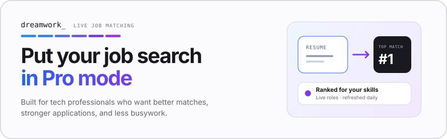

<a href="https://www.dreamworkhq.com/?utm_source=github&utm_medium=readme_cta&utm_campaign=gh-senior-swe">
  <picture>
    <source media="(prefers-color-scheme: dark)" srcset="./static/img/banner-dark.svg">
    <source media="(prefers-color-scheme: light)" srcset="./static/img/banner-light.svg">
    
  </picture>
</a>

<h1 align="center">Senior Software Engineer Jobs</h1>

Senior, staff, principal, and lead software engineering roles in the United States. No management, junior, new-grad, or internship listings.

  
  

  <a href="https://www.dreamworkhq.com/?utm_source=github&utm_medium=readme_cta&utm_campaign=gh-senior-swe">
    <picture>
      <source media="(prefers-color-scheme: dark)" srcset="./static/img/btn-matches-dark.svg">
      <source media="(prefers-color-scheme: light)" srcset="./static/img/btn-matches-light.svg">
      
    </picture>
  </a>

  <a href="https://www.dreamworkhq.com/?utm_source=github&utm_medium=link_row&utm_campaign=gh-senior-swe">dreamworkhq.com</a>
  ·
  <a href="https://www.dreamworkhq.com/blog?utm_source=github&utm_medium=link_row&utm_campaign=gh-senior-swe">Blog</a>
  ·
  <a href="https://www.dreamworkhq.com/research?utm_source=github&utm_medium=link_row&utm_campaign=gh-senior-swe">Hiring research</a>
  ·
  <a href="../../issues">Report a listing</a>

Star this repo and new roles land in your GitHub feed every day. Listings come from [Dreamwork](https://www.dreamworkhq.com/?utm_source=github&utm_medium=readme_cta&utm_campaign=gh-senior-swe), which crawls 2.2M+ live jobs directly from company career pages.

Last updated: **2026-11-07**. Showing the **600** most recently indexed roles, curated from **3,000+** open listings on Dreamwork. Salary shows when the posting discloses it. Click a role to see details and apply.

- [Staff and lead](#staff-and-lead-235) · 235 roles
- [Senior](#senior-223) · 223 roles
- [Principal](#principal-142) · 142 roles

<!-- TABLE_START (auto-generated: do not edit by hand; edits are overwritten daily) -->

### Staff and lead (235)

| Company | Role | Location | Pay | Added |
| --- | --- | --- | --- | --- |
| **[Tilthq](https://www.dreamworkhq.com/c/tilthq.com?utm_source=github&utm_campaign=gh-senior-swe)** | [Staff Machine Learning Engineer](https://www.dreamworkhq.com/job/1044c4ab-db09-45d9-893e-af95ee7bd033?utm_source=github&utm_campaign=gh-senior-swe) | Remote (Remote - US) | $220K–$265K | 0d |
| **[Boston Dynamics](https://www.dreamworkhq.com/c/bostondynamics.com?utm_source=github&utm_campaign=gh-senior-swe)** | [Senior Staff ML Engineer, Spot](https://www.dreamworkhq.com/job/0b69e279-bcc6-4e37-ad95-61bb2cb54bf2?utm_source=github&utm_campaign=gh-senior-swe) | Waltham Office (POST) | $175K–$215K | 0d |
| **[Socure](https://www.dreamworkhq.com/c/socure.com?utm_source=github&utm_campaign=gh-senior-swe)** | [Staff Backend Graph Engineer](https://www.dreamworkhq.com/job/2815f768-e2a3-4667-915d-3e0b822b27fb?utm_source=github&utm_campaign=gh-senior-swe) | Remote (Remote - USA) | $225K–$250K | 0d |
| **[Perficient](https://www.dreamworkhq.com/c/perficient.com?utm_source=github&utm_campaign=gh-senior-swe)** | [Lead Cloud / AI Platform Engineer](https://www.dreamworkhq.com/job/2ca68092-7209-4cf6-9a97-d7aef463bbbd?utm_source=github&utm_campaign=gh-senior-swe) | United States | $134K–$171K | 0d |
| **[Freenome](https://www.dreamworkhq.com/c/freenome.com?utm_source=github&utm_campaign=gh-senior-swe)** | [Staff Software Engineer](https://www.dreamworkhq.com/job/3b540ca3-16aa-4b76-b4b5-9d35a4c26bdc?utm_source=github&utm_campaign=gh-senior-swe) | Remote | $188K–$270K | 0d |
| **[Walmart](https://www.dreamworkhq.com/c/walmart.com?utm_source=github&utm_campaign=gh-senior-swe)** | [(USA) Staff, Software Engineer](https://www.dreamworkhq.com/job/da9d5645-5a3f-424d-b907-00f81b0d0038?utm_source=github&utm_campaign=gh-senior-swe) | (USA) Bentonville Global Tech AR BENTONVILL… | $110K–$220K | 0d |
| **[WellmarkInc](https://www.dreamworkhq.com/c/wellmark.com?utm_source=github&utm_campaign=gh-senior-swe)** | [Lead Software Engineer - Enterprise AI Services & Agents](https://www.dreamworkhq.com/job/2ac0b600-23d4-49b9-8537-ee72ec26babd?utm_source=github&utm_campaign=gh-senior-swe) | Des Moines, IA, United States (Hybrid) |  | 0d |
| **[Squarespace](https://www.dreamworkhq.com/c/squarespace.com?utm_source=github&utm_campaign=gh-senior-swe)** | [Staff Software Engineer, Revenue Systems](https://www.dreamworkhq.com/job/6f942ebd-0fce-47f8-9757-28911a5b951c?utm_source=github&utm_campaign=gh-senior-swe) | — (Hybrid) | $170K–$299K | 0d |
| **[Prosync](https://www.dreamworkhq.com/c/prosync.com?utm_source=github&utm_campaign=gh-senior-swe)** | [Software Configuration Management & Release Engineer](https://www.dreamworkhq.com/job/70e13adf-249f-442c-bc7f-477b23c93d33?utm_source=github&utm_campaign=gh-senior-swe) | Annapolis Junction, Maryland, United States |  | 0d |
| **[Crusoe](https://www.dreamworkhq.com/c/crusoe.ai?utm_source=github&utm_campaign=gh-senior-swe)** | [Senior Staff Software Engineer, AI Model Lifecycle](https://www.dreamworkhq.com/job/98aadd40-b597-4f0b-ace3-fd0975bac67b?utm_source=github&utm_campaign=gh-senior-swe) | San Francisco, CA - US | $250K–$300K | 0d |
| **[Apptronik](https://www.dreamworkhq.com/c/apptronik.com?utm_source=github&utm_campaign=gh-senior-swe)** | [Staff Software Engineer, ML](https://www.dreamworkhq.com/job/c3d50947-266b-4a14-9eaa-3963f64867bd?utm_source=github&utm_campaign=gh-senior-swe) | Sunnyvale, CA | $285K–$340K | 0d |
| **[Rivianvw.Tech](https://www.dreamworkhq.com/c/rivianvw.tech?utm_source=github&utm_campaign=gh-senior-swe)** | [Staff Embedded Software Engineers](https://www.dreamworkhq.com/job/eadd0c5f-d2c1-4c95-a66a-e241b0242021?utm_source=github&utm_campaign=gh-senior-swe) | Palo Alto, California | $222K–$279K | 0d |
| **[Mcghealth](https://www.dreamworkhq.com/c/mcghealth.com?utm_source=github&utm_campaign=gh-senior-swe)** | [Staff Machine Learning Engineer](https://www.dreamworkhq.com/job/b2d935f4-2c11-439f-99da-b60d82adf3d8?utm_source=github&utm_campaign=gh-senior-swe) | Remote | $154K–$216K | 0d |
| **[Braincorporation](https://www.dreamworkhq.com/c/braincorp.com?utm_source=github&utm_campaign=gh-senior-swe)** | [Staff Software Engineer, Applications](https://www.dreamworkhq.com/job/e36c5fdf-762c-41fa-8eda-d4923fc976ac?utm_source=github&utm_campaign=gh-senior-swe) | San Diego, CA | $187K–$234K | 0d |
| **[Uscareeropenings Alliancelaundry](https://www.dreamworkhq.com/c/alliancelaundry.com?utm_source=github&utm_campaign=gh-senior-swe)** | [Software Architect](https://www.dreamworkhq.com/job/f8421a0e-eb8c-4874-bccc-c9c7fbb31c2f?utm_source=github&utm_campaign=gh-senior-swe) | US |  | 0d |
| **[AMD](https://www.dreamworkhq.com/c/amd.com?utm_source=github&utm_campaign=gh-senior-swe)** | [PMTS Software Development Engineer](https://www.dreamworkhq.com/job/0cee5fd2-7462-4026-a51e-02bba940f355?utm_source=github&utm_campaign=gh-senior-swe) | San Jose, California, United States |  | 0d |
| **[AMD](https://www.dreamworkhq.com/c/amd.com?utm_source=github&utm_campaign=gh-senior-swe)** | [PMTS Software System Design Engineer](https://www.dreamworkhq.com/job/31d087ee-bd9a-478a-8bae-c0e187383b5e?utm_source=github&utm_campaign=gh-senior-swe) | Santa Clara, California, United States |  | 0d |
| **[Simplisafe](https://www.dreamworkhq.com/c/simplisafe.com?utm_source=github&utm_campaign=gh-senior-swe)** | [Staff Software Engineer](https://www.dreamworkhq.com/job/1cb53650-8357-43ba-8ad0-64c5f6f041f2?utm_source=github&utm_campaign=gh-senior-swe) | Boston, MA (Hybrid) | $147K–$196K | 0d |
| **[Indeed.com](https://www.dreamworkhq.com/c/bhcpartners.org?utm_source=github&utm_campaign=gh-senior-swe)** | [Software Engineer V](https://www.dreamworkhq.com/job/425e463c-d6ce-4a11-9223-0fcdf23775f5?utm_source=github&utm_campaign=gh-senior-swe) | Remote (Austin, Texas, United States of America) | $183K–$275K | 0d |
| **[Thomson Reuters](https://www.dreamworkhq.com/c/thomsonreuters.com?utm_source=github&utm_campaign=gh-senior-swe)** | [Staff Software Engineer, Search Control Plane](https://www.dreamworkhq.com/job/9a86cd0b-00af-4ab1-ab50-c448d428a0a4?utm_source=github&utm_campaign=gh-senior-swe) | United States of America, New York, New York (Hybrid) | $99K–$134K | 0d |
| **[ProphetX](https://www.dreamworkhq.com/c/prophetx.com?utm_source=github&utm_campaign=gh-senior-swe)** | [Staff DevOps Engineer](https://www.dreamworkhq.com/job/aae70072-1c8e-476b-9a90-1743e30eb262?utm_source=github&utm_campaign=gh-senior-swe) | Remote (Remote - USA) | $180K–$220K | 0d |
| **[Thomson Reuters](https://www.dreamworkhq.com/c/thomsonreuters.com?utm_source=github&utm_campaign=gh-senior-swe)** | [Staff Software Engineer, Search Retrieval Platform](https://www.dreamworkhq.com/job/96f0b316-3b5d-4f69-80a1-26c7c3ca029c?utm_source=github&utm_campaign=gh-senior-swe) | United States of America, New York, New York (Hybrid) | $99K–$134K | 0d |
| **[The Home Depot](https://www.dreamworkhq.com/c/homedepot.com?utm_source=github&utm_campaign=gh-senior-swe)** | [Staff Software Engineer](https://www.dreamworkhq.com/job/ea2bb615-dc99-423a-9d72-97e9b5e5d81a?utm_source=github&utm_campaign=gh-senior-swe) | Remote (STORE SUPPORT CENTER, ATLANTA - 9090) |  | 0d |
| **[GE Vernova](https://www.dreamworkhq.com/c/gevernova.com?utm_source=github&utm_campaign=gh-senior-swe)** | [Staff Software Engineer - Full Stack Developer](https://www.dreamworkhq.com/job/a248abc3-ae6f-4b3a-bbca-61a6662ce0f9?utm_source=github&utm_campaign=gh-senior-swe) | Greenville | $98K–$164K | 0d |
| **[Comcast](https://www.dreamworkhq.com/c/comcast.com?utm_source=github&utm_campaign=gh-senior-swe)** | [Lead Backend Engineer](https://www.dreamworkhq.com/job/6d0cabeb-3257-45b7-87f8-4cb55158f81c?utm_source=github&utm_campaign=gh-senior-swe) | DC - Washington, 1325 G ST NW STE 300 | $142K–$213K | 0d |
| **[Google](https://www.dreamworkhq.com/c/google.com?utm_source=github&utm_campaign=gh-senior-swe)** | [Staff Software Engineer, Accelerators Systems Platforms Software Archit…](https://www.dreamworkhq.com/job/83234567-3315-4b95-9d11-e34af9ae0955?utm_source=github&utm_campaign=gh-senior-swe) | Sunnyvale, CA, USA | $207K–$300K | 0d |
| **[Google](https://www.dreamworkhq.com/c/google.com?utm_source=github&utm_campaign=gh-senior-swe)** | [Senior Staff Software Engineer, Feed Recommendation Infrastructure](https://www.dreamworkhq.com/job/e92ef360-60f5-4b11-b26e-6ee60a60d713?utm_source=github&utm_campaign=gh-senior-swe) | Mountain View, CA, USA | $262K–$364K | 0d |
| **[The Home Depot](https://www.dreamworkhq.com/c/homedepot.com?utm_source=github&utm_campaign=gh-senior-swe)** | [Staff Software Engineer (Remote)](https://www.dreamworkhq.com/job/29347392-72d7-47e0-9aa6-4817d21a1e3a?utm_source=github&utm_campaign=gh-senior-swe) | Remote (GEORGIA - VIRTUAL - GA01) | $120K–$190K | 0d |
| **[Boston Dynamics](https://www.dreamworkhq.com/c/bostondynamics.com?utm_source=github&utm_campaign=gh-senior-swe)** | [Senior Staff Audio Machine Learning Engineer](https://www.dreamworkhq.com/job/1b4f00f2-4ee8-4ffc-92de-546b4a60ef63?utm_source=github&utm_campaign=gh-senior-swe) | Waltham Office (POST) | $180K–$220K | 0d |
| **Solve IT Strategies** | [Staff Software Engineer - 37862626](https://www.dreamworkhq.com/job/1432493a-1632-4d61-9d93-f60fb44d060d?utm_source=github&utm_campaign=gh-senior-swe) | Mountain View, California, 94035, United St… |  | 0d |
| **[Google](https://www.dreamworkhq.com/c/google.com?utm_source=github&utm_campaign=gh-senior-swe)** | [Senior Staff Software Engineer, AI Telemetry and Developer Intelligence](https://www.dreamworkhq.com/job/46bdf2ee-8324-48a0-9891-c216dfda6eac?utm_source=github&utm_campaign=gh-senior-swe) | San Jose, CA, USA | $262K–$364K | 0d |
| **[Capital One](https://www.dreamworkhq.com/c/capitalone.com?utm_source=github&utm_campaign=gh-senior-swe)** | [AI Engineer 4 (AI Safety and Multimodal)](https://www.dreamworkhq.com/job/8dc1b4e4-8f33-4dd4-9280-18da68ce1670?utm_source=github&utm_campaign=gh-senior-swe) | Cambridge, MA | $197K–$225K | 0d |
| **[Digital Consultants](https://www.dreamworkhq.com/c/digiconintl.com?utm_source=github&utm_campaign=gh-senior-swe)** | [Application Developer SME (SIPR Case Management System modernization)](https://www.dreamworkhq.com/job/976db194-c9fe-431f-acd4-79c6b5ee6687?utm_source=github&utm_campaign=gh-senior-swe) | Remote (Quantico, VA) | $180K–$190K | 0d |
| **[Salesforce](https://www.dreamworkhq.com/c/salesforce.com?utm_source=github&utm_campaign=gh-senior-swe)** | [Software Engineering LMTS](https://www.dreamworkhq.com/job/7d8cab56-b7af-447c-8322-e91907e7f786?utm_source=github&utm_campaign=gh-senior-swe) | California - San Francisco | $173K–$260K | 0d |
| **[Paccar Inc](https://www.dreamworkhq.com/c/paccar.com?utm_source=github&utm_campaign=gh-senior-swe)** | [Lead Software Engineer - Validation Solutions, Automation & Analytics](https://www.dreamworkhq.com/job/64e9f67d-3b3f-45c3-90c4-078ab234b013?utm_source=github&utm_campaign=gh-senior-swe) | United States (Hybrid) | $104K–$163K | 0d |
| **[Toyota](https://www.dreamworkhq.com/c/toyota.com.au?utm_source=github&utm_campaign=gh-senior-swe)** | [Lead Software Engineer, Front-End Engineering](https://www.dreamworkhq.com/job/2eafe440-d849-43e3-8f7a-1e7312437a6c?utm_source=github&utm_campaign=gh-senior-swe) | Plano, Texas |  | 0d |
| **[Cvshealth](https://www.dreamworkhq.com/c/cvshealth.com?utm_source=github&utm_campaign=gh-senior-swe)** | [Staff Software Development Engineer](https://www.dreamworkhq.com/job/7e9006ac-ed2f-4388-8343-60edfcadeac8?utm_source=github&utm_campaign=gh-senior-swe) | Remote (Woonsocket-1 CVS Drive) | $107K–$284K | 0d |
| **GD Information Technology** | [Software Engineering Lead and Application Architect - TS/SCI with Polyg…](https://www.dreamworkhq.com/job/779a61a7-af7e-48d6-bb6b-197b91d22393?utm_source=github&utm_campaign=gh-senior-swe) | USA VA Chantilly - 14700 Lee Rd (VAS100) | $162K–$219K | 0d |
| **[Gridware](https://www.dreamworkhq.com/c/gridware.ai?utm_source=github&utm_campaign=gh-senior-swe)** | [Staff Software Engineer, Full Stack](https://www.dreamworkhq.com/job/5535e897-fafb-4448-8c68-ae6eee8dea3a?utm_source=github&utm_campaign=gh-senior-swe) | San Francisco, CA | $245K–$260K | 0d |
| **[Recruiting From Scratch](https://www.dreamworkhq.com/c/recruitingfromscratch.com?utm_source=github&utm_campaign=gh-senior-swe)** | [Senior to Staff ML Engineer](https://www.dreamworkhq.com/job/6f618ee5-303e-4d23-9cd2-e707c5ce2aa8?utm_source=github&utm_campaign=gh-senior-swe) | Remote (New York, New York) |  | 0d |
| **[Humana](https://www.dreamworkhq.com/c/humana.com?utm_source=github&utm_campaign=gh-senior-swe)** | [Lead Full-Stack Engineer - Backend Focus](https://www.dreamworkhq.com/job/b3d2f0b2-4502-49d8-b2eb-a1ab9299980d?utm_source=github&utm_campaign=gh-senior-swe) | Remote (Work at Home - Florida) | $129K–$178K | 0d |
| **[GM](https://www.dreamworkhq.com/c/gmdefense.com?utm_source=github&utm_campaign=gh-senior-swe)** | [Staff ML Engineer - Embodied AI Scaling Foundations](https://www.dreamworkhq.com/job/df0f259c-fe59-468a-a04e-fea8aafad20e?utm_source=github&utm_campaign=gh-senior-swe) | GM Automation - Sunnyvale - GM Automation -… |  | 0d |
| **[Google](https://www.dreamworkhq.com/c/google.com?utm_source=github&utm_campaign=gh-senior-swe)** | [Senior Staff Software Engineer, Audio Systems, XR](https://www.dreamworkhq.com/job/3912dc1b-5e85-46d8-b254-4a996d0d7e42?utm_source=github&utm_campaign=gh-senior-swe) | San Jose, CA, USA | $262K–$364K | 0d |
| **[Recruiting From Scratch](https://www.dreamworkhq.com/c/recruitingfromscratch.com?utm_source=github&utm_campaign=gh-senior-swe)** | [Senior-Staff Fullstack Engineer](https://www.dreamworkhq.com/job/f9b22f2a-3f82-410f-be44-19c7c07d9748?utm_source=github&utm_campaign=gh-senior-swe) | Remote (New York, New York) |  | 0d |
| **[Amazon](https://www.dreamworkhq.com/c/amazon.com?utm_source=github&utm_campaign=gh-senior-swe)** | [Sr Software Development Engineer, ADC2S](https://www.dreamworkhq.com/job/6a445e77-44e2-42c8-b2d6-7acda2e94b93?utm_source=github&utm_campaign=gh-senior-swe) | Denver, Colorado, USA | $168K–$227K | 0d |
| **[Brain Co.](https://www.dreamworkhq.com/c/brain.co?utm_source=github&utm_campaign=gh-senior-swe)** | [Staff Software Engineer, Applications](https://www.dreamworkhq.com/job/28fcba3a-63e4-446f-a0ea-2d5f86f53296?utm_source=github&utm_campaign=gh-senior-swe) | San Diego, CA | $187K–$234K | 0d |
| **[Boeing](https://www.dreamworkhq.com/c/boeing.com?utm_source=github&utm_campaign=gh-senior-swe)** | [Software Architect](https://www.dreamworkhq.com/job/2d2a87fc-aaa6-4c8d-8035-6ef9445c65b6?utm_source=github&utm_campaign=gh-senior-swe) | Remote (United States - Remote) | $250K–$338K | 0d |
| **[Microsoft](https://www.dreamworkhq.com/c/microsoft.com?utm_source=github&utm_campaign=gh-senior-swe)** | [Senior Software Engineer](https://www.dreamworkhq.com/job/68f48834-980e-4c3f-9bfa-9b8c58696170?utm_source=github&utm_campaign=gh-senior-swe) | Redmond, Washington, United States | $120K–$235K | 0d |
| **[Northrop Grumman](https://www.dreamworkhq.com/c/northropgrumman.com?utm_source=github&utm_campaign=gh-senior-swe)** | [Staff Cloud Engineer - Position qualifies for sign-on bonus starting at…](https://www.dreamworkhq.com/job/598aafa5-c538-43c9-bf63-5c7405e216c1?utm_source=github&utm_campaign=gh-senior-swe) | United States-North Carolina-Morrisville | $169K–$266K | 0d |
| **[Google](https://www.dreamworkhq.com/c/google.com?utm_source=github&utm_campaign=gh-senior-swe)** | [Staff Software Engineer, AI/ML, Google Cloud](https://www.dreamworkhq.com/job/63f1104f-ec51-43de-8829-ebff2ef0fde7?utm_source=github&utm_campaign=gh-senior-swe) | Sunnyvale, CA, USA | $207K–$300K | 0d |
| **[Northrop Grumman](https://www.dreamworkhq.com/c/northropgrumman.com?utm_source=github&utm_campaign=gh-senior-swe)** | [Staff DevOps Engineer - Position qualifies for sign-on bonus starting a…](https://www.dreamworkhq.com/job/313e8f40-71ce-428d-ab89-9368508035f0?utm_source=github&utm_campaign=gh-senior-swe) | United States-North Carolina-Morrisville | $169K–$266K | 0d |
| **[Apple](https://www.dreamworkhq.com/c/apple.com?utm_source=github&utm_campaign=gh-senior-swe)** | [Staff Machine Learning Engineer - Matching, Apple Ads](https://www.dreamworkhq.com/job/17632a0d-2758-4d6a-9d96-be7a919612fe?utm_source=github&utm_campaign=gh-senior-swe) | Cupertino, California, 95014, United States | $216K–$325K | 0d |
| **[Capital One](https://www.dreamworkhq.com/c/capitalone.com?utm_source=github&utm_campaign=gh-senior-swe)** | [Full-stack Engineer 4](https://www.dreamworkhq.com/job/4441546c-84bb-43f9-a065-f84220cad8e2?utm_source=github&utm_campaign=gh-senior-swe) | McLean, VA (Hybrid) | $197K–$225K | 0d |
| **[Nucleus Security](https://www.dreamworkhq.com/c/nucleussecurity.com?utm_source=github&utm_campaign=gh-senior-swe)** | [Staff Agentic Software Engineer - US Ticketing Team Lead](https://www.dreamworkhq.com/job/c0e20471-bf1e-453a-9110-460c91a28187?utm_source=github&utm_campaign=gh-senior-swe) | Remote |  | 0d |
| **[Google](https://www.dreamworkhq.com/c/google.com?utm_source=github&utm_campaign=gh-senior-swe)** | [Senior Staff Software Engineer, AI Mode and AI Overviews Helpfulness](https://www.dreamworkhq.com/job/ada57ac4-1347-40db-a641-6f9c52d9eda9?utm_source=github&utm_campaign=gh-senior-swe) | New York, NY, USA | $262K–$364K | 0d |
| **[Google](https://www.dreamworkhq.com/c/google.com?utm_source=github&utm_campaign=gh-senior-swe)** | [Hardware/Software Co-Design Engineer, Inference](https://www.dreamworkhq.com/job/f28cb2d9-1aee-4a21-89b5-207d6c5d6b9d?utm_source=github&utm_campaign=gh-senior-swe) | Sunnyvale, CA, USA | $192K–$278K | 0d |
| **[Stellantis](https://www.dreamworkhq.com/c/stellantis.com?utm_source=github&utm_campaign=gh-senior-swe)** | [Lead Software Architect Compute Platform \[SOC\]](https://www.dreamworkhq.com/job/44bfdb36-d0ba-4735-b732-7cb52d5ee060?utm_source=github&utm_campaign=gh-senior-swe) | 1000 Chrysler Drive |  | 0d |
| **[Capital One](https://www.dreamworkhq.com/c/capitalone.com?utm_source=github&utm_campaign=gh-senior-swe)** | [Data Engineer 5](https://www.dreamworkhq.com/job/c79bc668-8e25-452c-baf9-f79fb475567f?utm_source=github&utm_campaign=gh-senior-swe) | Wilmington, DE (Hybrid) | $209K–$239K | 0d |
| **[Micron](https://www.dreamworkhq.com/c/micron.com?utm_source=github&utm_campaign=gh-senior-swe)** | [Firmware Engineer, Member of the Technical Staff](https://www.dreamworkhq.com/job/2bf18879-1fe3-4cfd-a930-f84a0fac7d48?utm_source=github&utm_campaign=gh-senior-swe) | San Jose, CA | $277K–$355K | 0d |
| **[DocuSign](https://www.dreamworkhq.com/c/docusign.com?utm_source=github&utm_campaign=gh-senior-swe)** | [Lead Data Engineer](https://www.dreamworkhq.com/job/ca459a36-eeb1-41cb-b080-3453e3350dcc?utm_source=github&utm_campaign=gh-senior-swe) | San Francisco, California, United States (Hybrid) | $188K–$266K | 0d |
| **[Church](https://www.dreamworkhq.com/c/assets.ldscdn.org?utm_source=github&utm_campaign=gh-senior-swe)** | [Family Search Software Dev Engineer 5-AWS Cloud Architect (Lehi, UT)](https://www.dreamworkhq.com/job/5543575a-8446-4855-aa57-97df43705a7e?utm_source=github&utm_campaign=gh-senior-swe) | Lehi, UT, United States (Hybrid) |  | 0d |
| **[Owner.com](https://www.dreamworkhq.com/c/owner.com?utm_source=github&utm_campaign=gh-senior-swe)** | [Staff Software Engineer - Orders Platform](https://www.dreamworkhq.com/job/56cf035c-0c9f-4c8a-b3b9-88a7fe0990c0?utm_source=github&utm_campaign=gh-senior-swe) | Remote (Remote - United States) | $240K–$260K | 0d |
| **[Anthropic](https://www.dreamworkhq.com/c/anthropic.com?utm_source=github&utm_campaign=gh-senior-swe)** | [Staff+ Software Engineer, STEM](https://www.dreamworkhq.com/job/764f65a8-43f0-469a-8ac4-230435f5a212?utm_source=github&utm_campaign=gh-senior-swe) | San Francisco, CA \| New York City, NY \| S… | $405K–$485K | 0d |
| **[Walmart](https://www.dreamworkhq.com/c/walmart.com?utm_source=github&utm_campaign=gh-senior-swe)** | [(USA) Staff, Data Engineer](https://www.dreamworkhq.com/job/890049e4-dd07-4d05-aebf-ab1d87078e51?utm_source=github&utm_campaign=gh-senior-swe) | (USA) Together Building AR Bentonville Home… | $110K–$220K | 0d |
| **[Walmart](https://www.dreamworkhq.com/c/walmart.com?utm_source=github&utm_campaign=gh-senior-swe)** | [Staff, Software Engineer](https://www.dreamworkhq.com/job/fe99421b-cb4d-4da6-a7d3-1216c6990df5?utm_source=github&utm_campaign=gh-senior-swe) | (USA) SUNNYVALE TECH CORNERS BLDG 6 CA SUNN… | $143K–$286K | 0d |
| **[Walmart](https://www.dreamworkhq.com/c/walmart.com?utm_source=github&utm_campaign=gh-senior-swe)** | [Staff, Data Engineer \| Bentonville, Arkansas](https://www.dreamworkhq.com/job/4247ff31-5bc7-4636-bb52-fafeee2fb356?utm_source=github&utm_campaign=gh-senior-swe) | (USA) ISD Office - DGTC AR BENTONVILLE Home… (Hybrid) |  | 0d |
| **[Coupang](https://www.dreamworkhq.com/c/coupang.com?utm_source=github&utm_campaign=gh-senior-swe)** | [Staff Machine Learning Engineer, Offsite Ads](https://www.dreamworkhq.com/job/7191092f-9bd0-4b2b-8608-dc39bde9f3da?utm_source=github&utm_campaign=gh-senior-swe) | Mountain View, USA | $164K–$282K | 0d |
| **[Solveintelligence](https://www.dreamworkhq.com/c/solveintelligence.com?utm_source=github&utm_campaign=gh-senior-swe)** | [US Infrastructure Engineer](https://www.dreamworkhq.com/job/1143886e-0b91-4b23-8f7a-851e5eef5dee?utm_source=github&utm_campaign=gh-senior-swe) | New York | $120K–$250K | 0d |
| **[RenesasElectronics](https://www.dreamworkhq.com/c/renesas.com?utm_source=github&utm_campaign=gh-senior-swe)** | [Staff Defect Metrology AI/ML Engineer](https://www.dreamworkhq.com/job/ebb3d7ef-4827-46b3-b526-1aeacb1b9e91?utm_source=github&utm_campaign=gh-senior-swe) | Goleta, CALIFORNIA, United States | $120K–$160K | 0d |
| **[Patientpoint](https://www.dreamworkhq.com/c/patientpoint.com?utm_source=github&utm_campaign=gh-senior-swe)** | [Senior Staff Software Engineer, Android & IoT](https://www.dreamworkhq.com/job/70bb87f9-8804-46ae-a9de-798e4a23137f?utm_source=github&utm_campaign=gh-senior-swe) | Remote (Remote, US) | $144K–$221K | 0d |
| **[Goteleport](https://www.dreamworkhq.com/c/goteleport.com?utm_source=github&utm_campaign=gh-senior-swe)** | [Staff Backend Engineer - Performance - US](https://www.dreamworkhq.com/job/c7a7de6a-d2ff-4563-8bfc-6809563ecfbc?utm_source=github&utm_campaign=gh-senior-swe) | Remote (United States (Remote)) | $222K–$342K | 0d |
| **[Fanniemae](https://www.dreamworkhq.com/c/fanniemae.com?utm_source=github&utm_campaign=gh-senior-swe)** | [Cloud Engineer-Advisor (AWS)](https://www.dreamworkhq.com/job/4d3d3d3f-4f55-46c5-8b50-8ee04f79c909?utm_source=github&utm_campaign=gh-senior-swe) | Reston, VA | $155K–$209K | 0d |
| **[Samsara](https://www.dreamworkhq.com/c/samsara.com?utm_source=github&utm_campaign=gh-senior-swe)** | [Staff Machine Learning Engineer - Edge AI](https://www.dreamworkhq.com/job/b8ca684e-a6ba-4059-85bb-53cc64586c7e?utm_source=github&utm_campaign=gh-senior-swe) | Remote (Remote - US) | $179K–$319K | 0d |
| **[RTX (Raytheon)](https://www.dreamworkhq.com/c/rtx.com?utm_source=github&utm_campaign=gh-senior-swe)** | [Lead Software Integration Solutions Architect](https://www.dreamworkhq.com/job/f6716e3b-d58b-46f3-a956-c3e7c5c6c648?utm_source=github&utm_campaign=gh-senior-swe) | US-MA-MARLBOROUGH-MA2 ~ 1001 Boston Post Rd… (Hybrid) | $132K–$252K | 0d |
| **[Mortenson](https://www.dreamworkhq.com/c/mortenson.com?utm_source=github&utm_campaign=gh-senior-swe)** | [Lead Software Developer](https://www.dreamworkhq.com/job/e6e94e2e-8191-4bf5-84ab-1248e10b0ec4?utm_source=github&utm_campaign=gh-senior-swe) | MN, United States (Hybrid) | $129K–$194K | 0d |
| **[Peraton](https://www.dreamworkhq.com/c/peraton.com?utm_source=github&utm_campaign=gh-senior-swe)** | [Lead Full Stack Software Engineer](https://www.dreamworkhq.com/job/30084770-ccf4-4218-835b-7f8a8de66115?utm_source=github&utm_campaign=gh-senior-swe) | Aurora, CO, US | $112K–$179K | 0d |
| **[Eversource](https://www.dreamworkhq.com/c/eversource.com?utm_source=github&utm_campaign=gh-senior-swe)** | [IT Lead Developer, SAP Solutions (Hybrid)](https://www.dreamworkhq.com/job/49d9f8a8-e574-43e9-9216-22699ceea89b?utm_source=github&utm_campaign=gh-senior-swe) | Berlin, CT (Hybrid) | $154K–$171K | 0d |
| **[Wolters Kluwer](https://www.dreamworkhq.com/c/wolterskluwer.com?utm_source=github&utm_campaign=gh-senior-swe)** | [Lead Software Test Automation Engineer](https://www.dreamworkhq.com/job/7f58fc5a-a3e7-447c-adf3-d0e21b82bc31?utm_source=github&utm_campaign=gh-senior-swe) | USA - Coppell, TX (Hybrid) | $90K–$157K | 0d |
| **[Vertiv](https://www.dreamworkhq.com/c/vertiv.com?utm_source=github&utm_campaign=gh-senior-swe)** | [Lead Developer Enablement Engineer (Apple Infrastructure)](https://www.dreamworkhq.com/job/9dcd563e-bd27-4d7a-b682-49842d57d2d1?utm_source=github&utm_campaign=gh-senior-swe) | Westerville, OH, United States |  | 0d |
| **[MTB](https://www.dreamworkhq.com/c/mtb.com?utm_source=github&utm_campaign=gh-senior-swe)** | [Lead Data Engineer](https://www.dreamworkhq.com/job/5df8a90c-722d-4735-a585-6c9f364d1f7f?utm_source=github&utm_campaign=gh-senior-swe) | Buffalo, NY (Hybrid) | $116K–$194K | 0d |
| **[Northrop Grumman](https://www.dreamworkhq.com/c/northropgrumman.com?utm_source=github&utm_campaign=gh-senior-swe)** | [Staff AI/ML Software Engineer - Level 5](https://www.dreamworkhq.com/job/cd21d029-f7fa-4acf-987c-928a3bd89380?utm_source=github&utm_campaign=gh-senior-swe) | United States-Colorado-Schriever AFB | $195K–$292K | 0d |
| **[Anduril](https://www.dreamworkhq.com/c/anduril.com?utm_source=github&utm_campaign=gh-senior-swe)** | [Staff Robotics Software Engineer, CUAS, Omen](https://www.dreamworkhq.com/job/b38ccf9b-1251-44c6-918d-fe8d5cc1f280?utm_source=github&utm_campaign=gh-senior-swe) | Costa Mesa, California, United States |  | 0d |
| **[Capital One](https://www.dreamworkhq.com/c/capitalone.com?utm_source=github&utm_campaign=gh-senior-swe)** | [Full-stack Engineer 5](https://www.dreamworkhq.com/job/985e2833-5759-4339-ab57-8756ccbe1c24?utm_source=github&utm_campaign=gh-senior-swe) | Plano, TX | $209K–$239K | 0d |
| **[Luminai](https://www.dreamworkhq.com/c/luminai.com?utm_source=github&utm_campaign=gh-senior-swe)** | [Applied AI Engineer, Team Lead](https://www.dreamworkhq.com/job/59287056-64d8-40e2-9f86-0143ae546956?utm_source=github&utm_campaign=gh-senior-swe) | SF Bay Area | $200K–$350K | 0d |
| **[DocuSign](https://www.dreamworkhq.com/c/docusign.com?utm_source=github&utm_campaign=gh-senior-swe)** | [Lead Data Engineer](https://www.dreamworkhq.com/job/b2092547-7093-4144-94ec-b7c22261993b?utm_source=github&utm_campaign=gh-senior-swe) | San Francisco, CA, US (Hybrid) | $188K–$266K | 0d |
| **[Uber](https://www.dreamworkhq.com/c/uber.com?utm_source=github&utm_campaign=gh-senior-swe)** | [Staff Software Engineer Michelangelo Control Plane](https://www.dreamworkhq.com/job/7866a4f9-b720-495c-8f61-cc2cbf21f4b5?utm_source=github&utm_campaign=gh-senior-swe) | Sunnyvale, CA, United States (Hybrid) | $232K–$258K | 0d |
| **[ServiceNow](https://www.dreamworkhq.com/c/servicenow.com?utm_source=github&utm_campaign=gh-senior-swe)** | [Staff Machine Learning Engineer](https://www.dreamworkhq.com/job/26022f22-fcba-4f7b-94d3-27c5968b40c9?utm_source=github&utm_campaign=gh-senior-swe) | Santa Clara, California, United States | $176K–$308K | 0d |
| **[Coinbase](https://www.dreamworkhq.com/c/coinbase.com?utm_source=github&utm_campaign=gh-senior-swe)** | [Staff Software Engineer - Backend (Consumer - Agentic Trading)](https://www.dreamworkhq.com/job/dc17c301-7e58-4dd9-9641-c2e6736d7740?utm_source=github&utm_campaign=gh-senior-swe) | Remote (Remote - USA) | $218K–$257K | 0d |
| **[Meta](https://www.dreamworkhq.com/c/meta.com?utm_source=github&utm_campaign=gh-senior-swe)** | [Software Engineer - Traffic Capacity & Performance](https://www.dreamworkhq.com/job/a4da3923-07e8-4b5e-86c0-8243de62962b?utm_source=github&utm_campaign=gh-senior-swe) | Menlo Park, CAAI InfrastructureSoftware Eng… | $184K–$257K | 0d |
| **[Meta](https://www.dreamworkhq.com/c/meta.com?utm_source=github&utm_campaign=gh-senior-swe)** | [Software Engineer - Traffic Efficiency](https://www.dreamworkhq.com/job/c2bc8e25-914d-4e9e-b67d-d0da368d5c8f?utm_source=github&utm_campaign=gh-senior-swe) | Menlo Park, CAAI InfrastructureSoftware Eng… | $184K–$257K | 0d |
| **[Alluxio](https://www.dreamworkhq.com/c/alluxio.io?utm_source=github&utm_campaign=gh-senior-swe)** | [Software Engineer – Distributed Systems](https://www.dreamworkhq.com/job/f1dd7b03-c7d8-4293-a6fc-ba75a05ecf7d?utm_source=github&utm_campaign=gh-senior-swe) | Foster City, California | $230K–$330K | 0d |
| **[Parachutehealth](https://www.dreamworkhq.com/c/parachutehealth.com?utm_source=github&utm_campaign=gh-senior-swe)** | [Staff Software Engineer, Eligibility & Benefits](https://www.dreamworkhq.com/job/35055a9b-fd57-4c33-ad21-78f52583b588?utm_source=github&utm_campaign=gh-senior-swe) | Remote (U.S. Remote) | $200K–$260K | 0d |
| **[Coinbase](https://www.dreamworkhq.com/c/coinbase.com?utm_source=github&utm_campaign=gh-senior-swe)** | [Staff Software Engineer, Frontend/Mobile (Consumer - Agentic Trading)](https://www.dreamworkhq.com/job/e39502f9-415c-46d1-8c61-88e3beb19d41?utm_source=github&utm_campaign=gh-senior-swe) | Remote (Remote - USA) | $152K–$179K | 1d |
| **[Renewedvision](https://www.dreamworkhq.com/c/renewedvision.com?utm_source=github&utm_campaign=gh-senior-swe)** | [Staff Software Engineer - Web](https://www.dreamworkhq.com/job/9751f8f1-a790-45f9-8589-a769dac28c8e?utm_source=github&utm_campaign=gh-senior-swe) | Remote (Remote (US) · East Coast working hours) |  | 1d |
| **[Finra](https://www.dreamworkhq.com/c/finra.org?utm_source=github&utm_campaign=gh-senior-swe)** | [Lead Software Engineer](https://www.dreamworkhq.com/job/0a2a9fbd-65e9-4fd1-b13b-e04aac7db37b?utm_source=github&utm_campaign=gh-senior-swe) | Tysons, VA (Job Posting) (Hybrid) | $212K–$238K | 1d |
| **[Google](https://www.dreamworkhq.com/c/google.com?utm_source=github&utm_campaign=gh-senior-swe)** | [Staff Optical Validation Engineer, Platforms Infrastructure Engineering](https://www.dreamworkhq.com/job/62d3cd93-be52-474b-b864-f926c227295b?utm_source=github&utm_campaign=gh-senior-swe) | Sunnyvale, CA, USA | $188K–$274K | 1d |
| **[Google](https://www.dreamworkhq.com/c/google.com?utm_source=github&utm_campaign=gh-senior-swe)** | [Staff Software Engineer, Cloud Interconnect](https://www.dreamworkhq.com/job/10552244-15f8-4e69-b86c-8fb23976ecce?utm_source=github&utm_campaign=gh-senior-swe) | Cambridge, MA, USA (Hybrid) | $207K–$300K | 1d |
| **[Google](https://www.dreamworkhq.com/c/google.com?utm_source=github&utm_campaign=gh-senior-swe)** | [Staff Software Engineer, AI/ML](https://www.dreamworkhq.com/job/42967246-4e41-45cd-8964-73812976900c?utm_source=github&utm_campaign=gh-senior-swe) | Mountain View, CA, USA, New York, NY, USA | $207K–$300K | 1d |
| **[Google](https://www.dreamworkhq.com/c/google.com?utm_source=github&utm_campaign=gh-senior-swe)** | [Staff Software Engineer, Infrastructure](https://www.dreamworkhq.com/job/d2184b83-3549-46cb-8090-910a813f2396?utm_source=github&utm_campaign=gh-senior-swe) | Cambridge, MA, USA | $207K–$300K | 1d |
| **[JPMorgan Chase](https://www.dreamworkhq.com/c/careers.jpmorgan.com?utm_source=github&utm_campaign=gh-senior-swe)** | [Sr. Lead Software Engineer](https://www.dreamworkhq.com/job/65307cee-d30b-4a26-bb5f-212bbb743479?utm_source=github&utm_campaign=gh-senior-swe) | NY, United States | $176K–$260K | 1d |
| **[Hudl](https://www.dreamworkhq.com/c/hudl.com?utm_source=github&utm_campaign=gh-senior-swe)** | [Lead Software Engineer - Business Operations](https://www.dreamworkhq.com/job/43548420-7d7f-40b8-9a2f-a95507ca1fa2?utm_source=github&utm_campaign=gh-senior-swe) | Lincoln, NE, United States; Omaha, NE, Unit… (Hybrid) | $132K–$220K | 1d |
| **[Toyota Motor North America](https://www.dreamworkhq.com/c/toyota.com?utm_source=github&utm_campaign=gh-senior-swe)** | [Lead Software Engineer, Front-End Engineering](https://www.dreamworkhq.com/job/d92023e6-e936-4a3d-b4c9-ba5c6bcd0347?utm_source=github&utm_campaign=gh-senior-swe) | Plano, Texas |  | 1d |
| **[Lucid Motors](https://www.dreamworkhq.com/c/lucidmotors.com?utm_source=github&utm_campaign=gh-senior-swe)** | [Staff Embedded Software Engineer – AUTOSAR, Platform Software](https://www.dreamworkhq.com/job/32c5a409-b8fb-448e-86ce-e879bf66d279?utm_source=github&utm_campaign=gh-senior-swe) | Newark, CA | $179K–$263K | 1d |
| **[Google](https://www.dreamworkhq.com/c/google.com?utm_source=github&utm_campaign=gh-senior-swe)** | [Staff Software Engineer, Infrastructure](https://www.dreamworkhq.com/job/5ac4a56a-6cb7-4331-9363-264d470f3275?utm_source=github&utm_campaign=gh-senior-swe) | Sunnyvale, CA, USA | $207K–$300K | 1d |
| **[Google](https://www.dreamworkhq.com/c/google.com?utm_source=github&utm_campaign=gh-senior-swe)** | [Staff Engineer, YouTube Shorts Creation Editor, Android](https://www.dreamworkhq.com/job/4ba21727-72c0-4337-b2c8-4f74c007fff6?utm_source=github&utm_campaign=gh-senior-swe) | San Bruno, CA, USA | $207K–$300K | 1d |
| **[Ionq](https://www.dreamworkhq.com/c/ionq.com?utm_source=github&utm_campaign=gh-senior-swe)** | [Staff Backend Software Engineer, Cloud Platform](https://www.dreamworkhq.com/job/bf8e4781-4e57-4e0a-a1d1-803e393e8abe?utm_source=github&utm_campaign=gh-senior-swe) | Bothell, Washington, United States | $152K–$228K | 1d |
| **[Clear](https://www.dreamworkhq.com/c/clearme.com?utm_source=github&utm_campaign=gh-senior-swe)** | [Staff Software Engineer, Infrastructure](https://www.dreamworkhq.com/job/0e6bd394-c1d7-4c1c-842d-cbd467b292a7?utm_source=github&utm_campaign=gh-senior-swe) | New York, NY, United States | $215K–$260K | 1d |
| **[Gdit](https://www.dreamworkhq.com/c/gdit.com?utm_source=github&utm_campaign=gh-senior-swe)** | [Software Engineering Lead and Application Architect - TS/SCI with Polyg…](https://www.dreamworkhq.com/job/54774022-b650-4c4d-bb49-d8678261c3da?utm_source=github&utm_campaign=gh-senior-swe) | USA VA Chantilly | $162K–$219K | 1d |
| **[Standardbots](https://www.dreamworkhq.com/c/standardbots.com?utm_source=github&utm_campaign=gh-senior-swe)** | [Staff Firmware Engineer - AMR](https://www.dreamworkhq.com/job/ef6fcbde-9218-4b70-b7d9-97a5d0b28787?utm_source=github&utm_campaign=gh-senior-swe) | Boston, MA | $180K–$215K | 1d |
| **[OneTrust](https://www.dreamworkhq.com/c/onetrust.com?utm_source=github&utm_campaign=gh-senior-swe)** | [Senior Staff Software Engineer](https://www.dreamworkhq.com/job/6d7b9408-8331-47e8-8c54-7dc62fa83517?utm_source=github&utm_campaign=gh-senior-swe) | San Francisco, California | $165K–$248K | 1d |
| **[Scale AI](https://www.dreamworkhq.com/c/scale.com?utm_source=github&utm_campaign=gh-senior-swe)** | [Staff Software Engineer, AI Developer Tooling](https://www.dreamworkhq.com/job/b4124905-d371-4769-b8d9-a879952533d1?utm_source=github&utm_campaign=gh-senior-swe) | San Francisco, CA; New York, NY | $252K–$315K | 1d |
| **[Availity](https://www.dreamworkhq.com/c/availity.com?utm_source=github&utm_campaign=gh-senior-swe)** | [FHIR Software Engineer IV](https://www.dreamworkhq.com/job/a98956cc-4d24-41b6-b624-1f76af538f9a?utm_source=github&utm_campaign=gh-senior-swe) | Remote (Remote - United States) |  | 1d |
| **[Verygoodsecurity](https://www.dreamworkhq.com/c/verygoodsecurity.com?utm_source=github&utm_campaign=gh-senior-swe)** | [Sr. Software Engineer - DevEx](https://www.dreamworkhq.com/job/5bba1a35-c85e-4520-8a7f-3de785320ba3?utm_source=github&utm_campaign=gh-senior-swe) | United States (Hybrid) | $150K–$200K | 1d |
| **[Gridunity](https://www.dreamworkhq.com/c/gridunity.com?utm_source=github&utm_campaign=gh-senior-swe)** | [Staff Software Engineer, Applied AI](https://www.dreamworkhq.com/job/2d38214f-fe44-4834-bdcc-9cd92431da38?utm_source=github&utm_campaign=gh-senior-swe) | Remote | $231K–$265K | 1d |
| **[Chainguard](https://www.dreamworkhq.com/c/chainguard.dev?utm_source=github&utm_campaign=gh-senior-swe)** | [Staff Software Engineer, Chainguard Harness](https://www.dreamworkhq.com/job/76a3133d-0100-4512-86a8-3f112d493040?utm_source=github&utm_campaign=gh-senior-swe) | Remote (United States - Remote) | $205K–$231K | 1d |
| **[Cvshealth](https://www.dreamworkhq.com/c/cvshealth.com?utm_source=github&utm_campaign=gh-senior-swe)** | [Staff Software Development Engineer](https://www.dreamworkhq.com/job/af8a810e-fc4f-48ae-8bec-3880dedcbd0c?utm_source=github&utm_campaign=gh-senior-swe) | Remote (50 Locations) | $107K–$284K | 1d |
| **[Alo Yoga](https://www.dreamworkhq.com/c/aloyoga.com?utm_source=github&utm_campaign=gh-senior-swe)** | [Lead Data Engineer](https://www.dreamworkhq.com/job/b6712387-4867-4888-9e0c-2f4512bf30ff?utm_source=github&utm_campaign=gh-senior-swe) | Beverly Hills LAND, Beverly Hills, CA (HQ-L) | $180K–$220K | 1d |
| **[Rackspace](https://www.dreamworkhq.com/c/rackspace.com?utm_source=github&utm_campaign=gh-senior-swe)** | [Data Engineer V - US](https://www.dreamworkhq.com/job/84ed601c-1e0d-4836-add5-d3a9f203cc48?utm_source=github&utm_campaign=gh-senior-swe) | US-Work from Home (Hybrid) | $166K–$243K | 1d |
| **[Apple](https://www.dreamworkhq.com/c/apple.com?utm_source=github&utm_campaign=gh-senior-swe)** | [Staff Machine Learning Engineer - Matching, Apple Ads](https://www.dreamworkhq.com/job/06130a9e-6760-41a1-9a3a-026026595a76?utm_source=github&utm_campaign=gh-senior-swe) | Cupertino | $216K–$325K | 1d |
| **[Meta](https://www.dreamworkhq.com/c/meta.com?utm_source=github&utm_campaign=gh-senior-swe)** | [QA Engineering Lead (AI)](https://www.dreamworkhq.com/job/cdf3440f-a401-4bfd-b86c-a66616f08692?utm_source=github&utm_campaign=gh-senior-swe) | Menlo Park, CAArtificial IntelligenceEngine… | $163K–$224K | 1d |
| **[Revolutionmedicines](https://www.dreamworkhq.com/c/revolutionmedicines.com?utm_source=github&utm_campaign=gh-senior-swe)** | [Staff Site Reliability Engineer](https://www.dreamworkhq.com/job/bb398428-2244-4eb9-85ac-3c8e81863a47?utm_source=github&utm_campaign=gh-senior-swe) | Redwood City, California, United States (Hybrid) | $164K–$205K | 1d |
| **[Apple](https://www.dreamworkhq.com/c/apple.com?utm_source=github&utm_campaign=gh-senior-swe)** | [Software Engineer, Triage Services](https://www.dreamworkhq.com/job/fc324a58-081e-4ad4-a355-f91454717097?utm_source=github&utm_campaign=gh-senior-swe) | Cupertino, California, 95014, United States | $150K–$278K | 1d |
| **[Nucleus Security](https://www.dreamworkhq.com/c/nucleussecurity.com?utm_source=github&utm_campaign=gh-senior-swe)** | [Staff Agentic Data Engineer – Data Platform](https://www.dreamworkhq.com/job/e1148b9c-0ef5-4683-ba5f-60c53f83a0f6?utm_source=github&utm_campaign=gh-senior-swe) | Remote |  | 1d |
| **[Capital One](https://www.dreamworkhq.com/c/capitalone.com?utm_source=github&utm_campaign=gh-senior-swe)** | [Staff Software Engineer - Card Technology](https://www.dreamworkhq.com/job/6b225940-e797-4fb4-9040-a251603c8366?utm_source=github&utm_campaign=gh-senior-swe) | San Francisco, CA | $245K–$279K | 1d |
| **[Northrop Grumman](https://www.dreamworkhq.com/c/northropgrumman.com?utm_source=github&utm_campaign=gh-senior-swe)** | [Staff Engineer Embedded Software](https://www.dreamworkhq.com/job/6796e14e-356c-4f9c-bcc3-ce533f167da3?utm_source=github&utm_campaign=gh-senior-swe) | United States-Florida-Apopka | $153K–$229K | 1d |
| **[Stellantis](https://www.dreamworkhq.com/c/stellantis.com?utm_source=github&utm_campaign=gh-senior-swe)** | [Staff Embedded Base Software Engineer – Audio Systems](https://www.dreamworkhq.com/job/f1210d5c-02c7-4dc8-8ae7-7ec6b79efa88?utm_source=github&utm_campaign=gh-senior-swe) | 1000 Chrysler Drive |  | 1d |
| **[Capgemini](https://www.dreamworkhq.com/c/capgemini.com?utm_source=github&utm_campaign=gh-senior-swe)** | [Lead Software Engineer - Java/AWS](https://www.dreamworkhq.com/job/e4c67281-5f5c-44cd-b9cf-5bcfd76f06a1?utm_source=github&utm_campaign=gh-senior-swe) | New York (Hybrid) | $140K–$175K | 1d |
| **[Google](https://www.dreamworkhq.com/c/google.com?utm_source=github&utm_campaign=gh-senior-swe)** | [Staff Software Engineer, Agentic, Optimization, Recursive Self-Improvem…](https://www.dreamworkhq.com/job/6b17184e-bf5c-43ec-9c85-2631f599687a?utm_source=github&utm_campaign=gh-senior-swe) | Mountain View, CA, USA | $207K–$300K | 1d |
| **Hewlett Packard Enterprise** | [Lead Agentic AI Offensive Security Engineer](https://www.dreamworkhq.com/job/7eef0f02-f2fb-4dce-b057-3db5df9f0606?utm_source=github&utm_campaign=gh-senior-swe) | Spring, Texas, United States of America (Hybrid) | $183K–$365K | 1d |
| **[Google](https://www.dreamworkhq.com/c/google.com?utm_source=github&utm_campaign=gh-senior-swe)** | [Senior Staff Software Engineer, AI/ML, Google Cloud Compute Infrastruct…](https://www.dreamworkhq.com/job/57f7a9f9-67a3-43ac-ab4e-1ae92557104a?utm_source=github&utm_campaign=gh-senior-swe) | Sunnyvale, CA, USA | $262K–$364K | 1d |
| **[Truist Bank](https://www.dreamworkhq.com/c/truist.com?utm_source=github&utm_campaign=gh-senior-swe)** | [APM Lead-Sr. Infrastructure Engineer](https://www.dreamworkhq.com/job/41764192-b2db-4755-9af1-0aa99dddd94d?utm_source=github&utm_campaign=gh-senior-swe) | Charlotte NC - 2320 Cascade Pointe Boulevard |  | 1d |
| **[Cvshealth](https://www.dreamworkhq.com/c/cvshealth.com?utm_source=github&utm_campaign=gh-senior-swe)** | [Staff Data Engineer - Databricks](https://www.dreamworkhq.com/job/6be68734-0a25-41ea-821b-c1f69993b5ff?utm_source=github&utm_campaign=gh-senior-swe) | Remote (Work At Home-Illinois) | $130K–$261K | 1d |
| **[Elbit America](https://www.dreamworkhq.com/c/elbitamerica.com?utm_source=github&utm_campaign=gh-senior-swe)** | [Staff Algorithm/AI Engineer](https://www.dreamworkhq.com/job/43831011-66db-4988-8d4e-b38902c45a30?utm_source=github&utm_campaign=gh-senior-swe) | Remote (Merrimack, NH, USA) |  | 1d |
| **[Code Metal](https://www.dreamworkhq.com/c/codemetal.ai?utm_source=github&utm_campaign=gh-senior-swe)** | [Staff Software Engineer, Compiler](https://www.dreamworkhq.com/job/31d55b67-34a2-4fef-9e1d-c30717b727cb?utm_source=github&utm_campaign=gh-senior-swe) | Boston Hub (Hybrid) | $170K–$250K | 1d |
| **[Diversified Services Network](https://www.dreamworkhq.com/c/dsnworldwide.com?utm_source=github&utm_campaign=gh-senior-swe)** | [(1119604) Lead Software Engineer - Emerging Technologies](https://www.dreamworkhq.com/job/4fa2a0aa-c534-4c96-873f-5c7d77bd26b8?utm_source=github&utm_campaign=gh-senior-swe) | Chicago, Illinois, United States (Hybrid) | $140K–$145K | 1d |
| **Hub International Insurance** | [Senior AI Engineer](https://www.dreamworkhq.com/job/49c6b977-8e1b-4367-aac1-a83e4c679653?utm_source=github&utm_campaign=gh-senior-swe) | Chicago - IL - 200 N. La Salle St - Suite 1… (Hybrid) | $130K–$190K | 1d |
| **[Google](https://www.dreamworkhq.com/c/google.com?utm_source=github&utm_campaign=gh-senior-swe)** | [Staff Software Engineer, Cloud ML Compute Services](https://www.dreamworkhq.com/job/f8a717cc-59a0-42ca-b002-96c22bc07d92?utm_source=github&utm_campaign=gh-senior-swe) | Kirkland, WA, USA | $207K–$300K | 1d |
| **[Salesforce](https://www.dreamworkhq.com/c/salesforce.com?utm_source=github&utm_campaign=gh-senior-swe)** | [Senior Software Engineer (LMTS), Backend – Enterprise Productivity](https://www.dreamworkhq.com/job/6721da48-f248-4bf7-8d08-54c22a960003?utm_source=github&utm_campaign=gh-senior-swe) | California - San Francisco | $173K–$260K | 1d |
| **[Meta](https://www.dreamworkhq.com/c/meta.com?utm_source=github&utm_campaign=gh-senior-swe)** | [QA Engineering Lead, Product Quality Assurance](https://www.dreamworkhq.com/job/287a240e-072c-4377-ae5d-4e219c9be60a?utm_source=github&utm_campaign=gh-senior-swe) | Menlo Park, CA | $163K–$224K | 1d |
| **[CesiumAstro](https://www.dreamworkhq.com/c/cesiumastro.com?utm_source=github&utm_campaign=gh-senior-swe)** | [Staff Flight Software Engineer](https://www.dreamworkhq.com/job/a0ea873d-d93f-4a2d-a00b-212543c29312?utm_source=github&utm_campaign=gh-senior-swe) | Westminster, CO | $158K–$189K | 1d |
| **[Fanatics](https://www.dreamworkhq.com/c/fanatics.com?utm_source=github&utm_campaign=gh-senior-swe)** | [Staff Data Engineer](https://www.dreamworkhq.com/job/0761adbc-7bc5-4b77-8464-9720cd3d818c?utm_source=github&utm_campaign=gh-senior-swe) | Remote (New York, NY, United States) | $181K–$238K | 1d |
| **[Capital One](https://www.dreamworkhq.com/c/capitalone.com?utm_source=github&utm_campaign=gh-senior-swe)** | [AI Engineer 5](https://www.dreamworkhq.com/job/c6ec7763-a047-4990-90de-4fce26a04ed6?utm_source=github&utm_campaign=gh-senior-swe) | San Francisco, CA | $230K–$262K | 1d |
| **[DuraServ Corp](https://www.dreamworkhq.com/c/duraserv.com?utm_source=github&utm_campaign=gh-senior-swe)** | [Business Intelligence & Data Engineer](https://www.dreamworkhq.com/job/18f3cf33-2c8f-4fac-b533-95ea35f3bfdf?utm_source=github&utm_campaign=gh-senior-swe) | Corporate Office, Coppell, TX, US |  | 1d |
| **[Tempus AI](https://www.dreamworkhq.com/c/tempus.ai?utm_source=github&utm_campaign=gh-senior-swe)** | [Lead QA Engineer](https://www.dreamworkhq.com/job/4d01e330-adaf-4e5e-ac3d-738d09586a18?utm_source=github&utm_campaign=gh-senior-swe) | Aliso Viejo | $110K–$155K | 1d |
| **[Empower Retirement](https://www.dreamworkhq.com/c/empower.com?utm_source=github&utm_campaign=gh-senior-swe)** | [Lead Site Reliability Engineer](https://www.dreamworkhq.com/job/8c53da39-02e7-44b8-aa4b-49474bfb8c2a?utm_source=github&utm_campaign=gh-senior-swe) | Remote (Nationwide Remote) |  | 1d |
| **[Google](https://www.dreamworkhq.com/c/google.com?utm_source=github&utm_campaign=gh-senior-swe)** | [Staff Software Engineer, Gemini App, Data Engineering, DeepMind](https://www.dreamworkhq.com/job/8e8f85e1-467e-4ad2-8165-61b9357be217?utm_source=github&utm_campaign=gh-senior-swe) | Mountain View, CA, USA | $207K–$300K | 1d |
| **[Harbor Capital Advisors](https://www.dreamworkhq.com/c/harborcapital.com?utm_source=github&utm_campaign=gh-senior-swe)** | [Lead Data Engineer](https://www.dreamworkhq.com/job/009a6dd1-aff0-40a9-96de-d2f943f159f7?utm_source=github&utm_campaign=gh-senior-swe) | Chicago (Hybrid) | $180K–$220K | 1d |
| **[Google](https://www.dreamworkhq.com/c/google.com?utm_source=github&utm_campaign=gh-senior-swe)** | [Senior Staff Software Engineer, Recommendations, Rankings, Predictions,…](https://www.dreamworkhq.com/job/6c80e9b3-c132-4a71-92e2-9b9325dcac27?utm_source=github&utm_campaign=gh-senior-swe) | Mountain View, CA, USA | $262K–$364K | 1d |
| **[Perry Weather](https://www.dreamworkhq.com/c/perryweather.com?utm_source=github&utm_campaign=gh-senior-swe)** | [Staff Software Engineer](https://www.dreamworkhq.com/job/62d965a0-6620-4456-a275-974b2e31530a?utm_source=github&utm_campaign=gh-senior-swe) | Perry Weather |  | 1d |
| **[Stellantis](https://www.dreamworkhq.com/c/stellantis.com?utm_source=github&utm_campaign=gh-senior-swe)** | [Jr. Staff Android Engineer](https://www.dreamworkhq.com/job/33872f72-4993-4be6-87a1-9a146f969ce9?utm_source=github&utm_campaign=gh-senior-swe) | 1000 Chrysler Drive |  | 1d |
| **Hewlett Packard Enterprise** | [Systems Software Expert](https://www.dreamworkhq.com/job/b9dfcc4f-650f-40b0-bdaf-9ba2b406927a?utm_source=github&utm_campaign=gh-senior-swe) | Ft. Collins, Colorado, United States of Ame… (Hybrid) | $133K–$253K | 1d |
| **[ACV](https://www.dreamworkhq.com/c/acv.com?utm_source=github&utm_campaign=gh-senior-swe)** | [Software Engineer IV, Viper Engineering](https://www.dreamworkhq.com/job/09863735-805d-4f00-9505-3577de95ec31?utm_source=github&utm_campaign=gh-senior-swe) | Remote (Buffalo, NY, USA) | $130K–$160K | 1d |
| **[Google](https://www.dreamworkhq.com/c/google.com?utm_source=github&utm_campaign=gh-senior-swe)** | [Senior Staff Software Engineer, Site Reliability Engineering](https://www.dreamworkhq.com/job/c096a6ae-e1eb-4176-8682-816b50170059?utm_source=github&utm_campaign=gh-senior-swe) | Mountain View, CA, USA | $262K–$364K | 1d |
| **[The AES Group](https://www.dreamworkhq.com/c/aesgroup.com?utm_source=github&utm_campaign=gh-senior-swe)** | [IT Software Engineer 4 Lead Software Engineer Generative AI & Platform …](https://www.dreamworkhq.com/job/58af1fe8-10c4-48db-801d-ad809e47dcca?utm_source=github&utm_campaign=gh-senior-swe) | Irving, TX, 75039, Chicago, IL, 60661, Peor… (Hybrid) | $144K–$158K | 1d |
| **[Capital One](https://www.dreamworkhq.com/c/capitalone.com?utm_source=github&utm_campaign=gh-senior-swe)** | [AI Engineer 4](https://www.dreamworkhq.com/job/fd7f37f0-b5ad-4ed8-a1f3-b366bc2f9cad?utm_source=github&utm_campaign=gh-senior-swe) | San Francisco, CA | $197K–$225K | 1d |
| **[Apple](https://www.dreamworkhq.com/c/apple.com?utm_source=github&utm_campaign=gh-senior-swe)** | [Staff Machine Learning Engineer — Commerce & Growth Intelligence](https://www.dreamworkhq.com/job/5017fb98-4f77-4ea3-9254-b49a71c71a43?utm_source=github&utm_campaign=gh-senior-swe) | Cupertino, California, 95014, United States | $216K–$325K | 1d |
| **[EPAM](https://www.dreamworkhq.com/c/epam.com?utm_source=github&utm_campaign=gh-senior-swe)** | [Forward Deployed AI Engineer - Agentic Systems Lead](https://www.dreamworkhq.com/job/35037cfb-dbb5-480f-b215-03db498d676c?utm_source=github&utm_campaign=gh-senior-swe) | Remote (New York, USA) |  | 1d |
| **[Booz Allen Hamilton](https://www.dreamworkhq.com/c/boozallen.com?utm_source=github&utm_campaign=gh-senior-swe)** | [Cloud Infrastructure & Core Services DevOps Engineer](https://www.dreamworkhq.com/job/dd9a8601-f285-471a-936b-65ce640b6882?utm_source=github&utm_campaign=gh-senior-swe) | USA, SC, North Charleston (1141 Remount Roa… (Hybrid) | $99K–$225K | 1d |
| **[Abbott](https://www.dreamworkhq.com/c/lingo.com?utm_source=github&utm_campaign=gh-senior-swe)** | [Staff Data Engineer](https://www.dreamworkhq.com/job/1721dee2-23cd-4668-abf5-fb0124960e97?utm_source=github&utm_campaign=gh-senior-swe) | United States > Madison : 1 Exact Lane | $99K–$199K | 1d |
| **[Mitsubishi Electric US](https://www.dreamworkhq.com/c/mitsubishielectric.com?utm_source=github&utm_campaign=gh-senior-swe)** | [Software Architect](https://www.dreamworkhq.com/job/58653b5d-2528-4dc4-b586-0da86bc86d96?utm_source=github&utm_campaign=gh-senior-swe) | Suwanee GA | $111K–$139K | 1d |
| **ATTAINX** | [Data Engineer - Level III](https://www.dreamworkhq.com/job/65584cab-9bc2-4c11-a59f-82ead5c2ab9d?utm_source=github&utm_campaign=gh-senior-swe) | Remote (Fort Collins, CO, US) | $120K–$135K | 1d |
| **[Arizona State University](https://www.dreamworkhq.com/c/asu.edu?utm_source=github&utm_campaign=gh-senior-swe)** | [Software Engineer Lead](https://www.dreamworkhq.com/job/123efb55-42b6-48e5-a13d-13d29ea15a45?utm_source=github&utm_campaign=gh-senior-swe) | ASU SCOTTSDALE INNOVATION CENTER BUILDING T… (Hybrid) | $120K–$130K | 1d |
| **[Capital One](https://www.dreamworkhq.com/c/capitalone.com?utm_source=github&utm_campaign=gh-senior-swe)** | [Full Stack Engineer 4](https://www.dreamworkhq.com/job/714b7706-759d-4890-bbc4-5fdf55d7d0c8?utm_source=github&utm_campaign=gh-senior-swe) | McLean, VA | $197K–$225K | 1d |
| **[Capital One](https://www.dreamworkhq.com/c/capitalone.com?utm_source=github&utm_campaign=gh-senior-swe)** | [Mobile Engineer 5](https://www.dreamworkhq.com/job/762b83f4-7415-4fc4-843d-01ede844715c?utm_source=github&utm_campaign=gh-senior-swe) | McLean, VA | $230K–$262K | 1d |
| **[MillerKnoll](https://www.dreamworkhq.com/c/millerknoll.com?utm_source=github&utm_campaign=gh-senior-swe)** | [Staff Software Engineer](https://www.dreamworkhq.com/job/556a9759-be66-4b6a-849a-ddbbbaf28c7c?utm_source=github&utm_campaign=gh-senior-swe) | CT - Stamford Canal St 711 | $127K–$164K | 1d |
| **[Google](https://www.dreamworkhq.com/c/google.com?utm_source=github&utm_campaign=gh-senior-swe)** | [Staff Software Engineer, Database Efficiency](https://www.dreamworkhq.com/job/e24d5a4b-765e-4d92-93e1-97e0566e2268?utm_source=github&utm_campaign=gh-senior-swe) | Sunnyvale, CA, USA | $207K–$300K | 1d |
| **[Charles Schwab](https://www.dreamworkhq.com/c/schwab.com?utm_source=github&utm_campaign=gh-senior-swe)** | [.Net Full Stack Developer](https://www.dreamworkhq.com/job/6e31f09c-2c03-47cc-960e-057795cb0c4f?utm_source=github&utm_campaign=gh-senior-swe) | Austin, Texas, United States |  | 1d |
| **[Equinix](https://www.dreamworkhq.com/c/equinix.com?utm_source=github&utm_campaign=gh-senior-swe)** | [Staff Engineer, Product Software](https://www.dreamworkhq.com/job/bf4b5399-8135-458b-9585-a7e119162765?utm_source=github&utm_campaign=gh-senior-swe) | Redwood City | $146K–$218K | 1d |
| **[3m](https://www.dreamworkhq.com/c/3m.com?utm_source=github&utm_campaign=gh-senior-swe)** | [Lead Data Engineer](https://www.dreamworkhq.com/job/06dc7657-f1d4-4e95-8798-70d28db93f90?utm_source=github&utm_campaign=gh-senior-swe) | Remote (Remote - Minnesota) | $188K–$230K | 1d |
| **[3Core Systems](https://www.dreamworkhq.com/c/3coresystems.com?utm_source=github&utm_campaign=gh-senior-swe)** | [IT Software Engineer 4](https://www.dreamworkhq.com/job/49d1e558-d6b6-4f36-9e37-7282b5cfe37b?utm_source=github&utm_campaign=gh-senior-swe) | Chicago Heights, Illinois, 60411, United St… (Hybrid) |  | 1d |
| **[EWOR](https://www.dreamworkhq.com/c/ewor.org?utm_source=github&utm_campaign=gh-senior-swe)** | [Founding AI Engineer (On-site / Remote / Hybrid) (m/f/d)](https://www.dreamworkhq.com/job/2144517b-a5f8-4480-a20f-a537ac801fd2?utm_source=github&utm_campaign=gh-senior-swe) | Remote (Philadelphia, Pennsylvania, United Stat…) |  | 1d |
| **[EWOR](https://www.dreamworkhq.com/c/ewor.org?utm_source=github&utm_campaign=gh-senior-swe)** | [Founding AI Engineer (On-site / Remote / Hybrid) (m/f/d)](https://www.dreamworkhq.com/job/672f2c72-afa9-4702-bb2f-830efd30a556?utm_source=github&utm_campaign=gh-senior-swe) | Remote (Seattle, Washington, United States) |  | 1d |
| **[Google](https://www.dreamworkhq.com/c/google.com?utm_source=github&utm_campaign=gh-senior-swe)** | [Senior Staff Software Engineer, AI/ML, Multimodal Rich Features](https://www.dreamworkhq.com/job/073934e8-7864-4b6b-a9ff-1ab0d0985dc3?utm_source=github&utm_campaign=gh-senior-swe) | Mountain View, CA, USA | $262K–$364K | 1d |
| **[IPolarity](https://www.dreamworkhq.com/c/ipolarity.com?utm_source=github&utm_campaign=gh-senior-swe)** | [Lead Java Full Stack Developer at New York](https://www.dreamworkhq.com/job/691e16bf-9380-40fa-a5f0-ba51f1f6d63c?utm_source=github&utm_campaign=gh-senior-swe) | New Jersey | $104K | 1d |
| **[EXL](https://www.dreamworkhq.com/c/exlservice.com?utm_source=github&utm_campaign=gh-senior-swe)** | [Lead Databricks Data Engineer](https://www.dreamworkhq.com/job/9a2be3cd-5055-4898-98a6-0893f802e21c?utm_source=github&utm_campaign=gh-senior-swe) | New York, United States (Hybrid) | $130K–$160K | 1d |
| **[EXL](https://www.dreamworkhq.com/c/exlservice.com?utm_source=github&utm_campaign=gh-senior-swe)** | [Databricks Data Engineer](https://www.dreamworkhq.com/job/f386b506-b78b-4656-85ef-e8dc2544225d?utm_source=github&utm_campaign=gh-senior-swe) | New York, United States (Hybrid) | $100K–$135K | 1d |
| **[Google](https://www.dreamworkhq.com/c/google.com?utm_source=github&utm_campaign=gh-senior-swe)** | [Staff Software Engineer, Site Reliability Engineering, Raxium](https://www.dreamworkhq.com/job/e3884658-9819-4df2-818b-b05fe780e6cc?utm_source=github&utm_campaign=gh-senior-swe) | Fremont, CA, USA | $207K–$300K | 1d |
| **[Recruiting From Scratch](https://www.dreamworkhq.com/c/recruitingfromscratch.com?utm_source=github&utm_campaign=gh-senior-swe)** | [Senior/Staff Software Engineer, Agentic Platform](https://www.dreamworkhq.com/job/97017eb8-9c59-4796-b007-93a9ccc6ca2f?utm_source=github&utm_campaign=gh-senior-swe) | San Francisco, CA\|Hybrid (Hybrid) | $220K–$290K | 1d |
| **[State Street](https://www.dreamworkhq.com/c/statestreet.com?utm_source=github&utm_campaign=gh-senior-swe)** | [Full Stack Software Engineer - Technical Lead, AVP II](https://www.dreamworkhq.com/job/50d750a3-b9c0-4e91-b2ba-2deae593aa2b?utm_source=github&utm_campaign=gh-senior-swe) | Burlington Massachusetts | $90K–$158K | 1d |
| **[Capital One](https://www.dreamworkhq.com/c/capitalone.com?utm_source=github&utm_campaign=gh-senior-swe)** | [Full-stack Engineer 5](https://www.dreamworkhq.com/job/cf403442-7f0b-4f03-a29c-f4d448a64e47?utm_source=github&utm_campaign=gh-senior-swe) | McLean, VA | $230K–$262K | 1d |
| **[Initiate Government Solutions](https://www.dreamworkhq.com/c/initiategovernmentsolutions.com?utm_source=github&utm_campaign=gh-senior-swe)** | [DevOps Engineer](https://www.dreamworkhq.com/job/61afd8bf-eaf4-4093-941c-9f08f64f19aa?utm_source=github&utm_campaign=gh-senior-swe) | Remote (Washington, DC) |  | 1d |
| **[EWOR](https://www.dreamworkhq.com/c/ewor.org?utm_source=github&utm_campaign=gh-senior-swe)** | [Founding AI Engineer (On-site / Remote / Hybrid) (m/f/d)](https://www.dreamworkhq.com/job/4f866bdf-6828-47d0-8a7c-978d39fb40eb?utm_source=github&utm_campaign=gh-senior-swe) | Remote (San Diego, California, United States) |  | 1d |
| **[AT&T](https://www.dreamworkhq.com/c/att.com?utm_source=github&utm_campaign=gh-senior-swe)** | [Lead Data/AI Engineering](https://www.dreamworkhq.com/job/0acf6c34-c824-43db-90a0-a686d495689c?utm_source=github&utm_campaign=gh-senior-swe) | USA:TX:Dallas / One AT&T Plaza (208 S Akard… | $158K–$237K | 1d |
| **[Google](https://www.dreamworkhq.com/c/google.com?utm_source=github&utm_campaign=gh-senior-swe)** | [Senior Staff Software Engineer, Site Reliability Engineering, Workspace…](https://www.dreamworkhq.com/job/e6e6485f-af90-4530-966e-945a7faa8d05?utm_source=github&utm_campaign=gh-senior-swe) | Sunnyvale, CA, USA | $262K–$364K | 1d |
| **[Hike Medical](https://www.dreamworkhq.com/c/hike.medical?utm_source=github&utm_campaign=gh-senior-swe)** | [Staff Software Engineer](https://www.dreamworkhq.com/job/f99387bc-0e74-4419-a19c-dbf8e1cc1b98?utm_source=github&utm_campaign=gh-senior-swe) | San Francisco, CA | $250K–$300K | 1d |
| **[Motional](https://www.dreamworkhq.com/c/motional.com?utm_source=github&utm_campaign=gh-senior-swe)** | [Staff Software Engineer, Autonomous Vehicle Performance Metrics](https://www.dreamworkhq.com/job/eb6d5c60-df85-49e0-8e12-3ef8fc650ff4?utm_source=github&utm_campaign=gh-senior-swe) | Remote (Boston, Massachusetts, United States; L…) | $172K–$229K | 1d |
| **[OpenAI](https://www.dreamworkhq.com/c/openai.com?utm_source=github&utm_campaign=gh-senior-swe)** | [Software Engineer, Cyber Safeguards](https://www.dreamworkhq.com/job/9bb34ce1-e85e-473f-a2ca-1819a606a23c?utm_source=github&utm_campaign=gh-senior-swe) | San Francisco (Hybrid) | $230K–$325K | 1d |
| **[Qualtrics](https://www.dreamworkhq.com/c/qualtrics.com?utm_source=github&utm_campaign=gh-senior-swe)** | [Staff Machine Learning Engineer](https://www.dreamworkhq.com/job/70dc580f-7aef-4546-abda-876babdacc2a?utm_source=github&utm_campaign=gh-senior-swe) | Seattle, Washington, United States (Hybrid) | $213K–$259K | 1d |
| **[Waymo](https://www.dreamworkhq.com/c/waymo.com?utm_source=github&utm_campaign=gh-senior-swe)** | [Staff Machine Learning Engineer, AI Infrastructure](https://www.dreamworkhq.com/job/05250335-8ffb-4bdc-b49f-a6c277087bb1?utm_source=github&utm_campaign=gh-senior-swe) | Mountain View, CA, USA; San Francisco, CA, … | $251K–$310K | 1d |
| **[Roku](https://www.dreamworkhq.com/c/roku.com?utm_source=github&utm_campaign=gh-senior-swe)** | [Staff Software Engineer, Demand Bidder, Ad Serving Platform](https://www.dreamworkhq.com/job/175a5e82-e537-4224-a221-e2e69e2d4dfb?utm_source=github&utm_campaign=gh-senior-swe) | New York, New York (Hybrid) | $195K–$408K | 1d |
| **[Roku](https://www.dreamworkhq.com/c/roku.com?utm_source=github&utm_campaign=gh-senior-swe)** | [Staff Software Engineer, Demand Bidder, Ad Serving Platform](https://www.dreamworkhq.com/job/81ed1b2d-a4fb-4adf-b3f9-451656c77f23?utm_source=github&utm_campaign=gh-senior-swe) | Boston, Massachusetts (Hybrid) | $196K–$352K | 1d |
| **[Roku](https://www.dreamworkhq.com/c/roku.com?utm_source=github&utm_campaign=gh-senior-swe)** | [Staff Software Engineer, Demand Bidder, Ad Serving Platform](https://www.dreamworkhq.com/job/26c10cc8-043d-4a1a-afd9-dc28891e5b13?utm_source=github&utm_campaign=gh-senior-swe) | San Jose, California (Hybrid) | $195K–$408K | 1d |
| **[Boston Dynamics](https://www.dreamworkhq.com/c/bostondynamics.com?utm_source=github&utm_campaign=gh-senior-swe)** | [Senior Staff Audio Machine Learning Engineer](https://www.dreamworkhq.com/job/3c31d610-a9aa-4e8b-b416-3fa9a5e2ed58?utm_source=github&utm_campaign=gh-senior-swe) | Waltham, MA | $180K–$220K | 1d |
| **[Northrop Grumman](https://www.dreamworkhq.com/c/northropgrumman.com?utm_source=github&utm_campaign=gh-senior-swe)** | [Staff DevOps Engineer - Position qualifies for sign-on bonus starting a…](https://www.dreamworkhq.com/job/87124632-a1c5-411e-b591-b6c9cde86ead?utm_source=github&utm_campaign=gh-senior-swe) | 3 Locations | $169K–$266K | 1d |
| **[Northrop Grumman](https://www.dreamworkhq.com/c/northropgrumman.com?utm_source=github&utm_campaign=gh-senior-swe)** | [Staff Cloud Engineer - Position qualifies for sign-on bonus starting at…](https://www.dreamworkhq.com/job/4400192d-db96-4cb3-a7c5-1d744aeab7c2?utm_source=github&utm_campaign=gh-senior-swe) | 3 Locations | $169K–$266K | 1d |
| **[General Motors](https://www.dreamworkhq.com/c/generalmotors.com?utm_source=github&utm_campaign=gh-senior-swe)** | [Staff ML Engineer - Embodied AI Scaling Foundations](https://www.dreamworkhq.com/job/81cbbbe0-b49e-482a-8503-d77a93eaceee?utm_source=github&utm_campaign=gh-senior-swe) | Remote (Sunnyvale, California, United States of…) |  | 1d |
| **[GE Aerospace](https://www.dreamworkhq.com/c/geaerospace.com?utm_source=github&utm_campaign=gh-senior-swe)** | [Software Lead Engineer](https://www.dreamworkhq.com/job/dcffb997-405d-4122-a88c-a5cd49ebf1da?utm_source=github&utm_campaign=gh-senior-swe) | Evendale |  | 1d |
| **[Fivetran](https://www.dreamworkhq.com/c/fivetran.com?utm_source=github&utm_campaign=gh-senior-swe)** | [Staff Software Engineer](https://www.dreamworkhq.com/job/e11fb0b8-d541-482a-9040-7bb90a7b3cdb?utm_source=github&utm_campaign=gh-senior-swe) | Remote (Remote, New York, United States, AMER) |  | 1d |
| **[Dentsuaegis](https://www.dreamworkhq.com/c/dentsu.com?utm_source=github&utm_campaign=gh-senior-swe)** | [Data Engineering Lead](https://www.dreamworkhq.com/job/6b3fa1b9-fbf8-400b-9286-e752e8af9c94?utm_source=github&utm_campaign=gh-senior-swe) | Chicago - N. State | $94K–$135K | 1d |
| **[Vetcove](https://www.dreamworkhq.com/c/vetcove.com?utm_source=github&utm_campaign=gh-senior-swe)** | [Staff Developer Experience Engineer](https://www.dreamworkhq.com/job/b0c83342-0985-417a-a70a-52f0e9176372?utm_source=github&utm_campaign=gh-senior-swe) | Remote | $190K–$210K | 1d |
| **[Affirm](https://www.dreamworkhq.com/c/affirm.com?utm_source=github&utm_campaign=gh-senior-swe)** | [Staff Software Engineer, Fullstack (Account Management)](https://www.dreamworkhq.com/job/9d2f23fe-0e1f-483b-bbed-758332366724?utm_source=github&utm_campaign=gh-senior-swe) | Remote (Remote US) | $230K–$290K | 1d |
| **[ServiceNow](https://www.dreamworkhq.com/c/servicenow.com?utm_source=github&utm_campaign=gh-senior-swe)** | [Staff Machine Learning Engineer_Voice AI Engineer](https://www.dreamworkhq.com/job/46470539-0a98-492f-a72e-64c846190555?utm_source=github&utm_campaign=gh-senior-swe) | Kirkland, Washington, United States (Hybrid) | $176K–$308K | 1d |
| **[ServiceNow](https://www.dreamworkhq.com/c/servicenow.com?utm_source=github&utm_campaign=gh-senior-swe)** | [Senior Staff Machine Learning Engineer_Voice AI](https://www.dreamworkhq.com/job/f658dbe2-0d4c-4718-ae33-9c77ea71f27a?utm_source=github&utm_campaign=gh-senior-swe) | Kirkland, Washington, United States (Hybrid) | $201K–$352K | 1d |
| **[Scitec](https://www.dreamworkhq.com/c/scitec.com?utm_source=github&utm_campaign=gh-senior-swe)** | [Staff / Senior Staff Test Automation Engineer](https://www.dreamworkhq.com/job/3174d9a1-1292-41d1-90c0-d9f79218cda2?utm_source=github&utm_campaign=gh-senior-swe) | Boulder, Colorado, United States | $102K–$157K | 1d |
| **[Gusto](https://www.dreamworkhq.com/c/gusto.com?utm_source=github&utm_campaign=gh-senior-swe)** | [Staff Machine Learning Engineer - Risk](https://www.dreamworkhq.com/job/a40cff2d-ff05-4301-b3cd-b6d55a0aee0e?utm_source=github&utm_campaign=gh-senior-swe) | San Francisco, CA - Hybrid (Hybrid) | $227K–$284K | 1d |
| **[JPMorgan Chase](https://www.dreamworkhq.com/c/careers.jpmorgan.com?utm_source=github&utm_campaign=gh-senior-swe)** | [Lead Software Engineer - Java](https://www.dreamworkhq.com/job/af240529-89b1-4c23-af83-ea251a4f70f3?utm_source=github&utm_campaign=gh-senior-swe) | Jersey City, NJ, United States | $157K–$215K | 1d |
| **[JPMorgan Chase](https://www.dreamworkhq.com/c/careers.jpmorgan.com?utm_source=github&utm_campaign=gh-senior-swe)** | [Senior Lead Software Engineer - Security Platforms](https://www.dreamworkhq.com/job/fdbbfb4c-03e5-4146-b756-5b09bf4292d7?utm_source=github&utm_campaign=gh-senior-swe) | Jersey City, NJ, United States | $176K–$260K | 1d |
| **[HPE](https://www.dreamworkhq.com/c/hpe.com?utm_source=github&utm_campaign=gh-senior-swe)** | [Systems Software Expert](https://www.dreamworkhq.com/job/29adeabf-8536-4195-a5ae-8ddd9ee9fe78?utm_source=github&utm_campaign=gh-senior-swe) | Ft. Collins, Colorado, United States of Ame… (Hybrid) | $133K–$253K | 1d |
| **[Nvidia](https://www.dreamworkhq.com/c/nvidia.com?utm_source=github&utm_campaign=gh-senior-swe)** | [Senior Networking Software Architect](https://www.dreamworkhq.com/job/44b4589b-84ec-413b-89da-0d39a3847e3f?utm_source=github&utm_campaign=gh-senior-swe) | US, CA, Santa Clara | $184K–$357K | 1d |
| **[ServiceNow](https://www.dreamworkhq.com/c/servicenow.com?utm_source=github&utm_campaign=gh-senior-swe)** | [Staff Database Engineer](https://www.dreamworkhq.com/job/5ed8219b-e91e-44e6-ac49-777c6d77ab08?utm_source=github&utm_campaign=gh-senior-swe) | Santa Clara, CALIFORNIA, United States (Hybrid) | $146K–$256K | 1d |
| **[JPMorgan Chase](https://www.dreamworkhq.com/c/careers.jpmorgan.com?utm_source=github&utm_campaign=gh-senior-swe)** | [Lead Software Engineer](https://www.dreamworkhq.com/job/5fed60d1-2846-4765-9b2c-f8da2c727842?utm_source=github&utm_campaign=gh-senior-swe) | Jersey City, NJ, United States | $157K–$215K | 1d |
| **[JPMorgan Chase](https://www.dreamworkhq.com/c/careers.jpmorgan.com?utm_source=github&utm_campaign=gh-senior-swe)** | [Sr Lead Software Engineer – Java & Trading Platform](https://www.dreamworkhq.com/job/f533e7fa-e99e-4aa0-bb5e-25ed2eddfde3?utm_source=github&utm_campaign=gh-senior-swe) | Jersey City, NJ, United States | $176K–$260K | 1d |
| **[JPMorgan Chase](https://www.dreamworkhq.com/c/careers.jpmorgan.com?utm_source=github&utm_campaign=gh-senior-swe)** | [Sr. Lead Infrastructure Engineer - Network Engineer](https://www.dreamworkhq.com/job/b5dba197-0e95-4e3f-b233-c021c339c272?utm_source=github&utm_campaign=gh-senior-swe) | OH, United States | $162K–$210K | 1d |
| **[Atomicmachines](https://www.dreamworkhq.com/c/atomicmachines.com?utm_source=github&utm_campaign=gh-senior-swe)** | [Staff Infrastructure Engineer, Robotic Systems](https://www.dreamworkhq.com/job/dc18f319-3b74-4c17-904b-659bc41b121b?utm_source=github&utm_campaign=gh-senior-swe) | Emeryville, or Santa Clara, California | $180K–$230K | 1d |
| **[Sonatus](https://www.dreamworkhq.com/c/sonatus.com?utm_source=github&utm_campaign=gh-senior-swe)** | [Staff System Test Automation Engineer, AI](https://www.dreamworkhq.com/job/4720115a-28cb-4ab2-b656-5cb6974aaf7f?utm_source=github&utm_campaign=gh-senior-swe) | Detroit, MI | $156K–$214K | 1d |
| **[Cox Enterprises](https://www.dreamworkhq.com/c/coxinc.com?utm_source=github&utm_campaign=gh-senior-swe)** | [Lead Software Engineer - Data Engineering & Platform](https://www.dreamworkhq.com/job/b9140fc8-d0ad-4e9d-93fb-7b6e5a52623a?utm_source=github&utm_campaign=gh-senior-swe) | Dallas TX (Hybrid) | $123K–$204K | 1d |
| **[Notion](https://www.dreamworkhq.com/c/notion.so?utm_source=github&utm_campaign=gh-senior-swe)** | [Software Engineer, Growth](https://www.dreamworkhq.com/job/8c6d7874-3345-426c-9e3e-0e399fa16fe2?utm_source=github&utm_campaign=gh-senior-swe) | San Francisco, California (Hybrid) | $272K–$320K | 1d |
| **[Amazon](https://www.dreamworkhq.com/c/amazon.com?utm_source=github&utm_campaign=gh-senior-swe)** | [Sr Software Development Engineer, ADC2S](https://www.dreamworkhq.com/job/00d0a33d-752f-4968-9ef3-caf668f60db5?utm_source=github&utm_campaign=gh-senior-swe) | US, CO, Denver | $168K–$227K | 2d |
| **[Navy Federal Credit Union](https://www.dreamworkhq.com/c/navyfederal.org?utm_source=github&utm_campaign=gh-senior-swe)** | [ETS Developer IV- Core Payments](https://www.dreamworkhq.com/job/a9e09620-38db-41d6-9791-b97958ad1f3f?utm_source=github&utm_campaign=gh-senior-swe) | Vienna, VA, United States (Hybrid) | $98K–$143K | 2d |
| **[Apple](https://www.dreamworkhq.com/c/apple.com?utm_source=github&utm_campaign=gh-senior-swe)** | [Frontend Architect (AI Experiences), Retail and Marcom Engineering](https://www.dreamworkhq.com/job/481aebf5-2825-42c0-b7e4-9908153c682d?utm_source=github&utm_campaign=gh-senior-swe) | Sunnyvale | $216K–$325K | 2d |
| **[Werfen](https://www.dreamworkhq.com/c/werfen.com?utm_source=github&utm_campaign=gh-senior-swe)** | [Developer Experience Lead](https://www.dreamworkhq.com/job/841f93d4-f431-49b9-b344-d3248c5660fc?utm_source=github&utm_campaign=gh-senior-swe) | Bedford, MA, US |  | 2d |
| **[Hubinternational](https://www.dreamworkhq.com/c/hubinternational.com?utm_source=github&utm_campaign=gh-senior-swe)** | [Senior AI Engineer](https://www.dreamworkhq.com/job/327b9e73-1b7c-42ea-8616-3692690c6e34?utm_source=github&utm_campaign=gh-senior-swe) | Chicago, IL (Hybrid) | $130K–$190K | 2d |
| **[PingWind](https://www.dreamworkhq.com/c/pingwind.com?utm_source=github&utm_campaign=gh-senior-swe)** | [AI Software Architect](https://www.dreamworkhq.com/job/27b2f54f-8726-4d10-be91-bebf937bbb61?utm_source=github&utm_campaign=gh-senior-swe) | Rockville, MD | $122K–$170K | 2d |
| **[Walmart](https://www.dreamworkhq.com/c/walmart.com?utm_source=github&utm_campaign=gh-senior-swe)** | [Staff, Software Engineer - FullStack Java Engineer](https://www.dreamworkhq.com/job/152d6604-e70e-47e7-8740-759206b19416?utm_source=github&utm_campaign=gh-senior-swe) | (USA) Crossman Respect Building CA SUNNYVAL… | $143K–$286K | 2d |
| **[Green Dot](https://www.dreamworkhq.com/c/greendot.com?utm_source=github&utm_campaign=gh-senior-swe)** | [Lead Software Engineer](https://www.dreamworkhq.com/job/22c25f7b-66f5-495c-a114-ce48237118ea?utm_source=github&utm_campaign=gh-senior-swe) | Los Angeles, California (Hybrid) | $142K–$199K | 2d |
| **[Booz Allen Hamilton](https://www.dreamworkhq.com/c/boozallen.com?utm_source=github&utm_campaign=gh-senior-swe)** | [Cloud Infrastructure & Core Services DevOps Engineer](https://www.dreamworkhq.com/job/11497358-e22d-4c1e-9459-5adff809a9af?utm_source=github&utm_campaign=gh-senior-swe) | North Charleston, SC (Hybrid) | $99K–$225K | 2d |
| **[Pinterest](https://www.dreamworkhq.com/c/pinterest.com?utm_source=github&utm_campaign=gh-senior-swe)** | [Staff Software Engineer, Ads Agent Infra](https://www.dreamworkhq.com/job/db262e38-2b19-4c8f-bff2-54972baf8f34?utm_source=github&utm_campaign=gh-senior-swe) | Remote (San Francisco, CA, US; Remote, US) | $208K–$365K | 2d |
| **[Waymo](https://www.dreamworkhq.com/c/waymo.com?utm_source=github&utm_campaign=gh-senior-swe)** | [Senior Staff Machine Learning Engineer, Perception, Simulation Realism](https://www.dreamworkhq.com/job/2a920e3a-42a6-4230-8171-26f72c09c642?utm_source=github&utm_campaign=gh-senior-swe) | Mountain View, California, United States; S… | $298K–$368K | 2d |
| **[OKX](https://www.dreamworkhq.com/c/okx.com?utm_source=github&utm_campaign=gh-senior-swe)** | [Staff Machine Learning Engineer（Risk Intelligence/AI Agent）](https://www.dreamworkhq.com/job/d551d28d-5453-45e2-86e0-efd4f3f9cf2c?utm_source=github&utm_campaign=gh-senior-swe) | San Jose, California, United States |  | 2d |
| **[Accenture Federal Services](https://www.dreamworkhq.com/c/accenturefederal.com?utm_source=github&utm_campaign=gh-senior-swe)** | [Software Engineer (SWE) 2](https://www.dreamworkhq.com/job/f3da0ce2-368e-45db-93f0-8c8b574bab02?utm_source=github&utm_campaign=gh-senior-swe) | Annapolis Junction, MD | $138K–$269K | 2d |
| **[Miopartners](https://www.dreamworkhq.com/c/miopartners.com?utm_source=github&utm_campaign=gh-senior-swe)** | [Lead Technologist, Cloud Engineering](https://www.dreamworkhq.com/job/e71189a9-96d5-4256-bcab-972dbba491d6?utm_source=github&utm_campaign=gh-senior-swe) | New York | $200K | 2d |
| **[Rocket Companies](https://www.dreamworkhq.com/c/rocketcompanies.com?utm_source=github&utm_campaign=gh-senior-swe)** | [Staff Software Engineer](https://www.dreamworkhq.com/job/2cb1a807-fa76-43cd-961d-640e01384817?utm_source=github&utm_campaign=gh-senior-swe) | Remote (Remote - Michigan) | $149K–$318K | 2d |
| **[Tempus](https://www.dreamworkhq.com/c/tempus.com?utm_source=github&utm_campaign=gh-senior-swe)** | [Lead QA Engineer](https://www.dreamworkhq.com/job/7ea0f781-54ce-4ace-8c11-e2f7e7a55910?utm_source=github&utm_campaign=gh-senior-swe) | Aliso Viejo | $110K–$155K | 2d |
| **[AT&T](https://www.dreamworkhq.com/c/att.com?utm_source=github&utm_campaign=gh-senior-swe)** | [Lead Data/AI Engineering](https://www.dreamworkhq.com/job/d4d8d69d-c940-4694-9ebf-f5796e595660?utm_source=github&utm_campaign=gh-senior-swe) | Remote (Dallas, Texas) | $158K–$237K | 2d |
| **[FIS Global](https://www.dreamworkhq.com/c/fisglobal.com?utm_source=github&utm_campaign=gh-senior-swe)** | [Software Engineer Lead](https://www.dreamworkhq.com/job/dc05807b-3f28-4c4b-82b9-aa221ae5ebd4?utm_source=github&utm_campaign=gh-senior-swe) | US AR LIT 4001 |  | 2d |

### Senior (223)

| Company | Role | Location | Pay | Added |
| --- | --- | --- | --- | --- |
| **[Baldwin](https://www.dreamworkhq.com/c/baldwinhardwaredirect.com?utm_source=github&utm_campaign=gh-senior-swe)** | [Senior Data Engineer, AI/ML Platforms](https://www.dreamworkhq.com/job/7126133f-6184-4088-b64b-de6ae133899a?utm_source=github&utm_campaign=gh-senior-swe) | Remote (Remote US) |  | 0d |
| **[Mercury](https://www.dreamworkhq.com/c/mercury.com?utm_source=github&utm_campaign=gh-senior-swe)** | [Senior Software Engineer - Design Systems](https://www.dreamworkhq.com/job/30e49dde-e19b-4deb-bba8-d3c30a9ae2a8?utm_source=github&utm_campaign=gh-senior-swe) | Remote (San Francisco, CA, New York, NY, Portla…) | $201K–$251K | 0d |
| **[SBTGlobalInc](https://www.dreamworkhq.com/c/sbtglobal.co?utm_source=github&utm_campaign=gh-senior-swe)** | [Sr. AI DevOps Developer(Korean Bilingual)](https://www.dreamworkhq.com/job/c4dd9eb2-070c-422d-8ea3-7ff8906582d5?utm_source=github&utm_campaign=gh-senior-swe) | Plano, TX, United States |  | 0d |
| **[Cowboyspace](https://www.dreamworkhq.com/c/cowboyspace.com?utm_source=github&utm_campaign=gh-senior-swe)** | [Senior Facilities & Infrastructure Engineer](https://www.dreamworkhq.com/job/c160c8ac-7393-4846-b964-406c2be385b9?utm_source=github&utm_campaign=gh-senior-swe) | Kent, Washington | $149K–$191K | 0d |
| **[ClickUp](https://www.dreamworkhq.com/c/clickup.com?utm_source=github&utm_campaign=gh-senior-swe)** | [Senior AI Developer](https://www.dreamworkhq.com/job/a8378e20-b3d3-4c83-8bb7-d661aac60302?utm_source=github&utm_campaign=gh-senior-swe) | Remote (United States) | $200K–$250K | 0d |
| **[Umd](https://www.dreamworkhq.com/c/umd.edu?utm_source=github&utm_campaign=gh-senior-swe)** | [IT Platform Engineer Senior](https://www.dreamworkhq.com/job/248cbad0-e639-4172-a4b6-cc7d757f85f6?utm_source=github&utm_campaign=gh-senior-swe) | University of Maryland College Park (Hybrid) | $132K–$159K | 0d |
| **[Immuta](https://www.dreamworkhq.com/c/immuta.com?utm_source=github&utm_campaign=gh-senior-swe)** | [Sr. Software Engineer (Core Policy)](https://www.dreamworkhq.com/job/b249d809-4c1b-4d96-a52f-8317f08be809?utm_source=github&utm_campaign=gh-senior-swe) | College Park, MD \| Columbus, OH \| Boston,… (Hybrid) | $155K–$170K | 0d |
| **[Gdit](https://www.dreamworkhq.com/c/gdit.com?utm_source=github&utm_campaign=gh-senior-swe)** | [ServiceNow Developer Senior – Electronic Health Records – Remote!](https://www.dreamworkhq.com/job/53380856-90bb-4fde-9a43-b82e62fe8662?utm_source=github&utm_campaign=gh-senior-swe) | Remote (Any Location / Remote) | $109K–$147K | 0d |
| **[Intuitive](https://www.dreamworkhq.com/c/intuitive.com?utm_source=github&utm_campaign=gh-senior-swe)** | [Senior Embedded Software Engineer - Platform Software](https://www.dreamworkhq.com/job/1336b5ad-eddf-4d6a-9647-28b21c0ce391?utm_source=github&utm_campaign=gh-senior-swe) | Sunnyvale, CA, United States | $189K–$271K | 0d |
| **[Blue Origin](https://www.dreamworkhq.com/c/blueorigin.com?utm_source=github&utm_campaign=gh-senior-swe)** | [Autonomy Software Systems Engineer Sr – New Glenn](https://www.dreamworkhq.com/job/4df4e64e-eb4a-4eb1-a773-ca8d5517a165?utm_source=github&utm_campaign=gh-senior-swe) | Greater Seattle Area | $157K–$220K | 0d |
| **[Mayo US](https://www.dreamworkhq.com/c/mayoclinic.org?utm_source=github&utm_campaign=gh-senior-swe)** | [IT Cloud Engineer, Engineering Platform Automation](https://www.dreamworkhq.com/job/72dd4cda-5645-41b8-8d47-c4a703f81395?utm_source=github&utm_campaign=gh-senior-swe) | Rochester, MN, United States (Hybrid) | $113K–$158K | 0d |
| **[Scalepex](https://www.dreamworkhq.com/c/scalepex.com?utm_source=github&utm_campaign=gh-senior-swe)** | [Senior Software Development Engineer in Test (SDET) - Remote](https://www.dreamworkhq.com/job/3e92155e-5daf-4812-86d2-8e40b91deb85?utm_source=github&utm_campaign=gh-senior-swe) | Remote (Plano, Texas, United States) |  | 0d |
| **[The Exploration Company](https://www.dreamworkhq.com/c/exploration.company?utm_source=github&utm_campaign=gh-senior-swe)** | [Software System Engineer](https://www.dreamworkhq.com/job/96e371ca-58ac-4edc-b140-3c16114efc83?utm_source=github&utm_campaign=gh-senior-swe) | Houston, Texas |  | 0d |
| **[Booz Allen Hamilton](https://www.dreamworkhq.com/c/boozallen.com?utm_source=github&utm_campaign=gh-senior-swe)** | [Palantir Foundry Developer, Senior](https://www.dreamworkhq.com/job/72047550-e647-4b88-b7a6-59dc24075586?utm_source=github&utm_campaign=gh-senior-swe) | Lexington Park, MD (Hybrid) | $87K–$198K | 0d |
| **[Booz Allen Hamilton](https://www.dreamworkhq.com/c/boozallen.com?utm_source=github&utm_campaign=gh-senior-swe)** | [Power Platform Developer](https://www.dreamworkhq.com/job/9efe3254-bd64-4fd1-b829-314be477d12a?utm_source=github&utm_campaign=gh-senior-swe) | Arlington, VA (Hybrid) | $87K–$198K | 0d |
| **[Booz Allen Hamilton](https://www.dreamworkhq.com/c/boozallen.com?utm_source=github&utm_campaign=gh-senior-swe)** | [Pega Developer](https://www.dreamworkhq.com/job/053120cd-23b5-4762-8919-44794f673f99?utm_source=github&utm_campaign=gh-senior-swe) | McLean, VA (Hybrid) | $69K–$158K | 0d |
| **[T-Mobile](https://www.dreamworkhq.com/c/t-mobile.com?utm_source=github&utm_campaign=gh-senior-swe)** | [T-Ads Sr Engineer, Software Full Stack](https://www.dreamworkhq.com/job/8e6844c9-2790-4f06-a401-3d9c8fabd859?utm_source=github&utm_campaign=gh-senior-swe) | Philadelphia, Pennsylvania | $114K–$229K | 0d |
| **[Capgemini](https://www.dreamworkhq.com/c/capgemini.com?utm_source=github&utm_campaign=gh-senior-swe)** | [Duckcreek Developer](https://www.dreamworkhq.com/job/1eca138f-fd87-4232-93b7-3f22bad37454?utm_source=github&utm_campaign=gh-senior-swe) | — | $120K–$145K | 0d |
| **[Capgemini](https://www.dreamworkhq.com/c/capgemini.com?utm_source=github&utm_campaign=gh-senior-swe)** | [Android Platform Engineer](https://www.dreamworkhq.com/job/01a89be7-95bb-4a21-bcb5-a1f92ad84a09?utm_source=github&utm_campaign=gh-senior-swe) | — | $82K–$193K | 0d |
| **[Akamai Technologies](https://www.dreamworkhq.com/c/akamai.com?utm_source=github&utm_campaign=gh-senior-swe)** | [Senior Software Engineer](https://www.dreamworkhq.com/job/8c234604-cca5-4dbd-9a1e-fb6c54ba19c2?utm_source=github&utm_campaign=gh-senior-swe) | Remote (United States) | $121K–$219K | 0d |
| **[SoFi](https://www.dreamworkhq.com/c/sofi.com?utm_source=github&utm_campaign=gh-senior-swe)** | [Senior Software Engineer, AI Platform - Prism](https://www.dreamworkhq.com/job/cf6bb368-02bd-4cd2-b62e-e73ead11c906?utm_source=github&utm_campaign=gh-senior-swe) | Remote (CA - San Francisco; WA - Seattle) | $128K–$240K | 0d |
| **[HarvardUniversity](https://www.dreamworkhq.com/c/harvard.edu?utm_source=github&utm_campaign=gh-senior-swe)** | [Senior Software Engineer](https://www.dreamworkhq.com/job/7ee8f5b3-ac6c-43ee-a0fc-b1f8a43ec670?utm_source=github&utm_campaign=gh-senior-swe) | Boston, MA, United States (Hybrid) |  | 0d |
| **[Colpipe](https://www.dreamworkhq.com/c/colonialpipeline.com?utm_source=github&utm_campaign=gh-senior-swe)** | [Senior Software Engineer](https://www.dreamworkhq.com/job/e4a6d238-de19-4424-9cf0-df181d52577c?utm_source=github&utm_campaign=gh-senior-swe) | Alpharetta, GA |  | 0d |
| **[Oracle](https://www.dreamworkhq.com/c/oracle.com?utm_source=github&utm_campaign=gh-senior-swe)** | [Senior Platform Software Engineer](https://www.dreamworkhq.com/job/fcc36b6f-d864-4dcd-8dde-2c4a0473bdf3?utm_source=github&utm_campaign=gh-senior-swe) | Nashville, TN, United States | $88K–$210K | 0d |
| **[Cisco](https://www.dreamworkhq.com/c/cisco.com?utm_source=github&utm_campaign=gh-senior-swe)** | [Senior Data Engineer, Network Platform](https://www.dreamworkhq.com/job/bda9276f-ca88-453d-a08b-9dc8b28dfb4d?utm_source=github&utm_campaign=gh-senior-swe) | Remote (Remote - California, USA) | $168K–$245K | 0d |
| **[Cisco](https://www.dreamworkhq.com/c/cisco.com?utm_source=github&utm_campaign=gh-senior-swe)** | [Senior Software Engineer, Network Platform Security](https://www.dreamworkhq.com/job/be8c99c4-ff3c-4561-b4d3-cf9b73fb8df2?utm_source=github&utm_campaign=gh-senior-swe) | Milpitas, California, US | $168K–$245K | 0d |
| **[Clarityinnovates](https://www.dreamworkhq.com/c/clarityinnovates.com?utm_source=github&utm_campaign=gh-senior-swe)** | [Senior Data Engineer](https://www.dreamworkhq.com/job/57837199-d9a6-448c-841e-84253dee258e?utm_source=github&utm_campaign=gh-senior-swe) | MacDill AFB, Florida | $94K–$159K | 0d |
| **[Clarityinnovates](https://www.dreamworkhq.com/c/clarityinnovates.com?utm_source=github&utm_campaign=gh-senior-swe)** | [Senior Software Engineer](https://www.dreamworkhq.com/job/c477780e-48e5-4826-8563-978fc40e6e44?utm_source=github&utm_campaign=gh-senior-swe) | Columbia, MD (Hybrid) | $102K–$174K | 0d |
| **[Crusoe](https://www.dreamworkhq.com/c/crusoe.ai?utm_source=github&utm_campaign=gh-senior-swe)** | [Senior Software Engineer, CAPE](https://www.dreamworkhq.com/job/d9045a7f-4ee7-4c68-a17b-6f17e496765e?utm_source=github&utm_campaign=gh-senior-swe) | San Francisco, CA - US | $170K–$205K | 0d |
| **[Betterhelpcom](https://www.dreamworkhq.com/c/betterhelp.com?utm_source=github&utm_campaign=gh-senior-swe)** | [Senior Full Stack Software Engineer](https://www.dreamworkhq.com/job/f805ef8a-7f2c-4f3d-8dfc-06d978831fd0?utm_source=github&utm_campaign=gh-senior-swe) | Remote (US - Remote) | $130K–$185K | 0d |
| **[Vertiv](https://www.dreamworkhq.com/c/vertiv.com?utm_source=github&utm_campaign=gh-senior-swe)** | [Sr. Engineer Firmware Engineering XII](https://www.dreamworkhq.com/job/8d15dca1-f061-4f8e-a02b-9c97f9193a42?utm_source=github&utm_campaign=gh-senior-swe) | United States |  | 0d |
| **[Aerovect](https://www.dreamworkhq.com/c/aerovect.com?utm_source=github&utm_campaign=gh-senior-swe)** | [Senior Infrastructure Engineer (Garage)](https://www.dreamworkhq.com/job/b4530ed7-34b2-48fb-95b5-ed6862ae0f69?utm_source=github&utm_campaign=gh-senior-swe) | Atlanta - Onsite |  | 0d |
| **[Canopytax](https://www.dreamworkhq.com/c/getcanopy.com?utm_source=github&utm_campaign=gh-senior-swe)** | [Engineering Team Lead, Data Engineer](https://www.dreamworkhq.com/job/18e534a2-c8f9-4913-9de9-2d74ed17065c?utm_source=github&utm_campaign=gh-senior-swe) | Draper, UT |  | 0d |
| **[Ensco](https://www.dreamworkhq.com/c/ensco.com?utm_source=github&utm_campaign=gh-senior-swe)** | [Senior Embedded Software Engineer](https://www.dreamworkhq.com/job/c8942888-dd76-4c11-af1c-4c6c4b87d51f?utm_source=github&utm_campaign=gh-senior-swe) | Binghamton, New York, United States | $91K–$160K | 0d |
| **[Nextech](https://www.dreamworkhq.com/c/nextech.com?utm_source=github&utm_campaign=gh-senior-swe)** | [Senior Data Engineer](https://www.dreamworkhq.com/job/e6cf2b8c-f609-4652-bb6b-07cdb7994555?utm_source=github&utm_campaign=gh-senior-swe) | Remote |  | 0d |
| **[Extrahopnetworks](https://www.dreamworkhq.com/c/extrahop.com?utm_source=github&utm_campaign=gh-senior-swe)** | [Software Engineer III \| Security](https://www.dreamworkhq.com/job/9dc60dbb-3719-4be0-abc3-4ad081b7b55b?utm_source=github&utm_campaign=gh-senior-swe) | Remote (Remote (US) \| Hybrid \| Seattle, WA) | $150K–$163K | 0d |
| **[Rivianvw.Tech](https://www.dreamworkhq.com/c/rivianvw.tech?utm_source=github&utm_campaign=gh-senior-swe)** | [Sr. Software Systems Validation Engineers](https://www.dreamworkhq.com/job/cae3f0b2-68cf-4592-9758-ce05605b257d?utm_source=github&utm_campaign=gh-senior-swe) | Palo Alto, California | $160K–$175K | 0d |
| **[Rivianvw.Tech](https://www.dreamworkhq.com/c/rivianvw.tech?utm_source=github&utm_campaign=gh-senior-swe)** | [Sr. Embedded Software Engineers](https://www.dreamworkhq.com/job/537ed305-a1d6-448c-9b10-6de7e5f84c66?utm_source=github&utm_campaign=gh-senior-swe) | Palo Alto, California | $188K–$220K | 0d |
| **[Coinbase](https://www.dreamworkhq.com/c/coinbase.com?utm_source=github&utm_campaign=gh-senior-swe)** | [Senior Machine Learning Engineer](https://www.dreamworkhq.com/job/11690a6d-085f-471f-abf1-02dc81afc27a?utm_source=github&utm_campaign=gh-senior-swe) | Remote (Remote - USA) | $214K–$225K | 0d |
| **[OpenTrain AI](https://www.dreamworkhq.com/c/opentrain.ai?utm_source=github&utm_campaign=gh-senior-swe)** | [Full-Stack Engineer](https://www.dreamworkhq.com/job/4ff942bd-e0c4-4425-b0d7-d43d714dd965?utm_source=github&utm_campaign=gh-senior-swe) | Remote | $104K–$208K | 0d |
| **[Starfish](https://www.dreamworkhq.com/c/starfishco.com?utm_source=github&utm_campaign=gh-senior-swe)** | [Software Engineer, Senior](https://www.dreamworkhq.com/job/2a87ceec-f512-4f41-888b-c3218ea49b28?utm_source=github&utm_campaign=gh-senior-swe) | Hanscom AFB (Hybrid) | $135K–$150K | 0d |
| **[Talan](https://www.dreamworkhq.com/c/talan.com?utm_source=github&utm_campaign=gh-senior-swe)** | [Senior Data Engineer – Energy Trading & Cloud Data Solutions](https://www.dreamworkhq.com/job/e770d4ca-588b-40d3-9a42-5e9ee702ae3b?utm_source=github&utm_campaign=gh-senior-swe) | Houston, , United States (Hybrid) |  | 0d |
| **[Apple](https://www.dreamworkhq.com/c/apple.com?utm_source=github&utm_campaign=gh-senior-swe)** | [Senior Software Developer in Test - Embedded Sensors QE, Core OS](https://www.dreamworkhq.com/job/00caeba8-7fa3-434c-ac9b-033536423304?utm_source=github&utm_campaign=gh-senior-swe) | Cupertino | $185K–$325K | 0d |
| **[Apple](https://www.dreamworkhq.com/c/apple.com?utm_source=github&utm_campaign=gh-senior-swe)** | [AI Software Evaluation Engineer, Siri AI Quality](https://www.dreamworkhq.com/job/3b51dd4e-411b-4d72-953e-80b9670391bd?utm_source=github&utm_campaign=gh-senior-swe) | Cupertino | $150K–$278K | 0d |
| **[Apple](https://www.dreamworkhq.com/c/apple.com?utm_source=github&utm_campaign=gh-senior-swe)** | [AIML - Sr Machine Learning Platform Engineer, Evaluation](https://www.dreamworkhq.com/job/fec95ea4-3fe5-4289-9809-85fdcd6bf3cd?utm_source=github&utm_campaign=gh-senior-swe) | Seattle | $175K–$309K | 0d |
| **[Gartner](https://www.dreamworkhq.com/c/gartner.com?utm_source=github&utm_campaign=gh-senior-swe)** | [Sr Software Engineer](https://www.dreamworkhq.com/job/267c6f54-e8f1-4c16-8705-7e0f0f4f2b4f?utm_source=github&utm_campaign=gh-senior-swe) | Irving, TX (Hybrid) | $100K–$154K | 0d |
| **[Taskrabbit](https://www.dreamworkhq.com/c/taskrabbit.com?utm_source=github&utm_campaign=gh-senior-swe)** | [Senior Site Reliability Engineer](https://www.dreamworkhq.com/job/3f1a60b3-4610-469c-a67a-61324cccb9f2?utm_source=github&utm_campaign=gh-senior-swe) | San Francisco, California, United States (Hybrid) | $135K–$185K | 0d |
| **[Halcyon](https://www.dreamworkhq.com/c/halcyon.io?utm_source=github&utm_campaign=gh-senior-swe)** | [Senior Backend Cloud Engineer](https://www.dreamworkhq.com/job/54867bee-1017-441a-a6e9-7a7494e06d7a?utm_source=github&utm_campaign=gh-senior-swe) | Remote (Remote, US) | $120K–$170K | 0d |
| **[Uber](https://www.dreamworkhq.com/c/uber.com?utm_source=github&utm_campaign=gh-senior-swe)** | [Sr Software Engineer - Mobile and Edge Networking](https://www.dreamworkhq.com/job/bc205771-93c6-48d5-ba91-0d1420ec6433?utm_source=github&utm_campaign=gh-senior-swe) | San Francisco, California + 2 locations (Hybrid) | $202K–$224K | 0d |
| **[AMD](https://www.dreamworkhq.com/c/amd.com?utm_source=github&utm_campaign=gh-senior-swe)** | [Sr. Software Development Engineer](https://www.dreamworkhq.com/job/99efa1b4-2ba7-43ab-8f75-927ddb61922d?utm_source=github&utm_campaign=gh-senior-swe) | Austin, Texas, United States |  | 0d |
| **[AMD](https://www.dreamworkhq.com/c/amd.com?utm_source=github&utm_campaign=gh-senior-swe)** | [MTS Software Development Engineer](https://www.dreamworkhq.com/job/3e0940f7-ede1-4135-bb5e-b7ce6a4fd406?utm_source=github&utm_campaign=gh-senior-swe) | Santa Clara, California, United States |  | 0d |
| **[AMD](https://www.dreamworkhq.com/c/amd.com?utm_source=github&utm_campaign=gh-senior-swe)** | [SMTS Software Development Engineer](https://www.dreamworkhq.com/job/a41665c1-5186-4556-a7be-7ed39fd20443?utm_source=github&utm_campaign=gh-senior-swe) | Austin, Texas, United States |  | 0d |
| **[AMD](https://www.dreamworkhq.com/c/amd.com?utm_source=github&utm_campaign=gh-senior-swe)** | [SMTS Software Development Engineer](https://www.dreamworkhq.com/job/75cd8fa6-3c4b-4545-ab59-947da30cc893?utm_source=github&utm_campaign=gh-senior-swe) | Remote (Santa Clara, California, United States) |  | 0d |
| **[AMD](https://www.dreamworkhq.com/c/amd.com?utm_source=github&utm_campaign=gh-senior-swe)** | [Sr. Software Development Engineer](https://www.dreamworkhq.com/job/c08b0262-001a-4e78-9312-aabff9ab8772?utm_source=github&utm_campaign=gh-senior-swe) | San Jose, California, United States |  | 0d |
| **[AMD](https://www.dreamworkhq.com/c/amd.com?utm_source=github&utm_campaign=gh-senior-swe)** | [MTS Software System Design Engineer](https://www.dreamworkhq.com/job/37b5c4a4-6e88-48a5-9366-06fc15fe2779?utm_source=github&utm_campaign=gh-senior-swe) | Austin, Texas, United States |  | 0d |
| **[AMD](https://www.dreamworkhq.com/c/amd.com?utm_source=github&utm_campaign=gh-senior-swe)** | [SMTS Software System Design Engineer](https://www.dreamworkhq.com/job/3dbd7830-3a36-4f0e-aac0-164a881fda7a?utm_source=github&utm_campaign=gh-senior-swe) | PLYMOUTH, Minnesota, United States |  | 0d |
| **[AMD](https://www.dreamworkhq.com/c/amd.com?utm_source=github&utm_campaign=gh-senior-swe)** | [Sr. Software Development Engineer](https://www.dreamworkhq.com/job/203ebb28-bdf5-4efc-8334-0bd236052cbe?utm_source=github&utm_campaign=gh-senior-swe) | Boxborough, Massachusetts, United States |  | 0d |
| **[AMD](https://www.dreamworkhq.com/c/amd.com?utm_source=github&utm_campaign=gh-senior-swe)** | [Sr. Software Development Engineer](https://www.dreamworkhq.com/job/c00faaea-e536-401a-96ab-0a5efbb635fc?utm_source=github&utm_campaign=gh-senior-swe) | Remote (Santa Clara, California, United States) |  | 0d |
| **[AMD](https://www.dreamworkhq.com/c/amd.com?utm_source=github&utm_campaign=gh-senior-swe)** | [Sr. Software System Designer](https://www.dreamworkhq.com/job/fcbc0143-43a7-44b2-9e0b-754d0e9187e7?utm_source=github&utm_campaign=gh-senior-swe) | Remote (Santa Clara, California, United States) |  | 0d |
| **[AMD](https://www.dreamworkhq.com/c/amd.com?utm_source=github&utm_campaign=gh-senior-swe)** | [SMTS Software Development Engineer](https://www.dreamworkhq.com/job/36a14ce2-07ed-4167-a715-d7085cdffc5b?utm_source=github&utm_campaign=gh-senior-swe) | Remote (San Jose, California, United States) |  | 0d |
| **[AMD](https://www.dreamworkhq.com/c/amd.com?utm_source=github&utm_campaign=gh-senior-swe)** | [Sr. Firmware Engineer](https://www.dreamworkhq.com/job/1f0db759-2de9-47af-8e66-1113f5d91720?utm_source=github&utm_campaign=gh-senior-swe) | Santa Clara, California, United States |  | 0d |
| **[OpenAI](https://www.dreamworkhq.com/c/openai.com?utm_source=github&utm_campaign=gh-senior-swe)** | [Applied AI Engineer, Enterprise - EDU](https://www.dreamworkhq.com/job/85537044-17b7-4055-afe4-b3340af4952a?utm_source=github&utm_campaign=gh-senior-swe) | San Francisco (Hybrid) | $251K–$278K | 0d |
| **[OpenAI](https://www.dreamworkhq.com/c/openai.com?utm_source=github&utm_campaign=gh-senior-swe)** | [Applied AI Engineer, Enterprise - Healthcare Life Sciences (HLS)](https://www.dreamworkhq.com/job/69cdc3c9-590b-4aec-9edf-01c90254b7a2?utm_source=github&utm_campaign=gh-senior-swe) | San Francisco (Hybrid) | $251K–$278K | 0d |
| **[Nationwide](https://www.dreamworkhq.com/c/nationwide.co.uk?utm_source=github&utm_campaign=gh-senior-swe)** | [Consultant, Software Engineer (DevXP)](https://www.dreamworkhq.com/job/8dae8f2d-fd48-4d99-bfee-5ba403b9f351?utm_source=github&utm_campaign=gh-senior-swe) | Ohio - Columbus, Three Nationwide Plaza (Hybrid) | $118K–$222K | 0d |
| **[PayPal](https://www.dreamworkhq.com/c/paypal.com?utm_source=github&utm_campaign=gh-senior-swe)** | [Sr Software Engineer](https://www.dreamworkhq.com/job/ea0106f0-f198-49ac-8d75-b5ed2c875eca?utm_source=github&utm_campaign=gh-senior-swe) | San Jose, California, United States of Amer… (Hybrid) | $144K–$213K | 0d |
| **[Entarian](https://www.dreamworkhq.com/c/entarian.com?utm_source=github&utm_campaign=gh-senior-swe)** | [Software Developer](https://www.dreamworkhq.com/job/ece65efe-79ae-4c5a-a696-8d9e6f341a2e?utm_source=github&utm_campaign=gh-senior-swe) | Albuquerque, NM, US (Hybrid) | $110K–$122K | 0d |
| **[Temporal](https://www.dreamworkhq.com/c/temporal.io?utm_source=github&utm_campaign=gh-senior-swe)** | [Senior Software Engineer, Cloud Applications](https://www.dreamworkhq.com/job/ad25c2b9-2cbe-483a-bce8-96457c7b2e11?utm_source=github&utm_campaign=gh-senior-swe) | Remote (United States (Remote)) | $141K–$231K | 0d |
| **[Toyota Motor North America](https://www.dreamworkhq.com/c/toyota.com?utm_source=github&utm_campaign=gh-senior-swe)** | [Software Engineering Lead](https://www.dreamworkhq.com/job/7df185ed-69bd-49cb-bc5c-4d1ef6bcc70b?utm_source=github&utm_campaign=gh-senior-swe) | Plano, Texas |  | 0d |
| **[Qvest.Us](https://www.dreamworkhq.com/c/qvest.us?utm_source=github&utm_campaign=gh-senior-swe)** | [Senior DevOps Engineer (AWS)](https://www.dreamworkhq.com/job/915546c2-c6b9-451a-85cf-dc6d982bfd2d?utm_source=github&utm_campaign=gh-senior-swe) | New York, NY (Hybrid) |  | 0d |
| **[Seatgeek](https://www.dreamworkhq.com/c/seatgeek.com?utm_source=github&utm_campaign=gh-senior-swe)** | [Senior Fullstack Engineer, FanX AI](https://www.dreamworkhq.com/job/512fd960-d5f5-49aa-9d1a-6a3b8fdd30ba?utm_source=github&utm_campaign=gh-senior-swe) | Remote (Remote - United States) | $144K–$209K | 0d |
| **[Seatgeek](https://www.dreamworkhq.com/c/seatgeek.com?utm_source=github&utm_campaign=gh-senior-swe)** | [Senior Fullstack Engineer, FanX AI](https://www.dreamworkhq.com/job/0d38083c-e46a-46c6-a73b-0b9f0a88e9e1?utm_source=github&utm_campaign=gh-senior-swe) | Remote (New York, New York) | $144K–$209K | 0d |
| **[Ironmountainsolutions](https://www.dreamworkhq.com/c/ironmountainsolutions.com?utm_source=github&utm_campaign=gh-senior-swe)** | [Army Launched Effects Software Safety Engineer](https://www.dreamworkhq.com/job/bb53f62e-c09f-4d15-a639-253f9e36d2ea?utm_source=github&utm_campaign=gh-senior-swe) | Remote (Huntsville, AL) |  | 0d |
| **[Pimacounty](https://www.dreamworkhq.com/c/pimacounty.gov?utm_source=github&utm_campaign=gh-senior-swe)** | [ITSD - Software Engineer II](https://www.dreamworkhq.com/job/1d62922e-f0fa-4ff7-ae5f-f969bc7a8a1a?utm_source=github&utm_campaign=gh-senior-swe) | SUPERIOR COURT | $79K–$87K | 0d |
| **[Databricks](https://www.dreamworkhq.com/c/databricks.com?utm_source=github&utm_campaign=gh-senior-swe)** | [Senior Backend Software Engineer- (AI Platform)](https://www.dreamworkhq.com/job/1eb3d9c4-1d3d-4d6d-a4e5-68ec1626dcb9?utm_source=github&utm_campaign=gh-senior-swe) | Mountain View, California; San Francisco, C… | $166K–$225K | 0d |
| **[Asm](https://www.dreamworkhq.com/c/asm.com?utm_source=github&utm_campaign=gh-senior-swe)** | [Senior Engineer I, Software Engineering](https://www.dreamworkhq.com/job/4fadeab6-1ac9-441d-ab3f-9e3c966a417a?utm_source=github&utm_campaign=gh-senior-swe) | US > Arizona > Phoenix |  | 0d |
| **[HEXAWARE](https://www.dreamworkhq.com/c/hexaware.com?utm_source=github&utm_campaign=gh-senior-swe)** | [Python Full Stack Engineer - Professional](https://www.dreamworkhq.com/job/99de1fef-f806-4ed8-9b09-4dbb94c21d1a?utm_source=github&utm_campaign=gh-senior-swe) | United States (Hybrid) |  | 0d |
| **[Columbiasportswearcompany](https://www.dreamworkhq.com/c/columbiasportswearcompany.com?utm_source=github&utm_campaign=gh-senior-swe)** | [Senior Software Engineer, Platform Engineering](https://www.dreamworkhq.com/job/1164d534-57cc-4be9-a19e-4c61359fa6b2?utm_source=github&utm_campaign=gh-senior-swe) | Portland, Oregon, United States of America (Hybrid) |  | 0d |
| **[Photon](https://www.dreamworkhq.com/c/photon.com?utm_source=github&utm_campaign=gh-senior-swe)** | [Android Developer](https://www.dreamworkhq.com/job/871f2b72-a2bb-4397-9842-864551285b36?utm_source=github&utm_campaign=gh-senior-swe) | United States |  | 0d |
| **[L3Harris](https://www.dreamworkhq.com/c/l3harris.com?utm_source=github&utm_campaign=gh-senior-swe)** | [Senior Software Engineer - Encryption (Clifton)](https://www.dreamworkhq.com/job/1ba7116f-34a6-469c-865a-9576904dfaed?utm_source=github&utm_campaign=gh-senior-swe) | Clifton, NJ (On-Site) | $97K–$180K | 0d |
| **Harvard Partners Trusted IT Adv…** | [Senior Infrastructure Engineer](https://www.dreamworkhq.com/job/40090a9c-c4bf-4fa0-9f3f-45f627e62228?utm_source=github&utm_campaign=gh-senior-swe) | Remote (75 State Street Boston, Massachusetts, …) | $166K | 0d |
| **[Miami Dolphins and Hard Rock St…](https://www.dreamworkhq.com/c/hardrockstadium.com?utm_source=github&utm_campaign=gh-senior-swe)** | [Full Stack Web Developer](https://www.dreamworkhq.com/job/9f8f777d-c6b8-4e30-bef8-e0430bd766b8?utm_source=github&utm_campaign=gh-senior-swe) | Miami Gardens, FL |  | 0d |
| **[ADP](https://www.dreamworkhq.com/c/adp.com?utm_source=github&utm_campaign=gh-senior-swe)** | [Senior Lead Infrastructure Engineer](https://www.dreamworkhq.com/job/107ac563-f23e-4386-9292-084c6c24e9a7?utm_source=github&utm_campaign=gh-senior-swe) | 5995 Windward Parkway | $158K–$256K | 0d |
| **DK Crown Holdings** | [Senior Machine Learning Engineer](https://www.dreamworkhq.com/job/3f570c93-958b-4240-a8ac-d3c5e04925c8?utm_source=github&utm_campaign=gh-senior-swe) | Boston, MA | $134K–$168K | 0d |
| **[Coventek Inc](https://www.dreamworkhq.com/c/coventek.com?utm_source=github&utm_campaign=gh-senior-swe)** | [IT Analyst (Senior Java Application Developer)](https://www.dreamworkhq.com/job/56aa641a-1722-4f9b-851f-426060e6bd5f?utm_source=github&utm_campaign=gh-senior-swe) | Remote (Salt Lake City, Utah, United States) |  | 0d |
| **[Boeing](https://www.dreamworkhq.com/c/boeing.com?utm_source=github&utm_campaign=gh-senior-swe)** | [Lead Software Engineer - Embedded](https://www.dreamworkhq.com/job/edd7dcde-0ee9-4ab2-80d2-7f4c9450c3d0?utm_source=github&utm_campaign=gh-senior-swe) | Remote (United States - Remote) | $212K–$286K | 0d |
| **[ADMINISTRADOR DE REDES](https://www.dreamworkhq.com/c/stefanini.com?utm_source=github&utm_campaign=gh-senior-swe)** | [Mobile Engineer](https://www.dreamworkhq.com/job/893c82e6-5d7b-4d89-957e-d07de2c07d2b?utm_source=github&utm_campaign=gh-senior-swe) | Dearborn, MI United States | $127K–$137K | 0d |
| **[L3Harris](https://www.dreamworkhq.com/c/l3harris.com?utm_source=github&utm_campaign=gh-senior-swe)** | [Senior Software Engineer (PBY)](https://www.dreamworkhq.com/job/3eb2d3a5-b364-48e5-8f6c-6cbee32e6749?utm_source=github&utm_campaign=gh-senior-swe) | USA-FL-Palm Bay-Troutman |  | 0d |
| **[Commonwealth of Pennsylvania](https://www.dreamworkhq.com/c/pa.gov?utm_source=github&utm_campaign=gh-senior-swe)** | [Applications Developer, Office of Information Technology, PGCB Bureau o…](https://www.dreamworkhq.com/job/f88b3b21-9306-4f4e-996c-43e51e5b782e?utm_source=github&utm_campaign=gh-senior-swe) | Remote (Dauphin County, PA) | $79K–$120K | 0d |
| **[L3Harris](https://www.dreamworkhq.com/c/l3harris.com?utm_source=github&utm_campaign=gh-senior-swe)** | [Lead, Software Engineer (DevOps Engineer)](https://www.dreamworkhq.com/job/1d76a287-669b-4327-8a1f-383ee05dbde3?utm_source=github&utm_campaign=gh-senior-swe) | USA-CO-CO Springs-4450Fountain | $117K–$218K | 0d |
| **[Community Care](https://www.dreamworkhq.com/c/communitycare.com?utm_source=github&utm_campaign=gh-senior-swe)** | [Software Engineering - Senior Software Engineer 134-2011](https://www.dreamworkhq.com/job/cb51376b-d8bc-4ae6-91e1-30e096fb98f8?utm_source=github&utm_campaign=gh-senior-swe) | Tulsa, OK, USA |  | 0d |
| **Keystone Consulting** | [.NET Web Developer IV](https://www.dreamworkhq.com/job/733d6e04-f9d9-43d7-b02b-1d2779c2a53f?utm_source=github&utm_campaign=gh-senior-swe) | Madison, Wisconsin, 53718, United States (Hybrid) | $116K | 0d |
| **[Northrop Grumman](https://www.dreamworkhq.com/c/northropgrumman.com?utm_source=github&utm_campaign=gh-senior-swe)** | [Senior Software Engineer](https://www.dreamworkhq.com/job/df4ab22d-6d46-4b03-bd8e-6d0f7605e1ee?utm_source=github&utm_campaign=gh-senior-swe) | United States-Virginia-Newport News | $129K–$194K | 0d |
| **TeleSolv Consulting** | [NET Developer](https://www.dreamworkhq.com/job/e86de4b3-0e02-467f-bb22-595110df22c0?utm_source=github&utm_campaign=gh-senior-swe) | Washington, DC | $110K–$125K | 0d |
| **[Chameleon Integrated Services](https://www.dreamworkhq.com/c/chameleonintegrated.com?utm_source=github&utm_campaign=gh-senior-swe)** | [Sr. Azure Application Developer](https://www.dreamworkhq.com/job/e22382f3-63e4-4362-992b-62c51ef159a6?utm_source=github&utm_campaign=gh-senior-swe) | Washington, DC |  | 0d |
| **[Meta](https://www.dreamworkhq.com/c/meta.com?utm_source=github&utm_campaign=gh-senior-swe)** | [QA Engineering Lead (AI)](https://www.dreamworkhq.com/job/f6f91c86-c1cc-4de0-a1f5-91e8fc040bac?utm_source=github&utm_campaign=gh-senior-swe) | Menlo Park, CA | $138K–$191K | 0d |
| **TeleSolv Consulting** | [Microsoft Power App Developer](https://www.dreamworkhq.com/job/f141bd78-2180-453d-bd7d-4cdff37acd87?utm_source=github&utm_campaign=gh-senior-swe) | Washington, DC | $115K–$135K | 0d |
| **[Amazon](https://www.dreamworkhq.com/c/amazon.com?utm_source=github&utm_campaign=gh-senior-swe)** | [Delivery Consultant- DevOps, AWS Professional Services](https://www.dreamworkhq.com/job/c127829d-c51a-4bbe-a28d-ed8eeb9dbc4b?utm_source=github&utm_campaign=gh-senior-swe) | Dallas, Texas, USA | $131K–$178K | 0d |
| **[Community Federal Savings Bank](https://www.dreamworkhq.com/c/communitybanking.com?utm_source=github&utm_campaign=gh-senior-swe)** | [Sr. Associate, Cloud Engineer](https://www.dreamworkhq.com/job/ded36fd6-4829-465d-8349-df108b71d423?utm_source=github&utm_campaign=gh-senior-swe) | New York, NY, US (Hybrid) | $150K–$160K | 0d |
| **[Cynet Systems](https://www.dreamworkhq.com/c/cynet.com?utm_source=github&utm_campaign=gh-senior-swe)** | [Lead React Developer](https://www.dreamworkhq.com/job/be3a304e-e42d-4f2e-886c-7f98da5491ae?utm_source=github&utm_campaign=gh-senior-swe) | Denver,CO,80201, Atlanta, GA, 30301, United… | $131K–$141K | 0d |
| **[Comcast](https://www.dreamworkhq.com/c/comcast.com?utm_source=github&utm_campaign=gh-senior-swe)** | [Sr. Software Engineer -4 Days ONSITE- Englewood, CO or Reston, VA - Fre…](https://www.dreamworkhq.com/job/14f7a15e-74ea-4289-9510-b1aff787815a?utm_source=github&utm_campaign=gh-senior-swe) | VA - Reston, 11951 Freedom Dr Ste 900 | $136K–$213K | 0d |
| **[Shedd Aquarium](https://www.dreamworkhq.com/c/sheddaquarium.org?utm_source=github&utm_campaign=gh-senior-swe)** | [Sr. Application Developer](https://www.dreamworkhq.com/job/d1e8581f-1092-445c-9940-3d1669190f7d?utm_source=github&utm_campaign=gh-senior-swe) | Chicago, Illinois, 60605 United States (Hybrid) | $100K–$120K | 0d |
| **[Booz Allen Hamilton](https://www.dreamworkhq.com/c/boozallen.com?utm_source=github&utm_campaign=gh-senior-swe)** | [Android Tactical Assault Kit Engineer](https://www.dreamworkhq.com/job/8edaf371-ff06-4cda-9c11-40a32fac0bdf?utm_source=github&utm_campaign=gh-senior-swe) | USA, VA, Lorton (8500 Cinder Bed Rd) (Hybrid) | $69K–$158K | 0d |
| **[Dentsu](https://www.dreamworkhq.com/c/merkle.com?utm_source=github&utm_campaign=gh-senior-swe)** | [Data Engineering Lead](https://www.dreamworkhq.com/job/6eb19ead-8896-41b8-9cfc-9357cbf675dc?utm_source=github&utm_campaign=gh-senior-swe) | Chicago - N. State | $94K–$135K | 0d |
| **[DraftKings](https://www.dreamworkhq.com/c/draftkings.com?utm_source=github&utm_campaign=gh-senior-swe)** | [Senior Machine Learning Engineer](https://www.dreamworkhq.com/job/16a50518-4657-4bc5-b9dd-ab26c0e85058?utm_source=github&utm_campaign=gh-senior-swe) | Boston, MA | $134K–$168K | 0d |
| **[Charles Schwab](https://www.dreamworkhq.com/c/schwab.com?utm_source=github&utm_campaign=gh-senior-swe)** | [Sr. DevOps Engineer](https://www.dreamworkhq.com/job/39568e1c-0fff-49d6-b93b-245d96302d48?utm_source=github&utm_campaign=gh-senior-swe) | Austin, Texas, United States |  | 0d |
| **[TekWissen](https://www.dreamworkhq.com/c/tekwissen.com?utm_source=github&utm_campaign=gh-senior-swe)** | [GeoSpatial Sr.Developer Java - GSSJDV](https://www.dreamworkhq.com/job/6080b7da-36a3-40d8-bdd3-0ab84220d27b?utm_source=github&utm_campaign=gh-senior-swe) | Plano, TX, 99999, United States | $146K | 0d |
| **[Shorr Packaging](https://www.dreamworkhq.com/c/shorrpackaging.com?utm_source=github&utm_campaign=gh-senior-swe)** | [Microsoft 365 & Cloud Engineer](https://www.dreamworkhq.com/job/8314c4c5-0f48-471a-80bd-0bd87719173b?utm_source=github&utm_campaign=gh-senior-swe) | Corporate Headquarters (Hybrid) | $110K–$125K | 0d |
| **[The City of Falls Church Virgin…](https://www.dreamworkhq.com/c/fallschurchva.gov?utm_source=github&utm_campaign=gh-senior-swe)** | [Microsoft Platform Engineer (System Engineer II)](https://www.dreamworkhq.com/job/0771627c-b0bc-4a80-9951-9f4093134ec0?utm_source=github&utm_campaign=gh-senior-swe) | Falls Church, VA | $100K–$135K | 0d |
| **[Fullsteam](https://www.dreamworkhq.com/c/fullsteam.com?utm_source=github&utm_campaign=gh-senior-swe)** | [Senior Software Developer](https://www.dreamworkhq.com/job/46bf2dbe-ea92-4ac9-9592-336c60eab071?utm_source=github&utm_campaign=gh-senior-swe) | Remote (US-GA-Remote) | $90K–$120K | 0d |
| **[Amazon](https://www.dreamworkhq.com/c/amazon.com?utm_source=github&utm_campaign=gh-senior-swe)** | [Senior DevOps Delivery Consultant, AWS Professional Services, AWS WWCO …](https://www.dreamworkhq.com/job/7e0e83ab-102f-4d6a-98ba-adbd86e880b1?utm_source=github&utm_campaign=gh-senior-swe) | Atlanta, Georgia, USA | $154K–$208K | 0d |
| **[State of Ohio](https://www.dreamworkhq.com/c/ohiodnr.gov?utm_source=github&utm_campaign=gh-senior-swe)** | [Software Development Specialist 4](https://www.dreamworkhq.com/job/2a225951-2d49-4467-866e-d2b0388ed718?utm_source=github&utm_campaign=gh-senior-swe) | ODH North High Complex | $96K | 0d |
| **[Genius Business Solutions](https://www.dreamworkhq.com/c/geniusbsi.com?utm_source=github&utm_campaign=gh-senior-swe)** | [UI Developer \| Onsite- McLean VA \| 6+ Montha](https://www.dreamworkhq.com/job/df99ac87-bc75-4385-88a4-5437880c88f5?utm_source=github&utm_campaign=gh-senior-swe) | West McLean, Virginia, 22103, United States |  | 0d |
| **[Boeing](https://www.dreamworkhq.com/c/boeing.com?utm_source=github&utm_campaign=gh-senior-swe)** | [Experienced Electrical/Optical Hardware/Software Space Systems Analyst](https://www.dreamworkhq.com/job/f9a95c4d-bf18-40b5-b877-f7a7eb77b86e?utm_source=github&utm_campaign=gh-senior-swe) | USA - Huntington Beach, CA | $106K–$144K | 0d |
| **[Nvidia](https://www.dreamworkhq.com/c/nvidia.com?utm_source=github&utm_campaign=gh-senior-swe)** | [Senior Software Developer, AI Networking](https://www.dreamworkhq.com/job/1aa244c9-274d-4d71-a0a1-91b0be1de2b4?utm_source=github&utm_campaign=gh-senior-swe) | US, CA, Santa Clara | $152K–$242K | 0d |
| **[Booz Allen Hamilton](https://www.dreamworkhq.com/c/boozallen.com?utm_source=github&utm_campaign=gh-senior-swe)** | [Agentic Operations Site Reliability Engineer](https://www.dreamworkhq.com/job/43703f91-08a2-47cd-9f38-821dbb14d8bf?utm_source=github&utm_campaign=gh-senior-swe) | USA, VA, McLean (8283 Greensboro Dr, Hamilt… (Hybrid) | $78K–$176K | 0d |
| **[Google](https://www.dreamworkhq.com/c/google.com?utm_source=github&utm_campaign=gh-senior-swe)** | [Senior Cloud Infrastructure Engineer, Google Public Sector](https://www.dreamworkhq.com/job/ddd5a7b6-150e-4312-a2ff-34bb3040ddaa?utm_source=github&utm_campaign=gh-senior-swe) | Reston, VA, USA (Hybrid) | $174K–$252K | 0d |
| **[Comcast](https://www.dreamworkhq.com/c/comcast.com?utm_source=github&utm_campaign=gh-senior-swe)** | [Lead Site Reliability Engineer, Data- FreeWheel](https://www.dreamworkhq.com/job/0ff1b6ab-9006-4783-9ac4-a1d51843903f?utm_source=github&utm_campaign=gh-senior-swe) | VA - Reston, 11951 Freedom Dr Ste 900 | $139K–$238K | 0d |
| **[Shree Narayani Networking Solut…](https://www.dreamworkhq.com/c/shreenarayani.com?utm_source=github&utm_campaign=gh-senior-swe)** | [Senior Java Developer](https://www.dreamworkhq.com/job/1bb6356e-5de9-4846-995b-1d31b2587e26?utm_source=github&utm_campaign=gh-senior-swe) | Jersey City, NJ, 07302, United States (Hybrid) | $146K | 0d |
| **[Comcast](https://www.dreamworkhq.com/c/comcast.com?utm_source=github&utm_campaign=gh-senior-swe)** | [Sr. Data Engineer - Freewheel](https://www.dreamworkhq.com/job/a132b53d-eb3e-466a-89dc-3bd4977777a0?utm_source=github&utm_campaign=gh-senior-swe) | NY - New York, 1407 Broadway Floor 12 | $142K–$222K | 0d |
| **Carnegie Mellon University** | [Senior Software Acquisition Innovation Specialist](https://www.dreamworkhq.com/job/53fde8c5-95e9-43fa-a6b0-6400a7f9962d?utm_source=github&utm_campaign=gh-senior-swe) | Pittsburgh, PA |  | 0d |
| **[VSG Business Solutions](https://www.dreamworkhq.com/c/tulip.ai?utm_source=github&utm_campaign=gh-senior-swe)** | [Full Stack Software Engineer (Java / React / Kubernetes)](https://www.dreamworkhq.com/job/f5d738b7-f6c5-44b0-a9e7-16d08ac785f3?utm_source=github&utm_campaign=gh-senior-swe) | Reston, VA, 20194, United States (Hybrid) | $156K–$166K | 0d |
| **International Logic Systems** | [.NET Developer](https://www.dreamworkhq.com/job/34a1d4a0-a0f3-4405-9b3c-e5acc39d2683?utm_source=github&utm_campaign=gh-senior-swe) | Washington, DC, United States (Hybrid) |  | 0d |
| **[VetsEZ](https://www.dreamworkhq.com/c/vetsez.com?utm_source=github&utm_campaign=gh-senior-swe)** | [Senior FHIR Data Platform Engineer (Remote Opportunity)](https://www.dreamworkhq.com/job/8318b238-4687-4c59-a6b5-dcfd92764d64?utm_source=github&utm_campaign=gh-senior-swe) | Remote (Atlanta, GA) |  | 0d |
| **Carnegie Mellon University** | [Real-Time Embedded Software Engineer](https://www.dreamworkhq.com/job/219432ea-1f14-4430-a548-25ea66a23308?utm_source=github&utm_campaign=gh-senior-swe) | Pittsburgh, PA |  | 0d |
| **Modernizing Medicine** | [Senior Software Quality Engineer 1-2](https://www.dreamworkhq.com/job/13282c17-5788-4592-a030-85e6070d7b74?utm_source=github&utm_campaign=gh-senior-swe) | Boca Raton, FL (Hybrid) |  | 0d |
| **[Clarity Innovations](https://www.dreamworkhq.com/c/clarityinnovations.com?utm_source=github&utm_campaign=gh-senior-swe)** | [Senior Data Engineer](https://www.dreamworkhq.com/job/cf369839-d533-409c-ae91-4fa3f4072a4e?utm_source=github&utm_campaign=gh-senior-swe) | MacDill AFB, Florida | $94K–$159K | 0d |
| **[Gordon Food Service](https://www.dreamworkhq.com/c/gordonoffoodservice.com?utm_source=github&utm_campaign=gh-senior-swe)** | [Cloud Services Devops Engineer](https://www.dreamworkhq.com/job/cb699067-8907-4265-9757-2e49cea9a1be?utm_source=github&utm_campaign=gh-senior-swe) | 383 17th St NW, Ste 300, Atlanta GA |  | 0d |
| **[Xlysi](https://www.dreamworkhq.com/c/xlysi.com?utm_source=github&utm_campaign=gh-senior-swe)** | [PowerBuilder Developer \| LA-Hybrid or Remote \| W2 Only.](https://www.dreamworkhq.com/job/d6c84c16-8f7f-4996-8cbf-515dc56a2274?utm_source=github&utm_campaign=gh-senior-swe) | Remote (Los Angeles, CA.) |  | 0d |
| **[Amentum](https://www.dreamworkhq.com/c/amentumcareers.com?utm_source=github&utm_campaign=gh-senior-swe)** | [Physical Infrastructure Engineer - Senior](https://www.dreamworkhq.com/job/e154ec2e-0fb9-47a7-8fdc-70f4c387640a?utm_source=github&utm_campaign=gh-senior-swe) | US-MD-Fort Meade1-8608 (MD063) | $135K–$200K | 0d |
| **[NCR Voyix](https://www.dreamworkhq.com/c/ncrvoyix.com?utm_source=github&utm_campaign=gh-senior-swe)** | [Senior Software Quality Engineer](https://www.dreamworkhq.com/job/f354fff7-d8a6-45cd-9ff9-b744b9fa566f?utm_source=github&utm_campaign=gh-senior-swe) | Irving (Mandalay) |  | 0d |
| **[Reliance One](https://www.dreamworkhq.com/c/relianceone.com?utm_source=github&utm_campaign=gh-senior-swe)** | [Test Automation Engineer](https://www.dreamworkhq.com/job/0e12341b-5275-48da-9d0d-0842b440f4a0?utm_source=github&utm_campaign=gh-senior-swe) | Plano, Texas, United States | $121K–$125K | 0d |
| **[Wells Fargo Bank](https://www.dreamworkhq.com/c/wellsfargo.com?utm_source=github&utm_campaign=gh-senior-swe)** | [Senior Software Engineer - Incentive Compensation](https://www.dreamworkhq.com/job/ac59d9f1-a3a3-4dd4-948e-252929c3fc51?utm_source=github&utm_campaign=gh-senior-swe) | 141278-NC-CIC Customer Information Ctr | $100K–$179K | 0d |
| **Carnegie Mellon University** | [Senior Software Engineer](https://www.dreamworkhq.com/job/dbf56d90-c245-4b66-99c4-bd8f991a722e?utm_source=github&utm_campaign=gh-senior-swe) | Pittsburgh, PA (Hybrid) |  | 0d |
| **[Crown Equipment](https://www.dreamworkhq.com/c/crown.com.au?utm_source=github&utm_campaign=gh-senior-swe)** | [Business Intelligence Developer](https://www.dreamworkhq.com/job/b5c14576-d2c0-4f05-b991-a3b8090f6a43?utm_source=github&utm_campaign=gh-senior-swe) | Ohio (Hybrid) |  | 0d |
| **[IPSecure](https://www.dreamworkhq.com/c/ipsecure.com?utm_source=github&utm_campaign=gh-senior-swe)** | [Senior Kubernetes Software Engineer](https://www.dreamworkhq.com/job/0dcf502b-9da4-4f55-bb5d-5fc38c2f229e?utm_source=github&utm_campaign=gh-senior-swe) | San Antonio, TX |  | 0d |
| **[Robert Half](https://www.dreamworkhq.com/c/roberthalf.com?utm_source=github&utm_campaign=gh-senior-swe)** | [Software Engineer III](https://www.dreamworkhq.com/job/efafdd12-cee6-4885-bc29-0f85270a3265?utm_source=github&utm_campaign=gh-senior-swe) | Remote (SAN RAMON) | $104K–$153K | 0d |
| **[Nvidia](https://www.dreamworkhq.com/c/nvidia.com?utm_source=github&utm_campaign=gh-senior-swe)** | [Senior Machine Learning Engineer, AI Safety Evaluations](https://www.dreamworkhq.com/job/f33034d2-4a45-4971-91f4-bb718ac6538b?utm_source=github&utm_campaign=gh-senior-swe) | US, CA, Santa Clara | $184K–$288K | 0d |
| **[Bright Vision Technologies](https://www.dreamworkhq.com/c/bvteck.com?utm_source=github&utm_campaign=gh-senior-swe)** | [Workday Integration Developer](https://www.dreamworkhq.com/job/44f20e03-7479-45d8-8e5a-e9c7cd6d4c19?utm_source=github&utm_campaign=gh-senior-swe) | Remote | $115K–$165K | 0d |
| **[SSG](https://www.dreamworkhq.com/c/symsstrategicgroup.com?utm_source=github&utm_campaign=gh-senior-swe)** | [Software Test Engineer](https://www.dreamworkhq.com/job/968dabaf-ab21-4da4-a496-ee273baf9c09?utm_source=github&utm_campaign=gh-senior-swe) | Remote (Grand Rapids, MI) | $85K–$117K | 0d |
| **[Nike](https://www.dreamworkhq.com/c/nike.com?utm_source=github&utm_campaign=gh-senior-swe)** | [Data Engineer 5 Hybrid](https://www.dreamworkhq.com/job/26ed84f1-a3d2-4ff3-9487-a056efb94125?utm_source=github&utm_campaign=gh-senior-swe) | One Bowerman Dr, Beaverton, OR, USA (Hybrid) |  | 0d |
| **[INFOSYS NOVA HOLDINGS](https://www.dreamworkhq.com/c/infosysnovaholdings.com?utm_source=github&utm_campaign=gh-senior-swe)** | [AWS/Java Full Stack Developer](https://www.dreamworkhq.com/job/3c33f262-7033-4137-8566-4e531e42b516?utm_source=github&utm_campaign=gh-senior-swe) | New York, NY, US | $100K–$125K | 0d |
| **TMS** | [Hiring \| Lead Software Developer (with OutSystems & Alteryx) \| 10+ Ye…](https://www.dreamworkhq.com/job/21b244c5-dd18-4927-a79c-2695b30bd967?utm_source=github&utm_campaign=gh-senior-swe) | Menlo Park, CA, USA |  | 0d |
| **[Chameleon Integrated Services](https://www.dreamworkhq.com/c/chameleonintegrated.com?utm_source=github&utm_campaign=gh-senior-swe)** | [.Net Developer](https://www.dreamworkhq.com/job/0d514ca1-73d5-4ec3-a2a0-e3b485014100?utm_source=github&utm_campaign=gh-senior-swe) | Washington, DC |  | 0d |
| **[Capgemini](https://www.dreamworkhq.com/c/capgemini.com?utm_source=github&utm_campaign=gh-senior-swe)** | [Python API/Java Developer Role](https://www.dreamworkhq.com/job/e679c45f-6634-4e36-b5c2-1ea5aa2f9b14?utm_source=github&utm_campaign=gh-senior-swe) | New York, NY, New York, USA |  | 0d |
| **[Booz Allen Hamilton](https://www.dreamworkhq.com/c/boozallen.com?utm_source=github&utm_campaign=gh-senior-swe)** | [Software Test Engineer, Senior](https://www.dreamworkhq.com/job/f755816e-7d0e-4e18-8615-6e5e66d97147?utm_source=github&utm_campaign=gh-senior-swe) | USA, CA, San Diego (49275 Electron Dr) (Hybrid) | $69K–$158K | 0d |
| **[STC](https://www.dreamworkhq.com/c/stccorp.com?utm_source=github&utm_campaign=gh-senior-swe)** | [Core Systems Operator/Developer](https://www.dreamworkhq.com/job/546ef32c-cc47-4e0d-8229-c29f2a2741ce?utm_source=github&utm_campaign=gh-senior-swe) | SILVER SPRING, MD 20910 US (Primary) | $85K–$145K | 0d |
| **PNC Bank** | [Data Engineer Senior - Data Modeling](https://www.dreamworkhq.com/job/007bdf89-1a10-4824-9b94-37256c781147?utm_source=github&utm_campaign=gh-senior-swe) | Phoenix - East Camelback Exec Suite (AZ014) | $91K–$186K | 0d |
| **[Quevera](https://www.dreamworkhq.com/c/quevera.com?utm_source=github&utm_campaign=gh-senior-swe)** | [Senior Software Engineer - Cryptography](https://www.dreamworkhq.com/job/4b9dfdfc-9ea0-4a7e-8e30-247b6d7a281a?utm_source=github&utm_campaign=gh-senior-swe) | Annapolis Junction, MD, US |  | 0d |
| **[STC](https://www.dreamworkhq.com/c/stccorp.com?utm_source=github&utm_campaign=gh-senior-swe)** | [Sr UI/UX Developer](https://www.dreamworkhq.com/job/a4a34340-62a9-41b9-94b0-8b784b019405?utm_source=github&utm_campaign=gh-senior-swe) | SILVER SPRING, MD 20910 US (Primary) | $80K–$105K | 0d |
| **[International Motors](https://www.dreamworkhq.com/c/internationalmotors.com?utm_source=github&utm_campaign=gh-senior-swe)** | [Senior AI/ML Engineer](https://www.dreamworkhq.com/job/99674fce-f932-4944-b463-39d21d07c898?utm_source=github&utm_campaign=gh-senior-swe) | Lisle, Illinois, United States |  | 0d |
| **[ELMO](https://www.dreamworkhq.com/c/brisbanegrammar.com?utm_source=github&utm_campaign=gh-senior-swe)** | [IT Infrastructure Engineer](https://www.dreamworkhq.com/job/368b0f6b-4685-4f6f-83c2-62e263169f36?utm_source=github&utm_campaign=gh-senior-swe) | Spring Hill QLD |  | 0d |
| **[Medtronic](https://www.dreamworkhq.com/c/medtronic.com?utm_source=github&utm_campaign=gh-senior-swe)** | [Sr. Application Infrastructure Engineer](https://www.dreamworkhq.com/job/7f211efc-f62e-4281-a921-9a6cb9420f5e?utm_source=github&utm_campaign=gh-senior-swe) | Mounds View, Minnesota, United States of Am… | $137K–$205K | 0d |
| **[Boxabl](https://www.dreamworkhq.com/c/boxabl.com?utm_source=github&utm_campaign=gh-senior-swe)** | [AI Engineer](https://www.dreamworkhq.com/job/d2c206f6-fbcf-4aed-9f44-e6fc4472035d?utm_source=github&utm_campaign=gh-senior-swe) | 5345 E NORTH BELT RD NORTH LAS VEGAS, Nevad… |  | 0d |
| **[Amewas](https://www.dreamworkhq.com/c/amewas.com?utm_source=github&utm_campaign=gh-senior-swe)** | [Software Developer (WSCE-JSE)-Senior](https://www.dreamworkhq.com/job/1e14470b-9117-423b-acd4-b59a03864dd1?utm_source=github&utm_campaign=gh-senior-swe) | Patuxent River, Maryland, United States (Hybrid) | $170K–$199K | 0d |
| **[The Home Depot](https://www.dreamworkhq.com/c/homedepot.com?utm_source=github&utm_campaign=gh-senior-swe)** | [Sr. Software Engineer](https://www.dreamworkhq.com/job/d15d34b4-48bc-4dd5-aae1-34d6a71281cf?utm_source=github&utm_campaign=gh-senior-swe) | Remote (STORE SUPPORT CENTER, ATLANTA - 9090) |  | 0d |
| **[SSG](https://www.dreamworkhq.com/c/symsstrategicgroup.com?utm_source=github&utm_campaign=gh-senior-swe)** | [Software Test Engineer](https://www.dreamworkhq.com/job/2317c800-a8df-4144-908f-bd21b55fb9ee?utm_source=github&utm_campaign=gh-senior-swe) | Remote (Ashburn, VA) | $85K–$117K | 0d |
| **Carnegie Mellon University** | [Senior Embedded Software Engineer](https://www.dreamworkhq.com/job/d6b5b1b7-6cca-4f80-adc0-9aef2ff7858c?utm_source=github&utm_campaign=gh-senior-swe) | Pittsburgh, PA |  | 0d |
| **[Ness Digital Engineering](https://www.dreamworkhq.com/c/nessdigital.com?utm_source=github&utm_campaign=gh-senior-swe)** | [Senior DevOps Engineer](https://www.dreamworkhq.com/job/a7060ef8-a946-4e19-b2af-2d7f23e03c98?utm_source=github&utm_campaign=gh-senior-swe) | Charlotte, North Carolina (Hybrid) |  | 0d |
| **[Recruiting From Scratch](https://www.dreamworkhq.com/c/recruitingfromscratch.com?utm_source=github&utm_campaign=gh-senior-swe)** | [Senior Machine Learning Engineer](https://www.dreamworkhq.com/job/0b0dd831-58bf-4be5-a50a-62d65b8de254?utm_source=github&utm_campaign=gh-senior-swe) | San Francisco, CA\|Onsite | $250K–$300K | 0d |
| **[Booz Allen Hamilton](https://www.dreamworkhq.com/c/boozallen.com?utm_source=github&utm_campaign=gh-senior-swe)** | [AI/ML Engineer](https://www.dreamworkhq.com/job/b5c899f6-b296-415d-961c-810a6ba400db?utm_source=github&utm_campaign=gh-senior-swe) | Undisclosed Location - USA, DC, Washington (Hybrid) | $99K–$225K | 0d |
| **[Thomson Reuters](https://www.dreamworkhq.com/c/thomsonreuters.com?utm_source=github&utm_campaign=gh-senior-swe)** | [Senior Software Engineer - AI, CoCounsel FDE](https://www.dreamworkhq.com/job/b9e6f759-27e5-454b-8fc3-841b74f4ffc6?utm_source=github&utm_campaign=gh-senior-swe) | United States of America, Washington, Distr… (Hybrid) | $70K–$102K | 0d |
| **TIAG** | [Senior Data Engineer](https://www.dreamworkhq.com/job/8e96b076-69f7-4e1f-9256-104b50e016dc?utm_source=github&utm_campaign=gh-senior-swe) | Remote (500 C St. SW Washington, District of Co…) | $120K–$150K | 0d |
| **Wyetech** | [Software Integration Engineer (SIE) Level 4](https://www.dreamworkhq.com/job/b5b54fb7-955a-4e23-95f5-fa6008dafe10?utm_source=github&utm_campaign=gh-senior-swe) | Annapolis Junction, MD | $170K–$240K | 0d |
| **[CliftonLarsonAllen](https://www.dreamworkhq.com/c/cliftonlarsonallen.com?utm_source=github&utm_campaign=gh-senior-swe)** | [Site Reliability Engineer](https://www.dreamworkhq.com/job/6dfb5e2f-34ee-4b63-9591-315b955d10ca?utm_source=github&utm_campaign=gh-senior-swe) | Connection Center-Charlotte,NC |  | 0d |
| **[INFOSYS NOVA HOLDINGS](https://www.dreamworkhq.com/c/infosysnovaholdings.com?utm_source=github&utm_campaign=gh-senior-swe)** | [Java Developer](https://www.dreamworkhq.com/job/d0d5c4de-60ee-4a43-a3af-14167467d823?utm_source=github&utm_campaign=gh-senior-swe) | New York, NY, US | $100K–$120K | 0d |
| **[Intel](https://www.dreamworkhq.com/c/intel.com?utm_source=github&utm_campaign=gh-senior-swe)** | [AI Software Development Engineer](https://www.dreamworkhq.com/job/13201d8d-627f-4a02-aa97-3f2f3b3e840a?utm_source=github&utm_campaign=gh-senior-swe) | US, California, Santa Clara (Hybrid) | $150K–$276K | 0d |
| **[SSG](https://www.dreamworkhq.com/c/symsstrategicgroup.com?utm_source=github&utm_campaign=gh-senior-swe)** | [Software Test Engineer](https://www.dreamworkhq.com/job/c74dc57f-cc0d-4f06-a9b3-099ee2ee6096?utm_source=github&utm_campaign=gh-senior-swe) | Remote (Mobile, AL) | $85K–$117K | 0d |
| **[ReSource Pro](https://www.dreamworkhq.com/c/resourcepro.com?utm_source=github&utm_campaign=gh-senior-swe)** | [Senior Data Engineer](https://www.dreamworkhq.com/job/a1697b42-dd13-455b-a982-76fd3f1ecf70?utm_source=github&utm_campaign=gh-senior-swe) | Remote | $97K–$164K | 0d |
| **[Cynet Systems](https://www.dreamworkhq.com/c/cynet.com?utm_source=github&utm_campaign=gh-senior-swe)** | [Senior DevOps Engineer](https://www.dreamworkhq.com/job/89586711-0c7b-4237-afe9-cfaec7f8777c?utm_source=github&utm_campaign=gh-senior-swe) | Alpharetta,GA,30004, Oakland, CA, 94601, Un… | $104K–$114K | 0d |
| **[Comcast](https://www.dreamworkhq.com/c/comcast.com?utm_source=github&utm_campaign=gh-senior-swe)** | [Mobile Engineer - Android](https://www.dreamworkhq.com/job/68bf54e1-ad20-4f5f-a62a-f05cf119a4ec?utm_source=github&utm_campaign=gh-senior-swe) | TX - Austin, 6200 Bridge Point Pkwy |  | 0d |
| **[Recruiting From Scratch](https://www.dreamworkhq.com/c/recruitingfromscratch.com?utm_source=github&utm_campaign=gh-senior-swe)** | [Senior Software Engineer (Agents)](https://www.dreamworkhq.com/job/8f4f19b7-8184-4938-aeb3-729a9c350fc7?utm_source=github&utm_campaign=gh-senior-swe) | San Francisco, CA\|Onsite | $180K–$330K | 0d |
| **Radiant Digital Solutions** | [Power BI Developer](https://www.dreamworkhq.com/job/afb649d8-20a4-4bd2-908b-25dbf4a02793?utm_source=github&utm_campaign=gh-senior-swe) | Remote (Alaska, United States) |  | 0d |
| **Azusa Solutions** | [Cleared Senior Software Engineer/System Engineer](https://www.dreamworkhq.com/job/105ca672-80c1-4eef-8a16-07c18aa8e891?utm_source=github&utm_campaign=gh-senior-swe) | Annapolis Junction, MD (Hybrid) |  | 0d |
| **[Wiser Solutions](https://www.dreamworkhq.com/c/wiser.com?utm_source=github&utm_campaign=gh-senior-swe)** | [Senior Machine Learning Engineer](https://www.dreamworkhq.com/job/0adfeaba-195c-46a1-a8b5-4793ce119f04?utm_source=github&utm_campaign=gh-senior-swe) | Remote (Ontario, CA, USA) | $160K–$200K | 0d |
| **[Fiserv](https://www.dreamworkhq.com/c/fiserv.com?utm_source=github&utm_campaign=gh-senior-swe)** | [Senior Network Infrastructure Engineer – F5 / NetScaler](https://www.dreamworkhq.com/job/de4a3b9d-6736-41a7-aa73-2c0f9161f8da?utm_source=github&utm_campaign=gh-senior-swe) | Greenwood Village, Colorado | $128K–$204K | 0d |
| **[Fiserv](https://www.dreamworkhq.com/c/fiserv.com?utm_source=github&utm_campaign=gh-senior-swe)** | [Senior Network Infrastructure Engineer – F5 / NetScaler](https://www.dreamworkhq.com/job/a0424dec-d253-4767-a53f-1de776a74c35?utm_source=github&utm_campaign=gh-senior-swe) | Berkeley Heights, New Jersey | $128K–$216K | 0d |
| **[SSG](https://www.dreamworkhq.com/c/symsstrategicgroup.com?utm_source=github&utm_campaign=gh-senior-swe)** | [Software Test Engineer](https://www.dreamworkhq.com/job/8c50bc33-202e-42aa-84a6-1b8d6a574b2b?utm_source=github&utm_campaign=gh-senior-swe) | Remote (Frederick, MD) | $85K–$117K | 0d |
| **[Lab37](https://www.dreamworkhq.com/c/lab37robotics.com?utm_source=github&utm_campaign=gh-senior-swe)** | [Senior Firmware Engineer](https://www.dreamworkhq.com/job/66ae9959-300c-46e4-8061-95a8371e6b98?utm_source=github&utm_campaign=gh-senior-swe) | Pittsburgh, PA | $158K–$218K | 0d |
| **[C1](https://www.dreamworkhq.com/c/onec1.com?utm_source=github&utm_campaign=gh-senior-swe)** | [Software Engineer](https://www.dreamworkhq.com/job/a3d38b51-9120-4a1c-8327-5a84cbfbd6b4?utm_source=github&utm_campaign=gh-senior-swe) | Portland | $180K–$250K | 0d |
| **[Chameleon Integrated Services](https://www.dreamworkhq.com/c/chameleonintegrated.com?utm_source=github&utm_campaign=gh-senior-swe)** | [DevOps Engineer](https://www.dreamworkhq.com/job/1f871d65-acc7-4cc2-a02f-e42469fac5eb?utm_source=github&utm_campaign=gh-senior-swe) | Washington, DC |  | 0d |
| **[cFocus Softwareorporated](https://www.dreamworkhq.com/c/cfocussoftware.com?utm_source=github&utm_campaign=gh-senior-swe)** | [FBI - Developer - CI Poly REQUIRED](https://www.dreamworkhq.com/job/75c3e3f9-5226-4476-ae52-47d392a6042e?utm_source=github&utm_campaign=gh-senior-swe) | Huntsville, AL |  | 0d |
| **[ASRC Federal](https://www.dreamworkhq.com/c/asrcfederal.com?utm_source=github&utm_campaign=gh-senior-swe)** | [Senior GUI Software Engineer – X Windows/Motif, SL-GMS, Fortran](https://www.dreamworkhq.com/job/82040352-5b8d-4e90-87b4-2f58cfa49a6e?utm_source=github&utm_campaign=gh-senior-swe) | Aberdeen Proving Ground, MD 21005, USA | $130K–$190K | 0d |
| **[STC](https://www.dreamworkhq.com/c/stccorp.com?utm_source=github&utm_campaign=gh-senior-swe)** | [Sr Core Developer](https://www.dreamworkhq.com/job/9c004447-b76e-4adb-9d0e-90bab182fa7b?utm_source=github&utm_campaign=gh-senior-swe) | SILVER SPRING, MD 20910 US (Primary) | $80K–$105K | 0d |
| **[Comcast](https://www.dreamworkhq.com/c/comcast.com?utm_source=github&utm_campaign=gh-senior-swe)** | [Sr Software Engineer](https://www.dreamworkhq.com/job/86f8a76d-2db4-4daa-bddc-9e35c3de659b?utm_source=github&utm_campaign=gh-senior-swe) | VA - Reston, 11951 Freedom Dr Ste 900 | $130K–$213K | 0d |
| **[Fairwinds Technologies, L](https://www.dreamworkhq.com/c/fairwindstech.com?utm_source=github&utm_campaign=gh-senior-swe)** | [Sr. FPGA Developer (REMOTE)](https://www.dreamworkhq.com/job/02b28220-b0aa-4845-a3a9-1d0c2fff64e5?utm_source=github&utm_campaign=gh-senior-swe) | Remote (Cocoa Beach, FL, US) | $150K–$175K | 0d |
| **[Genius Business Solutions](https://www.dreamworkhq.com/c/geniusbsi.com?utm_source=github&utm_campaign=gh-senior-swe)** | [Senior Java Developer \| onsite - McLean VA \| 6+ Months](https://www.dreamworkhq.com/job/5db70acb-48fd-4f9b-b222-4a6be4cf4167?utm_source=github&utm_campaign=gh-senior-swe) | West McLean, Virginia, 22103, United States |  | 0d |
| **[Dezign Concepts](https://www.dreamworkhq.com/c/dezignconcepts.com?utm_source=github&utm_campaign=gh-senior-swe)** | [Full-Stack Software Engineer](https://www.dreamworkhq.com/job/c237c686-73e1-4f17-a447-66aa2fae52e2?utm_source=github&utm_campaign=gh-senior-swe) | Chantilly, VA | $270K | 0d |
| **Carnegie Mellon University** | [Senior AI Security Software Engineer](https://www.dreamworkhq.com/job/0671dfa9-138d-4c97-8d97-262f79e060f9?utm_source=github&utm_campaign=gh-senior-swe) | Pittsburgh, PA |  | 0d |
| **[Simplot](https://www.dreamworkhq.com/c/simplot.com?utm_source=github&utm_campaign=gh-senior-swe)** | [Data Engineer III](https://www.dreamworkhq.com/job/ea5b0944-eafe-4281-bac9-bd6679ecdf3c?utm_source=github&utm_campaign=gh-senior-swe) | Simplot Headquarters - Boise |  | 0d |
| **[Apple](https://www.dreamworkhq.com/c/apple.com?utm_source=github&utm_campaign=gh-senior-swe)** | [ISE, System Experience - Senior Software Engineer, macOS System Experie…](https://www.dreamworkhq.com/job/6afebb8d-1e43-466b-9d55-96689ae7d9bb?utm_source=github&utm_campaign=gh-senior-swe) | Amsterdam, North Holland, 1017, United Stat… |  | 0d |
| **InnoSoul** | [Hybrid/Local AWS Developer (15+)](https://www.dreamworkhq.com/job/18509e78-bed9-4a01-8ac4-747df2c33a7c?utm_source=github&utm_campaign=gh-senior-swe) | Raleigh, NC, United States (Hybrid) |  | 0d |
| **[SSG](https://www.dreamworkhq.com/c/symsstrategicgroup.com?utm_source=github&utm_campaign=gh-senior-swe)** | [Software Test Engineer](https://www.dreamworkhq.com/job/0a80997d-8eb4-4c9c-ba70-8ae7d2cc188f?utm_source=github&utm_campaign=gh-senior-swe) | Remote (Detroit, MI) | $85K–$117K | 0d |
| **[West 4th Strategy](https://www.dreamworkhq.com/c/west4thstrategy.com?utm_source=github&utm_campaign=gh-senior-swe)** | [Devops Engineer](https://www.dreamworkhq.com/job/9feed3e0-efc1-4574-af5b-bf2b98a99601?utm_source=github&utm_campaign=gh-senior-swe) | Washington, DC (Hybrid) | $140K–$150K | 0d |
| **[Citizens](https://www.dreamworkhq.com/c/citizenscatering.co.nz?utm_source=github&utm_campaign=gh-senior-swe)** | [MGR, IT - Software Development](https://www.dreamworkhq.com/job/c9decaed-8ddc-461e-af8b-265e6f55d484?utm_source=github&utm_campaign=gh-senior-swe) | Citizens Home Office, Austin, TX, US |  | 0d |
| **Absentia Labs** | [Senior Data Engineer](https://www.dreamworkhq.com/job/6bfc44c2-35f9-4138-807d-26e010c9bfca?utm_source=github&utm_campaign=gh-senior-swe) | San Francisco (Hybrid) | $115K–$200K | 0d |
| **[Excelity](https://www.dreamworkhq.com/c/excelity.io?utm_source=github&utm_campaign=gh-senior-swe)** | [Cyber Software Engineer](https://www.dreamworkhq.com/job/f4ff9100-ebb6-47e8-9614-0752a9eeece9?utm_source=github&utm_campaign=gh-senior-swe) | Herndon, Virginia |  | 0d |
| **[Comcast](https://www.dreamworkhq.com/c/comcast.com?utm_source=github&utm_campaign=gh-senior-swe)** | [Sr. Software Engineer - Cloud Security](https://www.dreamworkhq.com/job/96dc7915-4d1c-4e7c-969a-ef032a812881?utm_source=github&utm_campaign=gh-senior-swe) | PA - Philadelphia, 1701 John F Kennedy Blvd |  | 0d |
| **[Flexstaf IT](https://www.dreamworkhq.com/c/flexstafit.com?utm_source=github&utm_campaign=gh-senior-swe)** | [Sr Data Engineer](https://www.dreamworkhq.com/job/9b789cbe-16b0-4d87-a489-7b1450052ca2?utm_source=github&utm_campaign=gh-senior-swe) | Irvine, California, United States (Hybrid) |  | 0d |
| **[Belk](https://www.dreamworkhq.com/c/belk.com?utm_source=github&utm_campaign=gh-senior-swe)** | [Lead Software Engineer](https://www.dreamworkhq.com/job/f6594b2f-5921-4c03-80ca-72a3fee7b125?utm_source=github&utm_campaign=gh-senior-swe) | Charlotte, NC - Corporate |  | 0d |
| **[RTX](https://www.dreamworkhq.com/c/pratt-whitney.com?utm_source=github&utm_campaign=gh-senior-swe)** | [Senior Software Engineer](https://www.dreamworkhq.com/job/10b3086e-1578-4c51-9049-29101eb18f79?utm_source=github&utm_campaign=gh-senior-swe) | US-FL-LARGO-382ST ~ 7887 Bryan Dairy Rd ~ B… (Hybrid) | $87K–$165K | 0d |
| **[Erias Ventures](https://www.dreamworkhq.com/c/erias.ventures?utm_source=github&utm_campaign=gh-senior-swe)** | [HPC - Senior Software Integration Engineer - Linux, Bash, Docker](https://www.dreamworkhq.com/job/19a9438f-664c-432a-b5aa-420749161f7e?utm_source=github&utm_campaign=gh-senior-swe) | Annapolis Junction, MD | $23K | 0d |
| **[Openings & Internships](https://www.dreamworkhq.com/c/cogentpeople.com?utm_source=github&utm_campaign=gh-senior-swe)** | [Sr. Software Engineer (Scala)](https://www.dreamworkhq.com/job/cd78f217-fa4f-446a-9b16-00a52113bf42?utm_source=github&utm_campaign=gh-senior-swe) | Columbia, MD (Hybrid) |  | 0d |
| **[ATOMS](https://www.dreamworkhq.com/c/atoms.tech?utm_source=github&utm_campaign=gh-senior-swe)** | [Senior Firmware Engineer](https://www.dreamworkhq.com/job/1d1ebd0a-3598-4cbe-ae9a-d0801aa7be9e?utm_source=github&utm_campaign=gh-senior-swe) | Pittsburgh, PA | $158K–$218K | 0d |
| **Carnegie Mellon University** | [Senior Machine Learning Engineer - Secure AI Lab](https://www.dreamworkhq.com/job/97810902-a70d-40d9-84d7-f94268e99fd9?utm_source=github&utm_campaign=gh-senior-swe) | Pittsburgh, PA |  | 0d |
| **[Nvidia](https://www.dreamworkhq.com/c/nvidia.com?utm_source=github&utm_campaign=gh-senior-swe)** | [Senior Firmware Engineer](https://www.dreamworkhq.com/job/71ac80b3-1912-477d-845c-9241d76f5c52?utm_source=github&utm_campaign=gh-senior-swe) | US, CA, Santa Clara | $184K–$288K | 0d |
| **[Turing](https://www.dreamworkhq.com/c/turing.com?utm_source=github&utm_campaign=gh-senior-swe)** | [Remote Senior Software Developer](https://www.dreamworkhq.com/job/78d12d35-2963-4ebb-a576-3af4b2a4ae9d?utm_source=github&utm_campaign=gh-senior-swe) | Remote (San Francisco, California, 94104 United…) | $416K–$624K | 0d |
| **[Google](https://www.dreamworkhq.com/c/google.com?utm_source=github&utm_campaign=gh-senior-swe)** | [Senior Software Engineer, Full Stack and Advanced Algorithms](https://www.dreamworkhq.com/job/9166a056-3bfa-4594-b132-95bb190ba79e?utm_source=github&utm_campaign=gh-senior-swe) | Atlanta, GA, USA | $174K–$252K | 0d |
| **[Capital One](https://www.dreamworkhq.com/c/capitalone.com?utm_source=github&utm_campaign=gh-senior-swe)** | [Full-stack Engineer 4](https://www.dreamworkhq.com/job/4538fc8c-7a76-4b65-958d-ff6027d925bb?utm_source=github&utm_campaign=gh-senior-swe) | Plano, TX | $179K–$205K | 0d |
| **[SSG](https://www.dreamworkhq.com/c/symsstrategicgroup.com?utm_source=github&utm_campaign=gh-senior-swe)** | [Software Test Engineer](https://www.dreamworkhq.com/job/15cafe4d-a98b-4179-9682-d60f24e9b732?utm_source=github&utm_campaign=gh-senior-swe) | Remote (Bethesda, MD) | $85K–$117K | 0d |
| **[Vizient](https://www.dreamworkhq.com/c/vizientinc.com?utm_source=github&utm_campaign=gh-senior-swe)** | [Senior Full Stack Engineer](https://www.dreamworkhq.com/job/2c0db7db-7137-4b58-8258-7ae8aa513326?utm_source=github&utm_campaign=gh-senior-swe) | Irving, TX 75062 Vizient Corporate HQ | $102K–$179K | 0d |
| **[Boeing](https://www.dreamworkhq.com/c/boeing.com?utm_source=github&utm_campaign=gh-senior-swe)** | [Senior Embedded Software Engineer](https://www.dreamworkhq.com/job/3acac4e8-4904-4c99-a6a6-c9293cc6e63c?utm_source=github&utm_campaign=gh-senior-swe) | Remote (United States - Remote) | $172K–$232K | 0d |
| **[Clera](https://www.dreamworkhq.com/c/clera.ai?utm_source=github&utm_campaign=gh-senior-swe)** | [Founding Cloud Infrastructure Engineer](https://www.dreamworkhq.com/job/bdc8069a-9a8d-4126-acfb-71a3f3962d0b?utm_source=github&utm_campaign=gh-senior-swe) | San Mateo |  | 0d |
| **[Wipro](https://www.dreamworkhq.com/c/wipro.com?utm_source=github&utm_campaign=gh-senior-swe)** | [Devops Lead L1(Contract)](https://www.dreamworkhq.com/job/2545cb60-6b1f-483d-9788-90ae48baaf30?utm_source=github&utm_campaign=gh-senior-swe) | Dallas | $60K–$135K | 0d |
| **TMS** | [Hiring \| AI Engineer – Agent Evaluation Specialist \| C2C/W2 \| 14+ Ye…](https://www.dreamworkhq.com/job/5ba4f891-bb3c-4f56-a82c-7237f1659583?utm_source=github&utm_campaign=gh-senior-swe) | Remote (Los Angeles, CA, USA) |  | 0d |
| **[SSG](https://www.dreamworkhq.com/c/symsstrategicgroup.com?utm_source=github&utm_campaign=gh-senior-swe)** | [Software Test Engineer](https://www.dreamworkhq.com/job/9998d1f5-2f36-45ef-a7a0-fd5a5f91395d?utm_source=github&utm_campaign=gh-senior-swe) | Remote (Overland Park, KS) | $85K–$117K | 0d |
| **[Allen Institute](https://www.dreamworkhq.com/c/alleninstitute.org?utm_source=github&utm_campaign=gh-senior-swe)** | [Senior Software Engineer – Scientific Instrumentation and Process Engin…](https://www.dreamworkhq.com/job/f7ec1718-1f14-44b1-bbe3-47c3d53a32fc?utm_source=github&utm_campaign=gh-senior-swe) | Seattle WA (Hybrid) | $170K–$213K | 0d |
| **[PCC Talent Acquisition Portal](https://www.dreamworkhq.com/c/precisioncastparts.com?utm_source=github&utm_campaign=gh-senior-swe)** | [Senior AI App Developer](https://www.dreamworkhq.com/job/2605c7ad-ae85-4cbb-93f1-74afab1addd8?utm_source=github&utm_campaign=gh-senior-swe) | Clackamas, Oregon, United States |  | 0d |
| **[Booz Allen Hamilton](https://www.dreamworkhq.com/c/boozallen.com?utm_source=github&utm_campaign=gh-senior-swe)** | [Maritime Software Integration and DevOps Engineer](https://www.dreamworkhq.com/job/1cac60ad-800e-4c10-a5c9-784636ac8e9a?utm_source=github&utm_campaign=gh-senior-swe) | USA, CA, Oxnard (300 East Esplanade Dr) (Hybrid) | $87K–$198K | 0d |
| **Advanced Technology Leaders** | [Software Analysis and Data Integration](https://www.dreamworkhq.com/job/c1ec4301-27f3-43e8-9e3e-b174ece01467?utm_source=github&utm_campaign=gh-senior-swe) | Fort Lee, VA, US |  | 0d |
| **[Inpro/Seal](https://www.dreamworkhq.com/c/inproseal.com?utm_source=github&utm_campaign=gh-senior-swe)** | [Software Engineer, Embedded Controls iI/III](https://www.dreamworkhq.com/job/7a4aac5a-490f-4720-886e-d52b35d94855?utm_source=github&utm_campaign=gh-senior-swe) | USA - Rosenberg, 2151 Randon Dyer Road |  | 0d |
| **[Comcast](https://www.dreamworkhq.com/c/comcast.com?utm_source=github&utm_campaign=gh-senior-swe)** | [Sr. Backend Engineer (Java) - Xumo](https://www.dreamworkhq.com/job/b33afb21-f155-4756-bb1f-23157aea2a62?utm_source=github&utm_campaign=gh-senior-swe) | CA - Irvine, 5300 California Ave., 4th floor | $142K–$189K | 0d |
| **Hewlett Packard Enterprise** | [System Software Specialist](https://www.dreamworkhq.com/job/b1c586e9-5b14-4484-bf66-797b7c755e99?utm_source=github&utm_campaign=gh-senior-swe) | Ft. Collins, Colorado, United States of Ame… (Hybrid) | $116K–$220K | 0d |
| **[Indeed.com](https://www.dreamworkhq.com/c/bhcpartners.org?utm_source=github&utm_campaign=gh-senior-swe)** | [Senior Machine Learning Engineer](https://www.dreamworkhq.com/job/231b3f5d-16fb-47c1-a9a7-5fbb5fd286d9?utm_source=github&utm_campaign=gh-senior-swe) | Texas, United States of America | $138K–$208K | 0d |

### Principal (142)

| Company | Role | Location | Pay | Added |
| --- | --- | --- | --- | --- |
| **[Oracle](https://www.dreamworkhq.com/c/oracle.com?utm_source=github&utm_campaign=gh-senior-swe)** | [Principal Core Infrastructure Engineer](https://www.dreamworkhq.com/job/635eadf1-8d17-476a-92a6-bdbef94b3264?utm_source=github&utm_campaign=gh-senior-swe) | Austin, TX, United States | $115K–$235K | 0d |
| **[Oracle](https://www.dreamworkhq.com/c/oracle.com?utm_source=github&utm_campaign=gh-senior-swe)** | [Principal Core Infrastructure Engineer](https://www.dreamworkhq.com/job/c17876d0-d42c-4dbd-9e02-b8ec672e76c5?utm_source=github&utm_campaign=gh-senior-swe) | Nashville, TN, United States | $115K–$235K | 0d |
| **[Pure Storage](https://www.dreamworkhq.com/c/purestorage.com?utm_source=github&utm_campaign=gh-senior-swe)** | [Principal Software Engineer](https://www.dreamworkhq.com/job/34db9007-7e3b-4815-9283-71f2894e8919?utm_source=github&utm_campaign=gh-senior-swe) | Bellevue, Washington; Santa Clara, Californ… | $180K–$300K | 0d |
| **[Crusoe](https://www.dreamworkhq.com/c/crusoe.ai?utm_source=github&utm_campaign=gh-senior-swe)** | [Principal Software Engineer](https://www.dreamworkhq.com/job/ab2676c0-11d0-43b3-8a27-29762c00c44e?utm_source=github&utm_campaign=gh-senior-swe) | San Francisco, CA - US | $285K–$335K | 0d |
| **[Clearesult](https://www.dreamworkhq.com/c/clearesult.com?utm_source=github&utm_campaign=gh-senior-swe)** | [Principal Data Platform Developer](https://www.dreamworkhq.com/job/d35363c2-cb81-4056-b70d-7d1fc9b434b1?utm_source=github&utm_campaign=gh-senior-swe) | Remote (Remote - Texas) | $142K–$213K | 0d |
| **[Theocc](https://www.dreamworkhq.com/c/theocc.com?utm_source=github&utm_campaign=gh-senior-swe)** | [Lead Associate Principal, Software Engineering: Java](https://www.dreamworkhq.com/job/774e4ed2-e3f2-422d-a989-d2221485eec9?utm_source=github&utm_campaign=gh-senior-swe) | Chicago - 125 S Franklin (Hybrid) | $136K–$223K | 0d |
| **[Apple](https://www.dreamworkhq.com/c/apple.com?utm_source=github&utm_campaign=gh-senior-swe)** | [Principal Platform Engineer - People Systems](https://www.dreamworkhq.com/job/8739dd6a-55dc-4cd0-983f-4b9fab8ecbf6?utm_source=github&utm_campaign=gh-senior-swe) | Sunnyvale | $263K–$394K | 0d |
| **[AMD](https://www.dreamworkhq.com/c/amd.com?utm_source=github&utm_campaign=gh-senior-swe)** | [PMTS Software Development Engineer](https://www.dreamworkhq.com/job/c4213ddd-338b-42e8-b798-2985911549f0?utm_source=github&utm_campaign=gh-senior-swe) | Remote (Santa Clara, California, United States) |  | 0d |
| **[Emerson](https://www.dreamworkhq.com/c/emerson.com?utm_source=github&utm_campaign=gh-senior-swe)** | [Principal Embedded Software Engineer](https://www.dreamworkhq.com/job/0e6b696b-6469-4092-b0ee-649e9d0baf71?utm_source=github&utm_campaign=gh-senior-swe) | Shakopee, MN, United States | $150K–$200K | 0d |
| **[Cotality](https://www.dreamworkhq.com/c/cotality.com?utm_source=github&utm_campaign=gh-senior-swe)** | [Principal, Software Development Engineer](https://www.dreamworkhq.com/job/5c9d7c94-c4e0-4785-a9a1-ec92748c748d?utm_source=github&utm_campaign=gh-senior-swe) | Dallas, TX | $134K–$165K | 0d |
| **[Medtronic](https://www.dreamworkhq.com/c/medtronic.com?utm_source=github&utm_campaign=gh-senior-swe)** | [Principal Application Infrastructure Engineer](https://www.dreamworkhq.com/job/3820c04b-3c9f-4ecf-9271-94d635816e69?utm_source=github&utm_campaign=gh-senior-swe) | Mounds View, Minnesota, United States of Am… | $168K–$252K | 0d |
| **[Microsoft](https://www.dreamworkhq.com/c/microsoft.com?utm_source=github&utm_campaign=gh-senior-swe)** | [Principal Software Engineer](https://www.dreamworkhq.com/job/1e1dfeb0-9a68-4cd5-aaef-92dc72cc13b9?utm_source=github&utm_campaign=gh-senior-swe) | Redmond, Washington, United States | $143K–$275K | 0d |
| **[Microsoft](https://www.dreamworkhq.com/c/microsoft.com?utm_source=github&utm_campaign=gh-senior-swe)** | [Principal Software Engineer - AI Experiences, Monetization](https://www.dreamworkhq.com/job/03fa9aaa-2c9a-49a6-9294-8f137df4c843?utm_source=github&utm_campaign=gh-senior-swe) | Redmond, Washington, United States (Hybrid) | $143K–$275K | 0d |
| **[Apple](https://www.dreamworkhq.com/c/apple.com?utm_source=github&utm_campaign=gh-senior-swe)** | [Frontend Architect (AI Experiences), Retail and Marcom Engineering](https://www.dreamworkhq.com/job/8177745a-890e-4b4e-b9ed-f5b1e2140e52?utm_source=github&utm_campaign=gh-senior-swe) | Sunnyvale, California, 94085, United States | $216K–$325K | 0d |
| **[Apple](https://www.dreamworkhq.com/c/apple.com?utm_source=github&utm_campaign=gh-senior-swe)** | [Principal Software Engineer - Apple Data Platform](https://www.dreamworkhq.com/job/82591448-3531-4914-96e2-9f9c3d40ae32?utm_source=github&utm_campaign=gh-senior-swe) | Shanghai, 200335, United States |  | 0d |
| **[DriveTime](https://www.dreamworkhq.com/c/drivetime.com?utm_source=github&utm_campaign=gh-senior-swe)** | [Principal Software Engineer](https://www.dreamworkhq.com/job/3837ee58-4a68-4052-be33-a41acc535c1b?utm_source=github&utm_campaign=gh-senior-swe) | Remote (1720 W Rio Salado Pkwy Tempe, AZ 85281) |  | 0d |
| **[Microsoft](https://www.dreamworkhq.com/c/microsoft.com?utm_source=github&utm_campaign=gh-senior-swe)** | [Principal Software Engineer - Microsoft Advertising](https://www.dreamworkhq.com/job/29fe9aa5-02f6-4a55-bff3-15422e419725?utm_source=github&utm_campaign=gh-senior-swe) | Redmond, Washington, United States (Hybrid) | $143K–$275K | 0d |
| **[Make Your Move](https://www.dreamworkhq.com/c/salemfive.com?utm_source=github&utm_campaign=gh-senior-swe)** | [Principal Cloud Platform Engineer](https://www.dreamworkhq.com/job/b178c0e1-2680-47c3-b9a3-54d2bf1d1f65?utm_source=github&utm_campaign=gh-senior-swe) | Salem, Massachusetts, 01970, United States (Hybrid) | $159K–$270K | 0d |
| **[Comcast](https://www.dreamworkhq.com/c/comcast.com?utm_source=github&utm_campaign=gh-senior-swe)** | [Lead Software Engineer- Englewood, CO or Sunnyvale, CA- ONSITE 4X Weely…](https://www.dreamworkhq.com/job/9b0fec3c-4fac-4034-93d0-ad366383e336?utm_source=github&utm_campaign=gh-senior-swe) | CA - Sunnyvale, 1050 Enterprise Way #500 | $160K–$240K | 0d |
| **[Northrop Grumman](https://www.dreamworkhq.com/c/northropgrumman.com?utm_source=github&utm_campaign=gh-senior-swe)** | [Sr. Principal DevOps Engineer (AHT) - Position qualifies for sign-on bo…](https://www.dreamworkhq.com/job/ea1ecf57-9f6d-4455-8036-030f7b1d8231?utm_source=github&utm_campaign=gh-senior-swe) | United States-North Carolina-Morrisville | $136K–$213K | 0d |
| **[VSG Business Solutions](https://www.dreamworkhq.com/c/tulip.ai?utm_source=github&utm_campaign=gh-senior-swe)** | [Data Architect / Principal Data Engineer](https://www.dreamworkhq.com/job/1f6d220c-33a0-4df7-9dbf-496e74ee615a?utm_source=github&utm_campaign=gh-senior-swe) | Farmingtn Hls, MI, 48332, United States | $125K–$135K | 0d |
| **[Salesforce](https://www.dreamworkhq.com/c/salesforce.com?utm_source=github&utm_campaign=gh-senior-swe)** | [Principal Member of Technical Staff (PMTS) / Staff Software Engineer – …](https://www.dreamworkhq.com/job/394efbcf-5b2b-4942-b558-5a2208f2c6f4?utm_source=github&utm_campaign=gh-senior-swe) | California - San Francisco | $197K–$314K | 0d |
| **[RTX](https://www.dreamworkhq.com/c/pratt-whitney.com?utm_source=github&utm_campaign=gh-senior-swe)** | [Senior Principal Software Engineer - Core Services and Libraries (Onsit…](https://www.dreamworkhq.com/job/37c4b420-25d5-43e8-a810-d017f3a36743?utm_source=github&utm_campaign=gh-senior-swe) | US-AL-HUNTSVILLE-382 ~ 420 Jan Davis Dr ~ D… (Hybrid) | $132K–$252K | 0d |
| **[Waters Corporation](https://www.dreamworkhq.com/c/waters.com?utm_source=github&utm_campaign=gh-senior-swe)** | [Principal Software Development Engineer](https://www.dreamworkhq.com/job/60206b87-f111-425d-9b01-e0ea7f78f1ce?utm_source=github&utm_campaign=gh-senior-swe) | Milford, Massachusetts, United States (Hybrid) |  | 0d |
| **[Northrop Grumman](https://www.dreamworkhq.com/c/northropgrumman.com?utm_source=github&utm_campaign=gh-senior-swe)** | [Software Engineer / Principal Software Engineer](https://www.dreamworkhq.com/job/862e7b7a-398c-42c1-aa26-86bc91620abe?utm_source=github&utm_campaign=gh-senior-swe) | United States-Nebraska-Bellevue | $79K–$119K | 0d |
| **[General Dynamics Mission Systems](https://www.dreamworkhq.com/c/gdmissionsystems.com?utm_source=github&utm_campaign=gh-senior-swe)** | [Space Force Software Architect](https://www.dreamworkhq.com/job/61795830-523a-46a0-9557-1046b01a31f7?utm_source=github&utm_campaign=gh-senior-swe) | Arizona (Hybrid) |  | 0d |
| **[Walmart](https://www.dreamworkhq.com/c/walmart.com?utm_source=github&utm_campaign=gh-senior-swe)** | [(USA) Principal, Software Engineer](https://www.dreamworkhq.com/job/3fb61a92-9feb-4fb9-bf66-fd56f68a0213?utm_source=github&utm_campaign=gh-senior-swe) | (USA) Crossman Service Building CA SUNNYVAL… | $143K–$286K | 0d |
| **[Nvidia](https://www.dreamworkhq.com/c/nvidia.com?utm_source=github&utm_campaign=gh-senior-swe)** | [Principal Site Reliability Engineer](https://www.dreamworkhq.com/job/97ba9bda-1b46-4739-b930-de33b66bd315?utm_source=github&utm_campaign=gh-senior-swe) | US, CA, Santa Clara (Hybrid) | $248K–$397K | 0d |
| **[Comcast](https://www.dreamworkhq.com/c/comcast.com?utm_source=github&utm_campaign=gh-senior-swe)** | [Principal Software Development Engineer](https://www.dreamworkhq.com/job/509635b1-3221-4309-9981-ab3fa8451a14?utm_source=github&utm_campaign=gh-senior-swe) | PA - Philadelphia, 1800 Arch St | $189K–$296K | 0d |
| **[Comcast](https://www.dreamworkhq.com/c/comcast.com?utm_source=github&utm_campaign=gh-senior-swe)** | [Principal Engineer, Xfinity Mobile Systems & Software Architecture](https://www.dreamworkhq.com/job/f0986210-38ec-414e-a9b4-6397b60a3cd5?utm_source=github&utm_campaign=gh-senior-swe) | PA - Philadelphia, 1800 Arch St |  | 0d |
| **[Stellantis](https://www.dreamworkhq.com/c/stellantis.com?utm_source=github&utm_campaign=gh-senior-swe)** | [Lead Software Architect Compute Platform \[SOC\] Communication Protocol](https://www.dreamworkhq.com/job/f090add1-b1a4-493b-b0e0-b71d9e381937?utm_source=github&utm_campaign=gh-senior-swe) | 1000 Chrysler Drive |  | 0d |
| **[Northrop Grumman](https://www.dreamworkhq.com/c/northropgrumman.com?utm_source=github&utm_campaign=gh-senior-swe)** | [DevOps Engineer or Principal DevOps Engineer - Position qualifies for s…](https://www.dreamworkhq.com/job/8f24a081-3803-4659-b18c-73a6778eb143?utm_source=github&utm_campaign=gh-senior-swe) | United States-North Carolina-Morrisville | $88K–$138K | 0d |
| **[Motorola Solutions](https://www.dreamworkhq.com/c/motorolasolutions.com?utm_source=github&utm_campaign=gh-senior-swe)** | [Principal Firmware Engineer](https://www.dreamworkhq.com/job/abc7d673-261c-41d8-bc42-5f43b116c15a?utm_source=github&utm_campaign=gh-senior-swe) | California Northern, US Offsite | $135K–$155K | 0d |
| **[Walmart](https://www.dreamworkhq.com/c/walmart.com?utm_source=github&utm_campaign=gh-senior-swe)** | [Principal, Software Engineer](https://www.dreamworkhq.com/job/761b4787-8995-4058-8ee6-e93baf64588a?utm_source=github&utm_campaign=gh-senior-swe) | Sunnyvale, CA | $143K–$286K | 0d |
| **[Caterpillar](https://www.dreamworkhq.com/c/caterpillar.com?utm_source=github&utm_campaign=gh-senior-swe)** | [Principal Software Engineer - Simulation Data, Validation & Infrastruct…](https://www.dreamworkhq.com/job/75637241-beb5-46c0-8871-d9f38f4bdbcc?utm_source=github&utm_campaign=gh-senior-swe) | Irving, Texas | $148K–$240K | 0d |
| **[Caterpillar](https://www.dreamworkhq.com/c/caterpillar.com?utm_source=github&utm_campaign=gh-senior-swe)** | [Principal Software Engineer - Digital Twin and Simulation Platform](https://www.dreamworkhq.com/job/cc285577-838c-4f64-832e-282ee7cf4aa7?utm_source=github&utm_campaign=gh-senior-swe) | Irving, Texas | $148K–$240K | 0d |
| **[Herbalife](https://www.dreamworkhq.com/c/herbalife.com?utm_source=github&utm_campaign=gh-senior-swe)** | [Principal I, Fusion Cloud Developer](https://www.dreamworkhq.com/job/1f72308e-4f73-4c47-82d3-8f22b7618937?utm_source=github&utm_campaign=gh-senior-swe) | Winston-Salem, NC, US (Hybrid) |  | 0d |
| **[Walmart](https://www.dreamworkhq.com/c/walmart.com?utm_source=github&utm_campaign=gh-senior-swe)** | [Principal, Software Engineer - Walmart Data Ventures](https://www.dreamworkhq.com/job/c2e4c233-ade0-4634-8865-c835f9dfbc86?utm_source=github&utm_campaign=gh-senior-swe) | (USA) BELLEVUE SKYLINE OFFICE WA BELLEVUE H… | $132K–$264K | 0d |
| **[Caterpillar](https://www.dreamworkhq.com/c/caterpillar.com?utm_source=github&utm_campaign=gh-senior-swe)** | [Principal Software Engineer - Robotics & Physical AI Simulation](https://www.dreamworkhq.com/job/e6f28cd9-c891-419f-982a-bf70436e5a94?utm_source=github&utm_campaign=gh-senior-swe) | Irving, Texas | $148K–$240K | 0d |
| **[Caterpillar](https://www.dreamworkhq.com/c/caterpillar.com?utm_source=github&utm_campaign=gh-senior-swe)** | [Principal Software Engineer - Agentic AI & Simulation Automation](https://www.dreamworkhq.com/job/b4b3d084-ae1f-4f67-b569-10809d64e747?utm_source=github&utm_campaign=gh-senior-swe) | Irving, Texas | $148K–$240K | 0d |
| **[Oracle](https://www.dreamworkhq.com/c/oracle.com?utm_source=github&utm_campaign=gh-senior-swe)** | [Principal Platform Software Engineer - Oracle Health](https://www.dreamworkhq.com/job/0d5cd2af-81f9-40cf-832b-b00bc1b37824?utm_source=github&utm_campaign=gh-senior-swe) | United States | $106K–$235K | 0d |
| **[Oracle](https://www.dreamworkhq.com/c/oracle.com?utm_source=github&utm_campaign=gh-senior-swe)** | [Lead Principal Application Software Engineer](https://www.dreamworkhq.com/job/f0a90152-043f-4cf6-a275-b816e185f290?utm_source=github&utm_campaign=gh-senior-swe) | Nashville, TN, United States | $105K–$264K | 0d |
| **[Oracle](https://www.dreamworkhq.com/c/oracle.com?utm_source=github&utm_campaign=gh-senior-swe)** | [Principal Site Reliability Engineer - Oracle Health (US REMOTE)](https://www.dreamworkhq.com/job/4759f123-7181-4eb9-b910-8a5c8624a270?utm_source=github&utm_campaign=gh-senior-swe) | Remote (United States) | $85K–$210K | 0d |
| **[Western Alliance Bank](https://www.dreamworkhq.com/c/westernalliancebank.com?utm_source=github&utm_campaign=gh-senior-swe)** | [Principal Engineer I - AI Engineering](https://www.dreamworkhq.com/job/87c1b86a-98a5-45de-baf0-a13604ee883b?utm_source=github&utm_campaign=gh-senior-swe) | Phoenix, AZ |  | 0d |
| **[Northrop Grumman](https://www.dreamworkhq.com/c/northropgrumman.com?utm_source=github&utm_campaign=gh-senior-swe)** | [Sr. Principal / Principal Software Engineer - Release Train Engineer](https://www.dreamworkhq.com/job/32a52171-67d4-40f6-af50-9a491fd4310d?utm_source=github&utm_campaign=gh-senior-swe) | United States-California-El Segundo | $114K–$213K | 0d |
| **[RTX (Raytheon)](https://www.dreamworkhq.com/c/rtx.com?utm_source=github&utm_campaign=gh-senior-swe)** | [Senior Principal Engineer, Software Engineering](https://www.dreamworkhq.com/job/06ec0835-0bb7-4588-8683-7aca16c2ab55?utm_source=github&utm_campaign=gh-senior-swe) | US-IA-CEDAR RAPIDS-131 ~ 5450 C Ave NE ~ BL… (Hybrid) | $136K–$252K | 0d |
| **[Intel](https://www.dreamworkhq.com/c/intel.com?utm_source=github&utm_campaign=gh-senior-swe)** | [Distinguished Engineer, End to End GPU AI Software Architect](https://www.dreamworkhq.com/job/a5c7adce-d568-4272-ae73-7ce0e199e3d3?utm_source=github&utm_campaign=gh-senior-swe) | US, California, Santa Clara (Hybrid) |  | 0d |
| **[Northrop Grumman](https://www.dreamworkhq.com/c/northropgrumman.com?utm_source=github&utm_campaign=gh-senior-swe)** | [Principal / Sr. Principal Full Stack Software Engineer (AHT)](https://www.dreamworkhq.com/job/ab60d69a-6361-4bfc-a634-b3ebd3824619?utm_source=github&utm_campaign=gh-senior-swe) | United States-Ohio-Beavercreek | $104K–$194K | 0d |
| **[Northrop Grumman](https://www.dreamworkhq.com/c/northropgrumman.com?utm_source=github&utm_campaign=gh-senior-swe)** | [Principal / Sr. Principal Engineer Software - Cloud & Applications](https://www.dreamworkhq.com/job/321a5eeb-f207-45e9-953e-041669a07b01?utm_source=github&utm_campaign=gh-senior-swe) | United States-California-El Segundo | $114K–$213K | 0d |
| **[ServiceNow](https://www.dreamworkhq.com/c/servicenow.com?utm_source=github&utm_campaign=gh-senior-swe)** | [Distinguished Platform Engineer](https://www.dreamworkhq.com/job/eace7704-1615-4272-af10-c5ff65316dd0?utm_source=github&utm_campaign=gh-senior-swe) | Santa Clara, CALIFORNIA, United States (Hybrid) | $279K–$488K | 0d |
| **[System Technology Research](https://www.dreamworkhq.com/c/str.us?utm_source=github&utm_campaign=gh-senior-swe)** | [Principal Mission Engineer - Full Stack (Secret Clearance Required)](https://www.dreamworkhq.com/job/a5d85827-5af5-4e0f-95cf-b981ec745cc5?utm_source=github&utm_campaign=gh-senior-swe) | Arlington, VA (Hybrid) | $240K–$290K | 0d |
| **[System Technology Research](https://www.dreamworkhq.com/c/str.us?utm_source=github&utm_campaign=gh-senior-swe)** | [Principal Mission Engineer - Full Stack (Secret Clearance Required)](https://www.dreamworkhq.com/job/845c1b2d-92a9-482d-b300-a54d5efaf457?utm_source=github&utm_campaign=gh-senior-swe) | San Diego, CA (Hybrid) | $240K–$290K | 0d |
| **[System Technology Research](https://www.dreamworkhq.com/c/str.us?utm_source=github&utm_campaign=gh-senior-swe)** | [Principal Mission Engineer - Full Stack (Secret Clearance Required)](https://www.dreamworkhq.com/job/a78ae59b-e177-4529-8444-7c0ccfc643fe?utm_source=github&utm_campaign=gh-senior-swe) | Remote | $240K–$290K | 0d |
| **[Lateral US](https://www.dreamworkhq.com/c/lateral.io?utm_source=github&utm_campaign=gh-senior-swe)** | [Principal Engineer - Agentic AI Engineering](https://www.dreamworkhq.com/job/6850074b-b2ea-4e22-878a-f098954c5021?utm_source=github&utm_campaign=gh-senior-swe) | Charlotte |  | 1d |
| **[Pathward](https://www.dreamworkhq.com/c/pathward.com?utm_source=github&utm_campaign=gh-senior-swe)** | [Software Engineer Principal](https://www.dreamworkhq.com/job/d49af927-0935-4847-b79c-3a038129712d?utm_source=github&utm_campaign=gh-senior-swe) | Remote | $104K–$174K | 1d |
| **[General Dynamics Mission Systems](https://www.dreamworkhq.com/c/gdmissionsystems.com?utm_source=github&utm_campaign=gh-senior-swe)** | [Space Force Software Architect](https://www.dreamworkhq.com/job/092af0af-465e-49cd-91d6-ba898f8e8801?utm_source=github&utm_campaign=gh-senior-swe) | Scottsdale, AZ, US (Hybrid) | $201K–$223K | 1d |
| **[Snowflake](https://www.dreamworkhq.com/c/snowflake.com?utm_source=github&utm_campaign=gh-senior-swe)** | [Principal Software Engineer - Observability](https://www.dreamworkhq.com/job/109e0e39-d6d5-4e34-adbd-d57fe3de7161?utm_source=github&utm_campaign=gh-senior-swe) | US-CA-Menlo Park | $264K–$380K | 1d |
| **[Terranorbitalcorporation](https://www.dreamworkhq.com/c/terranorbital.com?utm_source=github&utm_campaign=gh-senior-swe)** | [Principal Embedded Software Engineer](https://www.dreamworkhq.com/job/f823e486-30bb-49e1-aa11-1a450d26fe78?utm_source=github&utm_campaign=gh-senior-swe) | Irvine, CA | $175K–$230K | 1d |
| **[Palo Alto Networks](https://www.dreamworkhq.com/c/paloaltonetworks.com?utm_source=github&utm_campaign=gh-senior-swe)** | [Sr Principal Software Engineer](https://www.dreamworkhq.com/job/1159eaf2-d933-48f2-94f7-220549d9fdfd?utm_source=github&utm_campaign=gh-senior-swe) | Office - USA - CA - Headquarters | $184K–$297K | 1d |
| **[Oracle](https://www.dreamworkhq.com/c/oracle.com?utm_source=github&utm_campaign=gh-senior-swe)** | [Principal Network Developer](https://www.dreamworkhq.com/job/d47f6147-49e4-4331-9898-453a14588069?utm_source=github&utm_campaign=gh-senior-swe) | Nashville, TN, United States | $102K–$210K | 1d |
| **[Oracle](https://www.dreamworkhq.com/c/oracle.com?utm_source=github&utm_campaign=gh-senior-swe)** | [Lead Principal Software Engineer, Core Infrastructure](https://www.dreamworkhq.com/job/be7c7113-684c-4a03-92d7-0e124c11ec41?utm_source=github&utm_campaign=gh-senior-swe) | Nashville, TN, United States | $146K–$306K | 1d |
| **[Walmart](https://www.dreamworkhq.com/c/walmart.com?utm_source=github&utm_campaign=gh-senior-swe)** | [(USA) Principal, Software Engineer](https://www.dreamworkhq.com/job/adacf25c-d8f3-4f18-a088-6cd111ff21c8?utm_source=github&utm_campaign=gh-senior-swe) | (USA) Crossman Service Building CA SUNNYVAL… | $143K–$286K | 1d |
| **[Oracle](https://www.dreamworkhq.com/c/oracle.com?utm_source=github&utm_campaign=gh-senior-swe)** | [Lead Principal Platform Software Engineer](https://www.dreamworkhq.com/job/afc6276d-15a5-4d6e-ab8b-3d84d43f002a?utm_source=github&utm_campaign=gh-senior-swe) | Nashville, TN, United States | $114K–$306K | 1d |
| **[Thea.Energy](https://www.dreamworkhq.com/c/thea.energy?utm_source=github&utm_campaign=gh-senior-swe)** | [Principal Real-Time Software Engineer](https://www.dreamworkhq.com/job/828e6630-8d2e-4e06-9407-6da9ed654a27?utm_source=github&utm_campaign=gh-senior-swe) | Kearny, NJ | $200K–$230K | 1d |
| **[RTX (Raytheon)](https://www.dreamworkhq.com/c/rtx.com?utm_source=github&utm_campaign=gh-senior-swe)** | [Principal Java Software Engineer (Onsite)](https://www.dreamworkhq.com/job/32a0ed9b-785a-4f0a-a0f0-1f3c6e0c60b7?utm_source=github&utm_campaign=gh-senior-swe) | US-CO-AURORA-S77 ~ 16470 E Hughes Dr ~ BLDG… (Hybrid) | $108K–$205K | 1d |
| **[RTX (Raytheon)](https://www.dreamworkhq.com/c/rtx.com?utm_source=github&utm_campaign=gh-senior-swe)** | [Senior Principal Software Engineer - Core Services and Libraries (Onsit…](https://www.dreamworkhq.com/job/8fd4ae19-d221-4eb2-9a54-8636442b1c51?utm_source=github&utm_campaign=gh-senior-swe) | US-AL-HUNTSVILLE-382 ~ 420 Jan Davis Dr ~ D… (Hybrid) | $132K–$252K | 1d |
| **[Oracle](https://www.dreamworkhq.com/c/oracle.com?utm_source=github&utm_campaign=gh-senior-swe)** | [Lead Principal Platform Software Engineer](https://www.dreamworkhq.com/job/cfabdee2-161a-49fc-a877-5807dce42c94?utm_source=github&utm_campaign=gh-senior-swe) | Seattle, WA, United States | $114K–$306K | 1d |
| **[Fidelity](https://www.dreamworkhq.com/c/fidelity.com?utm_source=github&utm_campaign=gh-senior-swe)** | [Principal, AI/ML Engineer](https://www.dreamworkhq.com/job/c59c6e37-f694-4258-ab8d-2430ad9dafd2?utm_source=github&utm_campaign=gh-senior-swe) | 100 Howe Dr, Covington KY (Hybrid) |  | 1d |
| **[Meta](https://www.dreamworkhq.com/c/meta.com?utm_source=github&utm_campaign=gh-senior-swe)** | [Software Engineer - Android (Technical Leadership)](https://www.dreamworkhq.com/job/22bdb04c-33e4-4407-aca8-15d28e008115?utm_source=github&utm_campaign=gh-senior-swe) | Menlo Park, CA | $219K–$301K | 1d |
| **[Fidelity](https://www.dreamworkhq.com/c/fidelity.com?utm_source=github&utm_campaign=gh-senior-swe)** | [Principal Software Engineer](https://www.dreamworkhq.com/job/3936e482-c9ee-41a5-9d7d-4f5ad1e720cf?utm_source=github&utm_campaign=gh-senior-swe) | 49 North 400 West, Salt Lake City UT (Hybrid) |  | 1d |
| **[Northrop Grumman](https://www.dreamworkhq.com/c/northropgrumman.com?utm_source=github&utm_campaign=gh-senior-swe)** | [Software Configuration Analyst / Principal Software Configuration Analy…](https://www.dreamworkhq.com/job/f2497fb0-121f-4726-b836-c7869b5a084a?utm_source=github&utm_campaign=gh-senior-swe) | United States-Florida-Apopka | $81K–$122K | 1d |
| **[Talent Search PRO](https://www.dreamworkhq.com/c/netmaker.com?utm_source=github&utm_campaign=gh-senior-swe)** | [Software Engineer, Java/Python & AI](https://www.dreamworkhq.com/job/19fe386a-ba6a-47c0-96e3-7530dfff69a2?utm_source=github&utm_campaign=gh-senior-swe) | Atlanta, GA\|Cincinnati, OH\|St. Louis, MO (Hybrid) | $150K–$180K | 1d |
| **[Wonder Group](https://www.dreamworkhq.com/c/wondergroup.co.nz?utm_source=github&utm_campaign=gh-senior-swe)** | [Principal Software Engineer](https://www.dreamworkhq.com/job/109b1d66-4e86-42b2-8891-b2b2874e8d0e?utm_source=github&utm_campaign=gh-senior-swe) | Chicago | $244K–$254K | 1d |
| **[Walmart](https://www.dreamworkhq.com/c/walmart.com?utm_source=github&utm_campaign=gh-senior-swe)** | [(USA) Principal Software Engineer](https://www.dreamworkhq.com/job/16d9a44d-720c-47c0-9e4f-4f28abac9275?utm_source=github&utm_campaign=gh-senior-swe) | (USA) Crossman Respect Building CA SUNNYVAL… | $110K–$220K | 1d |
| **Knowledge Builders** | [HBITS-08-15083-Software Architect-Expert](https://www.dreamworkhq.com/job/db1bc299-65ea-4b76-a9ab-0be1d22cadcd?utm_source=github&utm_campaign=gh-senior-swe) | 1220 Washington Ave., Bldg. 5, Albany, NY 1… |  | 1d |
| **[Nyla Technology Solutions](https://www.dreamworkhq.com/c/nylatech.com?utm_source=github&utm_campaign=gh-senior-swe)** | [Principal SI Platform Engineer](https://www.dreamworkhq.com/job/edfffc14-54e7-46e5-bbff-e350f39ce58e?utm_source=github&utm_campaign=gh-senior-swe) | Annapolis Junction, MD, US, 20701 | $199K–$235K | 1d |
| **[AAPC](https://www.dreamworkhq.com/c/aapc.com?utm_source=github&utm_campaign=gh-senior-swe)** | [Lead Software Engineer-Marketing Technology](https://www.dreamworkhq.com/job/cccd8d25-34b7-4b81-9426-02e2c330c96a?utm_source=github&utm_campaign=gh-senior-swe) | Remote |  | 1d |
| **[Microsoft](https://www.dreamworkhq.com/c/microsoft.com?utm_source=github&utm_campaign=gh-senior-swe)** | [Principal Software Engineer - AI Experiences, Advertising](https://www.dreamworkhq.com/job/60dcb17e-e250-46f6-9e85-2ef34fc69685?utm_source=github&utm_campaign=gh-senior-swe) | Mountain View, California, United States (Hybrid) | $143K–$275K | 1d |
| **[Quality Technology Services](https://www.dreamworkhq.com/c/qts.com?utm_source=github&utm_campaign=gh-senior-swe)** | [Backend Software Architect](https://www.dreamworkhq.com/job/dfeb2440-8af9-4fad-9616-c092793897ba?utm_source=github&utm_campaign=gh-senior-swe) | US VA Ashburn 1 DC1 | $152K–$228K | 1d |
| **[Fidelity](https://www.dreamworkhq.com/c/fidelity.com?utm_source=github&utm_campaign=gh-senior-swe)** | [Principal, Mobile Developer](https://www.dreamworkhq.com/job/5d7a06d4-ad00-4808-8ab2-3b3a001ecc22?utm_source=github&utm_campaign=gh-senior-swe) | 49 North 400 West, Salt Lake City UT (Hybrid) |  | 1d |
| **Hewlett Packard Enterprise** | [Principal Agentic AI Security Engineer](https://www.dreamworkhq.com/job/a444b580-5ed2-4073-816c-477c0f7a6448?utm_source=github&utm_campaign=gh-senior-swe) | Ft. Collins, Colorado, United States of Ame… (Hybrid) | $133K–$253K | 1d |
| **[Apple](https://www.dreamworkhq.com/c/apple.com?utm_source=github&utm_campaign=gh-senior-swe)** | [Machine Learning Architect, Platform Architecture](https://www.dreamworkhq.com/job/3ab5bcad-ff40-4e98-853b-7f033be4542c?utm_source=github&utm_campaign=gh-senior-swe) | Cupertino, California, 95014, United States | $216K–$325K | 1d |
| **[Walmart](https://www.dreamworkhq.com/c/walmart.com?utm_source=github&utm_campaign=gh-senior-swe)** | [(USA) Distinguished, Software Engineer](https://www.dreamworkhq.com/job/a98fb166-2c50-474a-b091-65f6fc116069?utm_source=github&utm_campaign=gh-senior-swe) | (USA) GEC Sunnyvale Bus Pk Bldg M CA SUNNYV… | $169K–$338K | 1d |
| **[Partner's Capital](https://www.dreamworkhq.com/c/partners-cap.com?utm_source=github&utm_campaign=gh-senior-swe)** | [Principal Software Engineer](https://www.dreamworkhq.com/job/aafc0a6a-5fcb-4f1f-ad0e-cf0919302aa4?utm_source=github&utm_campaign=gh-senior-swe) | Boston, Massachusetts, 02210, United States | $160K–$185K | 1d |
| **[GE Aerospace](https://www.dreamworkhq.com/c/geaerospace.com?utm_source=github&utm_campaign=gh-senior-swe)** | [Software Architect](https://www.dreamworkhq.com/job/4dd66118-58e1-4b16-9074-d6fb0250561a?utm_source=github&utm_campaign=gh-senior-swe) | Grand Rapids |  | 1d |
| **[Workday](https://www.dreamworkhq.com/c/workaday.com?utm_source=github&utm_campaign=gh-senior-swe)** | [Principal Software Engineer, Agentic UX](https://www.dreamworkhq.com/job/80085642-9942-4b34-a2bb-702ff9872357?utm_source=github&utm_campaign=gh-senior-swe) | USA, CA, Pleasanton | $246K–$370K | 1d |
| **[Walmart](https://www.dreamworkhq.com/c/walmart.com?utm_source=github&utm_campaign=gh-senior-swe)** | [Distinguished, Software Engineer (Architect) \| Omni Services \| Sunnyv…](https://www.dreamworkhq.com/job/399ea038-4c19-4d59-bf53-c9b409c2ed33?utm_source=github&utm_campaign=gh-senior-swe) | (USA) Crossman Excellence Building CA SUNNY… (Hybrid) | $169K–$338K | 1d |
| **[Northrop Grumman](https://www.dreamworkhq.com/c/northropgrumman.com?utm_source=github&utm_campaign=gh-senior-swe)** | [Sr Principal Cyber Software Engineer (J)](https://www.dreamworkhq.com/job/213f2f23-3135-4e5b-8628-84447893a338?utm_source=github&utm_campaign=gh-senior-swe) | United States-Maryland-Annapolis Junction | $156K–$235K | 1d |
| **[Meta](https://www.dreamworkhq.com/c/meta.com?utm_source=github&utm_campaign=gh-senior-swe)** | [Software Engineer (Machine Learning, Technical Leadership) - Meta Busin…](https://www.dreamworkhq.com/job/c868cc93-8366-4404-aeb9-77f1ffeb964b?utm_source=github&utm_campaign=gh-senior-swe) | Bellevue, WA; Menlo Park, CA | $271K–$347K | 1d |
| **Elevated Resources** | [GREEN DOT: Principal Software Engineer](https://www.dreamworkhq.com/job/7465ee96-395f-43cc-bc76-eb27fdc30164?utm_source=github&utm_campaign=gh-senior-swe) | Green Dot |  | 1d |
| **[Thales](https://www.dreamworkhq.com/c/thales.com?utm_source=github&utm_campaign=gh-senior-swe)** | [Software Architect](https://www.dreamworkhq.com/job/8aaf41d3-43fc-4066-99bc-d2bc39ce489e?utm_source=github&utm_campaign=gh-senior-swe) | Austin - Arboretum Plaza (Hybrid) | $278K | 1d |
| **[Berkshire Hathaway Energy](https://www.dreamworkhq.com/c/berkshirehathawayenergy.com?utm_source=github&utm_campaign=gh-senior-swe)** | [Software Engineer 3/Sr/Principal](https://www.dreamworkhq.com/job/48899eab-fc3e-46d9-bc64-cc13723dd1f5?utm_source=github&utm_campaign=gh-senior-swe) | Des Moines, IA, United States | $102K–$169K | 1d |
| **[Northrop Grumman](https://www.dreamworkhq.com/c/northropgrumman.com?utm_source=github&utm_campaign=gh-senior-swe)** | [Principal Cyber Software Engineer (J)](https://www.dreamworkhq.com/job/04b0b80a-c5a6-4851-9af0-026aceb32f13?utm_source=github&utm_campaign=gh-senior-swe) | United States-Maryland-Annapolis Junction | $125K–$188K | 1d |
| **[RTX](https://www.dreamworkhq.com/c/pratt-whitney.com?utm_source=github&utm_campaign=gh-senior-swe)** | [Principal Antenna/RF Front End Design Engineer](https://www.dreamworkhq.com/job/57b986e4-c49d-40b7-9342-4e58b4a232e5?utm_source=github&utm_campaign=gh-senior-swe) | US-MD-COLUMBIA-720 ~ 9861 Broken Land Pkwy … (Hybrid) | $118K–$225K | 1d |
| **[BB6 Defense](https://www.dreamworkhq.com/c/bb6defense.com?utm_source=github&utm_campaign=gh-senior-swe)** | [AI Engineer](https://www.dreamworkhq.com/job/6f025d47-7d48-47f1-8f36-90631249a1c5?utm_source=github&utm_campaign=gh-senior-swe) | Columbia, MD | $160K–$220K | 1d |
| **[Bexorg](https://www.dreamworkhq.com/c/bexorg.com?utm_source=github&utm_campaign=gh-senior-swe)** | [Principal Software Engineer](https://www.dreamworkhq.com/job/f5c1d6fd-8ba6-404b-ad5c-761c263711ea?utm_source=github&utm_campaign=gh-senior-swe) | New Haven, CT | $200K–$260K | 1d |
| **[Salesforce](https://www.dreamworkhq.com/c/salesforce.com?utm_source=github&utm_campaign=gh-senior-swe)** | [Software Engineering, AI Systems (PMTS)](https://www.dreamworkhq.com/job/4cd515a3-d61d-46f8-b17e-f285d7c26bbe?utm_source=github&utm_campaign=gh-senior-swe) | California - San Francisco | $197K–$314K | 1d |
| **[Microsoft](https://www.dreamworkhq.com/c/microsoft.com?utm_source=github&utm_campaign=gh-senior-swe)** | [Principal Firmware Engineer](https://www.dreamworkhq.com/job/93324a95-35a0-41fa-8947-9439559ca62a?utm_source=github&utm_campaign=gh-senior-swe) | Redmond, Washington, United States | $143K–$275K | 1d |
| **[Walmart](https://www.dreamworkhq.com/c/walmart.com?utm_source=github&utm_campaign=gh-senior-swe)** | [Distinguished, Software Engineer](https://www.dreamworkhq.com/job/0679d784-5916-4894-8ef5-721163056899?utm_source=github&utm_campaign=gh-senior-swe) | (USA) Crossman Service Building CA SUNNYVAL… |  | 1d |
| **[Grubhub](https://www.dreamworkhq.com/c/wonderapp.com?utm_source=github&utm_campaign=gh-senior-swe)** | [Principal Software Engineer](https://www.dreamworkhq.com/job/d3c137ed-9315-4bed-b489-d4a9502255e5?utm_source=github&utm_campaign=gh-senior-swe) | Chicago | $244K–$254K | 1d |
| **[Military Spouse Corporate Caree…](https://www.dreamworkhq.com/c/reyesholdings.com?utm_source=github&utm_campaign=gh-senior-swe)** | [Principal Software Engineer - Digital Media - Dallas, TX](https://www.dreamworkhq.com/job/401dcbf1-ef84-4fc9-8f29-5cab2c90cb08?utm_source=github&utm_campaign=gh-senior-swe) | Dallas, Texas, United States (Hybrid) | $120K–$180K | 1d |
| **[Microsoft](https://www.dreamworkhq.com/c/microsoft.com?utm_source=github&utm_campaign=gh-senior-swe)** | [Principal Software Engineer(s) + Senior Software Engineer(s)](https://www.dreamworkhq.com/job/df3c6e2e-c07a-486a-b4a8-2f9617fd7296?utm_source=github&utm_campaign=gh-senior-swe) | Redmond, Washington, United States | $120K–$235K | 1d |
| **[Military Spouse Corporate Caree…](https://www.dreamworkhq.com/c/reyesholdings.com?utm_source=github&utm_campaign=gh-senior-swe)** | [Principal Software Engineer - Digital Media - Little Rock, AR](https://www.dreamworkhq.com/job/a3af9ee5-a280-4968-ac27-d2b70da71301?utm_source=github&utm_campaign=gh-senior-swe) | Little Rock, Arkansas, United States (Hybrid) | $120K–$180K | 1d |
| **[Northrop Grumman](https://www.dreamworkhq.com/c/northropgrumman.com?utm_source=github&utm_campaign=gh-senior-swe)** | [DevOps Engineer - Level 3 or 4](https://www.dreamworkhq.com/job/2a0cb26b-c136-4118-a617-bd85c4633fd3?utm_source=github&utm_campaign=gh-senior-swe) | United States-Colorado-Schriever AFB | $104K–$155K | 1d |
| **[Northrop Grumman](https://www.dreamworkhq.com/c/northropgrumman.com?utm_source=github&utm_campaign=gh-senior-swe)** | [Principal / Sr. Principal Engineer Software Quality](https://www.dreamworkhq.com/job/86ba882c-8030-4d9c-8b8d-3cc6911210b8?utm_source=github&utm_campaign=gh-senior-swe) | United States-California-Woodland Hills | $104K–$155K | 1d |
| **[Northrop Grumman](https://www.dreamworkhq.com/c/northropgrumman.com?utm_source=github&utm_campaign=gh-senior-swe)** | [Principal or Sr. Principal DevOps Engineer](https://www.dreamworkhq.com/job/a6de9469-28d1-4b36-8387-89e05ff2ae4b?utm_source=github&utm_campaign=gh-senior-swe) | United States-Maryland-Baltimore | $109K–$163K | 1d |
| **[Salesforce](https://www.dreamworkhq.com/c/salesforce.com?utm_source=github&utm_campaign=gh-senior-swe)** | [Identity- Software Engineer, Principal Member Technical Staff](https://www.dreamworkhq.com/job/76ddf084-ea1a-41b1-9c06-ff03fb476d26?utm_source=github&utm_campaign=gh-senior-swe) | Remote (Washington - Seattle Metro - Remote) | $197K–$314K | 1d |
| **[Accenture](https://www.dreamworkhq.com/c/accenture.com?utm_source=github&utm_campaign=gh-senior-swe)** | [SAP Finance Process Integration Lead - Software & Platforms (CMT)](https://www.dreamworkhq.com/job/91f03a09-da5e-4fb9-8c17-9d56fdeb9dce?utm_source=github&utm_campaign=gh-senior-swe) | Dallas, 5205 N OConnor Las Colinas, Corp | $163K–$414K | 1d |
| **BambooHR** | [Principal Architect, AI-Native Developer Experience](https://www.dreamworkhq.com/job/7f6d19a3-fca6-483f-b8fc-6887e5fefbf0?utm_source=github&utm_campaign=gh-senior-swe) | Remote (Arizona \| Remote; Florida \| Remote; G…) | $24K | 1d |
| **[Roblox](https://www.dreamworkhq.com/c/roblox.com?utm_source=github&utm_campaign=gh-senior-swe)** | [Principal Software Engineer, Languages & Compilers](https://www.dreamworkhq.com/job/4a2ec492-22d7-4e28-ae55-43266c959acd?utm_source=github&utm_campaign=gh-senior-swe) | San Mateo, CA, United States | $295K–$345K | 1d |
| **[Medtronic](https://www.dreamworkhq.com/c/medtronic.com?utm_source=github&utm_campaign=gh-senior-swe)** | [Principal Application Infrastructure Engineer](https://www.dreamworkhq.com/job/519c736d-d9cf-48f3-bd97-60fb29d3be1c?utm_source=github&utm_campaign=gh-senior-swe) | Newton, Massachusetts, United States of Ame… | $168K–$252K | 1d |
| **[Oracle](https://www.dreamworkhq.com/c/oracle.com?utm_source=github&utm_campaign=gh-senior-swe)** | [Lead Principal Core Infrastructure Engineer](https://www.dreamworkhq.com/job/38f2256a-9adf-4b51-a881-ae9d1c4821a6?utm_source=github&utm_campaign=gh-senior-swe) | Nashville, TN, United States | $146K–$306K | 1d |
| **Bamboohr17** | [Principal Architect, AI-Native Developer Experience](https://www.dreamworkhq.com/job/b25e3295-141e-45e7-a561-aeb82b668be0?utm_source=github&utm_campaign=gh-senior-swe) | Remote (Arizona \| Remote; Florida \| Remote; G…) |  | 1d |
| **[Northrop Grumman](https://www.dreamworkhq.com/c/northropgrumman.com?utm_source=github&utm_campaign=gh-senior-swe)** | [Sr. Principal DevOps Engineer (AHT) - Position qualifies for sign-on bo…](https://www.dreamworkhq.com/job/962724b7-3272-4949-931e-2c9a508ba03a?utm_source=github&utm_campaign=gh-senior-swe) | 3 Locations | $136K–$213K | 1d |
| **[Oracle](https://www.dreamworkhq.com/c/oracle.com?utm_source=github&utm_campaign=gh-senior-swe)** | [Principal Software Engineer, Core Infrastructure](https://www.dreamworkhq.com/job/75572ea0-c5a6-47dc-8018-6fec5e2a2a63?utm_source=github&utm_campaign=gh-senior-swe) | Nashville, TN, United States | $115K–$235K | 1d |
| **[Waters Corporation](https://www.dreamworkhq.com/c/waters.com?utm_source=github&utm_campaign=gh-senior-swe)** | [Principal Software Development Engineer](https://www.dreamworkhq.com/job/45fa626c-f93c-4788-b91d-726a7fa71bfc?utm_source=github&utm_campaign=gh-senior-swe) | Milford, MA, US (Hybrid) |  | 1d |
| **[Gdit](https://www.dreamworkhq.com/c/gdit.com?utm_source=github&utm_campaign=gh-senior-swe)** | [Senior Front End Engineer](https://www.dreamworkhq.com/job/4461a768-2571-4997-bb7c-55a50aea1067?utm_source=github&utm_campaign=gh-senior-swe) | Remote (Any Location / Remote) | $122K–$165K | 1d |
| **[Motorola Solutions](https://www.dreamworkhq.com/c/motorolasolutions.com?utm_source=github&utm_campaign=gh-senior-swe)** | [Principal Firmware Engineer](https://www.dreamworkhq.com/job/7da9ca37-1766-48e2-8013-f4668141879d?utm_source=github&utm_campaign=gh-senior-swe) | Fort Collins, CO (CO29) | $135K–$155K | 1d |
| **[The Home Depot](https://www.dreamworkhq.com/c/homedepot.com?utm_source=github&utm_campaign=gh-senior-swe)** | [Software Engineer Principal](https://www.dreamworkhq.com/job/da729663-0d26-45b9-b513-7f623fbb4e7c?utm_source=github&utm_campaign=gh-senior-swe) | Remote (STORE SUPPORT CENTER, ATLANTA - 9090) |  | 1d |
| **[Peraton](https://www.dreamworkhq.com/c/peraton.com?utm_source=github&utm_campaign=gh-senior-swe)** | [Software Developer - SME](https://www.dreamworkhq.com/job/f890b8aa-8322-4e78-8f79-4c5649b487d3?utm_source=github&utm_campaign=gh-senior-swe) | Atlantic City, NJ, US (Hybrid) | $135K–$216K | 1d |
| **[Workday](https://www.dreamworkhq.com/c/workaday.com?utm_source=github&utm_campaign=gh-senior-swe)** | [Principal Forward Deployed Engineer (FDE) - Developer Platform](https://www.dreamworkhq.com/job/a2cab10b-5006-4d3a-ae8a-59dd084e911b?utm_source=github&utm_campaign=gh-senior-swe) | USA, CA, Pleasanton | $206K–$310K | 1d |
| **[HPE](https://www.dreamworkhq.com/c/hpe.com?utm_source=github&utm_campaign=gh-senior-swe)** | [Principal Agentic AI Offensive Security Engineer](https://www.dreamworkhq.com/job/6ede7e35-269f-408f-80a4-94d04b9cec41?utm_source=github&utm_campaign=gh-senior-swe) | Spring, Texas, United States of America (Hybrid) | $127K–$291K | 1d |
| **[Leidos](https://www.dreamworkhq.com/c/leidos.com?utm_source=github&utm_campaign=gh-senior-swe)** | [ServiceNow Developer](https://www.dreamworkhq.com/job/9890fb1c-01a7-4a13-ac93-73b945c3125d?utm_source=github&utm_campaign=gh-senior-swe) | Chantilly, VA | $154K–$278K | 1d |
| **[Markon](https://www.dreamworkhq.com/c/markon.com?utm_source=github&utm_campaign=gh-senior-swe)** | [Software Engineer Level 3](https://www.dreamworkhq.com/job/43fa0f7c-c90d-429e-a474-321655abd942?utm_source=github&utm_campaign=gh-senior-swe) | Annapolis Junction, MD, US | $240K–$250K | 2d |
| **[Meta](https://www.dreamworkhq.com/c/meta.com?utm_source=github&utm_campaign=gh-senior-swe)** | [Software Engineer - Android (Technical Leadership)](https://www.dreamworkhq.com/job/77b9fbd6-9c7a-4724-b5dc-fd92e7c1220c?utm_source=github&utm_campaign=gh-senior-swe) | Menlo Park, CASoftware EngineeringEngineeri… | $219K–$301K | 2d |
| **[Microsoft](https://www.dreamworkhq.com/c/microsoft.com?utm_source=github&utm_campaign=gh-senior-swe)** | [Principal Software Engineer](https://www.dreamworkhq.com/job/e63db297-41c2-4845-bb5e-ecbc17898618?utm_source=github&utm_campaign=gh-senior-swe) | — | $143K–$275K | 2d |
| **[Oracle](https://www.dreamworkhq.com/c/oracle.com?utm_source=github&utm_campaign=gh-senior-swe)** | [Principal Core Infrastructure Engineer (Nashville, TN, relo available)](https://www.dreamworkhq.com/job/5c2d3fff-cf50-4a8e-a1b4-18ccf1ebf54e?utm_source=github&utm_campaign=gh-senior-swe) | Nashville, TN, United States | $115K–$235K | 2d |
| **[Fa Essf Saasfaprod1](https://www.dreamworkhq.com/c/brkenergy.com?utm_source=github&utm_campaign=gh-senior-swe)** | [Software Engineer 3/Sr/Principal](https://www.dreamworkhq.com/job/55640e6b-4a31-4ec8-aa32-aab4947fdfb0?utm_source=github&utm_campaign=gh-senior-swe) | Des Moines, IA, United States | $102K–$169K | 2d |
| **[Qtsdatacenters](https://www.dreamworkhq.com/c/qtsdatacenters.com?utm_source=github&utm_campaign=gh-senior-swe)** | [Backend Software Architect](https://www.dreamworkhq.com/job/f8dc59e2-37f3-4b92-8b51-cf326d27f6b9?utm_source=github&utm_campaign=gh-senior-swe) | US VA Ashburn 1 DC1 | $152K–$228K | 2d |
| **[Permitflow](https://www.dreamworkhq.com/c/permitflow.com?utm_source=github&utm_campaign=gh-senior-swe)** | [Principal Software Engineer, AI](https://www.dreamworkhq.com/job/00c53624-d4a8-43c4-a18d-9bff1a752adf?utm_source=github&utm_campaign=gh-senior-swe) | New York City, NY (Hybrid) | $250K–$300K | 2d |
| **[Permitflow](https://www.dreamworkhq.com/c/permitflow.com?utm_source=github&utm_campaign=gh-senior-swe)** | [Principal Software Engineer, Platform](https://www.dreamworkhq.com/job/edfd4d8a-b473-4a75-93e7-b8c2f754b1ca?utm_source=github&utm_campaign=gh-senior-swe) | New York City, NY (Hybrid) | $250K–$300K | 2d |
| **[Dun & Bradstreet](https://www.dreamworkhq.com/c/dnb.com?utm_source=github&utm_campaign=gh-senior-swe)** | [Principal Power Platform Engineer (R-19961)](https://www.dreamworkhq.com/job/a0411c5b-8efd-4d3f-9ba6-2424f31e6093?utm_source=github&utm_campaign=gh-senior-swe) | Florham Park - New Jersey - United States | $147K–$247K | 2d |
| **[Dun & Bradstreet](https://www.dreamworkhq.com/c/dnb.com?utm_source=github&utm_campaign=gh-senior-swe)** | [Principal Power Platform Engineer (R-19961)](https://www.dreamworkhq.com/job/d5e8d766-2205-484b-87e0-ae259b0a8b3e?utm_source=github&utm_campaign=gh-senior-swe) | Center Valley - Pennsylvania - United States |  | 2d |
| **[LinkedIn](https://www.dreamworkhq.com/c/linkedin.com?utm_source=github&utm_campaign=gh-senior-swe)** | [Principal Staff Software Engineer, Data Infrastructure](https://www.dreamworkhq.com/job/4637bb3d-24c6-49d2-9eae-410a4d03504c?utm_source=github&utm_campaign=gh-senior-swe) | Mountain View, CA, United States (Hybrid) | $231K–$378K | 2d |
| **[Salesforce](https://www.dreamworkhq.com/c/salesforce.com?utm_source=github&utm_campaign=gh-senior-swe)** | [Identity- Software Engineer, Principal Member Technical Staff](https://www.dreamworkhq.com/job/d531fcce-f3e0-4e5a-8884-23d6c2ae8525?utm_source=github&utm_campaign=gh-senior-swe) | California - San Francisco (Hybrid) | $197K–$314K | 2d |
| **[Zscaler](https://www.dreamworkhq.com/c/zscaler.com?utm_source=github&utm_campaign=gh-senior-swe)** | [Principal Software Development Engineer](https://www.dreamworkhq.com/job/f9cf20ff-5024-4a23-9e74-8e65550ba9d8?utm_source=github&utm_campaign=gh-senior-swe) | Santa Clara, California, USA (Hybrid) | $189K–$265K | 2d |
| **[RTX (Raytheon)](https://www.dreamworkhq.com/c/rtx.com?utm_source=github&utm_campaign=gh-senior-swe)** | [Principal Antenna/RF Front End Design Engineer](https://www.dreamworkhq.com/job/8ec8d41a-b26c-48cd-a793-8a12dbd90c03?utm_source=github&utm_campaign=gh-senior-swe) | 2 Locations (Hybrid) | $118K–$225K | 2d |
| **[RTX (Raytheon)](https://www.dreamworkhq.com/c/rtx.com?utm_source=github&utm_campaign=gh-senior-swe)** | [Principal Software Engineer, Onsite](https://www.dreamworkhq.com/job/93a8d9ab-302f-47a4-be29-f940ded9a1e1?utm_source=github&utm_campaign=gh-senior-swe) | US-CA-FULLERTON-676 ~ 1801 Hughes Dr ~ BLDG… (Hybrid) | $118K–$225K | 2d |
| **[Rocket Lab](https://www.dreamworkhq.com/c/rocketlabusa.com?utm_source=github&utm_campaign=gh-senior-swe)** | [Principal Flight Software Engineer](https://www.dreamworkhq.com/job/a89fb5c0-8ff1-4ba9-8072-7e6f9fb93bc9?utm_source=github&utm_campaign=gh-senior-swe) | Littleton, CO | $150K–$220K | 2d |
| **[Rocket Lab](https://www.dreamworkhq.com/c/rocketlabusa.com?utm_source=github&utm_campaign=gh-senior-swe)** | [Principal Flight Software Engineer](https://www.dreamworkhq.com/job/6a685590-9447-45b9-90f3-a901d7639e30?utm_source=github&utm_campaign=gh-senior-swe) | Long Beach, CA | $173K–$259K | 2d |
| **[SpaceX](https://www.dreamworkhq.com/c/spacex.com?utm_source=github&utm_campaign=gh-senior-swe)** | [Principal Software Engineer (Application Software)](https://www.dreamworkhq.com/job/e38fd52d-57e2-446a-a033-3b458b0bddc7?utm_source=github&utm_campaign=gh-senior-swe) | Hawthorne, CA (Hybrid) | $210K–$340K | 2d |
| **[SAIC](https://www.dreamworkhq.com/c/saic.com?utm_source=github&utm_campaign=gh-senior-swe)** | [Principal Software Development Engineer in Test](https://www.dreamworkhq.com/job/d2ff3df7-40c7-40ae-8464-357edc18c4f4?utm_source=github&utm_campaign=gh-senior-swe) | Remote (Remote Work, AL, United States) | $120K–$160K | 2d |

<!-- TABLE_END -->

Rather not scan a table? [Dreamwork](https://www.dreamworkhq.com/?utm_source=github&utm_medium=readme_cta&utm_campaign=gh-senior-swe) matches your resume against every role in this list and can apply for you. The free tier shows all your matches.

## More daily lists

- [New Grad Software Engineer Jobs: entry-level roles for graduates](https://github.com/dreamworkhq/New-Grad-Software-Engineer-Jobs)
- [2026–2027 Tech Internships: SWE, data, security, product, and design internships](https://github.com/dreamworkhq/Tech-Internships-2027)
- [Remote Tech Jobs: fully remote engineering roles](https://github.com/dreamworkhq/Remote-Tech-Jobs)
- [Dreamwork Research, live hiring data](https://www.dreamworkhq.com/research?utm_source=github&utm_medium=readme_links&utm_campaign=gh-senior-swe)
- [How to use Dreamwork, guides and tutorials](https://www.dreamworkhq.com/how-to?utm_source=github&utm_medium=readme_links&utm_campaign=gh-senior-swe)

## FAQ

<strong>How often is this list updated?</strong>

Once a day. A GitHub Action pulls newly verified roles from Dreamwork's public API, which crawls company career pages directly (Greenhouse, Lever, Ashby, Workday, and others). Closed roles drop off automatically.

<strong>What counts as a senior software engineering role?</strong>

Roles classified senior, staff, or principal in software development, frontend, backend, full-stack, mobile, DevOps, site reliability, data engineering, ML, security, cloud, platform, infrastructure, firmware, and related disciplines. Engineering management, sales, junior, new-grad, and internship roles are excluded.

<strong>Where does the salary data come from?</strong>

From the job posting itself. Inferred salary bands are hidden. When an employer does not disclose compensation, the salary column is blank.

<strong>Earlier in your career?</strong>

Use <a href="https://github.com/dreamworkhq/New-Grad-Software-Engineer-Jobs">New Grad Software Engineer Jobs</a> for entry-level full-time roles, or <a href="https://github.com/dreamworkhq/Tech-Internships-2027">Tech Internships 2027</a> for internships.

<strong>Can Dreamwork rank these roles for my experience?</strong>

Yes. <a href="https://www.dreamworkhq.com/?utm_source=github&utm_medium=faq&utm_campaign=gh-senior-swe">Dreamwork</a> ranks every role against your resume, skills, seniority, goals, and location. Seeing your matches is free.

## How this list is built

A [GitHub Action](.github/workflows/update.yml) runs once a day. It queries Dreamwork's public listings API, filters for senior, staff, principal, and lead software engineering roles in the United States, removes duplicates, and rewrites this README. The raw snapshot lives in [`data/listings.json`](data/listings.json). Listings are crawled directly from company career pages and ATS boards (Greenhouse, Lever, Ashby, Workday, and others), so links go to real, currently open postings. Found a bad listing? [Open an issue](../../issues).
