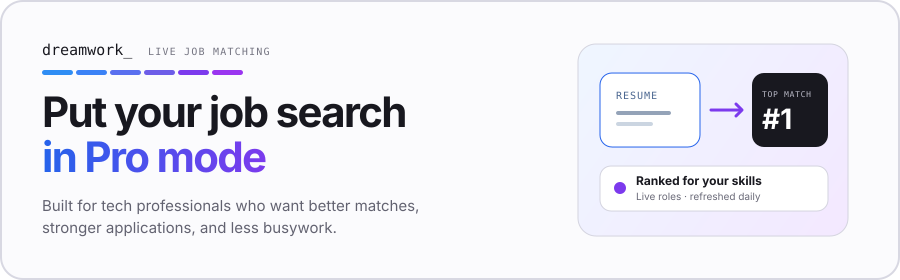

<a href="https://www.dreamworkhq.com/?utm_source=github&utm_medium=readme_cta&utm_campaign=gh-senior-swe">
  <picture>
    <source media="(prefers-color-scheme: dark)" srcset="./static/img/banner-dark.svg">
    <source media="(prefers-color-scheme: light)" srcset="./static/img/banner-light.svg">
    
  </picture>
</a>

<h1 align="center">Senior Software Engineer Jobs</h1>

Senior, staff, principal, and lead software engineering roles in the United States. No management, junior, new-grad, or internship listings.

  
  

  <a href="https://www.dreamworkhq.com/?utm_source=github&utm_medium=readme_cta&utm_campaign=gh-senior-swe">
    <picture>
      <source media="(prefers-color-scheme: dark)" srcset="./static/img/btn-matches-dark.svg">
      <source media="(prefers-color-scheme: light)" srcset="./static/img/btn-matches-light.svg">
      
    </picture>
  </a>

  <a href="https://www.dreamworkhq.com/?utm_source=github&utm_medium=link_row&utm_campaign=gh-senior-swe">dreamworkhq.com</a>
  ·
  <a href="https://www.dreamworkhq.com/blog?utm_source=github&utm_medium=link_row&utm_campaign=gh-senior-swe">Blog</a>
  ·
  <a href="https://www.dreamworkhq.com/research?utm_source=github&utm_medium=link_row&utm_campaign=gh-senior-swe">Hiring research</a>
  ·
  <a href="../../issues">Report a listing</a>

Star this repo and new roles land in your GitHub feed every day. Listings come from [Dreamwork](https://www.dreamworkhq.com/?utm_source=github&utm_medium=readme_cta&utm_campaign=gh-senior-swe), which crawls 1.6M+ live jobs directly from company career pages.

Last updated: **2026-10-15**. Showing the **600** most recently indexed roles, curated from **3,000+** open listings on Dreamwork. Salary shows when the posting discloses it. Click a role to see details and apply.

- [Senior](#senior-290) · 290 roles
- [Staff and lead](#staff-and-lead-214) · 214 roles
- [Principal](#principal-96) · 96 roles

<!-- TABLE_START (auto-generated: do not edit by hand; edits are overwritten daily) -->

### Senior (290)

| Company | Role | Location | Pay | Added |
| --- | --- | --- | --- | --- |
| **[Salesforce](https://www.dreamworkhq.com/c/salesforce.com?utm_source=github&utm_campaign=gh-senior-swe)** | [Software Engineering SMTS - Brain Team (REMOTE)](https://www.dreamworkhq.com/job/6b1d21a9-6e88-4e03-b23a-def8a054aff2?utm_source=github&utm_campaign=gh-senior-swe) | Remote (California - San Francisco) | $149K–$224K | 0d |
| **[Pieinsurance](https://www.dreamworkhq.com/c/pieinsurance.com?utm_source=github&utm_campaign=gh-senior-swe)** | [Senior Software Engineer - Infrastructure](https://www.dreamworkhq.com/job/0e8a1812-428d-4361-b36a-267e70bf6575?utm_source=github&utm_campaign=gh-senior-swe) | Remote (United States) | $150K–$185K | 0d |
| **[Mckesson](https://www.dreamworkhq.com/c/mckesson.com?utm_source=github&utm_campaign=gh-senior-swe)** | [Senior Software Engineer](https://www.dreamworkhq.com/job/34fb25b3-4d6a-4dce-aeb0-8dede8398f41?utm_source=github&utm_campaign=gh-senior-swe) | USA, TX, Irving (Hybrid) | $126K–$210K | 0d |
| **[Samsung](https://www.dreamworkhq.com/c/samsung.com?utm_source=github&utm_campaign=gh-senior-swe)** | [Senior Machine Learning Engineer](https://www.dreamworkhq.com/job/36dbcd6a-12b5-4dd1-a7c3-a66bcc573566?utm_source=github&utm_campaign=gh-senior-swe) | 1530 FM 973 Taylor, TX, USA | $106K–$145K | 0d |
| **[SpaceX](https://www.dreamworkhq.com/c/spacex.com?utm_source=github&utm_campaign=gh-senior-swe)** | [Sr. Software Engineer, Network Observability (Starlink)](https://www.dreamworkhq.com/job/24a2987b-5573-4b30-be9b-095f270a789f?utm_source=github&utm_campaign=gh-senior-swe) | Hawthorne, CA | $165K–$265K | 0d |
| **[Peraton](https://www.dreamworkhq.com/c/peraton.com?utm_source=github&utm_campaign=gh-senior-swe)** | [AWS Cloud Engineer](https://www.dreamworkhq.com/job/15b0f5f1-4442-4e2a-b83d-51004e0a1314?utm_source=github&utm_campaign=gh-senior-swe) | Remote (US) | $104K–$166K | 0d |
| **[Roblox](https://www.dreamworkhq.com/c/roblox.com?utm_source=github&utm_campaign=gh-senior-swe)** | [Senior Software Engineer, Safety Foundation](https://www.dreamworkhq.com/job/dde818ff-11c6-4cc2-b0e8-08941a4dac83?utm_source=github&utm_campaign=gh-senior-swe) | San Mateo, CA, United States | $197K–$243K | 0d |
| **[Lynker](https://www.dreamworkhq.com/c/lynker.com?utm_source=github&utm_campaign=gh-senior-swe)** | [Scientific Developer for UFS In-Core Data Assimilation](https://www.dreamworkhq.com/job/cdb39082-80ad-4159-8bab-b1721a168b8a?utm_source=github&utm_campaign=gh-senior-swe) | College Park, MD, US (Hybrid) | $75K–$120K | 0d |
| **[Embedding Vc](https://www.dreamworkhq.com/c/embedding.vc?utm_source=github&utm_campaign=gh-senior-swe)** | [Applied AI Engineer](https://www.dreamworkhq.com/job/0d5da322-99d4-41a9-a6ae-97a1c0f68af1?utm_source=github&utm_campaign=gh-senior-swe) | San Francisco Bay Area |  | 0d |
| **[Embedding Vc](https://www.dreamworkhq.com/c/embedding.vc?utm_source=github&utm_campaign=gh-senior-swe)** | [Developer Platform Engineer](https://www.dreamworkhq.com/job/714f03e4-db7c-479d-91eb-d919485b7544?utm_source=github&utm_campaign=gh-senior-swe) | San Francisco Bay Area |  | 0d |
| **[Mastercard](https://www.dreamworkhq.com/c/mastercard.com?utm_source=github&utm_campaign=gh-senior-swe)** | [Senior Software Engineer](https://www.dreamworkhq.com/job/28d769de-50e8-473d-a41b-b9da03c1a175?utm_source=github&utm_campaign=gh-senior-swe) | O'Fallon, Missouri | $115K–$184K | 0d |
| **[JPMorgan Chase](https://www.dreamworkhq.com/c/careers.jpmorgan.com?utm_source=github&utm_campaign=gh-senior-swe)** | [Lead Software Engineer - iOS Engineer](https://www.dreamworkhq.com/job/3a97550c-e69e-46c7-afdd-7f2e58f884f5?utm_source=github&utm_campaign=gh-senior-swe) | New York, NY, United States | $157K–$215K | 0d |
| **[Heart](https://www.dreamworkhq.com/c/heart.org?utm_source=github&utm_campaign=gh-senior-swe)** | [Full Stack Sr .NET Developer](https://www.dreamworkhq.com/job/332140f3-b38b-42aa-96e9-1771a5521699?utm_source=github&utm_campaign=gh-senior-swe) | Dallas, TX, US (Hybrid) |  | 0d |
| **[MTB](https://www.dreamworkhq.com/c/mtb.com?utm_source=github&utm_campaign=gh-senior-swe)** | [Senior Solutions Developer - Business Intelligence and Analytics](https://www.dreamworkhq.com/job/aba5b708-3972-4be4-8d42-01c6470c1539?utm_source=github&utm_campaign=gh-senior-swe) | Buffalo, NY (Hybrid) | $97K–$162K | 0d |
| **[Nakupuna](https://www.dreamworkhq.com/c/nakupuna.com?utm_source=github&utm_campaign=gh-senior-swe)** | [Senior Software Engineer/Developer](https://www.dreamworkhq.com/job/f64dff59-97b1-41cc-b7c2-5fbba6149087?utm_source=github&utm_campaign=gh-senior-swe) | Remote (Remote, US) | $120K–$135K | 0d |
| **[Harvey AI](https://www.dreamworkhq.com/c/harvey.ai?utm_source=github&utm_campaign=gh-senior-swe)** | [Software Engineer](https://www.dreamworkhq.com/job/aa35c847-9189-4fea-8460-8cda4f8fc38b?utm_source=github&utm_campaign=gh-senior-swe) | San Francisco (Hybrid) | $221K–$290K | 0d |
| **[Okgov](https://www.dreamworkhq.com/c/okgov.com?utm_source=github&utm_campaign=gh-senior-swe)** | [Senior Application Developer](https://www.dreamworkhq.com/job/29e23510-54f0-4b97-b877-c0346699aa64?utm_source=github&utm_campaign=gh-senior-swe) | Oklahoma County | $87K | 0d |
| **[Nationwide](https://www.dreamworkhq.com/c/nationwide.co.uk?utm_source=github&utm_campaign=gh-senior-swe)** | [Sr Engineer, Software Engineering - ServiceNow Platform Admin](https://www.dreamworkhq.com/job/295499db-a0cd-4b90-8e92-7b63a2377b39?utm_source=github&utm_campaign=gh-senior-swe) | Ohio - Columbus, Three Nationwide Plaza (Hybrid) | $76K–$143K | 0d |
| **[Pnc](https://www.dreamworkhq.com/c/pnc.com?utm_source=github&utm_campaign=gh-senior-swe)** | [Software Engineer Senior- UI Developer/Angular/React](https://www.dreamworkhq.com/job/d730c6a1-ae9d-46a8-a122-c86bc38c6318?utm_source=github&utm_campaign=gh-senior-swe) | Denver - 12345 W Colfax (CO147) | $86K–$173K | 0d |
| **[Pnc](https://www.dreamworkhq.com/c/pnc.com?utm_source=github&utm_campaign=gh-senior-swe)** | [Software Engineer Lead - Data and Automation Machine Learning Operation…](https://www.dreamworkhq.com/job/12bb438b-9b2c-46eb-99d2-3016e75aa3b5?utm_source=github&utm_campaign=gh-senior-swe) | Firstside Center Bldg (PA373) | $86K–$173K | 0d |
| **[Pnc](https://www.dreamworkhq.com/c/pnc.com?utm_source=github&utm_campaign=gh-senior-swe)** | [Software Engineer, Senior-Dynatrace, SQL Server/Mongo/Oracle](https://www.dreamworkhq.com/job/8d97a57c-519f-4350-813d-211af6d25072?utm_source=github&utm_campaign=gh-senior-swe) | PA - Pittsburgh (15222) | $95K–$158K | 0d |
| **[Pnc](https://www.dreamworkhq.com/c/pnc.com?utm_source=github&utm_campaign=gh-senior-swe)** | [Infrastructure Engineer Sr](https://www.dreamworkhq.com/job/eea6b60c-697b-425c-b221-12d237bd29d1?utm_source=github&utm_campaign=gh-senior-swe) | PA - Pittsburgh (15219) | $110K–$204K | 0d |
| **[JPMorgan Chase](https://www.dreamworkhq.com/c/careers.jpmorgan.com?utm_source=github&utm_campaign=gh-senior-swe)** | [Lead Software Engineer](https://www.dreamworkhq.com/job/c9ed7f4b-5adf-4919-8d0b-c170ab103485?utm_source=github&utm_campaign=gh-senior-swe) | Jersey City, NJ, United States (Hybrid) | $157K–$215K | 0d |
| **[JPMorgan Chase](https://www.dreamworkhq.com/c/careers.jpmorgan.com?utm_source=github&utm_campaign=gh-senior-swe)** | [Software Engineer \[Multiple Positions Available\]](https://www.dreamworkhq.com/job/851c0e6a-f8a4-4a31-9e7c-87230ba261d1?utm_source=github&utm_campaign=gh-senior-swe) | Houston, TX, United States |  | 0d |
| **[Peraton](https://www.dreamworkhq.com/c/peraton.com?utm_source=github&utm_campaign=gh-senior-swe)** | [Full Stack Developer](https://www.dreamworkhq.com/job/328abe5f-dfa9-457e-8127-73f4054ab73f?utm_source=github&utm_campaign=gh-senior-swe) | Cranston, RI, US | $86K–$138K | 0d |
| **[Peraton](https://www.dreamworkhq.com/c/peraton.com?utm_source=github&utm_campaign=gh-senior-swe)** | [Artificial Intelligence/Machine Learning (AI/ML) Engineer 2 TS/SCI w Po…](https://www.dreamworkhq.com/job/dc9713d2-d071-4970-bb28-3770c1228baf?utm_source=github&utm_campaign=gh-senior-swe) | Laurel, MD, US | $176K–$282K | 0d |
| **[GM Financial](https://www.dreamworkhq.com/c/gmfinancial.com?utm_source=github&utm_campaign=gh-senior-swe)** | [Senior Machine Learning Operations Engineer](https://www.dreamworkhq.com/job/44e2b94f-a12d-497e-936e-ed1d0e066fb3?utm_source=github&utm_campaign=gh-senior-swe) | Irving, TX, United States (Hybrid) |  | 0d |
| **[Children's Mercy KC](https://www.dreamworkhq.com/c/childrensmercy.org?utm_source=github&utm_campaign=gh-senior-swe)** | [Sr Data Engineer](https://www.dreamworkhq.com/job/69c70946-b426-440a-ada1-1a9ffaf1aaea?utm_source=github&utm_campaign=gh-senior-swe) | Kansas City, MO, US (Hybrid) | $100K | 0d |
| **[Whoop](https://www.dreamworkhq.com/c/whoop.com?utm_source=github&utm_campaign=gh-senior-swe)** | [Senior iOS Engineer (Connectivity)](https://www.dreamworkhq.com/job/1d707ee7-9926-465a-a44f-ab69a86503ae?utm_source=github&utm_campaign=gh-senior-swe) | Boston, MA | $150K–$215K | 0d |
| **[Logicgate](https://www.dreamworkhq.com/c/logicgate.com?utm_source=github&utm_campaign=gh-senior-swe)** | [Senior Software Engineer: Back-end](https://www.dreamworkhq.com/job/67b34078-49c9-4fc6-848e-c9d736f51f3e?utm_source=github&utm_campaign=gh-senior-swe) | Remote (Remote USA) | $125K–$165K | 0d |
| **[Chaosindustries](https://www.dreamworkhq.com/c/chaosinc.com?utm_source=github&utm_campaign=gh-senior-swe)** | [Senior Cloud Infrastructure Engineer](https://www.dreamworkhq.com/job/edb00482-6381-4302-ad7c-9cc3a1084c52?utm_source=github&utm_campaign=gh-senior-swe) | San Francisco, California, United States |  | 0d |
| **[Nebraskastatecareers](https://www.dreamworkhq.com/c/nebraskastatecareers.com?utm_source=github&utm_campaign=gh-senior-swe)** | [Application Developer - Web (.NET) Expert](https://www.dreamworkhq.com/job/78080f90-57f0-4e70-91c1-afdf191d5c35?utm_source=github&utm_campaign=gh-senior-swe) | Lincoln, NE | $75K | 0d |
| **[Tebra](https://www.dreamworkhq.com/c/tebra.com?utm_source=github&utm_campaign=gh-senior-swe)** | [Senior Software Engineer](https://www.dreamworkhq.com/job/a0139eaf-ae1a-4e86-9775-244d63207017?utm_source=github&utm_campaign=gh-senior-swe) | Remote (United States - Remote) | $159K | 0d |
| **[Ford](https://www.dreamworkhq.com/c/ford.com?utm_source=github&utm_campaign=gh-senior-swe)** | [Embedded Software Engineer, Body Controls](https://www.dreamworkhq.com/job/17329e39-c445-4957-86d0-47b6f9263c67?utm_source=github&utm_campaign=gh-senior-swe) | Dearborn, MI, United States (Hybrid) | $68K–$193K | 0d |
| **[Altentechnologyusa](https://www.dreamworkhq.com/c/altenusa.com?utm_source=github&utm_campaign=gh-senior-swe)** | [Data Engineer](https://www.dreamworkhq.com/job/f32a8873-5a7c-4159-87c1-363cf49a6973?utm_source=github&utm_campaign=gh-senior-swe) | Remote (Dallas, TX) | $130K–$150K | 0d |
| **[Tether](https://www.dreamworkhq.com/c/tether.to?utm_source=github&utm_campaign=gh-senior-swe)** | [Senior Node.js Software Engineer - Holepunch (100% Remote, Worldwide)](https://www.dreamworkhq.com/job/fbc1c467-17b8-4971-963c-8f5f64ebb3d8?utm_source=github&utm_campaign=gh-senior-swe) | Remote (Remote job) |  | 0d |
| **[Oxigen](https://www.dreamworkhq.com/c/oxigen.com?utm_source=github&utm_campaign=gh-senior-swe)** | [Senior iOS Engineer](https://www.dreamworkhq.com/job/3e45cd42-bb8c-4336-a1a2-ab86c2513807?utm_source=github&utm_campaign=gh-senior-swe) | Remote (Europe) |  | 0d |
| **[Metrostarsystems](https://www.dreamworkhq.com/c/metrostar.com?utm_source=github&utm_campaign=gh-senior-swe)** | [Cloud Engineer (6851)](https://www.dreamworkhq.com/job/3ea7b810-9cbe-4080-a2ee-5f70943cf689?utm_source=github&utm_campaign=gh-senior-swe) | Reston, VA | $150K–$235K | 0d |
| **[Metrostarsystems](https://www.dreamworkhq.com/c/metrostar.com?utm_source=github&utm_campaign=gh-senior-swe)** | [Sr. DevOps Engineer (6842) (Up to $25k Sign-on)](https://www.dreamworkhq.com/job/cc39e4a0-9987-4119-b319-c5624af05a9c?utm_source=github&utm_campaign=gh-senior-swe) | Reston, VA | $170K–$260K | 0d |
| **[Metrostarsystems](https://www.dreamworkhq.com/c/metrostar.com?utm_source=github&utm_campaign=gh-senior-swe)** | [Platform Engineer (6842) (Up to $25k Sign-on)](https://www.dreamworkhq.com/job/e67316eb-f0e1-4073-a8ae-724c2e74a882?utm_source=github&utm_campaign=gh-senior-swe) | Reston, VA | $170K–$260K | 0d |
| **[Metrostarsystems](https://www.dreamworkhq.com/c/metrostar.com?utm_source=github&utm_campaign=gh-senior-swe)** | [DevOps Engineer (6842) (Up to $25k Sign-on)](https://www.dreamworkhq.com/job/96e2d5e3-1f58-4025-8680-da61891f8e68?utm_source=github&utm_campaign=gh-senior-swe) | Reston, VA | $170K–$260K | 0d |
| **[Metrostarsystems](https://www.dreamworkhq.com/c/metrostar.com?utm_source=github&utm_campaign=gh-senior-swe)** | [Infrastructure Engineer (6842) (Up to $25k Sign-on)](https://www.dreamworkhq.com/job/45a92ea5-0448-4e13-8a96-00890f7cc24a?utm_source=github&utm_campaign=gh-senior-swe) | Reston, VA | $170K–$260K | 0d |
| **[Affirm](https://www.dreamworkhq.com/c/affirm.com?utm_source=github&utm_campaign=gh-senior-swe)** | [Senior Software Engineer, Backend (Lakehouse Infra)](https://www.dreamworkhq.com/job/dfed8ade-4dc2-4eea-af8f-0ef4228c25f7?utm_source=github&utm_campaign=gh-senior-swe) | Remote (Remote US) | $173K–$233K | 0d |
| **[Genpact](https://www.dreamworkhq.com/c/genpact.com?utm_source=github&utm_campaign=gh-senior-swe)** | [Sr. Data Architect - Data Engineering 3](https://www.dreamworkhq.com/job/1f101f1c-32e6-419b-86d4-7517037ecf65?utm_source=github&utm_campaign=gh-senior-swe) | 3401-G LLC-CTK: 521 Fifth Avenue, New York,… (Hybrid) | $100K–$125K | 0d |
| **[Nmi](https://www.dreamworkhq.com/c/nmi.com?utm_source=github&utm_campaign=gh-senior-swe)** | [Senior Software Engineer](https://www.dreamworkhq.com/job/4cc11a46-cd44-43c1-8be4-aad494b35b48?utm_source=github&utm_campaign=gh-senior-swe) | Remote (Remote, US) | $115K–$130K | 0d |
| **[Pitchbookdata](https://www.dreamworkhq.com/c/pitchbook.com?utm_source=github&utm_campaign=gh-senior-swe)** | [Sr. Machine Learning Engineer](https://www.dreamworkhq.com/job/bd139438-c6c6-4b81-b519-b8d093dbb50d?utm_source=github&utm_campaign=gh-senior-swe) | Seattle, Washington, United States (Hybrid) | $170K–$240K | 0d |
| **[Capgemini](https://www.dreamworkhq.com/c/capgemini.com?utm_source=github&utm_campaign=gh-senior-swe)** | [Senior Software Engineer](https://www.dreamworkhq.com/job/3f7bdf56-096c-4f35-90b2-d011824cac24?utm_source=github&utm_campaign=gh-senior-swe) | — | $61K–$90K | 0d |
| **[Capgemini](https://www.dreamworkhq.com/c/capgemini.com?utm_source=github&utm_campaign=gh-senior-swe)** | [Senior Data Engineer - MarTech AdTech](https://www.dreamworkhq.com/job/36abf5c3-455d-409e-af74-99508d577dbd?utm_source=github&utm_campaign=gh-senior-swe) | — | $95K–$169K | 0d |
| **[Capgemini](https://www.dreamworkhq.com/c/capgemini.com?utm_source=github&utm_campaign=gh-senior-swe)** | [SAP ABAP / RAP- Senior Application Developer](https://www.dreamworkhq.com/job/73330602-28d9-4557-958a-447850cea3a0?utm_source=github&utm_campaign=gh-senior-swe) | — | $101K–$183K | 0d |
| **[Capgemini](https://www.dreamworkhq.com/c/capgemini.com?utm_source=github&utm_campaign=gh-senior-swe)** | [Naehas Developer](https://www.dreamworkhq.com/job/d1883dd8-b0f7-4df5-99dd-890cde36cc47?utm_source=github&utm_campaign=gh-senior-swe) | — |  | 0d |
| **[Capgemini](https://www.dreamworkhq.com/c/capgemini.com?utm_source=github&utm_campaign=gh-senior-swe)** | [Fullstack Backend Developer](https://www.dreamworkhq.com/job/96c236ba-ecc5-4841-882a-08bf12711805?utm_source=github&utm_campaign=gh-senior-swe) | — |  | 0d |
| **[Drivetrain](https://www.dreamworkhq.com/c/drivetrain.ai?utm_source=github&utm_campaign=gh-senior-swe)** | [Site Reliability Engineer - SRE](https://www.dreamworkhq.com/job/3da5fd3e-c436-48cc-b098-c5334144a33a?utm_source=github&utm_campaign=gh-senior-swe) | United States (Hybrid) |  | 0d |
| **[Capgemini](https://www.dreamworkhq.com/c/capgemini.com?utm_source=github&utm_campaign=gh-senior-swe)** | [Front End Developer](https://www.dreamworkhq.com/job/85d69db8-66cf-4bfe-94b6-a2aad0610289?utm_source=github&utm_campaign=gh-senior-swe) | — | $68K–$93K | 0d |
| **[Optionmetrics](https://www.dreamworkhq.com/c/optionmetrics.com?utm_source=github&utm_campaign=gh-senior-swe)** | [Cloud Infrastructure & DevOps Engineer](https://www.dreamworkhq.com/job/e21e3219-0a87-4ba8-908f-23c815cddaa8?utm_source=github&utm_campaign=gh-senior-swe) | New York, NY | $100K–$150K | 0d |
| **[WJCompany](https://www.dreamworkhq.com/c/wjcompany.org?utm_source=github&utm_campaign=gh-senior-swe)** | [Sr. AI DevOps Developer- Bilingual (Korean/ English)](https://www.dreamworkhq.com/job/dec6d49b-6f78-4c98-8e60-ee25a2abc25f?utm_source=github&utm_campaign=gh-senior-swe) | Plano, TX, United States | $115K–$125K | 0d |
| **[WJCompany](https://www.dreamworkhq.com/c/wjcompany.org?utm_source=github&utm_campaign=gh-senior-swe)** | [Java Back-end Developer](https://www.dreamworkhq.com/job/ff20b4dc-55ee-4892-9bdc-ce6ecfc1705b?utm_source=github&utm_campaign=gh-senior-swe) | Plano, TX, United States | $85K–$95K | 0d |
| **[Crunchyroll](https://www.dreamworkhq.com/c/crunchyroll.com?utm_source=github&utm_campaign=gh-senior-swe)** | [Senior Software Engineer](https://www.dreamworkhq.com/job/1ad6283d-edd9-4249-9689-e3ccf02f6267?utm_source=github&utm_campaign=gh-senior-swe) | Los Angeles, California, United States (Hybrid) | $183K–$229K | 0d |
| **[Nationwide](https://www.dreamworkhq.com/c/nationwide.co.uk?utm_source=github&utm_campaign=gh-senior-swe)** | [Consultant, Site Reliability Engineer](https://www.dreamworkhq.com/job/ea273453-21d1-4a28-815f-8780db5e5340?utm_source=github&utm_campaign=gh-senior-swe) | Ohio - Columbus, Three Nationwide Plaza (Hybrid) | $118K–$222K | 0d |
| **[Google](https://www.dreamworkhq.com/c/google.com?utm_source=github&utm_campaign=gh-senior-swe)** | [Senior Software Engineer, Embedded, Pixel Camera](https://www.dreamworkhq.com/job/09275ad6-262c-43c7-ac12-201089661f8c?utm_source=github&utm_campaign=gh-senior-swe) | Mountain View, CA, USA | $174K–$252K | 0d |
| **[Google](https://www.dreamworkhq.com/c/google.com?utm_source=github&utm_campaign=gh-senior-swe)** | [Senior Software Engineer, Infrastructure, Kubernetes Networking](https://www.dreamworkhq.com/job/6a562c31-b58f-4145-a78b-721c2f44df5b?utm_source=github&utm_campaign=gh-senior-swe) | Sunnyvale, CA, USA | $174K–$252K | 0d |
| **[Google](https://www.dreamworkhq.com/c/google.com?utm_source=github&utm_campaign=gh-senior-swe)** | [Senior Software Engineer, Generative AI, Real World Journeys](https://www.dreamworkhq.com/job/9446fa1d-f415-48de-afb4-89bbb2768c8a?utm_source=github&utm_campaign=gh-senior-swe) | Mountain View, CA, USA | $174K–$252K | 0d |
| **[Google](https://www.dreamworkhq.com/c/google.com?utm_source=github&utm_campaign=gh-senior-swe)** | [Senior Software Engineer, AI/ML Computer Vision, Google Cloud](https://www.dreamworkhq.com/job/d1d7d67a-7829-4284-b652-d2d3115d4526?utm_source=github&utm_campaign=gh-senior-swe) | Redmond, WA, USA | $174K–$252K | 0d |
| **[Google](https://www.dreamworkhq.com/c/google.com?utm_source=github&utm_campaign=gh-senior-swe)** | [Senior Software Engineer, D Management Layer](https://www.dreamworkhq.com/job/649312ab-dc30-4e4f-bad0-222e394c5760?utm_source=github&utm_campaign=gh-senior-swe) | New York, NY, USA | $174K–$252K | 0d |
| **[Google](https://www.dreamworkhq.com/c/google.com?utm_source=github&utm_campaign=gh-senior-swe)** | [Senior Software Engineer, Generative AI, Research](https://www.dreamworkhq.com/job/ff5d0890-e08e-4f5e-9b7e-1bef149945e1?utm_source=github&utm_campaign=gh-senior-swe) | Sunnyvale, CA, USA | $174K–$252K | 0d |
| **[Google](https://www.dreamworkhq.com/c/google.com?utm_source=github&utm_campaign=gh-senior-swe)** | [Software Engineer, BigQuery Query Optimization](https://www.dreamworkhq.com/job/144ff685-56f2-44da-adbb-0571c7a6a5ef?utm_source=github&utm_campaign=gh-senior-swe) | Kirkland, WA, USA | $174K–$252K | 0d |
| **[Google](https://www.dreamworkhq.com/c/google.com?utm_source=github&utm_campaign=gh-senior-swe)** | [Software Engineer, Mobile Performance](https://www.dreamworkhq.com/job/57db7451-648a-4b92-a11a-31bc17d10f96?utm_source=github&utm_campaign=gh-senior-swe) | San Jose, CA, USA, Kirkland, WA, USA | $174K–$252K | 0d |
| **[Google](https://www.dreamworkhq.com/c/google.com?utm_source=github&utm_campaign=gh-senior-swe)** | [Packaging Design Engineer, Platforms Infrastructure Engineering](https://www.dreamworkhq.com/job/9c626876-e942-49cb-964e-5bfc455c8bc3?utm_source=github&utm_campaign=gh-senior-swe) | Sunnyvale, CA, USA | $159K–$230K | 0d |
| **[Google](https://www.dreamworkhq.com/c/google.com?utm_source=github&utm_campaign=gh-senior-swe)** | [Senior Software Engineer, Infrastructure, Google Distributed Cloud](https://www.dreamworkhq.com/job/34bb4b28-c444-4d45-85f7-10d6616745a5?utm_source=github&utm_campaign=gh-senior-swe) | Cambridge, MA, USA, Raleigh, NC, USA, Durha… | $174K–$252K | 0d |
| **[Tanium](https://www.dreamworkhq.com/c/tanium.com?utm_source=github&utm_campaign=gh-senior-swe)** | [Senior Software Engineer](https://www.dreamworkhq.com/job/501b8f63-e893-49b9-8c26-83747f189e55?utm_source=github&utm_campaign=gh-senior-swe) | Bellevue, WA (Hybrid); Durham, NC (Hybrid);… (Hybrid) | $191K–$293K | 0d |
| **[Tanium](https://www.dreamworkhq.com/c/tanium.com?utm_source=github&utm_campaign=gh-senior-swe)** | [Senior Software Engineer, DevOps](https://www.dreamworkhq.com/job/f7aafc7b-ee7a-40b9-be70-fae64a0d5109?utm_source=github&utm_campaign=gh-senior-swe) | Durham, NC (Hybrid); Reston, VA (Hybrid) (Hybrid) | $180K–$270K | 0d |
| **[Tanium](https://www.dreamworkhq.com/c/tanium.com?utm_source=github&utm_campaign=gh-senior-swe)** | [Senior Software Engineer - Full Stack](https://www.dreamworkhq.com/job/3a11b482-0eb9-4985-b8fd-6b76f0019215?utm_source=github&utm_campaign=gh-senior-swe) | Addison, TX (Hybrid); Bellevue, WA (Hybrid)… (Hybrid) | $191K–$293K | 0d |
| **[Tanium](https://www.dreamworkhq.com/c/tanium.com?utm_source=github&utm_campaign=gh-senior-swe)** | [Senior Software Engineer](https://www.dreamworkhq.com/job/d8e928a8-d547-4902-a6a1-31be0973ca25?utm_source=github&utm_campaign=gh-senior-swe) | Durham, NC (Hybrid); Emeryville, CA (Hybrid) (Hybrid) | $191K–$293K | 0d |
| **[Gdit](https://www.dreamworkhq.com/c/gdit.com?utm_source=github&utm_campaign=gh-senior-swe)** | [Senior Oracle Apps Developer](https://www.dreamworkhq.com/job/b14982c2-c800-4eff-863f-bc3ed662f2a4?utm_source=github&utm_campaign=gh-senior-swe) | Remote (Any Location / Remote) | $108K–$147K | 0d |
| **[Gdit](https://www.dreamworkhq.com/c/gdit.com?utm_source=github&utm_campaign=gh-senior-swe)** | [RBS Infrastructure Engineer](https://www.dreamworkhq.com/job/4da1c20a-bfe6-49e0-962b-7046055d26b2?utm_source=github&utm_campaign=gh-senior-swe) | USA NE Offutt AFB | $113K–$127K | 0d |
| **[Gdit](https://www.dreamworkhq.com/c/gdit.com?utm_source=github&utm_campaign=gh-senior-swe)** | [Senior API Developer](https://www.dreamworkhq.com/job/7c06652b-f3e2-44f0-8e8b-ef780eada071?utm_source=github&utm_campaign=gh-senior-swe) | Remote (Any Location / Remote) | $105K–$143K | 0d |
| **[Gdit](https://www.dreamworkhq.com/c/gdit.com?utm_source=github&utm_campaign=gh-senior-swe)** | [Site Reliability Engineer - TS/SCI with Polygraph](https://www.dreamworkhq.com/job/f6392255-9a29-4e2b-a8b2-73b5ce41e38f?utm_source=github&utm_campaign=gh-senior-swe) | USA VA Chantilly | $187K–$252K | 0d |
| **[Spotify](https://www.dreamworkhq.com/c/spotify.com?utm_source=github&utm_campaign=gh-senior-swe)** | [Senior Machine Learning Engineer, Personalization](https://www.dreamworkhq.com/job/e6bade04-e52b-49fd-9e32-013ee8edabc4?utm_source=github&utm_campaign=gh-senior-swe) | Remote (New York, NY) | $184K–$263K | 0d |
| **[Vultr](https://www.dreamworkhq.com/c/vultr.com?utm_source=github&utm_campaign=gh-senior-swe)** | [Senior Data Engineer](https://www.dreamworkhq.com/job/d76ad687-6a2a-4415-a7ed-3cac65d6e9fc?utm_source=github&utm_campaign=gh-senior-swe) | Remote (Remote - United States) | $155K–$180K | 0d |
| **[Elementbiosciences](https://www.dreamworkhq.com/c/elementbiosciences.com?utm_source=github&utm_campaign=gh-senior-swe)** | [Senior Software Test Engineer](https://www.dreamworkhq.com/job/70ea5e76-dcc8-41d8-bab4-61df18caf8f7?utm_source=github&utm_campaign=gh-senior-swe) | San Diego - Headquarters | $118K–$144K | 0d |
| **[American Express](https://www.dreamworkhq.com/c/americanexpress.com?utm_source=github&utm_campaign=gh-senior-swe)** | [Sr AI Engineer II - Enterprise Architecture](https://www.dreamworkhq.com/job/506a29e4-55ae-46e3-9080-64066c71ca33?utm_source=github&utm_campaign=gh-senior-swe) | New York, NY, United States (Hybrid) | $123K–$215K | 0d |
| **[American Express](https://www.dreamworkhq.com/c/americanexpress.com?utm_source=github&utm_campaign=gh-senior-swe)** | [Sr Software Engineer II - Enterprise Architecture](https://www.dreamworkhq.com/job/9ca0c73b-1a79-43d7-abbf-8eafcfe81028?utm_source=github&utm_campaign=gh-senior-swe) | New York, NY, United States (Hybrid) | $123K–$215K | 0d |
| **[Nexamp](https://www.dreamworkhq.com/c/nexamp.com?utm_source=github&utm_campaign=gh-senior-swe)** | [Senior Software Engineer (Full Stack)](https://www.dreamworkhq.com/job/cdc02ab5-e488-4a99-8fb0-8ea6c374d5d9?utm_source=github&utm_campaign=gh-senior-swe) | Boston, MA (Hybrid) | $167K–$210K | 0d |
| **[DocuSign](https://www.dreamworkhq.com/c/docusign.com?utm_source=github&utm_campaign=gh-senior-swe)** | [Software Engineer](https://www.dreamworkhq.com/job/2719c0ed-87ec-4561-9b37-6e513f64fa7c?utm_source=github&utm_campaign=gh-senior-swe) | Seattle, WA, US (Hybrid) | $140K–$207K | 0d |
| **[Grail](https://www.dreamworkhq.com/c/grail.com?utm_source=github&utm_campaign=gh-senior-swe)** | [Senior Software Engineer - Commercial - #4978](https://www.dreamworkhq.com/job/16c54418-c375-400b-9fe5-1e36608a18f8?utm_source=github&utm_campaign=gh-senior-swe) | Sunnyvale, CA | $169K–$180K | 0d |
| **[Strongtie](https://www.dreamworkhq.com/c/strongtie.com?utm_source=github&utm_campaign=gh-senior-swe)** | [Senior Software Engineer — Cloud Services & API Platform (C#/Azure Trac…](https://www.dreamworkhq.com/job/95fc4e9d-b1c7-4769-95e9-f93ffa594529?utm_source=github&utm_campaign=gh-senior-swe) | Plano, TX (Hybrid) | $108K–$183K | 0d |
| **[CrowdStrike](https://www.dreamworkhq.com/c/crowdstrike.com?utm_source=github&utm_campaign=gh-senior-swe)** | [Sr. Software Engineer II, AI on Sensor – Mac, Linux, or Windows (Hybrid)](https://www.dreamworkhq.com/job/36f1a18b-f11e-477c-b232-e48d47a1d0bf?utm_source=github&utm_campaign=gh-senior-swe) | USA - Sunnyvale, CA (Hybrid) | $160K–$250K | 0d |
| **[CrowdStrike](https://www.dreamworkhq.com/c/crowdstrike.com?utm_source=github&utm_campaign=gh-senior-swe)** | [Sr. Software Engineer, Infrastructure (Remote)](https://www.dreamworkhq.com/job/68907736-cfe6-43da-a911-fb8eeefcf92a?utm_source=github&utm_campaign=gh-senior-swe) | Remote (USA - Remote) | $140K–$215K | 0d |
| **[DNV](https://www.dreamworkhq.com/c/sps.dnv.com?utm_source=github&utm_campaign=gh-senior-swe)** | [Senior Data Engineer](https://www.dreamworkhq.com/job/f087f68e-650b-44cd-9ac0-9b33ce409303?utm_source=github&utm_campaign=gh-senior-swe) | San Diego, CA, United States (Hybrid) | $130K–$155K | 0d |
| **[CoreWeave](https://www.dreamworkhq.com/c/coreweave.com?utm_source=github&utm_campaign=gh-senior-swe)** | [Senior Software Engineer, Network Development](https://www.dreamworkhq.com/job/33cd4a4c-c289-4f13-890c-f4d712092d83?utm_source=github&utm_campaign=gh-senior-swe) | Livingston, NJ / New York, NY / Sunnyvale, … | $165K–$220K | 0d |
| **[Photon](https://www.dreamworkhq.com/c/photon.com?utm_source=github&utm_campaign=gh-senior-swe)** | [GenAI/Python Developer - AI/ML - Newyork, NY - Citi](https://www.dreamworkhq.com/job/62b1574e-3679-4040-b1b5-d41395293e62?utm_source=github&utm_campaign=gh-senior-swe) | United States | $155K–$217K | 0d |
| **[Dadavidson](https://www.dreamworkhq.com/c/dadavidson.com?utm_source=github&utm_campaign=gh-senior-swe)** | [Data Engineer](https://www.dreamworkhq.com/job/14dc8656-09fa-426a-ba36-0585d215babb?utm_source=github&utm_campaign=gh-senior-swe) | Western States or Midwest (Hybrid) | $74K–$118K | 0d |
| **[Wonder](https://www.dreamworkhq.com/c/wonder.com?utm_source=github&utm_campaign=gh-senior-swe)** | [Sr. Software Engineer (Back End)](https://www.dreamworkhq.com/job/ad68201d-05c9-4469-a149-e44c64802ef7?utm_source=github&utm_campaign=gh-senior-swe) | Spyce | $176K–$184K | 0d |
| **[MeridianLink](https://www.dreamworkhq.com/c/meridianlink.com?utm_source=github&utm_campaign=gh-senior-swe)** | [Sr Data Engineer](https://www.dreamworkhq.com/job/4e3040b3-aabf-4847-8d3c-027ee97f6278?utm_source=github&utm_campaign=gh-senior-swe) | Remote (US Remote) | $95K–$135K | 0d |
| **[Truveta](https://www.dreamworkhq.com/c/truveta.com?utm_source=github&utm_campaign=gh-senior-swe)** | [Senior Software Engineer - Normalization Platform](https://www.dreamworkhq.com/job/fb60366f-2655-47d6-ab2a-caa099332439?utm_source=github&utm_campaign=gh-senior-swe) | Seattle, WA (Hybrid) | $155K–$190K | 0d |
| **[SyngentaGroup](https://www.dreamworkhq.com/c/syngenta.com?utm_source=github&utm_campaign=gh-senior-swe)** | [R&D Analytics - AI Developer](https://www.dreamworkhq.com/job/d5482a09-283e-4c42-8360-38f7241d67a4?utm_source=github&utm_campaign=gh-senior-swe) | Durham, NORTH AMERICA, United States (Hybrid) | $105K–$157K | 0d |
| **[Liftoff](https://www.dreamworkhq.com/c/liftoff.com?utm_source=github&utm_campaign=gh-senior-swe)** | [Senior Software Engineer, Infrastructure](https://www.dreamworkhq.com/job/1f50f997-45fb-4bb2-95fe-2a5c389469ad?utm_source=github&utm_campaign=gh-senior-swe) | Remote (Redwood City, CA) | $165K–$205K | 0d |
| **[Relativity](https://www.dreamworkhq.com/c/relativity.com?utm_source=github&utm_campaign=gh-senior-swe)** | [Senior Software Engineer](https://www.dreamworkhq.com/job/cbe47a2c-69ec-4932-b792-48258743a209?utm_source=github&utm_campaign=gh-senior-swe) | Illinois (Hybrid) | $126K–$190K | 0d |
| **[Grafana Labs](https://www.dreamworkhq.com/c/grafana.com?utm_source=github&utm_campaign=gh-senior-swe)** | [Senior Fullstack Engineer - Grafana Data Source Plugins \| NASA \| (Rem…](https://www.dreamworkhq.com/job/cb6f23ba-7be7-45e2-b145-e0357c93ec93?utm_source=github&utm_campaign=gh-senior-swe) | Remote (United States (Remote)) | $154K–$185K | 0d |
| **[Grafana Labs](https://www.dreamworkhq.com/c/grafana.com?utm_source=github&utm_campaign=gh-senior-swe)** | [Senior Backend Engineer - Databases Tempo \| US \| Remote](https://www.dreamworkhq.com/job/fff177a2-bae0-45cb-8a67-67002452dbb8?utm_source=github&utm_campaign=gh-senior-swe) | Remote (United States (Remote)) | $154K–$185K | 0d |
| **[Apple](https://www.dreamworkhq.com/c/apple.com?utm_source=github&utm_campaign=gh-senior-swe)** | [Senior Software Engineer, Apple Services Engineering, iCloud Platform](https://www.dreamworkhq.com/job/8d3291ca-ab4c-43d0-bb93-17c3dceac70a?utm_source=github&utm_campaign=gh-senior-swe) | Seattle | $175K–$309K | 0d |
| **[Apple](https://www.dreamworkhq.com/c/apple.com?utm_source=github&utm_campaign=gh-senior-swe)** | [Senior Rendering Engine Software Engineer](https://www.dreamworkhq.com/job/e5f9b4c9-9f41-4993-8a45-3836f3ed08ed?utm_source=github&utm_campaign=gh-senior-swe) | Cupertino | $175K–$309K | 0d |
| **[Apple](https://www.dreamworkhq.com/c/apple.com?utm_source=github&utm_campaign=gh-senior-swe)** | [Senior Software Engineer, Apple Services Engineering](https://www.dreamworkhq.com/job/1c5d5f7d-8c4a-4563-9061-5fe5e6533fbb?utm_source=github&utm_campaign=gh-senior-swe) | Seattle | $175K–$309K | 0d |
| **[AMD](https://www.dreamworkhq.com/c/amd.com?utm_source=github&utm_campaign=gh-senior-swe)** | [Software Design Engineer - GPU Kernel Optimization](https://www.dreamworkhq.com/job/a916d215-001a-4b5e-8fc7-528d1c982086?utm_source=github&utm_campaign=gh-senior-swe) | San Jose, California, United States |  | 0d |
| **[Abby Care](https://www.dreamworkhq.com/c/abbycare.com?utm_source=github&utm_campaign=gh-senior-swe)** | [Senior Mobile Engineer (React Native)](https://www.dreamworkhq.com/job/48157eca-4dea-48b9-a5c0-adde0f65050d?utm_source=github&utm_campaign=gh-senior-swe) | San Francisco (Hybrid) | $170K–$240K | 0d |
| **[Reddit](https://www.dreamworkhq.com/c/reddit.com?utm_source=github&utm_campaign=gh-senior-swe)** | [Senior Machine Learning Systems Engineer, ML Platform](https://www.dreamworkhq.com/job/5130b185-eef4-4f52-9309-b31df6f02550?utm_source=github&utm_campaign=gh-senior-swe) | Remote (Remote - United States) | $217K–$303K | 0d |
| **[Trilogy Federal](https://www.dreamworkhq.com/c/trilogyfederal.com?utm_source=github&utm_campaign=gh-senior-swe)** | [Data Engineer - Momentum Financials](https://www.dreamworkhq.com/job/2303a278-043a-4809-a7bb-dd0863767450?utm_source=github&utm_campaign=gh-senior-swe) | Arlington, VA (Hybrid) | $110K–$120K | 0d |
| **[Trilogy Federal](https://www.dreamworkhq.com/c/trilogyfederal.com?utm_source=github&utm_campaign=gh-senior-swe)** | [Remote JAVA Software Engineer](https://www.dreamworkhq.com/job/0e53ebb7-3300-442d-989b-0b2accb708f2?utm_source=github&utm_campaign=gh-senior-swe) | Remote (Washington, D.C.) | $115K–$130K | 0d |
| **[Ameriprise](https://www.dreamworkhq.com/c/ameriprise.com?utm_source=github&utm_campaign=gh-senior-swe)** | [Senior Collaboration Platform Engineer – SharePoint & Microsoft 365](https://www.dreamworkhq.com/job/5a2752da-8691-43e2-acb3-4b31ca62e411?utm_source=github&utm_campaign=gh-senior-swe) | Minneapolis, Minnesota (Hybrid) | $115K–$157K | 0d |
| **[Connection](https://www.dreamworkhq.com/c/connection.com?utm_source=github&utm_campaign=gh-senior-swe)** | [Copilot Studio and Power Platform Engineer — Fabric Agent Extension](https://www.dreamworkhq.com/job/d727da2e-4aed-4cc1-85fe-7b9fc3adb6f8?utm_source=github&utm_campaign=gh-senior-swe) | Remote (Remote, US) |  | 0d |
| **[Tiger Analytics](https://www.dreamworkhq.com/c/tigeranalytics.com?utm_source=github&utm_campaign=gh-senior-swe)** | [Senior Data Engineer](https://www.dreamworkhq.com/job/986eb426-c60c-499f-8316-2b4928ec7fc1?utm_source=github&utm_campaign=gh-senior-swe) | Remote (Jersey City, New Jersey, United States) |  | 0d |
| **[Picklerobot](https://www.dreamworkhq.com/c/picklerobot.com?utm_source=github&utm_campaign=gh-senior-swe)** | [Senior Machine Learning Engineer - Perception](https://www.dreamworkhq.com/job/971885aa-dcbd-4a1e-958e-60f97b0a5242?utm_source=github&utm_campaign=gh-senior-swe) | Charlestown, MA | $170K–$227K | 0d |
| **[Lendingtree](https://www.dreamworkhq.com/c/lendingtree.com?utm_source=github&utm_campaign=gh-senior-swe)** | [Senior Data Engineer](https://www.dreamworkhq.com/job/e5ae72cd-446b-40c7-bc91-99bcb5469559?utm_source=github&utm_campaign=gh-senior-swe) | Remote | $100K–$130K | 0d |
| **[DRW](https://www.dreamworkhq.com/c/drw.com?utm_source=github&utm_campaign=gh-senior-swe)** | [Senior Software Engineer, Cumberland/Options Data](https://www.dreamworkhq.com/job/198fc4f3-3e25-4ceb-a100-77d5f5782ac0?utm_source=github&utm_campaign=gh-senior-swe) | New York City | $175K–$225K | 0d |
| **[Mark43](https://www.dreamworkhq.com/c/mark43.com?utm_source=github&utm_campaign=gh-senior-swe)** | [DevOps Engineer](https://www.dreamworkhq.com/job/4371e603-0971-4e6f-a8ac-c2923cf58a96?utm_source=github&utm_campaign=gh-senior-swe) | Remote |  | 0d |
| **[Metropolis](https://www.dreamworkhq.com/c/metropolis.ai?utm_source=github&utm_campaign=gh-senior-swe)** | [Senior Software Engineer, AI Agentic Platform](https://www.dreamworkhq.com/job/60aeccc4-148d-4688-9b3e-c841857d3f59?utm_source=github&utm_campaign=gh-senior-swe) | Seattle, Washington, United States (Hybrid) | $177K–$216K | 0d |
| **[Keybank](https://www.dreamworkhq.com/c/key.com?utm_source=github&utm_campaign=gh-senior-swe)** | [Sr. Full Stack Engineer](https://www.dreamworkhq.com/job/2dce9790-9873-4719-84fd-4b6b46428aaa?utm_source=github&utm_campaign=gh-senior-swe) | Remote (Remote, United States) | $80K–$150K | 0d |
| **[Finastra](https://www.dreamworkhq.com/c/finastra.com?utm_source=github&utm_campaign=gh-senior-swe)** | [Software Architect Senior Specialist](https://www.dreamworkhq.com/job/3fa38624-8249-4bab-9420-f076d5c621a5?utm_source=github&utm_campaign=gh-senior-swe) | Atlanta (Hybrid) |  | 0d |
| **[Hrhelp](https://www.dreamworkhq.com/c/netsuite.com?utm_source=github&utm_campaign=gh-senior-swe)** | [Senior Platform Software Engineer](https://www.dreamworkhq.com/job/eea2b893-f57a-4482-bd18-7cc319f31f1e?utm_source=github&utm_campaign=gh-senior-swe) | Nashville, TN, United States | $93K–$210K | 0d |
| **[Redwood Materials](https://www.dreamworkhq.com/c/redwoodmaterials.com?utm_source=github&utm_campaign=gh-senior-swe)** | [Senior Battery Data Engineer](https://www.dreamworkhq.com/job/93fe38c3-3fed-45a0-b3f5-00d4c4bff66f?utm_source=github&utm_campaign=gh-senior-swe) | San Francisco, California, United States | $173K–$198K | 0d |
| **[Q Ctrl](https://www.dreamworkhq.com/c/q-ctrl.com?utm_source=github&utm_campaign=gh-senior-swe)** | [Senior Cloud Platform Engineer](https://www.dreamworkhq.com/job/571ce6c3-3fdf-4ec1-8302-d35581b7b26b?utm_source=github&utm_campaign=gh-senior-swe) | Los Angeles | $150K–$225K | 0d |
| **[CityofPhiladelphia](https://www.dreamworkhq.com/c/phila.gov?utm_source=github&utm_campaign=gh-senior-swe)** | [Senior Software Engineer – Mobile Development (Android)](https://www.dreamworkhq.com/job/e20389d4-6700-4afe-aca0-e60e6b7b2a05?utm_source=github&utm_campaign=gh-senior-swe) | Philadelphia, PA, United States | $105K–$110K | 0d |
| **[Lightfeatheriollc](https://www.dreamworkhq.com/c/lightfeather.io?utm_source=github&utm_campaign=gh-senior-swe)** | [Senior ServiceNow Developer - Public Trust Clearance](https://www.dreamworkhq.com/job/d4474563-a223-4863-8838-4676f4d46fcd?utm_source=github&utm_campaign=gh-senior-swe) | Remote (United States) | $90K–$115K | 0d |
| **[Lightfeatheriollc](https://www.dreamworkhq.com/c/lightfeather.io?utm_source=github&utm_campaign=gh-senior-swe)** | [ServiceNow Platform Engineer](https://www.dreamworkhq.com/job/786165b6-98fc-4dcb-9386-6ccf18580c8a?utm_source=github&utm_campaign=gh-senior-swe) | Washington, DC (Hybrid) | $180K–$200K | 0d |
| **[Lightfeatheriollc](https://www.dreamworkhq.com/c/lightfeather.io?utm_source=github&utm_campaign=gh-senior-swe)** | [Senior Azure Cloud Engineer](https://www.dreamworkhq.com/job/19392dd1-848b-4934-9a40-a5b52debda93?utm_source=github&utm_campaign=gh-senior-swe) | Washington, DC (Hybrid) | $130K–$170K | 0d |
| **[Lightfeatheriollc](https://www.dreamworkhq.com/c/lightfeather.io?utm_source=github&utm_campaign=gh-senior-swe)** | [Full Stack Engineer](https://www.dreamworkhq.com/job/edf63e8c-dcd7-42f9-9963-d7261cae514c?utm_source=github&utm_campaign=gh-senior-swe) | Remote (United States) | $90K–$115K | 0d |
| **[Lightfeatheriollc](https://www.dreamworkhq.com/c/lightfeather.io?utm_source=github&utm_campaign=gh-senior-swe)** | [Lead ServiceNow Developer](https://www.dreamworkhq.com/job/8f803d49-a242-4bbe-a891-e470c2712673?utm_source=github&utm_campaign=gh-senior-swe) | Remote (United States) | $120K–$140K | 0d |
| **[Uber](https://www.dreamworkhq.com/c/uber.com?utm_source=github&utm_campaign=gh-senior-swe)** | [Senior Software Engineer - Java Platform](https://www.dreamworkhq.com/job/2de93cc4-55d7-4a7a-9496-cc163b24feee?utm_source=github&utm_campaign=gh-senior-swe) | Sunnyvale, California + 3 locations (Hybrid) | $202K–$224K | 0d |
| **[Uber](https://www.dreamworkhq.com/c/uber.com?utm_source=github&utm_campaign=gh-senior-swe)** | [Sr Software Engineer - Engineer](https://www.dreamworkhq.com/job/4fcdcc95-2a79-47cb-a6b3-799bc7de6b15?utm_source=github&utm_campaign=gh-senior-swe) | San Francisco, California + 1 location (Hybrid) | $202K–$224K | 0d |
| **[Uber](https://www.dreamworkhq.com/c/uber.com?utm_source=github&utm_campaign=gh-senior-swe)** | [Sr Software Engineer -Geocore](https://www.dreamworkhq.com/job/fb971867-db56-4638-a76f-836f95f13041?utm_source=github&utm_campaign=gh-senior-swe) | San Francisco, California (Hybrid) | $202K–$224K | 0d |
| **[Uber](https://www.dreamworkhq.com/c/uber.com?utm_source=github&utm_campaign=gh-senior-swe)** | [Sr Software Engineer- iOS, Experimentation](https://www.dreamworkhq.com/job/c38a84e9-3049-4b6a-8672-961b1cbd5e88?utm_source=github&utm_campaign=gh-senior-swe) | San Francisco, California (Hybrid) | $202K–$224K | 0d |
| **[Uber](https://www.dreamworkhq.com/c/uber.com?utm_source=github&utm_campaign=gh-senior-swe)** | [Sr Software Engineer - Experimentation](https://www.dreamworkhq.com/job/7c73c55c-07ff-41d1-b8bd-7faa4d0060fd?utm_source=github&utm_campaign=gh-senior-swe) | San Francisco, California (Hybrid) | $202K–$224K | 0d |
| **[Uber](https://www.dreamworkhq.com/c/uber.com?utm_source=github&utm_campaign=gh-senior-swe)** | [Sr Software Engineer - Location & Sensors](https://www.dreamworkhq.com/job/05e41def-78c1-441f-a021-b5b700964e11?utm_source=github&utm_campaign=gh-senior-swe) | San Francisco, California (Hybrid) | $202K–$224K | 0d |
| **[Lateral US](https://www.dreamworkhq.com/c/lateral.io?utm_source=github&utm_campaign=gh-senior-swe)** | [Feature Lead - Lead Android Engineer](https://www.dreamworkhq.com/job/e6878433-290f-4c11-b9eb-e761d0e4dcd7?utm_source=github&utm_campaign=gh-senior-swe) | Kennesaw |  | 0d |
| **[Lateral US](https://www.dreamworkhq.com/c/lateral.io?utm_source=github&utm_campaign=gh-senior-swe)** | [Assistant Vice President; Software Engineer](https://www.dreamworkhq.com/job/4b95cb7a-fecf-443f-b7a9-a923a613b23b?utm_source=github&utm_campaign=gh-senior-swe) | Charlotte (Hybrid) |  | 0d |
| **[Trace3](https://www.dreamworkhq.com/c/trace3.com?utm_source=github&utm_campaign=gh-senior-swe)** | [DevOps Engineer, TKG Platform Integrator](https://www.dreamworkhq.com/job/b575fc76-398b-4c0e-85a5-8d70b9844987?utm_source=github&utm_campaign=gh-senior-swe) | Colorado Springs, CO | $110K–$140K | 0d |
| **[Trace3](https://www.dreamworkhq.com/c/trace3.com?utm_source=github&utm_campaign=gh-senior-swe)** | [Software Developer, Java & Platform Integration](https://www.dreamworkhq.com/job/313e6470-3657-4954-8c0f-02c95956715f?utm_source=github&utm_campaign=gh-senior-swe) | Colorado Springs, CO | $130K–$210K | 0d |
| **[Abby Care](https://www.dreamworkhq.com/c/abbycare.com?utm_source=github&utm_campaign=gh-senior-swe)** | [Senior Applied AI Engineer](https://www.dreamworkhq.com/job/f3800794-e96e-4864-9e3a-8b4582b52a5e?utm_source=github&utm_campaign=gh-senior-swe) | San Francisco (Hybrid) | $220K–$270K | 0d |
| **[Two Six Technologies](https://www.dreamworkhq.com/c/twosixtech.com?utm_source=github&utm_campaign=gh-senior-swe)** | [Senior Systems Software Engineer](https://www.dreamworkhq.com/job/259f19ee-9f61-4435-8aac-95d1724c4cce?utm_source=github&utm_campaign=gh-senior-swe) | Arlington, Virginia | $144K–$216K | 0d |
| **[NW](https://www.dreamworkhq.com/c/nightwing.com?utm_source=github&utm_campaign=gh-senior-swe)** | [Infrastructure Engineer](https://www.dreamworkhq.com/job/7fe18ce2-887d-4043-ae9d-74e612358c0e?utm_source=github&utm_campaign=gh-senior-swe) | Annapolis Junction, MD | $77K–$163K | 0d |
| **[Equifax](https://www.dreamworkhq.com/c/equifax.com?utm_source=github&utm_campaign=gh-senior-swe)** | [Software Engineer](https://www.dreamworkhq.com/job/89bf7f2a-f9cf-4b88-815e-f2c7017f85ae?utm_source=github&utm_campaign=gh-senior-swe) | Remote (USA - Georgia - Atlanta - Remote) |  | 0d |
| **[Forbrightbank](https://www.dreamworkhq.com/c/forbrightbank.com?utm_source=github&utm_campaign=gh-senior-swe)** | [Senior QA Engineer, Digital Banking](https://www.dreamworkhq.com/job/f8671e24-7bb7-41ca-99d2-05772d41475b?utm_source=github&utm_campaign=gh-senior-swe) | Remote | $125K–$155K | 0d |
| **[Docker](https://www.dreamworkhq.com/c/docker.com?utm_source=github&utm_campaign=gh-senior-swe)** | [Senior Software Engineer, AI Developer Tools](https://www.dreamworkhq.com/job/8c1b8048-f0fd-411c-9e02-e12919ddd90e?utm_source=github&utm_campaign=gh-senior-swe) | Remote (San Francisco, CA) | $161K–$261K | 0d |
| **[I360technologiesinc](https://www.dreamworkhq.com/c/i360technologies.com?utm_source=github&utm_campaign=gh-senior-swe)** | [Oracle Analytics FDI Designer/Developer](https://www.dreamworkhq.com/job/dd3a8a03-2e19-497b-95a3-8385734fbc13?utm_source=github&utm_campaign=gh-senior-swe) | Remote (Gaithersburg, MD) | $100K–$155K | 0d |
| **[Mcghealth](https://www.dreamworkhq.com/c/mcghealth.com?utm_source=github&utm_campaign=gh-senior-swe)** | [Senior Database Engineer](https://www.dreamworkhq.com/job/e88c56fa-cd23-472a-9bb6-eb0ba2fc5204?utm_source=github&utm_campaign=gh-senior-swe) | Remote | $136K–$190K | 0d |
| **[Houserx](https://www.dreamworkhq.com/c/houserx.com?utm_source=github&utm_campaign=gh-senior-swe)** | [Sr. QA Engineer (SDET)](https://www.dreamworkhq.com/job/d94f1b2e-4730-43d1-a455-6b207fd09888?utm_source=github&utm_campaign=gh-senior-swe) | Remote | $130K–$150K | 0d |
| **[Hrhelp](https://www.dreamworkhq.com/c/netsuite.com?utm_source=github&utm_campaign=gh-senior-swe)** | [Senior Core Infrastructure Engineer](https://www.dreamworkhq.com/job/9f18bc9d-a523-4f60-bee2-17e4314c85d0?utm_source=github&utm_campaign=gh-senior-swe) | Nashville, TN, United States | $79K–$210K | 0d |
| **[Altanaai](https://www.dreamworkhq.com/c/altana.ai?utm_source=github&utm_campaign=gh-senior-swe)** | [Senior Software Engineer](https://www.dreamworkhq.com/job/f32e351e-f5b5-4f80-b34b-a2b2264600d0?utm_source=github&utm_campaign=gh-senior-swe) | Brooklyn, NY (Hybrid) | $170K–$200K | 0d |
| **[EXL Talent Acquisition Team](https://www.dreamworkhq.com/c/exl.com?utm_source=github&utm_campaign=gh-senior-swe)** | [Senior Python Developer](https://www.dreamworkhq.com/job/9483a9bf-0f6c-4236-b9b8-70837ff85784?utm_source=github&utm_campaign=gh-senior-swe) | Hartford, Connecticut, United States (Hybrid) | $80K–$90K | 0d |
| **[Honeywell](https://www.dreamworkhq.com/c/honeywell.com?utm_source=github&utm_campaign=gh-senior-swe)** | [Advanced AI Software Engineer](https://www.dreamworkhq.com/job/e3fc5f42-d97d-4fca-9084-8b72d103f680?utm_source=github&utm_campaign=gh-senior-swe) | Phoenix, AZ, United States (Hybrid) |  | 0d |
| **[Rbcglobal1](https://www.dreamworkhq.com/c/rbcglobalgroup.com?utm_source=github&utm_campaign=gh-senior-swe)** | [Lead Developer, RBC Capital Markets LLC, Jersey City, NJ](https://www.dreamworkhq.com/job/a3eefadf-5e4c-4682-b96e-0a2806f73823?utm_source=github&utm_campaign=gh-senior-swe) | Jersey City, New Jersey, United States of A… (Hybrid) | $193K | 0d |
| **[Northerntrust](https://www.dreamworkhq.com/c/northerntrust.com?utm_source=github&utm_campaign=gh-senior-swe)** | [Lead, Software Engineering](https://www.dreamworkhq.com/job/2e1303db-2a2a-4501-87ab-083efa23f702?utm_source=github&utm_campaign=gh-senior-swe) | Chicago, IL | $100K–$169K | 0d |
| **[Northerntrust](https://www.dreamworkhq.com/c/northerntrust.com?utm_source=github&utm_campaign=gh-senior-swe)** | [Sr. Lead SW Full Stack Engineering](https://www.dreamworkhq.com/job/d23689a9-a152-4d32-a641-6780e16e5f4e?utm_source=github&utm_campaign=gh-senior-swe) | Chicago, IL | $115K–$195K | 0d |
| **[Bright Vision Technologies](https://www.dreamworkhq.com/c/bvteck.com?utm_source=github&utm_campaign=gh-senior-swe)** | [Senior Backend Developer – Python](https://www.dreamworkhq.com/job/6aa88aa1-7d2b-46b6-94f2-26ab92727907?utm_source=github&utm_campaign=gh-senior-swe) | Remote | $100K–$150K | 0d |
| **[Cynet Systems](https://www.dreamworkhq.com/c/cynet.com?utm_source=github&utm_campaign=gh-senior-swe)** | [Senior Fullstack Developer](https://www.dreamworkhq.com/job/33aee008-5883-4461-934a-e51ffde9f7de?utm_source=github&utm_campaign=gh-senior-swe) | Redmond,WA,98052, United States | $94K–$104K | 0d |
| **[Fusion HCR](https://www.dreamworkhq.com/c/fusionhcr.com?utm_source=github&utm_campaign=gh-senior-swe)** | [Sr .Net Developer](https://www.dreamworkhq.com/job/d539fa14-b324-4131-826d-cc2781113559?utm_source=github&utm_campaign=gh-senior-swe) | Las Vegas, Nevada |  | 0d |
| **[Bright Vision Technologies](https://www.dreamworkhq.com/c/bvteck.com?utm_source=github&utm_campaign=gh-senior-swe)** | [Azure Infrastructure Engineer](https://www.dreamworkhq.com/job/8def5026-64a7-4d3d-b129-444129d8b19a?utm_source=github&utm_campaign=gh-senior-swe) | Remote | $100K–$120K | 0d |
| **[Foundation Software](https://www.dreamworkhq.com/c/foundationsoftware.com?utm_source=github&utm_campaign=gh-senior-swe)** | [Sr. Data Engineer](https://www.dreamworkhq.com/job/2bfd88ce-9d32-42a6-8c74-9084beaf3932?utm_source=github&utm_campaign=gh-senior-swe) | Strongsville, OH, USA |  | 0d |
| **[Bright Vision Technologies](https://www.dreamworkhq.com/c/bvteck.com?utm_source=github&utm_campaign=gh-senior-swe)** | [Oracle Cloud Engineer](https://www.dreamworkhq.com/job/0bd3aff2-9213-4428-a793-46d17ad19442?utm_source=github&utm_campaign=gh-senior-swe) | Remote | $100K–$150K | 0d |
| **[Capgemini](https://www.dreamworkhq.com/c/capgemini.com?utm_source=github&utm_campaign=gh-senior-swe)** | [Senior Software - Java AWS Lead](https://www.dreamworkhq.com/job/5d9044d8-742f-420d-8af9-b9a76dfffc6a?utm_source=github&utm_campaign=gh-senior-swe) | Dallas | $101K–$183K | 0d |
| **[Bright Vision Technologies](https://www.dreamworkhq.com/c/bvteck.com?utm_source=github&utm_campaign=gh-senior-swe)** | [SAP Middleware Developer](https://www.dreamworkhq.com/job/4fa3e98b-5c5e-4ea3-8211-797a6710cf05?utm_source=github&utm_campaign=gh-senior-swe) | Remote | $125K–$145K | 0d |
| **[MetroStar](https://www.dreamworkhq.com/c/metrostar.us?utm_source=github&utm_campaign=gh-senior-swe)** | [Sr. Cloud Engineer III (6805)](https://www.dreamworkhq.com/job/08298206-4ee2-479c-876b-088593783092?utm_source=github&utm_campaign=gh-senior-swe) | Reston, VA | $174K–$220K | 0d |
| **[Bright Vision Technologies](https://www.dreamworkhq.com/c/bvteck.com?utm_source=github&utm_campaign=gh-senior-swe)** | [ServiceNow Developer](https://www.dreamworkhq.com/job/35154ece-3d0d-47b9-a3e3-9e52b78773f6?utm_source=github&utm_campaign=gh-senior-swe) | Remote | $100K–$170K | 0d |
| **[Bright Vision Technologies](https://www.dreamworkhq.com/c/bvteck.com?utm_source=github&utm_campaign=gh-senior-swe)** | [Generative AI Engineer](https://www.dreamworkhq.com/job/c96efff0-1843-48df-b12d-db5b4495b32b?utm_source=github&utm_campaign=gh-senior-swe) | Remote | $90K–$115K | 0d |
| **[Blueprint Technologies](https://www.dreamworkhq.com/c/blueprinttechnologies.com?utm_source=github&utm_campaign=gh-senior-swe)** | [Senior Backend Engineer, AI & Data Systems](https://www.dreamworkhq.com/job/584cb8af-a839-45e0-913f-5246f2b1be49?utm_source=github&utm_campaign=gh-senior-swe) | Redmond, WA | $135K–$145K | 0d |
| **[Quevera](https://www.dreamworkhq.com/c/quevera.com?utm_source=github&utm_campaign=gh-senior-swe)** | [AWS Serverless Software Engineer](https://www.dreamworkhq.com/job/abcdb3de-8f29-43d2-8ee8-91255c536c54?utm_source=github&utm_campaign=gh-senior-swe) | Herndon, VA, US |  | 0d |
| **[Bright Vision Technologies](https://www.dreamworkhq.com/c/bvteck.com?utm_source=github&utm_campaign=gh-senior-swe)** | [Workday Technical Developer](https://www.dreamworkhq.com/job/a70bd993-3ae7-4ae5-ac28-c9c4851cd5c5?utm_source=github&utm_campaign=gh-senior-swe) | Remote | $100K–$150K | 0d |
| **[Bright Vision Technologies](https://www.dreamworkhq.com/c/bvteck.com?utm_source=github&utm_campaign=gh-senior-swe)** | [Senior SAP Technical Developer](https://www.dreamworkhq.com/job/0b05e032-434e-4532-9a57-ec4231f83a9c?utm_source=github&utm_campaign=gh-senior-swe) | Remote | $140K–$155K | 0d |
| **RedTech Recruitment** | [Founding Software Engineer](https://www.dreamworkhq.com/job/eb8ef627-a7d4-4044-b440-1997d29b482c?utm_source=github&utm_campaign=gh-senior-swe) | New York, 10001, United States | $200K–$400K | 0d |
| **[Bright Vision Technologies](https://www.dreamworkhq.com/c/bvteck.com?utm_source=github&utm_campaign=gh-senior-swe)** | [AWS Cloud Engineer](https://www.dreamworkhq.com/job/c19da5a7-c5d6-4577-bf38-b678861f2d87?utm_source=github&utm_campaign=gh-senior-swe) | Remote | $100K–$110K | 0d |
| **[Alpha Omega Integration](https://www.dreamworkhq.com/c/alphaomegaintegration.com?utm_source=github&utm_campaign=gh-senior-swe)** | [ETL Data Engineer](https://www.dreamworkhq.com/job/c101b12f-f5ad-4263-b7f1-dccd3a859382?utm_source=github&utm_campaign=gh-senior-swe) | Vienna, Virginia, 22182, United States (Hybrid) | $90K–$130K | 0d |
| **[Bright Vision Technologies](https://www.dreamworkhq.com/c/bvteck.com?utm_source=github&utm_campaign=gh-senior-swe)** | [Workday Developer](https://www.dreamworkhq.com/job/a1739dd1-616c-41c4-8af9-e3b4825ba021?utm_source=github&utm_campaign=gh-senior-swe) | Remote | $100K–$170K | 0d |
| **[MetroStar](https://www.dreamworkhq.com/c/metrostar.us?utm_source=github&utm_campaign=gh-senior-swe)** | [Sr. DevOps Engineer (6842) (Up to $25k Sign-on)](https://www.dreamworkhq.com/job/007eb77f-4544-4df7-8292-619414e351aa?utm_source=github&utm_campaign=gh-senior-swe) | Reston, VA | $170K–$260K | 0d |
| **[Confiz](https://www.dreamworkhq.com/c/confiz.com?utm_source=github&utm_campaign=gh-senior-swe)** | [Senior Full Stack Engineer](https://www.dreamworkhq.com/job/95ab4718-6e8d-410a-885e-6ead721d265d?utm_source=github&utm_campaign=gh-senior-swe) | Seattle, Washington, United States (Hybrid) |  | 0d |
| **[Bright Vision Technologies](https://www.dreamworkhq.com/c/bvteck.com?utm_source=github&utm_campaign=gh-senior-swe)** | [Intelligent Infrastructure Engineer](https://www.dreamworkhq.com/job/e027ce9a-e7c7-4634-9eef-1174d1b87c81?utm_source=github&utm_campaign=gh-senior-swe) | Remote | $100K–$150K | 0d |
| **[Snapsheet](https://www.dreamworkhq.com/c/snapsheet.com?utm_source=github&utm_campaign=gh-senior-swe)** | [Senior Software Engineer - Customer Vendor Management](https://www.dreamworkhq.com/job/70f6fcdb-6b86-446c-8ffd-5c9223eced3f?utm_source=github&utm_campaign=gh-senior-swe) | Remote | $135K–$165K | 0d |
| **ESG** | [Senior Cloud Engineer](https://www.dreamworkhq.com/job/d5900688-6bb3-49ea-8d45-dc37f917e93a?utm_source=github&utm_campaign=gh-senior-swe) | Houston, Texas, United States (Hybrid) | $110K–$135K | 0d |
| **[ClickHouse](https://www.dreamworkhq.com/c/clickhouse.com?utm_source=github&utm_campaign=gh-senior-swe)** | [Senior Software Engineer - Infrastructure - ClickPipes Platform](https://www.dreamworkhq.com/job/2d17e6d0-37eb-48d1-b9a0-435faadcffe3?utm_source=github&utm_campaign=gh-senior-swe) | Remote (United States) | $147K–$238K | 0d |
| **[Bright Vision Technologies](https://www.dreamworkhq.com/c/bvteck.com?utm_source=github&utm_campaign=gh-senior-swe)** | [Edge AI Engineer](https://www.dreamworkhq.com/job/fecb7ed0-0ecb-4c4e-b5d7-a1492c4b7cab?utm_source=github&utm_campaign=gh-senior-swe) | Remote | $100K–$155K | 0d |
| **[DEKA Research & Development](https://www.dreamworkhq.com/c/dekaresearch.com?utm_source=github&utm_campaign=gh-senior-swe)** | [Embedded Machine Learning Engineer](https://www.dreamworkhq.com/job/d4eb9c4a-1887-4404-9715-524b19e3365d?utm_source=github&utm_campaign=gh-senior-swe) | Manchester, NH |  | 0d |
| **[NationsBenefits](https://www.dreamworkhq.com/c/nationsbenefits.com?utm_source=github&utm_campaign=gh-senior-swe)** | [Senior Data Engineer](https://www.dreamworkhq.com/job/3292aad7-6ed0-4b31-8e0c-62d4afb16b64?utm_source=github&utm_campaign=gh-senior-swe) | Plantation, FL |  | 0d |
| **Reflexive Concepts** | [DevOps Engineer III](https://www.dreamworkhq.com/job/597af46d-bcd1-4a33-9c2d-176c5a269b3f?utm_source=github&utm_campaign=gh-senior-swe) | Columbia, MD |  | 0d |
| **[Bright Vision Technologies](https://www.dreamworkhq.com/c/bvteck.com?utm_source=github&utm_campaign=gh-senior-swe)** | [SAP UX Developer](https://www.dreamworkhq.com/job/55100d73-03c4-4da7-9104-822cb3154b1d?utm_source=github&utm_campaign=gh-senior-swe) | Remote | $125K–$145K | 0d |
| **[Bright Vision Technologies](https://www.dreamworkhq.com/c/bvteck.com?utm_source=github&utm_campaign=gh-senior-swe)** | [ServiceNow Solutions Developer](https://www.dreamworkhq.com/job/335ea782-8215-4dc0-b033-850daf7b56e8?utm_source=github&utm_campaign=gh-senior-swe) | Remote | $100K–$150K | 0d |
| **[Woongjin](https://www.dreamworkhq.com/c/woongjininc.com?utm_source=github&utm_campaign=gh-senior-swe)** | [Sr. AI DevOps Developer- Bilingual (Korean/ English)](https://www.dreamworkhq.com/job/c1a68467-9a19-40f3-82ed-6f3f9ac5ea9e?utm_source=github&utm_campaign=gh-senior-swe) | Plano, TX, USA | $115K–$125K | 0d |
| **[Bright Vision Technologies](https://www.dreamworkhq.com/c/bvteck.com?utm_source=github&utm_campaign=gh-senior-swe)** | [Backend Solutions Architect](https://www.dreamworkhq.com/job/cc1a7657-21c6-447b-9952-198636034e52?utm_source=github&utm_campaign=gh-senior-swe) | Remote | $100K–$150K | 0d |
| **[York Spaces Systems](https://www.dreamworkhq.com/c/yorkspacesystems.com?utm_source=github&utm_campaign=gh-senior-swe)** | [Senior Site Reliability Engineer](https://www.dreamworkhq.com/job/73b50d2c-b83b-4d24-af9d-ccb6b8e1c382?utm_source=github&utm_campaign=gh-senior-swe) | Greenwood Village, CO, 6060 South Willow Dr… (Hybrid) | $145K–$220K | 0d |
| **[Rxsight](https://www.dreamworkhq.com/c/rxsight.com?utm_source=github&utm_campaign=gh-senior-swe)** | [Senior Software Verification & Validation Engineer](https://www.dreamworkhq.com/job/bc636747-3c71-4565-90cc-b37d2ca7c839?utm_source=github&utm_campaign=gh-senior-swe) | Aliso Viejo, CA | $100K–$130K | 0d |
| **[Colgate](https://www.dreamworkhq.com/c/colgate.com?utm_source=github&utm_campaign=gh-senior-swe)** | [Lead Data Engineer](https://www.dreamworkhq.com/job/f478444a-f4d6-4e30-9604-ee93c03b28ac?utm_source=github&utm_campaign=gh-senior-swe) | United States (Hybrid) | $110K–$150K | 0d |
| **[Bright Vision Technologies](https://www.dreamworkhq.com/c/bvteck.com?utm_source=github&utm_campaign=gh-senior-swe)** | [Virtual Platform Engineer](https://www.dreamworkhq.com/job/61ba1e23-0d5f-4a1f-85c2-314e78084056?utm_source=github&utm_campaign=gh-senior-swe) | Remote | $125K–$145K | 0d |
| **[Bright Vision Technologies](https://www.dreamworkhq.com/c/bvteck.com?utm_source=github&utm_campaign=gh-senior-swe)** | [Full Stack Solutions Developer – Java](https://www.dreamworkhq.com/job/60089c31-7ecd-4586-8ecf-8399ec7243ac?utm_source=github&utm_campaign=gh-senior-swe) | Remote | $120K–$145K | 0d |
| **[NewGen Technologies](https://www.dreamworkhq.com/c/newgentech.com?utm_source=github&utm_campaign=gh-senior-swe)** | [E4/E3 DevOps Engineer](https://www.dreamworkhq.com/job/3da0bd24-3b74-4194-92b5-6e51cb02f853?utm_source=github&utm_campaign=gh-senior-swe) | Herndon, VA Information Technology |  | 0d |
| **[Google](https://www.dreamworkhq.com/c/google.com?utm_source=github&utm_campaign=gh-senior-swe)** | [Software Engineer, Mobile Performance](https://www.dreamworkhq.com/job/c979b7d1-3a0b-4d47-9eea-ce05d4443b7a?utm_source=github&utm_campaign=gh-senior-swe) | San Jose, CA, USA | $174K–$252K | 0d |
| **[CarParts.com](https://www.dreamworkhq.com/c/carparts.com?utm_source=github&utm_campaign=gh-senior-swe)** | [Senior AI Software Engineer](https://www.dreamworkhq.com/job/26e66194-97a2-4ddf-8407-fff4fd6133b7?utm_source=github&utm_campaign=gh-senior-swe) | Long Beach, CA, US (Hybrid) |  | 0d |
| **[Bright Vision Technologies](https://www.dreamworkhq.com/c/bvteck.com?utm_source=github&utm_campaign=gh-senior-swe)** | [SAP ABAP Developer](https://www.dreamworkhq.com/job/2cee19e7-b451-46c8-9a76-21de49ba45b7?utm_source=github&utm_campaign=gh-senior-swe) | Remote | $100K–$165K | 0d |
| **[GCI Careers](https://www.dreamworkhq.com/c/gcicareers.com?utm_source=github&utm_campaign=gh-senior-swe)** | [AI Software Engineer SME (TS/SCI with Poly Required)](https://www.dreamworkhq.com/job/c6b88e38-55a2-431e-b1eb-e134fdd97cee?utm_source=github&utm_campaign=gh-senior-swe) | Chantilly, Virginia, United States | $187K–$318K | 0d |
| **[Bright Vision Technologies](https://www.dreamworkhq.com/c/bvteck.com?utm_source=github&utm_campaign=gh-senior-swe)** | [Test Automation Engineer](https://www.dreamworkhq.com/job/b7cfd495-38d6-4b8f-8b27-3958307d586a?utm_source=github&utm_campaign=gh-senior-swe) | Remote | $100K–$150K | 0d |
| **[Sonata Software](https://www.dreamworkhq.com/c/sonatasoftware.com?utm_source=github&utm_campaign=gh-senior-swe)** | [Sr Platform Developer Oracle Fusion - Idea to Market (PLM)](https://www.dreamworkhq.com/job/f89429e1-3844-412a-a1ba-77476a6fd9c9?utm_source=github&utm_campaign=gh-senior-swe) | Redmond, Redmond, Washington, United States (Hybrid) |  | 0d |
| **[Bright Vision Technologies](https://www.dreamworkhq.com/c/bvteck.com?utm_source=github&utm_campaign=gh-senior-swe)** | [Senior AEM Developer](https://www.dreamworkhq.com/job/fc7e515c-172b-4615-b7fe-381f6f88ab9a?utm_source=github&utm_campaign=gh-senior-swe) | Remote | $100K–$160K | 0d |
| **[Apple](https://www.dreamworkhq.com/c/apple.com?utm_source=github&utm_campaign=gh-senior-swe)** | [Senior Site Reliability Engineer - ASE / iCloud](https://www.dreamworkhq.com/job/05badde4-33f3-407a-8842-25625c6abc32?utm_source=github&utm_campaign=gh-senior-swe) | Shanghai, 200335, United States (Hybrid) |  | 0d |
| **[Bright Vision Technologies](https://www.dreamworkhq.com/c/bvteck.com?utm_source=github&utm_campaign=gh-senior-swe)** | [Data Platform Engineer](https://www.dreamworkhq.com/job/a1ba09f5-3731-48ec-98fa-7bb5c7aa0636?utm_source=github&utm_campaign=gh-senior-swe) | Remote | $100K–$150K | 0d |
| **[Apple](https://www.dreamworkhq.com/c/apple.com?utm_source=github&utm_campaign=gh-senior-swe)** | [Senior Software Engineer Enterprise Technology Services](https://www.dreamworkhq.com/job/07047984-0380-4ef6-8392-2d66ba41ec6d?utm_source=github&utm_campaign=gh-senior-swe) | Sunnyvale, California, 94085, United States | $185K–$278K | 0d |
| **[Bright Vision Technologies](https://www.dreamworkhq.com/c/bvteck.com?utm_source=github&utm_campaign=gh-senior-swe)** | [Golang Software Engineer](https://www.dreamworkhq.com/job/f3d1a237-8c5b-4ab9-89ab-ae08972936f5?utm_source=github&utm_campaign=gh-senior-swe) | Remote | $100K–$150K | 0d |
| **[Google](https://www.dreamworkhq.com/c/google.com?utm_source=github&utm_campaign=gh-senior-swe)** | [Senior Software Engineer, Infrastructure, Google Distributed Cloud](https://www.dreamworkhq.com/job/d2bfb317-19c8-4bc5-a285-424505ef18db?utm_source=github&utm_campaign=gh-senior-swe) | Cambridge, MA, USA | $174K–$252K | 0d |
| **[SDG Group](https://www.dreamworkhq.com/c/sdggroup.es?utm_source=github&utm_campaign=gh-senior-swe)** | [Senior Databrick Data Engineering Consultant](https://www.dreamworkhq.com/job/e431bcda-df0a-4c73-b32d-f7db79e16cc7?utm_source=github&utm_campaign=gh-senior-swe) | 220 N Green St Chicago, USA, 60607 United S… (Hybrid) |  | 0d |
| **[Apple](https://www.dreamworkhq.com/c/apple.com?utm_source=github&utm_campaign=gh-senior-swe)** | [Embedded Software Engineer - Biophotonics](https://www.dreamworkhq.com/job/00f2089a-3093-4560-8220-a340952f40bc?utm_source=github&utm_campaign=gh-senior-swe) | Cupertino, California, 95014, United States | $185K–$325K | 0d |
| **[Apple](https://www.dreamworkhq.com/c/apple.com?utm_source=github&utm_campaign=gh-senior-swe)** | [Senior Software Engineer, Cloud Services Engineering](https://www.dreamworkhq.com/job/ea76f325-3de0-4724-88e7-efbf71b682ce?utm_source=github&utm_campaign=gh-senior-swe) | Shanghai, 200335, United States |  | 0d |
| **[Amazon](https://www.dreamworkhq.com/c/amazon.com?utm_source=github&utm_campaign=gh-senior-swe)** | [Senior Data Engineer, AWS Analytics Engineering](https://www.dreamworkhq.com/job/f0d46166-81ec-4e5d-8ec5-ae2184f6505b?utm_source=github&utm_campaign=gh-senior-swe) | Seattle, Washington, USA | $155K–$209K | 0d |
| **[Clera](https://www.dreamworkhq.com/c/clera.ai?utm_source=github&utm_campaign=gh-senior-swe)** | [Senior Full-Stack Software Engineer, Design](https://www.dreamworkhq.com/job/e0c672ba-f8d5-4849-bd71-1bc4665aba49?utm_source=github&utm_campaign=gh-senior-swe) | San Francisco | $130K–$225K | 0d |
| **JTEC Consulting** | [Senior Infrastructure Engineer (TS/SCI w/ Poly)](https://www.dreamworkhq.com/job/b44ce3cf-f44b-4e4d-9298-8e367013ae83?utm_source=github&utm_campaign=gh-senior-swe) | Chantilly, VA | $170K–$190K | 0d |
| **[Bright Vision Technologies](https://www.dreamworkhq.com/c/bvteck.com?utm_source=github&utm_campaign=gh-senior-swe)** | [Hadoop Big Data Developer](https://www.dreamworkhq.com/job/42459fe4-a153-4f50-9ecc-49fcc45373eb?utm_source=github&utm_campaign=gh-senior-swe) | Remote | $100K–$150K | 0d |
| **[Bright Vision Technologies](https://www.dreamworkhq.com/c/bvteck.com?utm_source=github&utm_campaign=gh-senior-swe)** | [Coupa Integration Developer](https://www.dreamworkhq.com/job/d34b90f6-f67c-4639-8e1e-d976763b2c95?utm_source=github&utm_campaign=gh-senior-swe) | Remote | $100K–$170K | 0d |
| **[Alphatec Spine](https://www.dreamworkhq.com/c/alphatecspine.com?utm_source=github&utm_campaign=gh-senior-swe)** | [Sr. Site Reliability Engineer, DevOps](https://www.dreamworkhq.com/job/0c367f57-24f7-4c38-a179-da01434953d3?utm_source=github&utm_campaign=gh-senior-swe) | Carlsbad, California, United States | $135K–$150K | 0d |
| **[LHP Engineering Solutions](https://www.dreamworkhq.com/c/lhpengineering.com?utm_source=github&utm_campaign=gh-senior-swe)** | [Firmware Engineer](https://www.dreamworkhq.com/job/903c4fe6-9116-413b-9549-69cba8c7a462?utm_source=github&utm_campaign=gh-senior-swe) | Goleta, CA |  | 0d |
| **[Crete United](https://www.dreamworkhq.com/c/creteunited.com?utm_source=github&utm_campaign=gh-senior-swe)** | [Software Technician](https://www.dreamworkhq.com/job/8b36aa8d-f50a-4afe-a5aa-03e0ee12a9f1?utm_source=github&utm_campaign=gh-senior-swe) | Englewood, Colorado, 80110, United States | $58K–$94K | 0d |
| **[TRIDENT SYSTEMS](https://www.dreamworkhq.com/c/tridentsystems.com?utm_source=github&utm_campaign=gh-senior-swe)** | [Software Engineer](https://www.dreamworkhq.com/job/fb1fac87-1d9a-4151-ab6b-687239a47fa3?utm_source=github&utm_campaign=gh-senior-swe) | Fairfax, VA, US (Hybrid) | $120K–$150K | 0d |
| **[Appex Innovation](https://www.dreamworkhq.com/c/appexinnovation.com?utm_source=github&utm_campaign=gh-senior-swe)** | [Senior Python Full -Stack Developer](https://www.dreamworkhq.com/job/29996217-9f44-4b8a-bb18-f9c8c17db059?utm_source=github&utm_campaign=gh-senior-swe) | Remote (Washington, 20001, United States) |  | 0d |
| **[Bright Vision Technologies](https://www.dreamworkhq.com/c/bvteck.com?utm_source=github&utm_campaign=gh-senior-swe)** | [ML Data Engineer](https://www.dreamworkhq.com/job/afc21211-6bf0-466a-84ca-5aab3cc591e7?utm_source=github&utm_campaign=gh-senior-swe) | Remote | $100K–$150K | 0d |
| **[Bright Vision Technologies](https://www.dreamworkhq.com/c/bvteck.com?utm_source=github&utm_campaign=gh-senior-swe)** | [AI Infrastructure Engineer](https://www.dreamworkhq.com/job/aea1f676-d3ce-4e22-b37d-b742f225bf1f?utm_source=github&utm_campaign=gh-senior-swe) | Remote | $100K–$160K | 0d |
| **[Amazon](https://www.dreamworkhq.com/c/amazon.com?utm_source=github&utm_campaign=gh-senior-swe)** | [Sr Quality Assurance Engineer, AFT Platform Engineering & Services](https://www.dreamworkhq.com/job/f6666e14-fa18-4dc1-887b-73bc5bfc71c9?utm_source=github&utm_campaign=gh-senior-swe) | Bellevue, Washington, USA | $133K–$180K | 0d |
| **[Bright Vision Technologies](https://www.dreamworkhq.com/c/bvteck.com?utm_source=github&utm_campaign=gh-senior-swe)** | [SAP Extension Developer](https://www.dreamworkhq.com/job/9a162362-38f2-45ce-a0ff-b09efa6bb3a6?utm_source=github&utm_campaign=gh-senior-swe) | Remote | $100K–$150K | 0d |
| **[Bright Vision Technologies](https://www.dreamworkhq.com/c/bvteck.com?utm_source=github&utm_campaign=gh-senior-swe)** | [PeopleSoft API Developer](https://www.dreamworkhq.com/job/bba7bfa2-2eb8-4e73-bee6-bf0a48b7fd1c?utm_source=github&utm_campaign=gh-senior-swe) | Remote | $120K–$135K | 0d |
| **[Valinor Enterprises](https://www.dreamworkhq.com/c/valinor.tech?utm_source=github&utm_campaign=gh-senior-swe)** | [Software Engineer, Backend (Platform)](https://www.dreamworkhq.com/job/3b20ae15-8bf7-4e66-a948-0e89ee5f9ca4?utm_source=github&utm_campaign=gh-senior-swe) | Remote (New York, NY) |  | 0d |
| **[Two Harbors Investment](https://www.dreamworkhq.com/c/twoharbors.com?utm_source=github&utm_campaign=gh-senior-swe)** | [Data Engineer](https://www.dreamworkhq.com/job/4f9f7a7e-92a6-4641-a680-1d8930b86f65?utm_source=github&utm_campaign=gh-senior-swe) | 446 Wrenplace Rd, Fort Mill, SC 29715, USA |  | 0d |
| **[Apple](https://www.dreamworkhq.com/c/apple.com?utm_source=github&utm_campaign=gh-senior-swe)** | [Senior Software Engineer, Retail & Marcom Engineering](https://www.dreamworkhq.com/job/6518ee42-422c-483b-b0c3-8249dfc27998?utm_source=github&utm_campaign=gh-senior-swe) | Cupertino, California, 95014, United States | $185K–$278K | 0d |
| **[Bright Vision Technologies](https://www.dreamworkhq.com/c/bvteck.com?utm_source=github&utm_campaign=gh-senior-swe)** | [Machine Learning Research Engineer](https://www.dreamworkhq.com/job/3c3691ea-956e-416e-bdbc-3e79928271ef?utm_source=github&utm_campaign=gh-senior-swe) | Remote | $100K–$150K | 0d |
| **[TMTG](https://www.dreamworkhq.com/c/tmtg.com?utm_source=github&utm_campaign=gh-senior-swe)** | [Senior Backend Engineer, AI Platform](https://www.dreamworkhq.com/job/1e181985-a516-43c8-996a-83115d963e1f?utm_source=github&utm_campaign=gh-senior-swe) | Remote (Sarasota, FL) |  | 0d |
| **Reflexive Concepts** | [Software Engineer III](https://www.dreamworkhq.com/job/66ace4e1-df97-4cee-afc4-243403b42480?utm_source=github&utm_campaign=gh-senior-swe) | Columbia, MD |  | 0d |
| **[Alpha Omega Integration](https://www.dreamworkhq.com/c/alphaomegaintegration.com?utm_source=github&utm_campaign=gh-senior-swe)** | [Senior Software Engineer](https://www.dreamworkhq.com/job/34641abe-7510-4baf-a974-c7dd15ebac4b?utm_source=github&utm_campaign=gh-senior-swe) | Vienna, Virginia, 22182, United States (Hybrid) | $90K–$130K | 0d |
| **[CarParts.com](https://www.dreamworkhq.com/c/carparts.com?utm_source=github&utm_campaign=gh-senior-swe)** | [Sr. Full Stack Engineer - AI Forward](https://www.dreamworkhq.com/job/8b3bb172-bb87-4116-8eb7-656cdafe9bec?utm_source=github&utm_campaign=gh-senior-swe) | Long Beach, CA, US (Hybrid) |  | 0d |
| **[Bright Vision Technologies](https://www.dreamworkhq.com/c/bvteck.com?utm_source=github&utm_campaign=gh-senior-swe)** | [PeopleSoft Platform Developer](https://www.dreamworkhq.com/job/c2670071-ece4-4e96-895f-f21cad1d2361?utm_source=github&utm_campaign=gh-senior-swe) | Remote | $120K–$140K | 0d |
| **[Indotronix International Corpor…](https://www.dreamworkhq.com/c/indotronix.com?utm_source=github&utm_campaign=gh-senior-swe)** | [Senior Java Developer](https://www.dreamworkhq.com/job/4c131135-7eb0-46e5-b17b-370e6d8ddaab?utm_source=github&utm_campaign=gh-senior-swe) | Dallas, TX, 75342, United States |  | 0d |
| **[Amazon Leo](https://www.dreamworkhq.com/c/amazonleo.com?utm_source=github&utm_campaign=gh-senior-swe)** | [Sr. Software Development Engineer, ZeroTouch GSG at Amazon Leo](https://www.dreamworkhq.com/job/b953b998-4370-4959-ae18-141ae3dac61d?utm_source=github&utm_campaign=gh-senior-swe) | Redmond, Washington, USA | $168K–$227K | 0d |
| **[Bright Vision Technologies](https://www.dreamworkhq.com/c/bvteck.com?utm_source=github&utm_campaign=gh-senior-swe)** | [Robot Application Developer](https://www.dreamworkhq.com/job/9059dffe-3f92-41da-9c32-e6200bcc66de?utm_source=github&utm_campaign=gh-senior-swe) | Remote | $100K–$150K | 0d |
| **[Bright Vision Technologies](https://www.dreamworkhq.com/c/bvteck.com?utm_source=github&utm_campaign=gh-senior-swe)** | [Algorithmic Trading Developer](https://www.dreamworkhq.com/job/e8b1d47d-5e24-4bb8-b4e4-802ba564c4a9?utm_source=github&utm_campaign=gh-senior-swe) | Remote | $100K–$150K | 0d |
| **[Bright Vision Technologies](https://www.dreamworkhq.com/c/bvteck.com?utm_source=github&utm_campaign=gh-senior-swe)** | [OpenShift Platform Engineer](https://www.dreamworkhq.com/job/34f67db7-aa34-4e2e-8a4b-4f44b7da3ee1?utm_source=github&utm_campaign=gh-senior-swe) | Remote | $100K–$180K | 0d |
| **[Bright Vision Technologies](https://www.dreamworkhq.com/c/bvteck.com?utm_source=github&utm_campaign=gh-senior-swe)** | [SAP HANA Platform Engineer](https://www.dreamworkhq.com/job/32a93464-9f67-4239-8cb3-6267c336eeef?utm_source=github&utm_campaign=gh-senior-swe) | Remote | $100K–$150K | 0d |
| **[Bright Vision Technologies](https://www.dreamworkhq.com/c/bvteck.com?utm_source=github&utm_campaign=gh-senior-swe)** | [Windchill Middleware Developer](https://www.dreamworkhq.com/job/51332694-93bf-461a-a699-567b977968ec?utm_source=github&utm_campaign=gh-senior-swe) | Remote | $130K–$180K | 0d |
| **[Reasint](https://www.dreamworkhq.com/c/reasint.com?utm_source=github&utm_campaign=gh-senior-swe)** | [Senior Software Engineer](https://www.dreamworkhq.com/job/ac6b7529-b875-467e-9325-adbe927b5800?utm_source=github&utm_campaign=gh-senior-swe) | Leawood, KS (Hybrid) |  | 0d |
| **[Apple](https://www.dreamworkhq.com/c/apple.com?utm_source=github&utm_campaign=gh-senior-swe)** | [Senior Software Engineer (Java Backend) ,Retail Engineering](https://www.dreamworkhq.com/job/5fa96bba-4f1f-4f9b-b0a8-75abf3dc6f04?utm_source=github&utm_campaign=gh-senior-swe) | Hyderabad, Telangana, United States |  | 0d |
| **[Bright Vision Technologies](https://www.dreamworkhq.com/c/bvteck.com?utm_source=github&utm_campaign=gh-senior-swe)** | [Machine Learning Data Engineer](https://www.dreamworkhq.com/job/ec41f911-be88-4a6b-b67b-02a7d38da4f3?utm_source=github&utm_campaign=gh-senior-swe) | Remote | $80K–$100K | 0d |
| **[Bright Vision Technologies](https://www.dreamworkhq.com/c/bvteck.com?utm_source=github&utm_campaign=gh-senior-swe)** | [Senior Data Engineer – Hadoop](https://www.dreamworkhq.com/job/e8efe07d-4578-4c7e-a1b7-555ceebbe848?utm_source=github&utm_campaign=gh-senior-swe) | Remote | $145K–$165K | 0d |
| **[Bright Vision Technologies](https://www.dreamworkhq.com/c/bvteck.com?utm_source=github&utm_campaign=gh-senior-swe)** | [Software Quality Engineer](https://www.dreamworkhq.com/job/5cff816a-c01f-4dbe-9041-cb7302fd0ed6?utm_source=github&utm_campaign=gh-senior-swe) | Remote | $100K–$150K | 0d |
| **[ADMINISTRADOR DE REDES](https://www.dreamworkhq.com/c/stefanini.com?utm_source=github&utm_campaign=gh-senior-swe)** | [Senior Software Developer](https://www.dreamworkhq.com/job/99845e60-bad6-4666-b604-bb9df3fd95b5?utm_source=github&utm_campaign=gh-senior-swe) | Dearborn, MI United States | $127K–$137K | 0d |
| **[Apple](https://www.dreamworkhq.com/c/apple.com?utm_source=github&utm_campaign=gh-senior-swe)** | [Site Reliability Engineer, Enterprise Technology Services](https://www.dreamworkhq.com/job/387c3eee-aba1-4fd9-a0c3-af3981757bff?utm_source=github&utm_campaign=gh-senior-swe) | Cork, County Cork, United States |  | 0d |
| **[Enabled Energy](https://www.dreamworkhq.com/c/enabledenergy.com?utm_source=github&utm_campaign=gh-senior-swe)** | [Project Developer Contractor](https://www.dreamworkhq.com/job/2cc89fd2-72ac-47c9-97c0-06f9e9964456?utm_source=github&utm_campaign=gh-senior-swe) | Remote (Littleton, Colorado, United States) |  | 0d |
| **Stealth Solutions** | [Senior DevOps Engineer](https://www.dreamworkhq.com/job/e9bebc10-e4df-4de8-a42c-b052bd9b7167?utm_source=github&utm_campaign=gh-senior-swe) | Hybrid - US (Hybrid) | $140K–$157K | 0d |
| **[Clera](https://www.dreamworkhq.com/c/clera.ai?utm_source=github&utm_campaign=gh-senior-swe)** | [Senior Full-Stack Software Engineer, Reinforcement Learning](https://www.dreamworkhq.com/job/ba8991be-a634-4469-a418-4c9a6fe5b417?utm_source=github&utm_campaign=gh-senior-swe) | San Francisco | $130K–$225K | 0d |
| **[Apple](https://www.dreamworkhq.com/c/apple.com?utm_source=github&utm_campaign=gh-senior-swe)** | [Software Development Engineer in Test, Retail CS&E](https://www.dreamworkhq.com/job/e057ef11-3d3d-4c67-94cb-cbcf36872486?utm_source=github&utm_campaign=gh-senior-swe) | Bengaluru, Karnataka, 560092, United States |  | 0d |
| **[EPAM](https://www.dreamworkhq.com/c/epam.com?utm_source=github&utm_campaign=gh-senior-swe)** | [Senior Software Quality Engineer](https://www.dreamworkhq.com/job/b7b64628-51e6-4425-8a60-6a35d5295632?utm_source=github&utm_campaign=gh-senior-swe) | Remote (New York, USA) |  | 0d |
| **[Bright Vision Technologies](https://www.dreamworkhq.com/c/bvteck.com?utm_source=github&utm_campaign=gh-senior-swe)** | [Machine Learning Infrastructure Engineer](https://www.dreamworkhq.com/job/3661b886-0f79-4de4-a04f-6cecbb50a134?utm_source=github&utm_campaign=gh-senior-swe) | Remote | $105K–$143K | 0d |
| **[Google](https://www.dreamworkhq.com/c/google.com?utm_source=github&utm_campaign=gh-senior-swe)** | [Senior Software Engineer, K and I Search](https://www.dreamworkhq.com/job/dc09db57-8871-4e83-b9f3-d55257c110a2?utm_source=github&utm_campaign=gh-senior-swe) | Chicago, IL, USA (Hybrid) | $174K–$253K | 0d |
| **[Bright Vision Technologies](https://www.dreamworkhq.com/c/bvteck.com?utm_source=github&utm_campaign=gh-senior-swe)** | [Edge Computing AI Engineer](https://www.dreamworkhq.com/job/73f1fffa-f4e9-4a29-86a2-ff365564cf64?utm_source=github&utm_campaign=gh-senior-swe) | Remote | $100K–$105K | 0d |
| **[Bright Vision Technologies](https://www.dreamworkhq.com/c/bvteck.com?utm_source=github&utm_campaign=gh-senior-swe)** | [Apache Kafka Developer](https://www.dreamworkhq.com/job/fc13dc7d-b71e-49f3-aa2a-8af5cad0ea5f?utm_source=github&utm_campaign=gh-senior-swe) | Remote | $100K–$150K | 0d |
| **[Bright Vision Technologies](https://www.dreamworkhq.com/c/bvteck.com?utm_source=github&utm_campaign=gh-senior-swe)** | [Site Reliability Engineer (SRE)](https://www.dreamworkhq.com/job/142aacc8-f4a1-449d-a6a8-4ccc0d400720?utm_source=github&utm_campaign=gh-senior-swe) | Remote | $100K–$180K | 0d |
| **[Bright Vision Technologies](https://www.dreamworkhq.com/c/bvteck.com?utm_source=github&utm_campaign=gh-senior-swe)** | [DevOps Automation Engineer](https://www.dreamworkhq.com/job/106de135-3e9f-4620-b24b-007a8ac30656?utm_source=github&utm_campaign=gh-senior-swe) | Remote | $75K–$95K | 0d |
| **[L3Harris](https://www.dreamworkhq.com/c/l3harris.com?utm_source=github&utm_campaign=gh-senior-swe)** | [Senior Rust Software Developer (Minimum $10k Sign-On Bonus)](https://www.dreamworkhq.com/job/50582395-6f72-4a15-a7f3-34518314c818?utm_source=github&utm_campaign=gh-senior-swe) | Camden, NJ | $125K–$195K | 0d |
| **[Bright Vision Technologies](https://www.dreamworkhq.com/c/bvteck.com?utm_source=github&utm_campaign=gh-senior-swe)** | [Backend Developer – Go](https://www.dreamworkhq.com/job/6d5d48e5-dd6e-4098-8ffc-785e49c08970?utm_source=github&utm_campaign=gh-senior-swe) | Remote | $100K–$150K | 0d |
| **[Bright Vision Technologies](https://www.dreamworkhq.com/c/bvteck.com?utm_source=github&utm_campaign=gh-senior-swe)** | [QA Automation Developer](https://www.dreamworkhq.com/job/f451dfe7-07b3-406e-828c-845b1abcdcda?utm_source=github&utm_campaign=gh-senior-swe) | Remote | $100K–$150K | 0d |
| **[Saxon Global](https://www.dreamworkhq.com/c/saxonglobal.com?utm_source=github&utm_campaign=gh-senior-swe)** | [Data Engineer](https://www.dreamworkhq.com/job/cdf795bd-6a4f-4297-9758-ccf37144cf80?utm_source=github&utm_campaign=gh-senior-swe) | Durham, NC, 27702, United States |  | 0d |
| **[SAIC](https://www.dreamworkhq.com/c/saic.com?utm_source=github&utm_campaign=gh-senior-swe)** | [Senior Software Developer - Precision Fires](https://www.dreamworkhq.com/job/3d5c7403-7259-4e01-93a6-7b115cc04d51?utm_source=github&utm_campaign=gh-senior-swe) | Huntsville, AL, United States (Hybrid) | $120K–$160K | 0d |
| **[ADMINISTRADOR DE REDES](https://www.dreamworkhq.com/c/stefanini.com?utm_source=github&utm_campaign=gh-senior-swe)** | [Senior Software Developer](https://www.dreamworkhq.com/job/e57d423d-dc5f-4e8c-8671-c055c2d3f250?utm_source=github&utm_campaign=gh-senior-swe) | Dearborn, Michigan, 48120 United States |  | 0d |
| **[Bright Vision Technologies](https://www.dreamworkhq.com/c/bvteck.com?utm_source=github&utm_campaign=gh-senior-swe)** | [Oracle Middleware Developer](https://www.dreamworkhq.com/job/251f1f2f-4555-43f7-8245-b0158029925a?utm_source=github&utm_campaign=gh-senior-swe) | Remote | $100K–$150K | 0d |
| **[DRT Strategies, Inc.](https://www.dreamworkhq.com/c/drtstrategies.com?utm_source=github&utm_campaign=gh-senior-swe)** | [SharePoint Online (SPO) / MS Power Platform Developer](https://www.dreamworkhq.com/job/46f17bda-ee19-4a22-b56c-5811621f8a7f?utm_source=github&utm_campaign=gh-senior-swe) | Silver Spring, MD | $90K–$110K | 0d |
| **[Bright Vision Technologies](https://www.dreamworkhq.com/c/bvteck.com?utm_source=github&utm_campaign=gh-senior-swe)** | [Workday Interface Developer](https://www.dreamworkhq.com/job/ff654ecb-aa1c-43b4-bbaa-c4f796fd4f27?utm_source=github&utm_campaign=gh-senior-swe) | Remote | $100K–$118K | 0d |
| **[Bright Vision Technologies](https://www.dreamworkhq.com/c/bvteck.com?utm_source=github&utm_campaign=gh-senior-swe)** | [SAP Data Engineer](https://www.dreamworkhq.com/job/4ca3472c-e2f8-4483-b754-900a1084b6b1?utm_source=github&utm_campaign=gh-senior-swe) | Remote | $130K–$150K | 0d |
| **[Bright Vision Technologies](https://www.dreamworkhq.com/c/bvteck.com?utm_source=github&utm_campaign=gh-senior-swe)** | [ERP Application Developer](https://www.dreamworkhq.com/job/8525150a-7c73-4c42-a310-c0f54a7902d4?utm_source=github&utm_campaign=gh-senior-swe) | Remote | $115K–$130K | 0d |
| **[Bright Vision Technologies](https://www.dreamworkhq.com/c/bvteck.com?utm_source=github&utm_campaign=gh-senior-swe)** | [OCI Platform Engineer](https://www.dreamworkhq.com/job/e2c3310c-701b-44df-9ae4-b69179a5acd3?utm_source=github&utm_campaign=gh-senior-swe) | Remote | $130K–$148K | 0d |
| **[Boston Scientific](https://www.dreamworkhq.com/c/bostonscientific.com?utm_source=github&utm_campaign=gh-senior-swe)** | [Sr R&D Firmware Engineer](https://www.dreamworkhq.com/job/0fe11252-1fd2-4d85-a46c-845afcefe02b?utm_source=github&utm_campaign=gh-senior-swe) | Maple Grove, Minnesota, United States | $85K | 0d |
| **[Apple](https://www.dreamworkhq.com/c/apple.com?utm_source=github&utm_campaign=gh-senior-swe)** | [Camera Embedded Software Engineer](https://www.dreamworkhq.com/job/51d4878d-2ec0-490d-8cdb-75a7de5d5d9e?utm_source=github&utm_campaign=gh-senior-swe) | Cupertino, California, 95014, United States | $150K–$278K | 0d |
| **[Two Harbors Investment](https://www.dreamworkhq.com/c/twoharbors.com?utm_source=github&utm_campaign=gh-senior-swe)** | [Data Engineer](https://www.dreamworkhq.com/job/cc5ba094-41a5-447d-8db9-d01ca4f34b7f?utm_source=github&utm_campaign=gh-senior-swe) | 1601 Utica Ave S, St Louis Park, MN 55416, … | $95K–$120K | 0d |
| **[Bright Vision Technologies](https://www.dreamworkhq.com/c/bvteck.com?utm_source=github&utm_campaign=gh-senior-swe)** | [Integration Platform Developer](https://www.dreamworkhq.com/job/a483aebe-a85d-46da-8723-f36e5e10abcb?utm_source=github&utm_campaign=gh-senior-swe) | Remote | $130K–$180K | 0d |
| **[SAIC](https://www.dreamworkhq.com/c/saic.com?utm_source=github&utm_campaign=gh-senior-swe)** | [Senior Cloud Engineer](https://www.dreamworkhq.com/job/1a7bce10-7e6f-4c71-91ef-d5596b6d1f80?utm_source=github&utm_campaign=gh-senior-swe) | Scott Afb, IL, United States (Hybrid) | $80K–$120K | 0d |
| **[RoundPoint Mortgage Servicing](https://www.dreamworkhq.com/c/roundpointmortgage.com?utm_source=github&utm_campaign=gh-senior-swe)** | [Data Engineer](https://www.dreamworkhq.com/job/9b005951-0bbb-4e4d-943b-fb35c4a86829?utm_source=github&utm_campaign=gh-senior-swe) | 446 Wrenplace Rd, Fort Mill, SC 29715, USA |  | 0d |
| **[Drew Marine](https://www.dreamworkhq.com/c/drewmarine.com?utm_source=github&utm_campaign=gh-senior-swe)** | [Applications Developer](https://www.dreamworkhq.com/job/51468946-6787-416d-a806-fbeb31fb006d?utm_source=github&utm_campaign=gh-senior-swe) | USA - PARSIPPANY, NJ, Parsippany-Troy Hills… | $120K–$140K | 0d |
| **[Bright Vision Technologies](https://www.dreamworkhq.com/c/bvteck.com?utm_source=github&utm_campaign=gh-senior-swe)** | [Full Stack Software Engineer – .NET](https://www.dreamworkhq.com/job/5ce17052-5fe9-4791-ba5f-2df18f61c721?utm_source=github&utm_campaign=gh-senior-swe) | Remote | $100K–$150K | 0d |
| **[LHP Engineering Solutions](https://www.dreamworkhq.com/c/lhpengineering.com?utm_source=github&utm_campaign=gh-senior-swe)** | [Senior Firmware Engineer](https://www.dreamworkhq.com/job/afa0139c-58b1-49a7-9943-ec027cdd4e69?utm_source=github&utm_campaign=gh-senior-swe) | Goleta, CA (Hybrid) |  | 0d |
| **[talentpluto](https://www.dreamworkhq.com/c/talentpluto.com?utm_source=github&utm_campaign=gh-senior-swe)** | [Software Engineer](https://www.dreamworkhq.com/job/81788a22-9090-48da-b055-be6b6c0d3824?utm_source=github&utm_campaign=gh-senior-swe) | San Francisco, California, United States | $180K–$220K | 0d |
| **[Bright Vision Technologies](https://www.dreamworkhq.com/c/bvteck.com?utm_source=github&utm_campaign=gh-senior-swe)** | [Coupa Middleware Developer](https://www.dreamworkhq.com/job/a63a8bcf-353a-4145-b7de-db630cf1ed57?utm_source=github&utm_campaign=gh-senior-swe) | Remote | $120K–$135K | 0d |
| **[Bright Vision Technologies](https://www.dreamworkhq.com/c/bvteck.com?utm_source=github&utm_campaign=gh-senior-swe)** | [AI Data Engineer](https://www.dreamworkhq.com/job/64cf3674-8a3e-4d94-a081-4c38d44fdd59?utm_source=github&utm_campaign=gh-senior-swe) | Remote | $100K–$150K | 0d |
| **[Bright Vision Technologies](https://www.dreamworkhq.com/c/bvteck.com?utm_source=github&utm_campaign=gh-senior-swe)** | [Financial Software Engineer](https://www.dreamworkhq.com/job/68a541d6-53f7-4f8f-b102-f1a5fc2b435c?utm_source=github&utm_campaign=gh-senior-swe) | Remote | $100K–$150K | 0d |
| **[Bright Vision Technologies](https://www.dreamworkhq.com/c/bvteck.com?utm_source=github&utm_campaign=gh-senior-swe)** | [CUDA Developer](https://www.dreamworkhq.com/job/3e2b67f0-c68e-4435-97db-299a9a9e7ffd?utm_source=github&utm_campaign=gh-senior-swe) | Remote | $85K–$110K | 0d |
| **[Bright Vision Technologies](https://www.dreamworkhq.com/c/bvteck.com?utm_source=github&utm_campaign=gh-senior-swe)** | [Senior .NET Solutions Developer](https://www.dreamworkhq.com/job/433e9fb3-c812-4897-9f9a-1cb67de089f8?utm_source=github&utm_campaign=gh-senior-swe) | Remote | $100K–$150K | 0d |
| **[MX Technologies](https://www.dreamworkhq.com/c/mx.com?utm_source=github&utm_campaign=gh-senior-swe)** | [Senior Software Engineer I](https://www.dreamworkhq.com/job/9f1af6f7-8ad4-4c6d-9283-a68d25c2cb50?utm_source=github&utm_campaign=gh-senior-swe) | Lehi, Utah, United States |  | 0d |
| **[Visionist](https://www.dreamworkhq.com/c/visionistinc.com?utm_source=github&utm_campaign=gh-senior-swe)** | [Cloud Software Engineer](https://www.dreamworkhq.com/job/bd74baa4-3532-4009-a31a-342caab726e9?utm_source=github&utm_campaign=gh-senior-swe) | Columbia, MD | $149K–$229K | 0d |
| **[Inadev](https://www.dreamworkhq.com/c/inadev.com?utm_source=github&utm_campaign=gh-senior-swe)** | [Senior Developer](https://www.dreamworkhq.com/job/da3e78e3-41d7-49b1-9ffb-7647d0b2054b?utm_source=github&utm_campaign=gh-senior-swe) | Reston, VA (Hybrid) | $150K–$170K | 0d |
| **[Bright Vision Technologies](https://www.dreamworkhq.com/c/bvteck.com?utm_source=github&utm_campaign=gh-senior-swe)** | [Senior API Developer](https://www.dreamworkhq.com/job/21761901-46e5-4ce5-9695-0a5a76c580e5?utm_source=github&utm_campaign=gh-senior-swe) | Remote | $100K–$150K | 0d |
| **[Apple](https://www.dreamworkhq.com/c/apple.com?utm_source=github&utm_campaign=gh-senior-swe)** | [Software Developement Engineer in Test](https://www.dreamworkhq.com/job/ff844f19-aff3-4bae-b340-ee4baa4d764b?utm_source=github&utm_campaign=gh-senior-swe) | Shanghai, 200335, United States |  | 0d |
| **[Wellmark](https://www.dreamworkhq.com/c/wellmark.org?utm_source=github&utm_campaign=gh-senior-swe)** | [Sr. Software Engineer](https://www.dreamworkhq.com/job/dc8939c5-952e-415d-95af-88b9c371682f?utm_source=github&utm_campaign=gh-senior-swe) | Des Moines, IA, USA |  | 0d |
| **[Bright Vision Technologies](https://www.dreamworkhq.com/c/bvteck.com?utm_source=github&utm_campaign=gh-senior-swe)** | [ERP Integration Developer](https://www.dreamworkhq.com/job/8b3add16-e19d-4aa3-a036-a75a7b8eb858?utm_source=github&utm_campaign=gh-senior-swe) | Remote | $100K–$150K | 0d |
| **[Leonardo DRS, Inc.](https://www.dreamworkhq.com/c/leonardodrs.com?utm_source=github&utm_campaign=gh-senior-swe)** | [Senior Software Engineer - UI-Focused Full-Stack](https://www.dreamworkhq.com/job/5b83e932-26aa-4343-81a8-fe2851a84210?utm_source=github&utm_campaign=gh-senior-swe) | Germantown, MD (Hybrid) | $107K–$145K | 0d |

### Staff and lead (214)

| Company | Role | Location | Pay | Added |
| --- | --- | --- | --- | --- |
| **[Salesforce](https://www.dreamworkhq.com/c/salesforce.com?utm_source=github&utm_campaign=gh-senior-swe)** | [Software Engineering SMTS / LMTS - AI Core (REMOTE)](https://www.dreamworkhq.com/job/a0f0b8c2-2950-4502-81d8-b797caf7efa3?utm_source=github&utm_campaign=gh-senior-swe) | California - San Francisco (Hybrid) | $173K–$260K | 0d |
| **[Alteryx](https://www.dreamworkhq.com/c/alteryx.com?utm_source=github&utm_campaign=gh-senior-swe)** | [Staff Developer Platform Engineer](https://www.dreamworkhq.com/job/6fdd848c-8611-4ce1-9ee7-6c55ab4395f4?utm_source=github&utm_campaign=gh-senior-swe) | Remote (US - Remote) | $183K–$200K | 0d |
| **[Capital One](https://www.dreamworkhq.com/c/capitalone.com?utm_source=github&utm_campaign=gh-senior-swe)** | [Full-stack Engineer 4](https://www.dreamworkhq.com/job/7a998741-eebe-41f1-8ee6-ab2052fda850?utm_source=github&utm_campaign=gh-senior-swe) | New York, NY | $215K–$246K | 0d |
| **[GE Vernova](https://www.dreamworkhq.com/c/gevernova.com?utm_source=github&utm_campaign=gh-senior-swe)** | [Staff Software Engineer](https://www.dreamworkhq.com/job/100e3a43-7ee6-42c6-a6bc-e2224b21131b?utm_source=github&utm_campaign=gh-senior-swe) | Greenville | $89K–$149K | 0d |
| **[Illumina](https://www.dreamworkhq.com/c/illumina.com?utm_source=github&utm_campaign=gh-senior-swe)** | [Staff AI DevOps Engineer](https://www.dreamworkhq.com/job/db4cc034-04ee-40fb-88f7-60b25c59f75e?utm_source=github&utm_campaign=gh-senior-swe) | US - California - San Diego (Hybrid) | $142K–$212K | 0d |
| **[Beaconbiosignals](https://www.dreamworkhq.com/c/beaconbiosignals.com?utm_source=github&utm_campaign=gh-senior-swe)** | [Staff Software Engineer, PostgreSQL](https://www.dreamworkhq.com/job/e51081ea-361a-4904-8b6f-2b01582b2a99?utm_source=github&utm_campaign=gh-senior-swe) | Remote (Boston, MA / Remote) | $170K–$190K | 0d |
| **[The Trade Desk](https://www.dreamworkhq.com/c/thetradedesk.com?utm_source=github&utm_campaign=gh-senior-swe)** | [Staff Software Engineer](https://www.dreamworkhq.com/job/ab92b0e9-714e-451f-877b-57094e55dd9d?utm_source=github&utm_campaign=gh-senior-swe) | Bellevue | $137K–$252K | 0d |
| **[Opengov](https://www.dreamworkhq.com/c/opengov.com?utm_source=github&utm_campaign=gh-senior-swe)** | [Staff Software Engineer](https://www.dreamworkhq.com/job/1334659b-7ae2-405d-a340-3ca9468a3c35?utm_source=github&utm_campaign=gh-senior-swe) | US \| Massachusetts \| Boston | $205K–$227K | 0d |
| **[Cisco](https://www.dreamworkhq.com/c/cisco.com?utm_source=github&utm_campaign=gh-senior-swe)** | [Software Engineering Technical Leader (Hybrid)](https://www.dreamworkhq.com/job/13449b6e-b496-40df-a64e-aeaeaa1264da?utm_source=github&utm_campaign=gh-senior-swe) | RTP, North Carolina, US (Hybrid) | $152K–$222K | 0d |
| **[Radai](https://www.dreamworkhq.com/c/radai.com?utm_source=github&utm_campaign=gh-senior-swe)** | [Staff Software Engineer, Speech](https://www.dreamworkhq.com/job/c42313d9-9cc9-42b2-9101-241c269d62f6?utm_source=github&utm_campaign=gh-senior-swe) | Remote (United States - Remote) | $187K–$265K | 0d |
| **[Omnissa](https://www.dreamworkhq.com/c/omnissa.com?utm_source=github&utm_campaign=gh-senior-swe)** | [Senior Java Developer](https://www.dreamworkhq.com/job/f497d5f7-4442-4426-9a5e-1ca4d5730057?utm_source=github&utm_campaign=gh-senior-swe) | Mountain View, California Office (Hybrid) | $180K–$250K | 0d |
| **[Affirm](https://www.dreamworkhq.com/c/affirm.com?utm_source=github&utm_campaign=gh-senior-swe)** | [Senior Staff Software Engineer, Backend (Cards)](https://www.dreamworkhq.com/job/3f61a311-ec2c-46bc-ad99-4603fa8c0215?utm_source=github&utm_campaign=gh-senior-swe) | Remote (Remote US) | $236K–$296K | 0d |
| **[Alkami](https://www.dreamworkhq.com/c/alkami.com?utm_source=github&utm_campaign=gh-senior-swe)** | [Staff Software Engineer (MANTL)](https://www.dreamworkhq.com/job/1c3e8ce7-30e7-4230-8ba0-b7f5d7f0c1dc?utm_source=github&utm_campaign=gh-senior-swe) | Remote (US Remote) | $140K–$175K | 0d |
| **[Google](https://www.dreamworkhq.com/c/google.com?utm_source=github&utm_campaign=gh-senior-swe)** | [Staff Software Engineer, Creativity Foundations, Photos Create](https://www.dreamworkhq.com/job/5c533823-9b69-4244-b099-6c484dd6db9f?utm_source=github&utm_campaign=gh-senior-swe) | New York, NY, USA, Mountain View, CA, USA | $207K–$300K | 0d |
| **[Google](https://www.dreamworkhq.com/c/google.com?utm_source=github&utm_campaign=gh-senior-swe)** | [Staff Software Engineer, DeepMind](https://www.dreamworkhq.com/job/d4d40fc3-ad0d-4ea6-a8ac-399c30a8b7f6?utm_source=github&utm_campaign=gh-senior-swe) | Mountain View, CA, USA, New York, NY, USA | $207K–$300K | 0d |
| **[Google](https://www.dreamworkhq.com/c/google.com?utm_source=github&utm_campaign=gh-senior-swe)** | [Senior Staff Software Engineer](https://www.dreamworkhq.com/job/dd14852e-114a-4059-b739-772cba928397?utm_source=github&utm_campaign=gh-senior-swe) | Sunnyvale, CA, USA | $207K–$300K | 0d |
| **[Google](https://www.dreamworkhq.com/c/google.com?utm_source=github&utm_campaign=gh-senior-swe)** | [Senior Staff Software Engineer, Infrastructure, Google Cloud](https://www.dreamworkhq.com/job/31922d0c-b4a6-42d0-bf13-991f6b904633?utm_source=github&utm_campaign=gh-senior-swe) | Cambridge, MA, USA, Sunnyvale, CA, USA | $262K–$364K | 0d |
| **[Google](https://www.dreamworkhq.com/c/google.com?utm_source=github&utm_campaign=gh-senior-swe)** | [Staff Software Engineer, AI/ML, Google Cloud](https://www.dreamworkhq.com/job/2d809300-e08a-4461-ac58-4ad71ffe4c0e?utm_source=github&utm_campaign=gh-senior-swe) | Sunnyvale, CA, USA | $207K–$300K | 0d |
| **[Google](https://www.dreamworkhq.com/c/google.com?utm_source=github&utm_campaign=gh-senior-swe)** | [Staff Software Engineer, XR Ecosystem, AR/VR Graphics and Compositor](https://www.dreamworkhq.com/job/ca35479a-48d9-41af-93a9-6bdee1d9419e?utm_source=github&utm_campaign=gh-senior-swe) | San José, CA, USA, San Diego, CA, USA | $207K–$300K | 0d |
| **[Google](https://www.dreamworkhq.com/c/google.com?utm_source=github&utm_campaign=gh-senior-swe)** | [Staff Software Engineer, Google Health](https://www.dreamworkhq.com/job/14d6be14-d0d0-4cc1-acea-a1c873abb92a?utm_source=github&utm_campaign=gh-senior-swe) | Mountain View, CA, USA | $207K–$300K | 0d |
| **[Google](https://www.dreamworkhq.com/c/google.com?utm_source=github&utm_campaign=gh-senior-swe)** | [Staff Software Engineer, Search Ads Budgeting](https://www.dreamworkhq.com/job/03479cd6-d7bb-40df-8d4d-53d8a077b357?utm_source=github&utm_campaign=gh-senior-swe) | Mountain View, CA, USA | $207K–$300K | 0d |
| **[Google](https://www.dreamworkhq.com/c/google.com?utm_source=github&utm_campaign=gh-senior-swe)** | [Staff Software Engineer, Android Infrastructure, Google Home](https://www.dreamworkhq.com/job/f5911f05-9176-423a-90d2-0952133d55e4?utm_source=github&utm_campaign=gh-senior-swe) | Mountain View, CA, USA | $207K–$300K | 0d |
| **[Google](https://www.dreamworkhq.com/c/google.com?utm_source=github&utm_campaign=gh-senior-swe)** | [Staff Software Engineer, Android Kernel and Systems](https://www.dreamworkhq.com/job/05ffd0e9-9728-40a0-a191-052cb5d3f60e?utm_source=github&utm_campaign=gh-senior-swe) | Mountain View, CA, USA | $207K–$300K | 0d |
| **[Google](https://www.dreamworkhq.com/c/google.com?utm_source=github&utm_campaign=gh-senior-swe)** | [Staff Software Engineer, Google Cloud Compute, Performance](https://www.dreamworkhq.com/job/612db2ec-8221-4f34-b931-8ea01dad3145?utm_source=github&utm_campaign=gh-senior-swe) | Seattle, WA, USA | $207K–$300K | 0d |
| **[SMX](https://www.dreamworkhq.com/c/smxtech.com?utm_source=github&utm_campaign=gh-senior-swe)** | [AWS Full Stack Applications Architect (5734)](https://www.dreamworkhq.com/job/f7d60bd0-1638-4a13-973e-a0f95d82352e?utm_source=github&utm_campaign=gh-senior-swe) | Hanover, MD | $123K–$206K | 0d |
| **[Pinterest](https://www.dreamworkhq.com/c/pinterest.com?utm_source=github&utm_campaign=gh-senior-swe)** | [Staff Machine Learning Engineer](https://www.dreamworkhq.com/job/f831156c-fe99-4e13-8f06-e0ffa901e9b3?utm_source=github&utm_campaign=gh-senior-swe) | Remote (San Francisco, CA, US; Remote, US) | $228K–$469K | 0d |
| **[Reddit](https://www.dreamworkhq.com/c/reddit.com?utm_source=github&utm_campaign=gh-senior-swe)** | [Staff Software Engineer, Android Design System](https://www.dreamworkhq.com/job/76146c04-60d3-430b-99ab-4a7b04bb3c8d?utm_source=github&utm_campaign=gh-senior-swe) | Remote (Remote - United States) | $217K–$304K | 0d |
| **[Uber](https://www.dreamworkhq.com/c/uber.com?utm_source=github&utm_campaign=gh-senior-swe)** | [Staff Machine Learning Engineer - Risk and Trust](https://www.dreamworkhq.com/job/b79688db-d6db-479e-b2d9-f9c33232534d?utm_source=github&utm_campaign=gh-senior-swe) | San Francisco, California + 1 location (Hybrid) | $232K–$258K | 0d |
| **[Uber](https://www.dreamworkhq.com/c/uber.com?utm_source=github&utm_campaign=gh-senior-swe)** | [Sr Staff Engineer - Backend](https://www.dreamworkhq.com/job/1f0e0daf-3eaa-42a1-bb07-805c8d91bcdb?utm_source=github&utm_campaign=gh-senior-swe) | Sunnyvale, California (Hybrid) | $267K–$297K | 0d |
| **[Mastercard](https://www.dreamworkhq.com/c/mastercard.com?utm_source=github&utm_campaign=gh-senior-swe)** | [Lead Software Development Engineer](https://www.dreamworkhq.com/job/2ead938c-c861-4dba-b0a0-bb364f4426f3?utm_source=github&utm_campaign=gh-senior-swe) | O'Fallon, Missouri | $140K–$231K | 0d |
| **[Docker](https://www.dreamworkhq.com/c/docker.com?utm_source=github&utm_campaign=gh-senior-swe)** | [Staff Software Engineer, AI Developer Tools](https://www.dreamworkhq.com/job/0508315a-0c35-446a-befe-cf5537fddafc?utm_source=github&utm_campaign=gh-senior-swe) | Remote (San Francisco, CA) | $170K–$276K | 0d |
| **[Altanaai](https://www.dreamworkhq.com/c/altana.ai?utm_source=github&utm_campaign=gh-senior-swe)** | [Staff Machine Learning Engineer](https://www.dreamworkhq.com/job/f6e18b98-f3f8-4ce6-b49a-3973876b00e3?utm_source=github&utm_campaign=gh-senior-swe) | Boston, MA; Brooklyn, NY; San Francisco, CA… (Hybrid) | $205K–$240K | 0d |
| **[Altanaai](https://www.dreamworkhq.com/c/altana.ai?utm_source=github&utm_campaign=gh-senior-swe)** | [Senior Staff Machine Learning Engineer](https://www.dreamworkhq.com/job/1df69b85-7982-49f1-bad7-26dd74b46be5?utm_source=github&utm_campaign=gh-senior-swe) | Boston, MA; Brooklyn, NY; San Francisco, CA… (Hybrid) | $250K–$295K | 0d |
| **[Altanaai](https://www.dreamworkhq.com/c/altana.ai?utm_source=github&utm_campaign=gh-senior-swe)** | [Staff Software Engineer](https://www.dreamworkhq.com/job/2ad4f9aa-b99a-4d82-b0f3-f1ca37501727?utm_source=github&utm_campaign=gh-senior-swe) | Brooklyn, NY (Hybrid) | $175K–$230K | 0d |
| **[Airwallex](https://www.dreamworkhq.com/c/airwallex.com?utm_source=github&utm_campaign=gh-senior-swe)** | [Staff Software Engineer, Growth](https://www.dreamworkhq.com/job/d12aebe7-12fb-458c-8389-45e9cc9670d8?utm_source=github&utm_campaign=gh-senior-swe) | US - San Francisco (Hybrid) | $163K–$279K | 0d |
| **[Northerntrust](https://www.dreamworkhq.com/c/northerntrust.com?utm_source=github&utm_campaign=gh-senior-swe)** | [Sr Lead, SW Full Stack Eng](https://www.dreamworkhq.com/job/a09a0d21-f5b0-416a-a904-8b1dcb9e7c14?utm_source=github&utm_campaign=gh-senior-swe) | Chicago, IL | $115K–$195K | 0d |
| **[Northerntrust](https://www.dreamworkhq.com/c/northerntrust.com?utm_source=github&utm_campaign=gh-senior-swe)** | [Sr. Lead, Software Engineering](https://www.dreamworkhq.com/job/cbb0a4ab-8c93-452c-90db-20491be2e154?utm_source=github&utm_campaign=gh-senior-swe) | Chicago, IL | $115K–$195K | 0d |
| **[Child Mind Institute](https://www.dreamworkhq.com/c/childmind.org?utm_source=github&utm_campaign=gh-senior-swe)** | [Lead Scientific Software Engineer, MoBI](https://www.dreamworkhq.com/job/588b813f-931f-449c-a6ba-2bbd838e2f2d?utm_source=github&utm_campaign=gh-senior-swe) | Remote (New York, NY, US) | $97K–$159K | 0d |
| **[Google](https://www.dreamworkhq.com/c/google.com?utm_source=github&utm_campaign=gh-senior-swe)** | [Staff Software Engineer](https://www.dreamworkhq.com/job/03d33100-ff76-4353-b8da-bb7a0ed16357?utm_source=github&utm_campaign=gh-senior-swe) | Austin, TX, USA | $207K–$301K | 0d |
| **[Google](https://www.dreamworkhq.com/c/google.com?utm_source=github&utm_campaign=gh-senior-swe)** | [Senior Staff Site Reliability Engineer, AViD, YouTube Ads](https://www.dreamworkhq.com/job/bac04dbc-767f-4dd7-b965-06c88ac7c11f?utm_source=github&utm_campaign=gh-senior-swe) | Mountain View, CA, USA | $262K–$364K | 0d |
| **[Bright Vision Technologies](https://www.dreamworkhq.com/c/bvteck.com?utm_source=github&utm_campaign=gh-senior-swe)** | [Kafka Platform Engineer](https://www.dreamworkhq.com/job/535406d5-3149-4a86-a7fb-f3d51fdae4b5?utm_source=github&utm_campaign=gh-senior-swe) | Remote | $130K–$180K | 0d |
| **[Google](https://www.dreamworkhq.com/c/google.com?utm_source=github&utm_campaign=gh-senior-swe)** | [Staff Software Engineer, Google Ads](https://www.dreamworkhq.com/job/3b48ae66-fbfe-4186-a877-12ec6f6adcc2?utm_source=github&utm_campaign=gh-senior-swe) | Mountain View, CA, USA | $207K–$300K | 0d |
| **[ARA Career](https://www.dreamworkhq.com/c/ara.com?utm_source=github&utm_campaign=gh-senior-swe)** | [Staff Software Engineer 1](https://www.dreamworkhq.com/job/2ec234a8-78c6-4c03-9ef1-85e1f7d27bdc?utm_source=github&utm_campaign=gh-senior-swe) | Greenville, South Carolina, 29605, United S… |  | 0d |
| **[Bright Vision Technologies](https://www.dreamworkhq.com/c/bvteck.com?utm_source=github&utm_campaign=gh-senior-swe)** | [Backend Application Engineer](https://www.dreamworkhq.com/job/51cb3ff1-72fc-48de-9856-ca347a374085?utm_source=github&utm_campaign=gh-senior-swe) | Remote | $100K–$150K | 0d |
| **[Google](https://www.dreamworkhq.com/c/google.com?utm_source=github&utm_campaign=gh-senior-swe)** | [Staff Software Engineer, AI and Infrastructure](https://www.dreamworkhq.com/job/35a70112-528e-45ae-977c-2c5305edada3?utm_source=github&utm_campaign=gh-senior-swe) | Sunnyvale, CA, USA | $207K–$300K | 0d |
| **[Bright Vision Technologies](https://www.dreamworkhq.com/c/bvteck.com?utm_source=github&utm_campaign=gh-senior-swe)** | [Advanced Software Engineer](https://www.dreamworkhq.com/job/5cd2ff9c-fed8-4215-9d1b-def9d05f6a89?utm_source=github&utm_campaign=gh-senior-swe) | Remote | $100K–$150K | 0d |
| **[Google](https://www.dreamworkhq.com/c/google.com?utm_source=github&utm_campaign=gh-senior-swe)** | [Staff Software Engineer, Embedded Systems, Pixel Display](https://www.dreamworkhq.com/job/ab78006b-45de-47e2-af2d-0e6b2f7714c3?utm_source=github&utm_campaign=gh-senior-swe) | Mountain View, CA, USA | $207K–$300K | 0d |
| **[Bright Vision Technologies](https://www.dreamworkhq.com/c/bvteck.com?utm_source=github&utm_campaign=gh-senior-swe)** | [Mule ESB Developer](https://www.dreamworkhq.com/job/99293510-7d08-4abf-8ff2-edf070345ce3?utm_source=github&utm_campaign=gh-senior-swe) | Remote | $130K–$180K | 0d |
| **[CGI](https://www.dreamworkhq.com/c/cgi.com?utm_source=github&utm_campaign=gh-senior-swe)** | [Lead Databricks Application Architect/Full Stack Developer](https://www.dreamworkhq.com/job/7c9f9d5d-11da-4299-b10a-0355beb2c7ff?utm_source=github&utm_campaign=gh-senior-swe) | Dallas, Texas, United States | $101K | 0d |
| **[Amazon](https://www.dreamworkhq.com/c/amazon.com?utm_source=github&utm_campaign=gh-senior-swe)** | [Sr. Software Development Engineer, AWS Quick](https://www.dreamworkhq.com/job/0b86f611-2bcf-488e-9c08-894e83936aa3?utm_source=github&utm_campaign=gh-senior-swe) | Bellevue, Washington, USA | $168K–$227K | 0d |
| **[Google](https://www.dreamworkhq.com/c/google.com?utm_source=github&utm_campaign=gh-senior-swe)** | [Staff Software Engineer, Google Cloud Compute Infrastructure](https://www.dreamworkhq.com/job/9e9bba2b-2ddc-44a9-9d99-042587533f68?utm_source=github&utm_campaign=gh-senior-swe) | Seattle, WA, USA | $207K–$300K | 0d |
| **[Moxie](https://www.dreamworkhq.com/c/moxie.com?utm_source=github&utm_campaign=gh-senior-swe)** | [Staff Data Engineer](https://www.dreamworkhq.com/job/b2efbc0f-4b4c-4c21-b748-a830419aece1?utm_source=github&utm_campaign=gh-senior-swe) | Remote (Remote - US) | $78K–$209K | 0d |
| **[Bigcommerce](https://www.dreamworkhq.com/c/bigcommerce.com?utm_source=github&utm_campaign=gh-senior-swe)** | [Lead Software Engineer-Backend (PHP)](https://www.dreamworkhq.com/job/dda18ae5-011d-4e09-a4a1-ef4ca5cf4f9b?utm_source=github&utm_campaign=gh-senior-swe) | Remote (United States - Remote) | $182K–$259K | 0d |
| **[Nvidia](https://www.dreamworkhq.com/c/nvidia.com?utm_source=github&utm_campaign=gh-senior-swe)** | [Senior Staff Software Engineer — Agentic Workflows](https://www.dreamworkhq.com/job/c14a58da-bee0-4d5e-ac09-f4b8724f40d3?utm_source=github&utm_campaign=gh-senior-swe) | US, CA, Santa Clara | $168K–$322K | 0d |
| **[Gusto](https://www.dreamworkhq.com/c/gusto.com?utm_source=github&utm_campaign=gh-senior-swe)** | [Senior Staff Software Engineer, Gusto Agent & Partner Experiences (API)](https://www.dreamworkhq.com/job/a4d0dd75-c041-495a-83bd-f939daf81607?utm_source=github&utm_campaign=gh-senior-swe) | Denver, CO - Hybrid; New York, NY - Hybrid;… (Hybrid) | $213K–$278K | 0d |
| **[Anduril](https://www.dreamworkhq.com/c/anduril.com?utm_source=github&utm_campaign=gh-senior-swe)** | [Staff Full-Stack Software Engineer, Manufacturing Software (ArsenalOS D…](https://www.dreamworkhq.com/job/7e963b45-6b98-47a2-a736-e55d9eb69ffc?utm_source=github&utm_campaign=gh-senior-swe) | Santa Ana, California, United States | $220K–$290K | 0d |
| **[Anduril](https://www.dreamworkhq.com/c/anduril.com?utm_source=github&utm_campaign=gh-senior-swe)** | [Senior Full-Stack Software Engineer (ArsenalOS Deployment)](https://www.dreamworkhq.com/job/23eae23d-14a6-4436-ad24-ee0f8cde39f8?utm_source=github&utm_campaign=gh-senior-swe) | Santa Ana, California, United States | $191K–$253K | 0d |
| **[Alo Yoga](https://www.dreamworkhq.com/c/aloyoga.com?utm_source=github&utm_campaign=gh-senior-swe)** | [Lead Engineer, Platform Engineering](https://www.dreamworkhq.com/job/7e6be986-59db-4be6-a183-57db632f9be9?utm_source=github&utm_campaign=gh-senior-swe) | San Ramon Office, San Ramon, CA (LO-SF) | $200K–$220K | 0d |
| **[ServiceNow](https://www.dreamworkhq.com/c/servicenow.com?utm_source=github&utm_campaign=gh-senior-swe)** | [Senior Staff Software Engineer-Voice AI Agent Prompting](https://www.dreamworkhq.com/job/48043a10-b90e-45fc-b9c8-229fa3807c44?utm_source=github&utm_campaign=gh-senior-swe) | Santa Clara, CALIFORNIA, United States | $191K–$334K | 0d |
| **[ServiceNow](https://www.dreamworkhq.com/c/servicenow.com?utm_source=github&utm_campaign=gh-senior-swe)** | [Senior Staff Software Engineer](https://www.dreamworkhq.com/job/ced12ce0-a81e-4e61-bc1d-09c1db3c0996?utm_source=github&utm_campaign=gh-senior-swe) | San Diego, California, United States | $172K–$301K | 0d |
| **[ServiceNow](https://www.dreamworkhq.com/c/servicenow.com?utm_source=github&utm_campaign=gh-senior-swe)** | [Staff Machine Learning Engineer](https://www.dreamworkhq.com/job/b2450204-37a9-4493-9fe9-601b71fd6c9e?utm_source=github&utm_campaign=gh-senior-swe) | Santa Clara, California, United States (Hybrid) | $176K–$308K | 0d |
| **[ServiceNow](https://www.dreamworkhq.com/c/servicenow.com?utm_source=github&utm_campaign=gh-senior-swe)** | [Senior Staff Machine Learning Engineer - DevOps](https://www.dreamworkhq.com/job/18489f0c-77b6-4902-9103-3f202fd9c781?utm_source=github&utm_campaign=gh-senior-swe) | Santa Clara, CALIFORNIA, United States (Hybrid) | $201K–$352K | 0d |
| **[ServiceNow](https://www.dreamworkhq.com/c/servicenow.com?utm_source=github&utm_campaign=gh-senior-swe)** | [Staff Software Engineer-Voice Connectivity](https://www.dreamworkhq.com/job/11a91345-8340-4816-ad9e-2dbc77b8c45c?utm_source=github&utm_campaign=gh-senior-swe) | Santa Clara, California, United States | $167K–$291K | 0d |
| **[ServiceNow](https://www.dreamworkhq.com/c/servicenow.com?utm_source=github&utm_campaign=gh-senior-swe)** | [Senior Staff Software Engineer_Voice AI Agent Prompting](https://www.dreamworkhq.com/job/ae0824cb-c0c4-4704-bcfe-51a82492e5d1?utm_source=github&utm_campaign=gh-senior-swe) | Santa Clara, California, United States | $191K–$334K | 0d |
| **[JPMorgan Chase](https://www.dreamworkhq.com/c/careers.jpmorgan.com?utm_source=github&utm_campaign=gh-senior-swe)** | [Lead Software Engineer – Cloud AWS Resiliency](https://www.dreamworkhq.com/job/cea1c92e-c170-45a9-9189-bd717f14afe5?utm_source=github&utm_campaign=gh-senior-swe) | Plano, TX, United States |  | 0d |
| **[Henryschein](https://www.dreamworkhq.com/c/henryschein.com?utm_source=github&utm_campaign=gh-senior-swe)** | [Staff Data Engineer](https://www.dreamworkhq.com/job/54c01626-7a7b-4d46-b25c-d2dd5a09a957?utm_source=github&utm_campaign=gh-senior-swe) | Remote (Washington, United States - Remote) | $150K–$165K | 0d |
| **[Caterpillar](https://www.dreamworkhq.com/c/caterpillar.com?utm_source=github&utm_campaign=gh-senior-swe)** | [Lead Angular Developer](https://www.dreamworkhq.com/job/7b3ccd6b-cfcf-4bc7-81bb-8ef48673745b?utm_source=github&utm_campaign=gh-senior-swe) | Chicago, Illinois (Hybrid) | $128K–$209K | 0d |
| **[Riot Games](https://www.dreamworkhq.com/c/riotgames.com?utm_source=github&utm_campaign=gh-senior-swe)** | [Staff Software Engineer, Engine Performance - Central Technology, Unrea…](https://www.dreamworkhq.com/job/f67fb3b7-e3be-4387-82dc-2ed92d6c1601?utm_source=github&utm_campaign=gh-senior-swe) | Los Angeles, USA | $193K–$269K | 0d |
| **[Salesforce](https://www.dreamworkhq.com/c/salesforce.com?utm_source=github&utm_campaign=gh-senior-swe)** | [Software Engineering LMTS](https://www.dreamworkhq.com/job/ca0c528a-8d12-4225-ae65-396b6627c2e8?utm_source=github&utm_campaign=gh-senior-swe) | California - San Francisco | $173K–$260K | 0d |
| **[JPMorgan Chase](https://www.dreamworkhq.com/c/careers.jpmorgan.com?utm_source=github&utm_campaign=gh-senior-swe)** | [Lead Software Engineer - Full Stack Java](https://www.dreamworkhq.com/job/48a73223-9466-41e5-8ea8-bbf6ea7f438a?utm_source=github&utm_campaign=gh-senior-swe) | Chicago, IL, United States | $138K–$185K | 0d |
| **[JPMorgan Chase](https://www.dreamworkhq.com/c/careers.jpmorgan.com?utm_source=github&utm_campaign=gh-senior-swe)** | [Lead Software Engineer - Python, React Full stack](https://www.dreamworkhq.com/job/b9d58438-9218-4e7b-bfd2-2d9a45c6f97b?utm_source=github&utm_campaign=gh-senior-swe) | Plano, TX, United States |  | 0d |
| **[JPMorgan Chase](https://www.dreamworkhq.com/c/careers.jpmorgan.com?utm_source=github&utm_campaign=gh-senior-swe)** | [Lead Software Engineer - React](https://www.dreamworkhq.com/job/ec4838f8-88cd-4d4c-ad01-dd85fb2b1e37?utm_source=github&utm_campaign=gh-senior-swe) | Chicago, IL, United States | $138K–$185K | 0d |
| **[Rippling](https://www.dreamworkhq.com/c/rippling.com?utm_source=github&utm_campaign=gh-senior-swe)** | [Staff Software Engineer - Agent Assist](https://www.dreamworkhq.com/job/4115dd37-0f17-4490-bb0e-f9021957bc2d?utm_source=github&utm_campaign=gh-senior-swe) | San Francisco, CA | $189K–$315K | 0d |
| **[Radarfirst](https://www.dreamworkhq.com/c/radarfirst.com?utm_source=github&utm_campaign=gh-senior-swe)** | [Lead Platform Engineer, AI and DevSecOps](https://www.dreamworkhq.com/job/6a3cb40f-a7f7-489f-b447-a621a6bc7a00?utm_source=github&utm_campaign=gh-senior-swe) | Remote (United States, Remote) | $155K–$175K | 0d |
| **[Zscaler](https://www.dreamworkhq.com/c/zscaler.com?utm_source=github&utm_campaign=gh-senior-swe)** | [Sr. Staff Software Development Engineer](https://www.dreamworkhq.com/job/056f87e4-bea8-48d0-92b9-b40708fd832c?utm_source=github&utm_campaign=gh-senior-swe) | Santa Clara, California, USA (Hybrid) | $180K–$225K | 0d |
| **[Northrop Grumman](https://www.dreamworkhq.com/c/northropgrumman.com?utm_source=github&utm_campaign=gh-senior-swe)** | [Sr. Principal / Staff Software Developer Lead](https://www.dreamworkhq.com/job/6a88b67c-e642-4fc5-af2f-74f18cf15f53?utm_source=github&utm_campaign=gh-senior-swe) | United States-California-Manhattan Beach | $142K–$266K | 0d |
| **[Northrop Grumman](https://www.dreamworkhq.com/c/northropgrumman.com?utm_source=github&utm_campaign=gh-senior-swe)** | [Staff Software Sustainment Lead](https://www.dreamworkhq.com/job/f858de1c-5ab6-4ee6-a068-ace304eca715?utm_source=github&utm_campaign=gh-senior-swe) | United States-Colorado-Colorado Springs | $161K–$241K | 0d |
| **[Northrop Grumman](https://www.dreamworkhq.com/c/northropgrumman.com?utm_source=github&utm_campaign=gh-senior-swe)** | [Staff Software Architect Engineer - Level 5](https://www.dreamworkhq.com/job/db8e9372-9981-43a8-9501-73c87d4034ce?utm_source=github&utm_campaign=gh-senior-swe) | United States-Colorado-Boulder | $175K–$266K | 0d |
| **[General Motors](https://www.dreamworkhq.com/c/generalmotors.com?utm_source=github&utm_campaign=gh-senior-swe)** | [Staff Data Engineer - GM Motorsports](https://www.dreamworkhq.com/job/13de61b1-ce1f-43be-9266-4984c77ef9bd?utm_source=github&utm_campaign=gh-senior-swe) | Remote (Remote - United States) | $160K–$180K | 0d |
| **[Abbott](https://www.dreamworkhq.com/c/lingo.com?utm_source=github&utm_campaign=gh-senior-swe)** | [Staff AI/ML Platform Engineer](https://www.dreamworkhq.com/job/ecacaf89-909d-45dc-9561-52eb5b00a4f0?utm_source=github&utm_campaign=gh-senior-swe) | United States - California - Alameda | $114K–$228K | 0d |
| **[Slack](https://www.dreamworkhq.com/c/slack.com?utm_source=github&utm_campaign=gh-senior-swe)** | [Staff Software Engineer, Data Infrastructure](https://www.dreamworkhq.com/job/b7df4986-bc60-4ec5-a5e3-996044077241?utm_source=github&utm_campaign=gh-senior-swe) | California - San Francisco | $197K–$314K | 0d |
| **[Boeing](https://www.dreamworkhq.com/c/boeing.com?utm_source=github&utm_campaign=gh-senior-swe)** | [Lead Software Systems Engineer](https://www.dreamworkhq.com/job/879f0e33-8356-42d4-9826-d9d16c5ad052?utm_source=github&utm_campaign=gh-senior-swe) | USA - Seal Beach, CA | $172K–$232K | 0d |
| **[Riot Games](https://www.dreamworkhq.com/c/riotgames.com?utm_source=github&utm_campaign=gh-senior-swe)** | [Staff Software Engineer, Engine Performance (Tools) - Central Technolog…](https://www.dreamworkhq.com/job/4d8ea592-d821-40dd-b86c-8a5b39a1415f?utm_source=github&utm_campaign=gh-senior-swe) | Los Angeles, USA | $193K–$269K | 0d |
| **[Allison Transmission](https://www.dreamworkhq.com/c/allisontransmission.com?utm_source=github&utm_campaign=gh-senior-swe)** | [Staff Platform Control Software Engineer](https://www.dreamworkhq.com/job/ea98e5d2-a25c-4721-9f96-c1c5dc779449?utm_source=github&utm_campaign=gh-senior-swe) | Indianapolis, IN |  | 0d |
| **[Elevance Health](https://www.dreamworkhq.com/c/elevancehealth.com?utm_source=github&utm_campaign=gh-senior-swe)** | [Staff Engineer - Full Stack Engineer(Identity and Access Management)](https://www.dreamworkhq.com/job/966332e8-1bba-4245-acc5-7663254739ca?utm_source=github&utm_campaign=gh-senior-swe) | GA-ATLANTA, 740 W PEACHTREE ST NW (Hybrid) |  | 0d |
| **[Thrivemarket](https://www.dreamworkhq.com/c/thrivemarket.com?utm_source=github&utm_campaign=gh-senior-swe)** | [Staff Site Reliability Engineer](https://www.dreamworkhq.com/job/d2163241-ca11-408b-a00d-31b26a056c65?utm_source=github&utm_campaign=gh-senior-swe) | Remote (Playa Vista, CA or Remote) | $180K–$225K | 0d |
| **[Broadcom](https://www.dreamworkhq.com/c/broadcom.com?utm_source=github&utm_campaign=gh-senior-swe)** | [R & D Engineer Software 5](https://www.dreamworkhq.com/job/680dc13d-15cc-4cd0-b8fa-bf72f38537df?utm_source=github&utm_campaign=gh-senior-swe) | USA-CA - Promontory D | $144K–$230K | 0d |
| **[Western Alliance Bank](https://www.dreamworkhq.com/c/westernalliancebank.com?utm_source=github&utm_campaign=gh-senior-swe)** | [Staff Engineer II - AI Forward Full Stack Engineer](https://www.dreamworkhq.com/job/a9458714-df41-4b57-a068-e3bac1598b70?utm_source=github&utm_campaign=gh-senior-swe) | Phoenix, AZ |  | 0d |
| **[General Motors](https://www.dreamworkhq.com/c/generalmotors.com?utm_source=github&utm_campaign=gh-senior-swe)** | [Staff Software Engineer for NextGen In-Vehicle Infotainment Systems - D…](https://www.dreamworkhq.com/job/018e8b43-4870-43d7-b0d9-f60c863df370?utm_source=github&utm_campaign=gh-senior-swe) | Mountain View, California, United States of… (Hybrid) | $189K–$291K | 0d |
| **[American Express](https://www.dreamworkhq.com/c/americanexpress.com?utm_source=github&utm_campaign=gh-senior-swe)** | [Staff AI Engineering - Enterprise AI Platforms](https://www.dreamworkhq.com/job/1413dc44-4ca1-4c37-86bc-92405e4ef0ac?utm_source=github&utm_campaign=gh-senior-swe) | Sunnyvale, CA, United States (Hybrid) | $144K–$256K | 0d |
| **[Walmart](https://www.dreamworkhq.com/c/walmart.com?utm_source=github&utm_campaign=gh-senior-swe)** | [(USA) Staff, Software Engineer](https://www.dreamworkhq.com/job/cb3a72d0-560d-46be-ad34-c7480513fe26?utm_source=github&utm_campaign=gh-senior-swe) | (USA) SUNNYVALE TECH CORNERS BLDG 6 CA SUNN… | $143K–$286K | 0d |
| **[HP Inc.](https://www.dreamworkhq.com/c/hpwolf.com?utm_source=github&utm_campaign=gh-senior-swe)** | [Retail Software Engineer](https://www.dreamworkhq.com/job/e9539427-4574-426d-bb78-ee787c3d9cf4?utm_source=github&utm_campaign=gh-senior-swe) | Spring, Texas, United States of America | $147K–$231K | 0d |
| **[Pax8inc](https://www.dreamworkhq.com/c/pax8.com?utm_source=github&utm_campaign=gh-senior-swe)** | [Senior Data Engineer II (Data Platforms)](https://www.dreamworkhq.com/job/28444a48-203c-4469-b2f4-9a631441d5f4?utm_source=github&utm_campaign=gh-senior-swe) | Remote (Remote - US) | $175K–$225K | 0d |
| **[Cyberhaven](https://www.dreamworkhq.com/c/cyberhaven.com?utm_source=github&utm_campaign=gh-senior-swe)** | [Staff Software Engineer (Cloud API)](https://www.dreamworkhq.com/job/0b448f92-f8c7-4098-b086-41a0dfbd0df5?utm_source=github&utm_campaign=gh-senior-swe) | SF Bay Area (Hybrid) | $220K–$260K | 0d |
| **[Boeing](https://www.dreamworkhq.com/c/boeing.com?utm_source=github&utm_campaign=gh-senior-swe)** | [Lead Software Engineer Developer - DevSecOps](https://www.dreamworkhq.com/job/09f15e16-a61d-4998-adeb-53a2bf95487b?utm_source=github&utm_campaign=gh-senior-swe) | USA - Richardson, TX | $172K–$232K | 0d |
| **[LinkedIn](https://www.dreamworkhq.com/c/linkedin.com?utm_source=github&utm_campaign=gh-senior-swe)** | [Staff Software Engineer, Systems Infrastructure - Agent Evaluation](https://www.dreamworkhq.com/job/565bb0e8-23ed-416a-9d1e-b574422df37b?utm_source=github&utm_campaign=gh-senior-swe) | Mountain View, CA, United States (Hybrid) | $175K–$287K | 0d |
| **[AbbVie](https://www.dreamworkhq.com/c/abbvie.com?utm_source=github&utm_campaign=gh-senior-swe)** | [Lead Site Reliability Engineer - Allergan Aesthetics](https://www.dreamworkhq.com/job/2006ee78-3f01-4208-b37e-309b9a4dadc5?utm_source=github&utm_campaign=gh-senior-swe) | Remote (Irvine, CA, United States) | $142K–$269K | 0d |
| **[AbbVie](https://www.dreamworkhq.com/c/abbvie.com?utm_source=github&utm_campaign=gh-senior-swe)** | [Lead Site Reliability Engineer - Allergan Aesthetics](https://www.dreamworkhq.com/job/2e135860-4e3c-4e03-95d4-924cb56b2245?utm_source=github&utm_campaign=gh-senior-swe) | Remote (Chicago, IL, United States) | $142K–$269K | 0d |
| **[AbbVie](https://www.dreamworkhq.com/c/abbvie.com?utm_source=github&utm_campaign=gh-senior-swe)** | [Lead Site Reliability Engineer - Allergan Aesthetics](https://www.dreamworkhq.com/job/f892e893-7c3c-40a9-81ed-ad5804a0d951?utm_source=github&utm_campaign=gh-senior-swe) | Remote (Seattle, WA, United States) | $142K–$269K | 0d |
| **[Wgu](https://www.dreamworkhq.com/c/wgu.edu?utm_source=github&utm_campaign=gh-senior-swe)** | [Staff Cloud Engineer - Craft Education](https://www.dreamworkhq.com/job/c40f788c-7f3b-4dc4-bf7a-1f7a7aeda651?utm_source=github&utm_campaign=gh-senior-swe) | Nashville, TN | $161K–$250K | 0d |
| **[Verkada](https://www.dreamworkhq.com/c/verkada.com?utm_source=github&utm_campaign=gh-senior-swe)** | [Senior-Staff Software Engineer, Tooling](https://www.dreamworkhq.com/job/a7d25bfe-6c8d-49a2-b4a1-7e95e3b9d6e5?utm_source=github&utm_campaign=gh-senior-swe) | San Mateo, CA United States | $130K–$280K | 0d |
| **Candidate Experience Site** | [Senior Software Dev QA Engineer](https://www.dreamworkhq.com/job/36ce1e0f-7a9a-4382-8777-20d9b03b3005?utm_source=github&utm_campaign=gh-senior-swe) | Santa Clara, CA, United States (Hybrid) | $112K–$137K | 0d |
| **[Fortinet](https://www.dreamworkhq.com/c/fortinet.com?utm_source=github&utm_campaign=gh-senior-swe)** | [Senior Software Dev QA Engineer](https://www.dreamworkhq.com/job/67dd8049-f694-4fce-a2f9-271d19f2de68?utm_source=github&utm_campaign=gh-senior-swe) | Santa Clara, CA, United States (Hybrid) | $112K–$137K | 0d |
| **[Jll](https://www.dreamworkhq.com/c/jll.com?utm_source=github&utm_campaign=gh-senior-swe)** | [Staff Software Engineer](https://www.dreamworkhq.com/job/e7f92c5b-b7d5-47a0-95de-ffc9cd0e15ea?utm_source=github&utm_campaign=gh-senior-swe) | Chicago, IL | $187K–$229K | 0d |
| **[JPMorgan Chase](https://www.dreamworkhq.com/c/careers.jpmorgan.com?utm_source=github&utm_campaign=gh-senior-swe)** | [Sr Lead Software Engineer- Java Full Stack/ IAM](https://www.dreamworkhq.com/job/946bafff-ed80-4393-bee4-9e1346bac362?utm_source=github&utm_campaign=gh-senior-swe) | Plano, TX, United States |  | 1d |
| **[General Motors](https://www.dreamworkhq.com/c/generalmotors.com?utm_source=github&utm_campaign=gh-senior-swe)** | [Staff Software Engineer– AI Enablement](https://www.dreamworkhq.com/job/b90f9bd8-2c63-42d2-a0d2-b3534473e38b?utm_source=github&utm_campaign=gh-senior-swe) | Remote (Milford, Michigan, United States of Ame…) | $189K–$291K | 1d |
| **[Stryker](https://www.dreamworkhq.com/c/stryker.com?utm_source=github&utm_campaign=gh-senior-swe)** | [Staff Embedded Software Engineer](https://www.dreamworkhq.com/job/72eda168-9636-4cf4-b132-11c7657f9291?utm_source=github&utm_campaign=gh-senior-swe) | Portage, Michigan (Hybrid) | $103K–$171K | 1d |
| **[Progleasing](https://www.dreamworkhq.com/c/progleasing.com?utm_source=github&utm_campaign=gh-senior-swe)** | [Lead Engineer - Full Stack (Remote)](https://www.dreamworkhq.com/job/45362f9f-28c3-4bd0-9789-1c3236ee5ee1?utm_source=github&utm_campaign=gh-senior-swe) | Remote (Georgia) |  | 1d |
| **[Progleasing](https://www.dreamworkhq.com/c/progleasing.com?utm_source=github&utm_campaign=gh-senior-swe)** | [Lead Engineer - Full Stack (Remote)](https://www.dreamworkhq.com/job/1b6e785d-df56-4215-9ddf-d77f4360ca44?utm_source=github&utm_campaign=gh-senior-swe) | Remote (North Carolina) |  | 1d |
| **[Progleasing](https://www.dreamworkhq.com/c/progleasing.com?utm_source=github&utm_campaign=gh-senior-swe)** | [Lead Engineer - Full Stack (Remote)](https://www.dreamworkhq.com/job/71a7338e-c7d8-4cb5-aa5a-b2f700094496?utm_source=github&utm_campaign=gh-senior-swe) | Remote (Ohio) |  | 1d |
| **[JPMorgan Chase](https://www.dreamworkhq.com/c/careers.jpmorgan.com?utm_source=github&utm_campaign=gh-senior-swe)** | [Lead Software Engineer - Full Stack / UI](https://www.dreamworkhq.com/job/3f23e9b2-819a-4dad-a350-d77f809c4bef?utm_source=github&utm_campaign=gh-senior-swe) | Plano, TX, United States |  | 1d |
| **[Peraton](https://www.dreamworkhq.com/c/peraton.com?utm_source=github&utm_campaign=gh-senior-swe)** | [Software Engineer Top Secret/SCI w/Poly](https://www.dreamworkhq.com/job/b29ee42f-8577-4980-a457-610b7556853e?utm_source=github&utm_campaign=gh-senior-swe) | Annapolis Junction, MD, US | $146K–$234K | 1d |
| **[Reddit](https://www.dreamworkhq.com/c/reddit.com?utm_source=github&utm_campaign=gh-senior-swe)** | [Staff Android Engineer, Android Platform](https://www.dreamworkhq.com/job/50dbdb0a-fb4a-47fb-82a7-c2b5f9791d7b?utm_source=github&utm_campaign=gh-senior-swe) | Remote (Remote - United States) | $217K–$304K | 1d |
| **[Coupang](https://www.dreamworkhq.com/c/coupang.com?utm_source=github&utm_campaign=gh-senior-swe)** | [Senior Staff Machine Learning Engineer](https://www.dreamworkhq.com/job/fe2c8ea4-a1a8-45b7-9b1f-08ad7e3fe68a?utm_source=github&utm_campaign=gh-senior-swe) | Mountain View, USA | $152K–$277K | 1d |
| **[Honeywell](https://www.dreamworkhq.com/c/honeywell.com?utm_source=github&utm_campaign=gh-senior-swe)** | [Lead AI Engineer](https://www.dreamworkhq.com/job/6428af8d-666c-4cc0-a0ab-480524545514?utm_source=github&utm_campaign=gh-senior-swe) | Atlanta, GA, United States (Hybrid) |  | 1d |
| **[Salesforce](https://www.dreamworkhq.com/c/salesforce.com?utm_source=github&utm_campaign=gh-senior-swe)** | [Lead Machine Learning Engineer](https://www.dreamworkhq.com/job/cbda208c-3cb3-4260-b244-4a4947c31c7d?utm_source=github&utm_campaign=gh-senior-swe) | California - San Francisco | $173K–$260K | 1d |
| **[Zocdoc](https://www.dreamworkhq.com/c/zocdoc.com?utm_source=github&utm_campaign=gh-senior-swe)** | [Staff Software Engineer, Appointment Management](https://www.dreamworkhq.com/job/9a775d6a-c8b9-4e14-a8be-467a03932115?utm_source=github&utm_campaign=gh-senior-swe) | New York, NY; Silicon Valley, CA (Hybrid) | $180K–$270K | 1d |
| **[ServiceNow](https://www.dreamworkhq.com/c/servicenow.com?utm_source=github&utm_campaign=gh-senior-swe)** | [Staff Software Engineer](https://www.dreamworkhq.com/job/5439edb5-a003-4b60-ab20-0cbc445da6f4?utm_source=github&utm_campaign=gh-senior-swe) | Santa Clara, California, United States (Hybrid) | $167K–$291K | 1d |
| **[ServiceNow](https://www.dreamworkhq.com/c/servicenow.com?utm_source=github&utm_campaign=gh-senior-swe)** | [Senior Staff Software Engineer - Agentic AI](https://www.dreamworkhq.com/job/0fa44037-b194-44d0-918d-3e2bc90e529e?utm_source=github&utm_campaign=gh-senior-swe) | Santa Clara, CALIFORNIA, United States (Hybrid) | $191K–$334K | 1d |
| **[JPMorgan Chase](https://www.dreamworkhq.com/c/careers.jpmorgan.com?utm_source=github&utm_campaign=gh-senior-swe)** | [AI Lead Software Engineer](https://www.dreamworkhq.com/job/8982f01a-750a-4f3d-a03b-f79d96463488?utm_source=github&utm_campaign=gh-senior-swe) | Jersey City, NJ, United States (Hybrid) | $157K–$215K | 1d |
| **[JPMorgan Chase](https://www.dreamworkhq.com/c/careers.jpmorgan.com?utm_source=github&utm_campaign=gh-senior-swe)** | [Lead Software Engineer - Java, React, AWS](https://www.dreamworkhq.com/job/a7626535-c33b-4ada-9efd-6825902d8250?utm_source=github&utm_campaign=gh-senior-swe) | Jersey City, NJ, United States | $157K–$215K | 1d |
| **[Delinea](https://www.dreamworkhq.com/c/delinea.com?utm_source=github&utm_campaign=gh-senior-swe)** | [Staff Software Engineer - Auth & Workflow Services](https://www.dreamworkhq.com/job/dd69c371-40f3-4228-aeaa-bbf2c9af59e1?utm_source=github&utm_campaign=gh-senior-swe) | Remote (U.S. Remote) | $165K–$182K | 1d |
| **[Connectder](https://www.dreamworkhq.com/c/connectder.com?utm_source=github&utm_campaign=gh-senior-swe)** | [Lead Device Software Engineer, Embedded & Firmware](https://www.dreamworkhq.com/job/06e79076-6196-4df5-90e6-9923ca99e5dd?utm_source=github&utm_campaign=gh-senior-swe) | Remote (Philadelphia, Pennsylvania, United Stat…) | $155K–$209K | 1d |
| **[Grindr](https://www.dreamworkhq.com/c/grindr.com?utm_source=github&utm_campaign=gh-senior-swe)** | [Staff Full Stack Engineer, Health](https://www.dreamworkhq.com/job/284be6ec-b703-4b9c-84ef-b331b865f455?utm_source=github&utm_campaign=gh-senior-swe) | Palo Alto (Hybrid) | $190K–$254K | 1d |
| **[Hopskipdrive](https://www.dreamworkhq.com/c/hopskipdrive.com?utm_source=github&utm_campaign=gh-senior-swe)** | [Staff Software Engineer, Quality Infrastructure](https://www.dreamworkhq.com/job/e08655ac-3d1c-4918-aa16-40aa0481524a?utm_source=github&utm_campaign=gh-senior-swe) | Remote | $195K–$210K | 1d |
| **[Northrop Grumman](https://www.dreamworkhq.com/c/northropgrumman.com?utm_source=github&utm_campaign=gh-senior-swe)** | [Sr. Principal / Staff Software Systems Engineer (TS Clearance)](https://www.dreamworkhq.com/job/ea18900c-b8d8-4890-894c-bcfaadd5bf28?utm_source=github&utm_campaign=gh-senior-swe) | 2 Locations | $123K–$266K | 1d |
| **[Anthropic](https://www.dreamworkhq.com/c/anthropic.com?utm_source=github&utm_campaign=gh-senior-swe)** | [Staff+ Software Engineer, Platform Acceleration](https://www.dreamworkhq.com/job/d45275dd-5acf-4426-a12b-8b481089d8cc?utm_source=github&utm_campaign=gh-senior-swe) | San Francisco, CA \| New York City, NY \| S… (Hybrid) | $405K–$485K | 1d |
| **[Toast](https://www.dreamworkhq.com/c/toasttab.com?utm_source=github&utm_campaign=gh-senior-swe)** | [Staff Software Engineer, Care Experience](https://www.dreamworkhq.com/job/c140f968-fccd-4500-abe9-a4b22d7ab401?utm_source=github&utm_campaign=gh-senior-swe) | Remote (Remote, US) | $193K–$309K | 1d |
| **[Zoox](https://www.dreamworkhq.com/c/zoox.com?utm_source=github&utm_campaign=gh-senior-swe)** | [Senior / Staff Machine Learning Engineer - 3D Sensor Simulation](https://www.dreamworkhq.com/job/027651d1-4702-4f7e-94d2-ffde75348416?utm_source=github&utm_campaign=gh-senior-swe) | Foster City, CA | $242K–$348K | 1d |
| **[DoorDash](https://www.dreamworkhq.com/c/doordash.com?utm_source=github&utm_campaign=gh-senior-swe)** | [Staff Software Engineer, Data Engineering](https://www.dreamworkhq.com/job/2698932f-0793-4c78-856c-8fa405a435f4?utm_source=github&utm_campaign=gh-senior-swe) | San Francisco, CA; Sunnyvale, CA; Seattle, … | $174K–$257K | 1d |
| **[DoorDash](https://www.dreamworkhq.com/c/doordash.com?utm_source=github&utm_campaign=gh-senior-swe)** | [Staff Software Engineer, Machine Learning](https://www.dreamworkhq.com/job/dc9f2b3e-7714-4053-befd-87ec26b96de2?utm_source=github&utm_campaign=gh-senior-swe) | San Francisco, CA; New York City, NY; Sunny… (Hybrid) | $204K–$299K | 1d |
| **[DoorDash](https://www.dreamworkhq.com/c/doordash.com?utm_source=github&utm_campaign=gh-senior-swe)** | [Staff Software Engineering, Backend (All Teams)](https://www.dreamworkhq.com/job/cfff9c19-87b8-41fd-a930-fa7ad198bed6?utm_source=github&utm_campaign=gh-senior-swe) | San Francisco, CA; New York, NY; Sunnyvale,… (Hybrid) | $194K–$285K | 1d |
| **[DoorDash](https://www.dreamworkhq.com/c/doordash.com?utm_source=github&utm_campaign=gh-senior-swe)** | [Staff Machine Learning Engineer, Personalization](https://www.dreamworkhq.com/job/acc06d5c-3680-4ff0-9088-bd659dc860b5?utm_source=github&utm_campaign=gh-senior-swe) | San Francisco, CA; Sunnyvale, CA (Hybrid) | $204K–$299K | 1d |
| **[DoorDash](https://www.dreamworkhq.com/c/doordash.com?utm_source=github&utm_campaign=gh-senior-swe)** | [Staff Machine Learning Engineer, Fulfillment Planning](https://www.dreamworkhq.com/job/d7f505ff-4268-4059-b7cf-fcd33c54d03b?utm_source=github&utm_campaign=gh-senior-swe) | San Francisco, CA; Sunnyvale, CA | $204K–$299K | 1d |
| **[Strivehealth](https://www.dreamworkhq.com/c/strivehealth.com?utm_source=github&utm_campaign=gh-senior-swe)** | [Staff Software Engineer](https://www.dreamworkhq.com/job/58eca0ea-fbca-454f-a1ac-bac8d3e783ce?utm_source=github&utm_campaign=gh-senior-swe) | Denver, CO (Hybrid) | $130K–$163K | 1d |
| **[Bill.com](https://www.dreamworkhq.com/c/bill.com?utm_source=github&utm_campaign=gh-senior-swe)** | [Staff Database Engineer](https://www.dreamworkhq.com/job/30c8936b-be19-41fd-9c08-052371317c3a?utm_source=github&utm_campaign=gh-senior-swe) | Remote (United States) | $184K–$221K | 1d |
| **[Aidashinc](https://www.dreamworkhq.com/c/aidash.com?utm_source=github&utm_campaign=gh-senior-swe)** | [Staff Engineer - Backend](https://www.dreamworkhq.com/job/d7ad6cbc-b520-49a4-93eb-087c313e5545?utm_source=github&utm_campaign=gh-senior-swe) | Palo Alto, California, United States | $230K–$270K | 1d |
| **[JPMorgan Chase](https://www.dreamworkhq.com/c/careers.jpmorgan.com?utm_source=github&utm_campaign=gh-senior-swe)** | [Remote Access Lead Infrastructure Engineer](https://www.dreamworkhq.com/job/0c63cc5a-3560-432d-a441-b138571464ca?utm_source=github&utm_campaign=gh-senior-swe) | Jersey City, NJ, United States | $147K–$190K | 1d |
| **[JPMorgan Chase](https://www.dreamworkhq.com/c/careers.jpmorgan.com?utm_source=github&utm_campaign=gh-senior-swe)** | [Lead Software Engineer - Java, AWS](https://www.dreamworkhq.com/job/cfaf5a9f-eacf-4c1c-823d-a5aea16fe1fd?utm_source=github&utm_campaign=gh-senior-swe) | Palo Alto, CA, United States | $157K–$215K | 1d |
| **[JPMorgan Chase](https://www.dreamworkhq.com/c/careers.jpmorgan.com?utm_source=github&utm_campaign=gh-senior-swe)** | [Lead Software Engineer - Java Backend Engineer](https://www.dreamworkhq.com/job/aec37b80-d230-4ffe-ac8b-718cf9758d6f?utm_source=github&utm_campaign=gh-senior-swe) | Jersey City, NJ, United States | $157K–$215K | 1d |
| **[Google](https://www.dreamworkhq.com/c/google.com?utm_source=github&utm_campaign=gh-senior-swe)** | [Senior Staff Software Engineer, Embedded Systems, Firmware](https://www.dreamworkhq.com/job/6afde861-7863-4e27-9a3c-8b40638a04a2?utm_source=github&utm_campaign=gh-senior-swe) | Sunnyvale, CA, USA | $262K–$364K | 1d |
| **[Inabia Software & Consulting](https://www.dreamworkhq.com/c/inabia.com?utm_source=github&utm_campaign=gh-senior-swe)** | [Lead, Software Engineer](https://www.dreamworkhq.com/job/fb782130-ca34-4df9-8f9e-58fff5a1a87c?utm_source=github&utm_campaign=gh-senior-swe) | Herndon, VA (Hybrid) |  | 1d |
| **[Super Micro Computer](https://www.dreamworkhq.com/c/supermicro.com?utm_source=github&utm_campaign=gh-senior-swe)** | [Sr. Cloud Software Engineer](https://www.dreamworkhq.com/job/822453b6-5a8a-43f3-a636-852fe7de3b1e?utm_source=github&utm_campaign=gh-senior-swe) | United States | $140K–$190K | 1d |
| **[SmartThings](https://www.dreamworkhq.com/c/smartthings.com?utm_source=github&utm_campaign=gh-senior-swe)** | [Staff Software Engineer, Components & Device Actions](https://www.dreamworkhq.com/job/9f753920-0a9b-428c-9c05-4f851f0bfbed?utm_source=github&utm_campaign=gh-senior-swe) | Minneapolis, MN (Hybrid) | $139K–$198K | 1d |
| **[NetApp](https://www.dreamworkhq.com/c/netapp.com?utm_source=github&utm_campaign=gh-senior-swe)** | [Software Engineer](https://www.dreamworkhq.com/job/303df042-fac3-4ff3-ac3c-0ba8b3328899?utm_source=github&utm_campaign=gh-senior-swe) | San Jose, CA, USA Office (SANJOSE) | $196K–$293K | 1d |
| **[Bright Vision Technologies](https://www.dreamworkhq.com/c/bvteck.com?utm_source=github&utm_campaign=gh-senior-swe)** | [Software Engineering Lead](https://www.dreamworkhq.com/job/0b4e4396-0832-45fc-a82d-e58b8d080cb6?utm_source=github&utm_campaign=gh-senior-swe) | Remote | $205K–$230K | 1d |
| **[Apple](https://www.dreamworkhq.com/c/apple.com?utm_source=github&utm_campaign=gh-senior-swe)** | [Full Stack Engineer, Device Management](https://www.dreamworkhq.com/job/cb752b9d-a084-4ce3-a6fd-6fc518f96eb6?utm_source=github&utm_campaign=gh-senior-swe) | Dublin, County Dublin, United States |  | 1d |
| **[Google](https://www.dreamworkhq.com/c/google.com?utm_source=github&utm_campaign=gh-senior-swe)** | [Staff Software Engineer, Watch SW Remote Compose](https://www.dreamworkhq.com/job/6fe41d5c-72a1-4bfa-8ffa-c81410baf97f?utm_source=github&utm_campaign=gh-senior-swe) | Remote (Mountain View, CA, USA) | $207K–$300K | 1d |
| **[The AES Group](https://www.dreamworkhq.com/c/aesgroup.com?utm_source=github&utm_campaign=gh-senior-swe)** | [Staff Rust Software Developer](https://www.dreamworkhq.com/job/f4015691-d88d-468a-a1af-cc4cd602e16b?utm_source=github&utm_campaign=gh-senior-swe) | Palo Alto, CA, 94304, United States |  | 1d |
| **[Google](https://www.dreamworkhq.com/c/google.com?utm_source=github&utm_campaign=gh-senior-swe)** | [Staff Software Engineer, Core Systems and Capacity Assurance](https://www.dreamworkhq.com/job/8b078d25-ad06-4fc2-936e-3e948f3ff82f?utm_source=github&utm_campaign=gh-senior-swe) | Austin, TX, USA | $207K–$300K | 1d |
| **Reflexive Concepts** | [DevOps Engineer V](https://www.dreamworkhq.com/job/93680f7c-725f-4831-907e-d0b2e77f409c?utm_source=github&utm_campaign=gh-senior-swe) | Annapolis Junction, MD |  | 1d |
| **[SentinelOne](https://www.dreamworkhq.com/c/sentinelone.com?utm_source=github&utm_campaign=gh-senior-swe)** | [Staff Backend Engineer - Prompt Security (Node.js / TypeScript)](https://www.dreamworkhq.com/job/4a44fb8a-b251-4210-a4f1-b2b3ef3ace5e?utm_source=github&utm_campaign=gh-senior-swe) | Remote (United States - Remote) | $156K–$215K | 1d |
| **[CACI](https://www.dreamworkhq.com/c/caci.com?utm_source=github&utm_campaign=gh-senior-swe)** | [ServiceNow CMDB Lead Developer](https://www.dreamworkhq.com/job/49dee76c-7b45-434b-88a8-a63303658899?utm_source=github&utm_campaign=gh-senior-swe) | Remote (Remote (Any State)) | $105K–$231K | 1d |
| **[NerdWallet](https://www.dreamworkhq.com/c/nerdwallet.com?utm_source=github&utm_campaign=gh-senior-swe)** | [Staff Software Engineer, CKD](https://www.dreamworkhq.com/job/deb98644-4e42-441f-99be-1950bf4e233b?utm_source=github&utm_campaign=gh-senior-swe) | Remote (NerdWallet US) | $152K–$282K | 1d |
| **[Micron](https://www.dreamworkhq.com/c/micron.com?utm_source=github&utm_campaign=gh-senior-swe)** | [Staff AI Full Stack Engineer](https://www.dreamworkhq.com/job/b3b77d86-8cd7-45ea-b92c-f64c7c377012?utm_source=github&utm_campaign=gh-senior-swe) | Boise, ID - Main Site |  | 1d |
| **[Google](https://www.dreamworkhq.com/c/google.com?utm_source=github&utm_campaign=gh-senior-swe)** | [Staff Software Engineer, XR Audio Platform and Wakeword](https://www.dreamworkhq.com/job/0c0e22df-2ec3-4469-8466-28a71f6f9025?utm_source=github&utm_campaign=gh-senior-swe) | San Jose, CA, USA | $207K–$300K | 1d |
| **[Google](https://www.dreamworkhq.com/c/google.com?utm_source=github&utm_campaign=gh-senior-swe)** | [Staff Software Engineer, AI/ML, AI Data Platform](https://www.dreamworkhq.com/job/f67ba94a-c1e5-4a14-87f9-675699dee734?utm_source=github&utm_campaign=gh-senior-swe) | Sunnyvale, CA, USA | $207K–$300K | 1d |
| **[Assured](https://www.dreamworkhq.com/c/assured.com?utm_source=github&utm_campaign=gh-senior-swe)** | [Staff Software Engineer](https://www.dreamworkhq.com/job/4bad6886-4f8b-4aa0-b703-1496ea709063?utm_source=github&utm_campaign=gh-senior-swe) | New York City | $300K–$350K | 1d |
| **[Bright Vision Technologies](https://www.dreamworkhq.com/c/bvteck.com?utm_source=github&utm_campaign=gh-senior-swe)** | [Staff Software Engineer](https://www.dreamworkhq.com/job/a8f9bcd9-55f2-45aa-b3cb-cecbd42a6eaa?utm_source=github&utm_campaign=gh-senior-swe) | Remote | $93K–$107K | 1d |
| **[Rivianvw.Tech](https://www.dreamworkhq.com/c/rivianvw.tech?utm_source=github&utm_campaign=gh-senior-swe)** | [Staff Software Engineer - Multimedia (Video Pipeline)](https://www.dreamworkhq.com/job/c72fce39-cf4c-48b1-942e-7e150930c843?utm_source=github&utm_campaign=gh-senior-swe) | Palo Alto, California (Hybrid) | $186K–$256K | 1d |
| **[Rivianvw.Tech](https://www.dreamworkhq.com/c/rivianvw.tech?utm_source=github&utm_campaign=gh-senior-swe)** | [Staff Embedded Software Engineer, Infotainment Connectivity](https://www.dreamworkhq.com/job/22867fb7-59ea-4487-ad70-72ce19263b78?utm_source=github&utm_campaign=gh-senior-swe) | Palo Alto, California (Hybrid) | $186K–$256K | 1d |
| **[Allegion](https://www.dreamworkhq.com/c/allegion.com?utm_source=github&utm_campaign=gh-senior-swe)** | [Lead Site Reliability Engineer](https://www.dreamworkhq.com/job/24d564f9-f680-4daf-b10f-1af179658a22?utm_source=github&utm_campaign=gh-senior-swe) | Carmel, IN | $154K–$176K | 1d |
| **[AeroVironment](https://www.dreamworkhq.com/c/avinc.com?utm_source=github&utm_campaign=gh-senior-swe)** | [Lead Software Engineer](https://www.dreamworkhq.com/job/e9a91d16-5de9-43c3-a5de-dc49927c468b?utm_source=github&utm_campaign=gh-senior-swe) | Moorpark, CA | $123K–$187K | 1d |
| **[AeroVironment](https://www.dreamworkhq.com/c/avinc.com?utm_source=github&utm_campaign=gh-senior-swe)** | [Senior Staff Embedded Software Engineer](https://www.dreamworkhq.com/job/6596547e-1fba-4211-99ff-4a66ca92a36b?utm_source=github&utm_campaign=gh-senior-swe) | 14501 Princeton, Moorpark, CA | $147K–$224K | 1d |
| **[Coupang](https://www.dreamworkhq.com/c/coupang.com?utm_source=github&utm_campaign=gh-senior-swe)** | [Sr. Staff Backend Engineer](https://www.dreamworkhq.com/job/4bbd2be2-d83a-418d-a6d1-a8b9c69f0093?utm_source=github&utm_campaign=gh-senior-swe) | Seattle, USA | $159K–$324K | 1d |
| **[Chainguard](https://www.dreamworkhq.com/c/chainguard.dev?utm_source=github&utm_campaign=gh-senior-swe)** | [Staff Software Engineer (Customer Platform)](https://www.dreamworkhq.com/job/c60b5251-05d6-45de-90fc-0d001ed2a4c4?utm_source=github&utm_campaign=gh-senior-swe) | Remote (United States - Remote) | $205K–$231K | 1d |
| **[Clearwater Analytics](https://www.dreamworkhq.com/c/clearwateranalytics.com?utm_source=github&utm_campaign=gh-senior-swe)** | [Sr. Software Development Engineer](https://www.dreamworkhq.com/job/1c10c7ff-eaa7-4561-9c27-d645855b7f91?utm_source=github&utm_campaign=gh-senior-swe) | Office - Chicago | $129K–$174K | 1d |
| **[Snowflake](https://www.dreamworkhq.com/c/snowflake.com?utm_source=github&utm_campaign=gh-senior-swe)** | [Staff Software Engineer - Ingestion](https://www.dreamworkhq.com/job/7c0d11dc-c586-4eba-ba61-9952f150822a?utm_source=github&utm_campaign=gh-senior-swe) | US-WA-Bellevue (Hybrid) | $236K–$339K | 1d |
| **[Ssctech](https://www.dreamworkhq.com/c/ssctech.com?utm_source=github&utm_campaign=gh-senior-swe)** | [Staff Full Stack Software Engineer](https://www.dreamworkhq.com/job/c3b53bad-de82-46bf-a6ed-a0bffbea3cb8?utm_source=github&utm_campaign=gh-senior-swe) | San Francisco CA - 221 Main Street | $150K–$175K | 1d |
| **[Ssctech](https://www.dreamworkhq.com/c/ssctech.com?utm_source=github&utm_campaign=gh-senior-swe)** | [Staff Front End Software Engineer](https://www.dreamworkhq.com/job/036d2d43-3fa6-42b1-9611-5da9d1085d71?utm_source=github&utm_campaign=gh-senior-swe) | San Francisco CA - 221 Main Street | $150K–$175K | 1d |
| **[Salesforce](https://www.dreamworkhq.com/c/salesforce.com?utm_source=github&utm_campaign=gh-senior-swe)** | [Software Engineering Architect - DevXP AI team](https://www.dreamworkhq.com/job/45f1abb9-fc04-46fc-8524-95da9560efb6?utm_source=github&utm_campaign=gh-senior-swe) | California - San Francisco | $218K–$365K | 1d |
| **[Walmart](https://www.dreamworkhq.com/c/walmart.com?utm_source=github&utm_campaign=gh-senior-swe)** | [(USA) Staff, Software Engineer](https://www.dreamworkhq.com/job/b3a2c6dd-1c68-495a-b391-d3d320e2b421?utm_source=github&utm_campaign=gh-senior-swe) | (USA) Crossman Service Building CA SUNNYVAL… | $143K–$286K | 1d |
| **[Tesla](https://www.dreamworkhq.com/c/tesla.com?utm_source=github&utm_campaign=gh-senior-swe)** | [Staff Software Development Engineer, IT Infrastructure Engineering](https://www.dreamworkhq.com/job/f0d799ff-d360-4107-9211-534e69f622e3?utm_source=github&utm_campaign=gh-senior-swe) | Austin, Texas |  | 1d |
| **[Lightfield](https://www.dreamworkhq.com/c/lightfield.com?utm_source=github&utm_campaign=gh-senior-swe)** | [Staff Machine Learning Engineer](https://www.dreamworkhq.com/job/0ba12166-0fc8-4aba-a417-2f50cb1853ae?utm_source=github&utm_campaign=gh-senior-swe) | HQ: San Francisco | $220K–$300K | 1d |
| **[Gdit](https://www.dreamworkhq.com/c/gdit.com?utm_source=github&utm_campaign=gh-senior-swe)** | [Lead Platform Engineering Architect](https://www.dreamworkhq.com/job/30f14829-ec08-41bb-ab11-83e836b2ce20?utm_source=github&utm_campaign=gh-senior-swe) | USA TX Lackland AFB (Hybrid) | $140K–$190K | 1d |
| **[Mastercard](https://www.dreamworkhq.com/c/mastercard.com?utm_source=github&utm_campaign=gh-senior-swe)** | [Lead Software Engineer](https://www.dreamworkhq.com/job/d0571bef-a62b-4a05-8690-0416220907e2?utm_source=github&utm_campaign=gh-senior-swe) | Atlanta, Georgia | $140K–$231K | 1d |
| **[PayPal](https://www.dreamworkhq.com/c/paypal.com?utm_source=github&utm_campaign=gh-senior-swe)** | [Staff Software Engineer](https://www.dreamworkhq.com/job/33650777-f363-49f5-904d-3621b805591b?utm_source=github&utm_campaign=gh-senior-swe) | Austin, Texas, United States of America (Hybrid) | $161K–$239K | 1d |
| **[Stryker](https://www.dreamworkhq.com/c/stryker.com?utm_source=github&utm_campaign=gh-senior-swe)** | [Staff Software Design Quality Engineer](https://www.dreamworkhq.com/job/d9856a2c-7e90-4da0-9289-ea082202ef65?utm_source=github&utm_campaign=gh-senior-swe) | Portage, Michigan (Hybrid) | $103K–$171K | 1d |
| **[Analog Devices](https://www.dreamworkhq.com/c/analog.com?utm_source=github&utm_campaign=gh-senior-swe)** | [Staff Engineer, Firmware Engineering](https://www.dreamworkhq.com/job/c7b5e8fd-9d80-4c12-9acb-33c675e660f7?utm_source=github&utm_campaign=gh-senior-swe) | Remote (US, CO, Colorado Springs, Chapel Hills) | $125K–$181K | 1d |
| **[Aumovio](https://www.dreamworkhq.com/c/aumovio.com?utm_source=github&utm_campaign=gh-senior-swe)** | [Sr Staff Software Engineer](https://www.dreamworkhq.com/job/47f97133-d991-4c89-a040-aeaa01281b36?utm_source=github&utm_campaign=gh-senior-swe) | Auburn Hills, MI, United States |  | 1d |
| **[Anduril](https://www.dreamworkhq.com/c/anduril.com?utm_source=github&utm_campaign=gh-senior-swe)** | [Staff Software Architect, Intelligence Systems](https://www.dreamworkhq.com/job/eead688f-e035-41af-a9d6-cae0bce53a98?utm_source=github&utm_campaign=gh-senior-swe) | Reston, Virginia, United States | $220K–$292K | 1d |
| **[Form Energy](https://www.dreamworkhq.com/c/formenergy.com?utm_source=github&utm_campaign=gh-senior-swe)** | [Staff Platform Engineer](https://www.dreamworkhq.com/job/cfa23fc2-beef-480f-a92d-5e3fcafd24c2?utm_source=github&utm_campaign=gh-senior-swe) | Berkeley, CA |  | 1d |
| **[Relativity](https://www.dreamworkhq.com/c/relativity.com?utm_source=github&utm_campaign=gh-senior-swe)** | [Staff Software Engineer](https://www.dreamworkhq.com/job/39ce6b8c-3b9d-4d21-9f77-1f26c3a239a2?utm_source=github&utm_campaign=gh-senior-swe) | Illinois (Hybrid) | $174K–$262K | 1d |
| **[Uber](https://www.dreamworkhq.com/c/uber.com?utm_source=github&utm_campaign=gh-senior-swe)** | [Sr Staff Engineer - Backend](https://www.dreamworkhq.com/job/66894762-2b34-4cdf-9399-2851d28971d5?utm_source=github&utm_campaign=gh-senior-swe) | Sunnyvale, CA, United States (Hybrid) | $267K–$297K | 1d |
| **[Uber](https://www.dreamworkhq.com/c/uber.com?utm_source=github&utm_campaign=gh-senior-swe)** | [Staff Machine Learning Engineer - Risk and Trust](https://www.dreamworkhq.com/job/79f00e73-3c24-410b-9b12-304c55d48de9?utm_source=github&utm_campaign=gh-senior-swe) | San Francisco, CA, United States (Hybrid) | $232K–$258K | 1d |
| **[Uber](https://www.dreamworkhq.com/c/uber.com?utm_source=github&utm_campaign=gh-senior-swe)** | [Staff Machine Learning Engineer - Pricing](https://www.dreamworkhq.com/job/122d3594-89ea-4606-bb9c-43430521ec73?utm_source=github&utm_campaign=gh-senior-swe) | New York City, NY, United States (Hybrid) | $232K–$258K | 1d |
| **[Uber](https://www.dreamworkhq.com/c/uber.com?utm_source=github&utm_campaign=gh-senior-swe)** | [Staff Software Engineer - Search Platform](https://www.dreamworkhq.com/job/2438e4f1-c626-4873-b290-ca4ceb5df306?utm_source=github&utm_campaign=gh-senior-swe) | Sunnyvale, CA, United States (Hybrid) | $232K–$258K | 1d |
| **[SBTGlobalInc](https://www.dreamworkhq.com/c/sbtglobal.co?utm_source=github&utm_campaign=gh-senior-swe)** | [Temporary DevOps/System Engineer (Sr.staff)](https://www.dreamworkhq.com/job/f1eadbc6-9099-46fa-b1f1-acabe690c452?utm_source=github&utm_campaign=gh-senior-swe) | San Jose, CA, United States | $95K | 1d |
| **[Labcorp](https://www.dreamworkhq.com/c/labcorp.com?utm_source=github&utm_campaign=gh-senior-swe)** | [Senior Lead Software Development Engineer](https://www.dreamworkhq.com/job/5d5c8ee2-4a3b-496d-a247-aa559a042a8b?utm_source=github&utm_campaign=gh-senior-swe) | Durham NC (Hybrid) | $180K–$230K | 1d |
| **[Turo](https://www.dreamworkhq.com/c/turo.com?utm_source=github&utm_campaign=gh-senior-swe)** | [Staff Software Engineer, Search Platform - Backend](https://www.dreamworkhq.com/job/d46cdced-1726-450f-982f-0534b43fbd01?utm_source=github&utm_campaign=gh-senior-swe) | San Francisco (Hybrid) | $182K–$228K | 1d |
| **[Walmart](https://www.dreamworkhq.com/c/walmart.com?utm_source=github&utm_campaign=gh-senior-swe)** | [(USA) Staff, Software Engineer, Web](https://www.dreamworkhq.com/job/2a00fa84-5043-409b-9e1b-aa32f30e1b13?utm_source=github&utm_campaign=gh-senior-swe) | (USA) Crossman Respect Building CA SUNNYVAL… | $143K–$286K | 1d |
| **[Toast](https://www.dreamworkhq.com/c/toasttab.com?utm_source=github&utm_campaign=gh-senior-swe)** | [Staff Software Engineer, Developer Experience](https://www.dreamworkhq.com/job/f33939e8-4a5b-4298-a385-2f84cc9a8c14?utm_source=github&utm_campaign=gh-senior-swe) | Remote (Remote, US) | $193K–$309K | 1d |
| **[Cisco](https://www.dreamworkhq.com/c/cisco.com?utm_source=github&utm_campaign=gh-senior-swe)** | [Software Engineering Technical Leader](https://www.dreamworkhq.com/job/9d6e0d31-6dde-466c-8ccb-8b7c1c873ec2?utm_source=github&utm_campaign=gh-senior-swe) | Remote (Boulder, Colorado, US) | $152K–$222K | 1d |
| **[Abbott](https://www.dreamworkhq.com/c/lingo.com?utm_source=github&utm_campaign=gh-senior-swe)** | [Staff Embedded Software Engineer](https://www.dreamworkhq.com/job/c9190c60-2220-45f4-ae3d-8cf4bc161bd5?utm_source=github&utm_campaign=gh-senior-swe) | United States - California - Alameda | $114K–$228K | 2d |
| **[Freddie Mac](https://www.dreamworkhq.com/c/freddiemac.com?utm_source=github&utm_campaign=gh-senior-swe)** | [Software Engineering Tech Lead](https://www.dreamworkhq.com/job/84ccd26d-62fe-43d5-8478-bba18fc09603?utm_source=github&utm_campaign=gh-senior-swe) | McLean, VA | $154K–$230K | 2d |
| **[Thomson Reuters](https://www.dreamworkhq.com/c/thomsonreuters.com?utm_source=github&utm_campaign=gh-senior-swe)** | [Staff Software Engineer - AI](https://www.dreamworkhq.com/job/875f5f08-82a0-4f48-a757-1dfaff5b62ea?utm_source=github&utm_campaign=gh-senior-swe) | United States of America, Frisco, Texas (Hybrid) | $127K–$237K | 2d |
| **[Thomson Reuters](https://www.dreamworkhq.com/c/thomsonreuters.com?utm_source=github&utm_campaign=gh-senior-swe)** | [Staff Software Engineer I](https://www.dreamworkhq.com/job/d096572d-9581-455b-abd7-cf915f5133a9?utm_source=github&utm_campaign=gh-senior-swe) | United States of America, Eagan, Minnesota (Hybrid) | $118K–$220K | 2d |
| **[Walmart](https://www.dreamworkhq.com/c/walmart.com?utm_source=github&utm_campaign=gh-senior-swe)** | [(USA) Staff, Machine Learning Engineer](https://www.dreamworkhq.com/job/ee41d5eb-0faf-46b0-9827-03a6bf6e09a9?utm_source=github&utm_campaign=gh-senior-swe) | (USA) SUNNYVALE TECH CORNERS CA SUNNYVALE H… | $169K–$338K | 2d |
| **[Walmart](https://www.dreamworkhq.com/c/walmart.com?utm_source=github&utm_campaign=gh-senior-swe)** | [(USA) Staff, Software Engineer](https://www.dreamworkhq.com/job/b010d55b-7734-4966-afff-140ad3736072?utm_source=github&utm_campaign=gh-senior-swe) | (USA) AR BENTONVILLE 10929 OTHER | $110K–$220K | 2d |
| **[Arcinstitute](https://www.dreamworkhq.com/c/arcinstitute.org?utm_source=github&utm_campaign=gh-senior-swe)** | [Software Engineer, ML Infrastructure](https://www.dreamworkhq.com/job/a0f018b2-bead-498c-8a67-5fb43ef9c38a?utm_source=github&utm_campaign=gh-senior-swe) | Palo Alto, CA | $191K–$237K | 2d |
| **[Google](https://www.dreamworkhq.com/c/google.com?utm_source=github&utm_campaign=gh-senior-swe)** | [Founding Staff Software Engineer, Agentic Data Warehouse](https://www.dreamworkhq.com/job/3e94408b-c2f5-42e2-a7e1-12f05df5126b?utm_source=github&utm_campaign=gh-senior-swe) | San Jose, CA, USA | $207K–$300K | 2d |
| **[Google](https://www.dreamworkhq.com/c/google.com?utm_source=github&utm_campaign=gh-senior-swe)** | [Senior Staff Software Engineer, Search Ads Monetization](https://www.dreamworkhq.com/job/71b6aea8-404b-4850-a0f8-1df5b0ca4a26?utm_source=github&utm_campaign=gh-senior-swe) | Mountain View, CA, USA | $262K–$364K | 2d |
| **[Salesforce](https://www.dreamworkhq.com/c/salesforce.com?utm_source=github&utm_campaign=gh-senior-swe)** | [Staff Software Engineer, Data Infrastructure](https://www.dreamworkhq.com/job/12bfc361-8424-498e-a38b-bcc1e5a88285?utm_source=github&utm_campaign=gh-senior-swe) | California - San Francisco | $197K–$314K | 2d |
| **[Beaconai](https://www.dreamworkhq.com/c/beaconai.com?utm_source=github&utm_campaign=gh-senior-swe)** | [Staff Applied AI Engineer, Agentic Systems](https://www.dreamworkhq.com/job/8fa929e4-3f05-4ee1-876c-f194e7763fe3?utm_source=github&utm_campaign=gh-senior-swe) | San Carlos - Hybrid (Hybrid) | $224K–$260K | 2d |
| **[Tatari](https://www.dreamworkhq.com/c/tatari.tv?utm_source=github&utm_campaign=gh-senior-swe)** | [Staff QA Engineer](https://www.dreamworkhq.com/job/08be7d1b-88fa-43d0-8476-4b1ec488f3a6?utm_source=github&utm_campaign=gh-senior-swe) | Los Angeles, California, United States (Hybrid) | $170K–$200K | 2d |
| **[Tatari](https://www.dreamworkhq.com/c/tatari.tv?utm_source=github&utm_campaign=gh-senior-swe)** | [Staff QA Engineer](https://www.dreamworkhq.com/job/2834f44e-3765-44bc-a6a7-4d408cededbf?utm_source=github&utm_campaign=gh-senior-swe) | San Francisco, California, United States (Hybrid) | $170K–$200K | 2d |
| **[Tatari](https://www.dreamworkhq.com/c/tatari.tv?utm_source=github&utm_campaign=gh-senior-swe)** | [Staff QA Engineer](https://www.dreamworkhq.com/job/6d10a150-4c98-4fe7-86b9-800ca1b27c8b?utm_source=github&utm_campaign=gh-senior-swe) | New York, New York, United States (Hybrid) | $170K–$200K | 2d |
| **[GE Vernova](https://www.dreamworkhq.com/c/gevernova.com?utm_source=github&utm_campaign=gh-senior-swe)** | [Sr Staff Software Architect](https://www.dreamworkhq.com/job/717eb798-0165-40b6-9f35-298b177ff9ef?utm_source=github&utm_campaign=gh-senior-swe) | Bellevue (Hybrid) | $163K–$244K | 2d |
| **[Uber](https://www.dreamworkhq.com/c/uber.com?utm_source=github&utm_campaign=gh-senior-swe)** | [Staff Machine Learning Engineer - Pricing](https://www.dreamworkhq.com/job/12ba692b-53c1-4e58-abf8-7df59991add4?utm_source=github&utm_campaign=gh-senior-swe) | New York City, New York + 3 locations (Hybrid) | $232K–$258K | 2d |
| **[Uber](https://www.dreamworkhq.com/c/uber.com?utm_source=github&utm_campaign=gh-senior-swe)** | [Staff Software Engineer - Search Platform](https://www.dreamworkhq.com/job/0db679b2-6c5a-498b-bace-9669435ec6f1?utm_source=github&utm_campaign=gh-senior-swe) | Sunnyvale, California + 1 location (Hybrid) | $232K–$258K | 2d |
| **[Lightfield](https://www.dreamworkhq.com/c/lightfield.com?utm_source=github&utm_campaign=gh-senior-swe)** | [Staff Software Engineer, Agentic Pipeline Generation](https://www.dreamworkhq.com/job/4bc2979b-0e05-4054-8891-2bcc557585a1?utm_source=github&utm_campaign=gh-senior-swe) | HQ: San Francisco | $220K–$300K | 2d |
| **[Lightfield](https://www.dreamworkhq.com/c/lightfield.com?utm_source=github&utm_campaign=gh-senior-swe)** | [Staff Software Engineer, Product](https://www.dreamworkhq.com/job/511b18e5-65e5-4e5e-90ff-5c62bc052db0?utm_source=github&utm_campaign=gh-senior-swe) | HQ: San Francisco | $220K–$300K | 2d |
| **[Modmed](https://www.dreamworkhq.com/c/modmed.com?utm_source=github&utm_campaign=gh-senior-swe)** | [Staff Software Engineer](https://www.dreamworkhq.com/job/c2086f1d-de5b-4e0a-a7ee-8f348dca6535?utm_source=github&utm_campaign=gh-senior-swe) | Boca Raton, FL (Hybrid) |  | 2d |
| **[Rippling](https://www.dreamworkhq.com/c/rippling.com?utm_source=github&utm_campaign=gh-senior-swe)** | [Senior Staff Software Engineer, AI](https://www.dreamworkhq.com/job/b0fbff8d-5471-4728-9bb2-bd1effa02b24?utm_source=github&utm_campaign=gh-senior-swe) | San Francisco, CA |  | 2d |

### Principal (96)

| Company | Role | Location | Pay | Added |
| --- | --- | --- | --- | --- |
| **[Mayo US](https://www.dreamworkhq.com/c/design.mayoclinic.org?utm_source=github&utm_campaign=gh-senior-swe)** | [Principal Data Engineer](https://www.dreamworkhq.com/job/62f2a7a8-684f-4385-af49-60b963057cc5?utm_source=github&utm_campaign=gh-senior-swe) | Rochester, MN, United States | $148K–$215K | 0d |
| **[Athenahealth](https://www.dreamworkhq.com/c/athenahealth.com?utm_source=github&utm_campaign=gh-senior-swe)** | [Software Architect, Scheduling](https://www.dreamworkhq.com/job/197a099a-d43d-4401-a170-392136816867?utm_source=github&utm_campaign=gh-senior-swe) | Austin TX (Hybrid) | $216K–$368K | 0d |
| **[Cisco](https://www.dreamworkhq.com/c/cisco.com?utm_source=github&utm_campaign=gh-senior-swe)** | [Principal Machine Learning Engineer](https://www.dreamworkhq.com/job/82c2d2c3-bb55-454e-be90-3da7c4a9e6a3?utm_source=github&utm_campaign=gh-senior-swe) | San Jose, California, US (Hybrid) | $296K–$375K | 0d |
| **[OCLC Careers](https://www.dreamworkhq.com/c/oclc.org?utm_source=github&utm_campaign=gh-senior-swe)** | [Principal Software Engineer](https://www.dreamworkhq.com/job/9f501950-ef17-4e20-8df5-601bcda2e9c5?utm_source=github&utm_campaign=gh-senior-swe) | Dublin, OH / Hybrid (Hybrid) |  | 0d |
| **[Orioninnovation](https://www.dreamworkhq.com/c/orioninnovation.com?utm_source=github&utm_campaign=gh-senior-swe)** | [Chief Architect - Observability ( Dynatrace ) & DevOps](https://www.dreamworkhq.com/job/2d692085-f654-4b4f-aadd-1d40f40a9cce?utm_source=github&utm_campaign=gh-senior-swe) | Columbus, Ohio, United States (Hybrid) |  | 0d |
| **[GE Vernova](https://www.dreamworkhq.com/c/gevernova.com?utm_source=github&utm_campaign=gh-senior-swe)** | [Principal AI Software Engineer](https://www.dreamworkhq.com/job/786d7720-fd20-4fcb-8864-011ca5a11e9f?utm_source=github&utm_campaign=gh-senior-swe) | Niskayuna | $145K–$243K | 0d |
| **[Permitflow](https://www.dreamworkhq.com/c/permitflow.com?utm_source=github&utm_campaign=gh-senior-swe)** | [Principal Software Engineer, AI](https://www.dreamworkhq.com/job/56a42894-7080-46b0-9af6-9a5321805674?utm_source=github&utm_campaign=gh-senior-swe) | New York City, NY (Hybrid) | $250K–$300K | 0d |
| **[Wellfit](https://www.dreamworkhq.com/c/wellfit.com?utm_source=github&utm_campaign=gh-senior-swe)** | [Software Architect, Plans](https://www.dreamworkhq.com/job/1a6541ee-b1d9-4097-a03b-e2ca88b18a9b?utm_source=github&utm_campaign=gh-senior-swe) | Irving, TX (Hybrid) | $160K–$180K | 0d |
| **[Gdit](https://www.dreamworkhq.com/c/gdit.com?utm_source=github&utm_campaign=gh-senior-swe)** | [Cloud Native Software Engineer SME](https://www.dreamworkhq.com/job/0310fe95-1ea0-4795-a82e-6666c6e01c51?utm_source=github&utm_campaign=gh-senior-swe) | Remote (Any Location / Remote) | $195K–$264K | 0d |
| **[Cardinalhealth](https://www.dreamworkhq.com/c/cardinalhealth.com?utm_source=github&utm_campaign=gh-senior-swe)** | [Sr. Principal, Product Software Design Quality Engineer](https://www.dreamworkhq.com/job/e51f2229-4dd1-4566-a5ff-0de0077b620a?utm_source=github&utm_campaign=gh-senior-swe) | MO-Hazelwood (Hybrid) | $107K–$152K | 0d |
| **[Hrhelp](https://www.dreamworkhq.com/c/netsuite.com?utm_source=github&utm_campaign=gh-senior-swe)** | [Lead Principal Software Engineer, Core Infrastructure](https://www.dreamworkhq.com/job/4cc4850a-4871-4b32-b7a4-61ad45416da7?utm_source=github&utm_campaign=gh-senior-swe) | Nashville, TN, United States | $146K–$306K | 0d |
| **[Elastic](https://www.dreamworkhq.com/c/elastic.co?utm_source=github&utm_campaign=gh-senior-swe)** | [Principal Software Engineer I - Platform Billing Experience](https://www.dreamworkhq.com/job/2f6b6f2a-a95a-44b6-920b-e93b5f0cf199?utm_source=github&utm_campaign=gh-senior-swe) | United States | $160K–$253K | 0d |
| **[Hrhelp](https://www.dreamworkhq.com/c/netsuite.com?utm_source=github&utm_campaign=gh-senior-swe)** | [Principal Platform Software Engineer](https://www.dreamworkhq.com/job/10146f75-3db0-4a73-b3d8-5c38ed548acd?utm_source=github&utm_campaign=gh-senior-swe) | FL, United States | $105K–$235K | 0d |
| **[Altanaai](https://www.dreamworkhq.com/c/altana.ai?utm_source=github&utm_campaign=gh-senior-swe)** | [Principal Platform Engineer](https://www.dreamworkhq.com/job/9ddf2dda-bd44-4015-b23b-d78a22a3db8c?utm_source=github&utm_campaign=gh-senior-swe) | Brooklyn, NY (Hybrid) | $250K–$295K | 0d |
| **[Northerntrust](https://www.dreamworkhq.com/c/northerntrust.com?utm_source=github&utm_campaign=gh-senior-swe)** | [Principal, Software Engineering](https://www.dreamworkhq.com/job/528377d5-c12c-475b-a17b-d93cc01d9d60?utm_source=github&utm_campaign=gh-senior-swe) | Chicago, IL | $137K–$234K | 0d |
| **[CVector Energy](https://www.dreamworkhq.com/c/cvectorenergy.com?utm_source=github&utm_campaign=gh-senior-swe)** | [Principal Software Engineer - Backend & AI Infra](https://www.dreamworkhq.com/job/b6f53cfa-a8b1-43ce-9237-8a32818bf7c8?utm_source=github&utm_campaign=gh-senior-swe) | New York, United States (Hybrid) | $150K–$175K | 0d |
| **[CTI Consulting](https://www.dreamworkhq.com/c/cticonsulting.net?utm_source=github&utm_campaign=gh-senior-swe)** | [Principal Full Stack Engineer 181792](https://www.dreamworkhq.com/job/a511a121-f4c5-4da7-b5b8-0194304e4399?utm_source=github&utm_campaign=gh-senior-swe) | Westlake, Ohio, 76262, United States |  | 0d |
| **[Match Point Solutions](https://www.dreamworkhq.com/c/matchpointsolutions.com?utm_source=github&utm_campaign=gh-senior-swe)** | [Sr. Software Technical Expert](https://www.dreamworkhq.com/job/c4a6ae0c-d14b-4c63-a85c-fabb53fc079d?utm_source=github&utm_campaign=gh-senior-swe) | Auburn Hills, MI, 48321, United States (Hybrid) | $100K–$110K | 0d |
| **[Sonata Software](https://www.dreamworkhq.com/c/sonatasoftware.com?utm_source=github&utm_campaign=gh-senior-swe)** | [Principal Snowflake Data Platform Engineer](https://www.dreamworkhq.com/job/c2f336df-5f5b-45ce-998f-42a6ef039e4f?utm_source=github&utm_campaign=gh-senior-swe) | San Antonio, Texas, United States |  | 0d |
| **[Bright Vision Technologies](https://www.dreamworkhq.com/c/bvteck.com?utm_source=github&utm_campaign=gh-senior-swe)** | [Workday Integration Developer](https://www.dreamworkhq.com/job/1e6478be-31c1-431e-87d3-b766868f89f5?utm_source=github&utm_campaign=gh-senior-swe) | Remote | $100K–$180K | 0d |
| **[Bright Vision Technologies](https://www.dreamworkhq.com/c/bvteck.com?utm_source=github&utm_campaign=gh-senior-swe)** | [Chief Software Engineer](https://www.dreamworkhq.com/job/f57e8fda-69e9-4e94-97b0-76436c4f3521?utm_source=github&utm_campaign=gh-senior-swe) | Remote | $100K–$150K | 0d |
| **[Onapsis](https://www.dreamworkhq.com/c/onapsis.com?utm_source=github&utm_campaign=gh-senior-swe)** | [Principal Software Engineer](https://www.dreamworkhq.com/job/c41802d1-dcce-423b-94a5-c63f2975da0c?utm_source=github&utm_campaign=gh-senior-swe) | Irving, TX |  | 0d |
| **[Amazon](https://www.dreamworkhq.com/c/amazon.com?utm_source=github&utm_campaign=gh-senior-swe)** | [Principal Software Development Engineer](https://www.dreamworkhq.com/job/ce33d2de-6332-4376-bf79-986d9892e658?utm_source=github&utm_campaign=gh-senior-swe) | Seattle, Washington, USA | $200K–$271K | 0d |
| **[Nvidia](https://www.dreamworkhq.com/c/nvidia.com?utm_source=github&utm_campaign=gh-senior-swe)** | [Principal System Software Engineer - CUDA Driver](https://www.dreamworkhq.com/job/ec54f134-8cf8-4d08-84ae-8bac3b96f709?utm_source=github&utm_campaign=gh-senior-swe) | US, CA, Santa Clara | $272K–$431K | 0d |
| **[Creditacceptance](https://www.dreamworkhq.com/c/creditacceptance.com?utm_source=github&utm_campaign=gh-senior-swe)** | [Distinguished Software Engineer](https://www.dreamworkhq.com/job/2dfa57eb-d023-4110-91f9-37ab1c02a080?utm_source=github&utm_campaign=gh-senior-swe) | Remote (USA - Remote) | $233K–$341K | 0d |
| **[Highnote](https://www.dreamworkhq.com/c/highnote.com?utm_source=github&utm_campaign=gh-senior-swe)** | [Principal Software Engineer](https://www.dreamworkhq.com/job/93cec793-2087-46d2-90c2-004efb3476b9?utm_source=github&utm_campaign=gh-senior-swe) | San Francisco, California (Hybrid) | $190K–$240K | 0d |
| **[Palo Alto Networks](https://www.dreamworkhq.com/c/paloaltonetworks.com?utm_source=github&utm_campaign=gh-senior-swe)** | [Principal Engineer Software - Front End (Prisma AIRS)](https://www.dreamworkhq.com/job/82ed69eb-8740-444b-974f-3be2d130b73b?utm_source=github&utm_campaign=gh-senior-swe) | Office - USA - CA - Headquarters (Hybrid) | $156K–$253K | 0d |
| **[Hrhelp](https://www.dreamworkhq.com/c/netsuite.com?utm_source=github&utm_campaign=gh-senior-swe)** | [Principal Software Engineer, Core Infrastructure](https://www.dreamworkhq.com/job/d6831f81-6c3d-4baf-acd9-565344535412?utm_source=github&utm_campaign=gh-senior-swe) | Seattle, WA, United States | $115K–$235K | 0d |
| **[Northrop Grumman](https://www.dreamworkhq.com/c/northropgrumman.com?utm_source=github&utm_campaign=gh-senior-swe)** | [Principal/Sr. Principal DevOps Engineer](https://www.dreamworkhq.com/job/cb72aced-8ab3-4d07-b63f-db4d95c6534a?utm_source=github&utm_campaign=gh-senior-swe) | United States-Texas-San Antonio |  | 0d |
| **[Abbott](https://www.dreamworkhq.com/c/lingo.com?utm_source=github&utm_campaign=gh-senior-swe)** | [Principal AI/ML Engineer](https://www.dreamworkhq.com/job/7b327018-3fa1-4d36-803d-78263faf7b93?utm_source=github&utm_campaign=gh-senior-swe) | United States - California - Alameda | $131K–$261K | 0d |
| **[Elevance Health](https://www.dreamworkhq.com/c/elevancehealth.com?utm_source=github&utm_campaign=gh-senior-swe)** | [Distinguished AI Engineer](https://www.dreamworkhq.com/job/6e80b30d-fb70-42b1-b2a4-5a2591f89000?utm_source=github&utm_campaign=gh-senior-swe) | IN-INDIANAPOLIS, 220 VIRGINIA AVE (Hybrid) | $255K–$417K | 0d |
| **[Walmart](https://www.dreamworkhq.com/c/walmart.com?utm_source=github&utm_campaign=gh-senior-swe)** | [(USA) Principal Software Engineer, AI](https://www.dreamworkhq.com/job/13e44d36-25de-43be-88ad-5333bd11da7b?utm_source=github&utm_campaign=gh-senior-swe) | (USA) Crossman Excellence Building CA SUNNY… | $95K–$165K | 0d |
| **[Western Alliance Bank](https://www.dreamworkhq.com/c/westernalliancebank.com?utm_source=github&utm_campaign=gh-senior-swe)** | [Principal Engineer I - Full Stack Developer - Digital Assets](https://www.dreamworkhq.com/job/ccbea25c-5d5e-45e7-a46b-7df7f3b0061c?utm_source=github&utm_campaign=gh-senior-swe) | Phoenix, AZ |  | 0d |
| **[PTC](https://www.dreamworkhq.com/c/ptc.com?utm_source=github&utm_campaign=gh-senior-swe)** | [Principal, Release Engineer (Automation Developer)](https://www.dreamworkhq.com/job/868ef14b-787c-47fe-908d-7f147843376c?utm_source=github&utm_campaign=gh-senior-swe) | Boston, MA, USA | $136K–$195K | 0d |
| **[Broadcom](https://www.dreamworkhq.com/c/broadcom.com?utm_source=github&utm_campaign=gh-senior-swe)** | [Infrastructure AI/ML Engineer for Memory Design, Characterization, and …](https://www.dreamworkhq.com/job/4921c6c4-9876-41c5-bfc1-7dd1f667f02b?utm_source=github&utm_campaign=gh-senior-swe) | 4 Locations | $151K–$241K | 0d |
| **[Walmart](https://www.dreamworkhq.com/c/walmart.com?utm_source=github&utm_campaign=gh-senior-swe)** | [Principal, Software Engineer](https://www.dreamworkhq.com/job/01552093-66b3-48c6-9edf-c2a45a1117ce?utm_source=github&utm_campaign=gh-senior-swe) | (USA) 221 River St NJ HOBOKEN Home Office | $132K–$264K | 0d |
| **[Mastercard](https://www.dreamworkhq.com/c/mastercard.com?utm_source=github&utm_campaign=gh-senior-swe)** | [Principal Software Engineer](https://www.dreamworkhq.com/job/dd455819-1abb-4b43-9577-63d0e20d27a3?utm_source=github&utm_campaign=gh-senior-swe) | New York City, New York | $204K–$337K | 1d |
| **[Athenahealth](https://www.dreamworkhq.com/c/athenahealth.com?utm_source=github&utm_campaign=gh-senior-swe)** | [Principal Software Engineer, Payer Portal](https://www.dreamworkhq.com/job/60c00f6c-c577-43a7-9cac-79fb064eeaf6?utm_source=github&utm_campaign=gh-senior-swe) | Boston MA (Hybrid) | $164K–$280K | 1d |
| **[Cotality](https://www.dreamworkhq.com/c/cotality.com?utm_source=github&utm_campaign=gh-senior-swe)** | [Principal, Software Development Engineer](https://www.dreamworkhq.com/job/430bd173-6017-46da-955c-a039c01bb687?utm_source=github&utm_campaign=gh-senior-swe) | Dallas, TX | $134K–$165K | 1d |
| **[AHEAD](https://www.dreamworkhq.com/c/ahead.com?utm_source=github&utm_campaign=gh-senior-swe)** | [Principal Engineer, Software Engineering](https://www.dreamworkhq.com/job/67f5e59f-50cc-4a6d-8896-511e0a299c1a?utm_source=github&utm_campaign=gh-senior-swe) | United States | $180K–$200K | 1d |
| **[Northrop Grumman](https://www.dreamworkhq.com/c/northropgrumman.com?utm_source=github&utm_campaign=gh-senior-swe)** | [Principal Software Engineer - Integration and Test](https://www.dreamworkhq.com/job/91063102-4df8-4481-9f0b-5e54ac4f1265?utm_source=github&utm_campaign=gh-senior-swe) | 2 Locations | $114K–$171K | 1d |
| **[Northrop Grumman](https://www.dreamworkhq.com/c/northropgrumman.com?utm_source=github&utm_campaign=gh-senior-swe)** | [Principal Software Engineer/ Sr. Principal Software Engineer](https://www.dreamworkhq.com/job/e81ea475-3a15-4882-9ae4-5224e9431ad0?utm_source=github&utm_campaign=gh-senior-swe) | 2 Locations | $104K–$194K | 1d |
| **[Northrop Grumman](https://www.dreamworkhq.com/c/northropgrumman.com?utm_source=github&utm_campaign=gh-senior-swe)** | [Principal Software Engineer - Integration and Test](https://www.dreamworkhq.com/job/277efe8b-78b3-42d6-81e8-b1ae46882b0f?utm_source=github&utm_campaign=gh-senior-swe) | United States-California-San Diego | $114K–$171K | 1d |
| **[Northrop Grumman](https://www.dreamworkhq.com/c/northropgrumman.com?utm_source=github&utm_campaign=gh-senior-swe)** | [Software Engineer/ Principal Software Engineer](https://www.dreamworkhq.com/job/39825d8b-d19e-4ecc-bf31-1c2674d802d1?utm_source=github&utm_campaign=gh-senior-swe) | 2 Locations | $83K–$155K | 1d |
| **[Elanco](https://www.dreamworkhq.com/c/elanco.com?utm_source=github&utm_campaign=gh-senior-swe)** | [Principal Data Engineer](https://www.dreamworkhq.com/job/0f73e529-63c2-4cd3-ac4a-2502caf7d984?utm_source=github&utm_campaign=gh-senior-swe) | Indianapolis, IN (Hybrid) |  | 1d |
| **[Hrhelp](https://www.dreamworkhq.com/c/netsuite.com?utm_source=github&utm_campaign=gh-senior-swe)** | [Principal Platform Software Engineer](https://www.dreamworkhq.com/job/5cf3308e-a561-4ab1-bbc5-370fe4b40a8b?utm_source=github&utm_campaign=gh-senior-swe) | Nashville, TN, United States | $105K–$235K | 1d |
| **[Hrhelp](https://www.dreamworkhq.com/c/netsuite.com?utm_source=github&utm_campaign=gh-senior-swe)** | [Principal Application Software Engineer, Java & Cloud](https://www.dreamworkhq.com/job/3a0187df-9eaa-41f8-b4d3-96fefa12f8ad?utm_source=github&utm_campaign=gh-senior-swe) | Austin, TX, United States | $100K–$210K | 1d |
| **[Hrhelp](https://www.dreamworkhq.com/c/netsuite.com?utm_source=github&utm_campaign=gh-senior-swe)** | [Principal Software Engineer](https://www.dreamworkhq.com/job/c1615594-f275-44c8-a856-fe72f875cb44?utm_source=github&utm_campaign=gh-senior-swe) | Nashville, TN, United States | $115K–$235K | 1d |
| **[Xboxgaming](https://www.dreamworkhq.com/c/king.com?utm_source=github&utm_campaign=gh-senior-swe)** | [Principal Software Engineer \| Xbox Media (San Francisco, CA)](https://www.dreamworkhq.com/job/0dc73124-077c-4d47-98ba-f6a60051889c?utm_source=github&utm_campaign=gh-senior-swe) | San Francisco (Hybrid) | $171K–$317K | 1d |
| **[Harriscomputer](https://www.dreamworkhq.com/c/harriscomputer.com?utm_source=github&utm_campaign=gh-senior-swe)** | [Software Architect](https://www.dreamworkhq.com/job/b6447573-7fa7-4ae9-a0ca-b1275801b29a?utm_source=github&utm_campaign=gh-senior-swe) | Remote (Tennessee, United States) | $125K–$150K | 1d |
| **[AMD](https://www.dreamworkhq.com/c/amd.com?utm_source=github&utm_campaign=gh-senior-swe)** | [Software Development Engineer - C++, Networking](https://www.dreamworkhq.com/job/971c47d4-f615-48ac-9e5e-02e13d8ea4fd?utm_source=github&utm_campaign=gh-senior-swe) | Santa Clara, California, United States |  | 1d |
| **[Activision Blizzard](https://www.dreamworkhq.com/c/activisionblizzard.com?utm_source=github&utm_campaign=gh-senior-swe)** | [Principal Software Engineer \| Xbox Media (San Francisco, CA)](https://www.dreamworkhq.com/job/3f397b83-48fc-4389-b229-d07382681c44?utm_source=github&utm_campaign=gh-senior-swe) | San Francisco (Hybrid) | $171K–$317K | 1d |
| **[Oracle](https://www.dreamworkhq.com/c/oracle.com?utm_source=github&utm_campaign=gh-senior-swe)** | [Principal Platform Software Engineer](https://www.dreamworkhq.com/job/7c499c42-d672-4dae-af0f-ac8769e126d3?utm_source=github&utm_campaign=gh-senior-swe) | Nashville, TN, United States | $105K–$235K | 1d |
| **[Oracle](https://www.dreamworkhq.com/c/oracle.com?utm_source=github&utm_campaign=gh-senior-swe)** | [Principal Application Software Engineer, Java & Cloud](https://www.dreamworkhq.com/job/296217e8-9526-4257-b345-35b048d89e6a?utm_source=github&utm_campaign=gh-senior-swe) | Austin, TX, United States | $100K–$210K | 1d |
| **[Oracle](https://www.dreamworkhq.com/c/oracle.com?utm_source=github&utm_campaign=gh-senior-swe)** | [Lead Principal Software Engineer, Core Infrastructure](https://www.dreamworkhq.com/job/63bbc86e-c202-4a52-8f39-db58620e108c?utm_source=github&utm_campaign=gh-senior-swe) | Nashville, TN, United States | $146K–$306K | 1d |
| **[Oracle](https://www.dreamworkhq.com/c/oracle.com?utm_source=github&utm_campaign=gh-senior-swe)** | [Principal Software Engineer](https://www.dreamworkhq.com/job/80846c2a-fb17-4c8b-9bed-8f297469550a?utm_source=github&utm_campaign=gh-senior-swe) | Nashville, TN, United States | $115K–$235K | 1d |
| **[Tivly](https://www.dreamworkhq.com/c/tivly.com?utm_source=github&utm_campaign=gh-senior-swe)** | [Principal Software Engineer - Java/Polyglot](https://www.dreamworkhq.com/job/dc153d85-ff9d-42eb-ac7a-4b5f55f8682a?utm_source=github&utm_campaign=gh-senior-swe) | Remote | $170K–$190K | 1d |
| **[NRG Energy](https://www.dreamworkhq.com/c/nrg.com?utm_source=github&utm_campaign=gh-senior-swe)** | [Principal Software Engineer, Platform](https://www.dreamworkhq.com/job/08b55fff-1d26-489e-9d87-bd48d26d3b3f?utm_source=github&utm_campaign=gh-senior-swe) | United States (Hybrid) | $225K–$285K | 1d |
| **[iManage](https://www.dreamworkhq.com/c/imanage.com?utm_source=github&utm_campaign=gh-senior-swe)** | [Principal Software Engineer (Cloud Platform)](https://www.dreamworkhq.com/job/781bcea1-b768-460b-8bde-6dcbdf5770ba?utm_source=github&utm_campaign=gh-senior-swe) | Chicago, IL (Hybrid) | $150K–$200K | 1d |
| **[Amazon](https://www.dreamworkhq.com/c/amazon.com?utm_source=github&utm_campaign=gh-senior-swe)** | [Principal Software Engineer, Devices Global Retail Technology](https://www.dreamworkhq.com/job/f7ad957e-4d3a-434c-adb9-49a67482fb45?utm_source=github&utm_campaign=gh-senior-swe) | Seattle, Washington, USA | $200K–$271K | 1d |
| **[Yahoo](https://www.dreamworkhq.com/c/yahoo.com?utm_source=github&utm_campaign=gh-senior-swe)** | [Principal Platform Engineer, Design Tools](https://www.dreamworkhq.com/job/16266da3-6e94-4320-bc9e-6e76ada0761e?utm_source=github&utm_campaign=gh-senior-swe) | United States of America (Hybrid) | $144K–$299K | 1d |
| **[Displaced Employees](https://www.dreamworkhq.com/c/displacedhousewife.com?utm_source=github&utm_campaign=gh-senior-swe)** | [Principal Data Engineer](https://www.dreamworkhq.com/job/1ddb0814-d63f-4709-85f4-9b356bd5ec34?utm_source=github&utm_campaign=gh-senior-swe) | Remote (New Brunswick, New Jersey, United State…) | $72K–$120K | 1d |
| **[Akamai Technologies](https://www.dreamworkhq.com/c/akamai.com?utm_source=github&utm_campaign=gh-senior-swe)** | [Principal Software Engineer Lead](https://www.dreamworkhq.com/job/abf980ad-061c-4d34-a409-cbc02846920e?utm_source=github&utm_campaign=gh-senior-swe) | Remote (United States) | $169K–$305K | 1d |
| **[Akamai Technologies](https://www.dreamworkhq.com/c/akamai.com?utm_source=github&utm_campaign=gh-senior-swe)** | [Principal Software Development Engineer in Test (Performance & Bare-Met…](https://www.dreamworkhq.com/job/6cc61382-5428-43a0-a102-7c187f6266c5?utm_source=github&utm_campaign=gh-senior-swe) | Remote (United States) | $169K–$305K | 1d |
| **[Qualified Health](https://www.dreamworkhq.com/c/qualifiedhealth.com?utm_source=github&utm_campaign=gh-senior-swe)** | [Principal Backend Engineer](https://www.dreamworkhq.com/job/aad0cc13-9eb5-456e-80a4-1c8fe47883d0?utm_source=github&utm_campaign=gh-senior-swe) | Palo Alto, CA (Hybrid) | $230K–$280K | 1d |
| **[Applied Materials](https://www.dreamworkhq.com/c/appliedmaterials.com?utm_source=github&utm_campaign=gh-senior-swe)** | [Software Architect](https://www.dreamworkhq.com/job/6a74da9d-bb68-4026-93c1-8f19d1489ee3?utm_source=github&utm_campaign=gh-senior-swe) | Benicia,CA | $132K–$182K | 1d |
| **[Assurant](https://www.dreamworkhq.com/c/assurant.com?utm_source=github&utm_campaign=gh-senior-swe)** | [Software Architect (Amazon Connect - IVR)](https://www.dreamworkhq.com/job/dd2d6e9d-61dd-4f7f-9661-67dc8e86fc96?utm_source=github&utm_campaign=gh-senior-swe) | Remote (United States Virtual) | $104K–$173K | 1d |
| **[Horizon3.ai](https://www.dreamworkhq.com/c/horizon3.ai?utm_source=github&utm_campaign=gh-senior-swe)** | [Principal Software Engineer, Agentic Data Platform](https://www.dreamworkhq.com/job/2e7a7636-b814-4f7e-9e34-f2373a84c43e?utm_source=github&utm_campaign=gh-senior-swe) | Remote (US, Remote) | $255K–$290K | 1d |
| **[Harriscomputer](https://www.dreamworkhq.com/c/harriscomputer.com?utm_source=github&utm_campaign=gh-senior-swe)** | [Software Architect](https://www.dreamworkhq.com/job/2f458110-c19a-441b-8444-75a9f9d28259?utm_source=github&utm_campaign=gh-senior-swe) | Pennsylvania, United States (Hybrid) | $115K–$125K | 1d |
| **[Salesforce](https://www.dreamworkhq.com/c/salesforce.com?utm_source=github&utm_campaign=gh-senior-swe)** | [Software Engineering PMTS](https://www.dreamworkhq.com/job/86c7a399-363f-4cb0-ac4f-9592e70ad510?utm_source=github&utm_campaign=gh-senior-swe) | California - San Francisco (Hybrid) | $197K–$314K | 1d |
| **[Riot Games](https://www.dreamworkhq.com/c/riotgames.com?utm_source=github&utm_campaign=gh-senior-swe)** | [Principal Software Engineer, Engine & Tools - League of Legends](https://www.dreamworkhq.com/job/850feceb-2c86-4a9a-8bdd-e677f83345a9?utm_source=github&utm_campaign=gh-senior-swe) | Los Angeles, USA | $229K–$320K | 1d |
| **[SAIC](https://www.dreamworkhq.com/c/saic.com?utm_source=github&utm_campaign=gh-senior-swe)** | [Software Testing Principal (MUMPS / Healthcare Systems)](https://www.dreamworkhq.com/job/1aa720df-dcf2-493d-8cc3-b67d3dc61853?utm_source=github&utm_campaign=gh-senior-swe) | Remote (Remote Work, TX, United States) |  | 1d |
| **[Rocket Lab](https://www.dreamworkhq.com/c/rocketlabusa.com?utm_source=github&utm_campaign=gh-senior-swe)** | [Principal Machine Learning Engineer (EO/IR Image Analysis)](https://www.dreamworkhq.com/job/d7cd9059-c378-4a5c-9c77-34e08d966291?utm_source=github&utm_campaign=gh-senior-swe) | Littleton, CO | $153K–$245K | 1d |
| **[F5](https://www.dreamworkhq.com/c/f5.com?utm_source=github&utm_campaign=gh-senior-swe)** | [Principal Software Development Engineer](https://www.dreamworkhq.com/job/88b6915b-16c3-44bf-be99-07c9f44d0286?utm_source=github&utm_campaign=gh-senior-swe) | Spokane Valley (Hybrid) | $188K–$282K | 1d |
| **[Gdit](https://www.dreamworkhq.com/c/gdit.com?utm_source=github&utm_campaign=gh-senior-swe)** | [Software Engineer 3](https://www.dreamworkhq.com/job/90fbdb63-201e-4708-998d-5e701bd1c0b2?utm_source=github&utm_campaign=gh-senior-swe) | USA MD Annapolis Junction | $176K–$238K | 1d |
| **[Northrop Grumman](https://www.dreamworkhq.com/c/northropgrumman.com?utm_source=github&utm_campaign=gh-senior-swe)** | [Principal Software Engineer/Sr. Principal Software Engineer](https://www.dreamworkhq.com/job/b7ed37d4-3ad3-4e11-8a70-e35aa96f6876?utm_source=github&utm_campaign=gh-senior-swe) | United States-California-Azusa | $114K–$171K | 1d |
| **[Northrop Grumman](https://www.dreamworkhq.com/c/northropgrumman.com?utm_source=github&utm_campaign=gh-senior-swe)** | [Platform DevOps Engineer / Principal Platform DevOps Engineer (AHT)](https://www.dreamworkhq.com/job/f3d6177c-cd81-43b8-90ab-cd43d3f51ff9?utm_source=github&utm_campaign=gh-senior-swe) | United States-Ohio-Wright-Patterson AFB | $83K–$155K | 1d |
| **[Northrop Grumman](https://www.dreamworkhq.com/c/northropgrumman.com?utm_source=github&utm_campaign=gh-senior-swe)** | [Sentinel Principal Software Engineer - 20421](https://www.dreamworkhq.com/job/39de713f-35c2-4e63-bdc6-624e0cfc6d3e?utm_source=github&utm_campaign=gh-senior-swe) | United States-Utah-Roy | $98K–$148K | 1d |
| **[Northrop Grumman](https://www.dreamworkhq.com/c/northropgrumman.com?utm_source=github&utm_campaign=gh-senior-swe)** | [Algorithms Software Engineer Lead - Level 3 or 4 (AHT)](https://www.dreamworkhq.com/job/75ad896c-5651-4147-98f8-4a2af82f377e?utm_source=github&utm_campaign=gh-senior-swe) | United States-Colorado-Boulder | $114K–$213K | 1d |
| **[Bandwidth](https://www.dreamworkhq.com/c/bandwidth.com?utm_source=github&utm_campaign=gh-senior-swe)** | [Sr. Netsuite Developer](https://www.dreamworkhq.com/job/04ecdb81-2098-44c8-992f-f0989c41355d?utm_source=github&utm_campaign=gh-senior-swe) | Raleigh, NC |  | 1d |
| **[Baxter](https://www.dreamworkhq.com/c/baxter.com?utm_source=github&utm_campaign=gh-senior-swe)** | [Sr Principal Engineer, Software Lead](https://www.dreamworkhq.com/job/c8835693-5bd0-4cce-940c-edb64754bcfc?utm_source=github&utm_campaign=gh-senior-swe) | Raleigh, North Carolina | $144K–$198K | 1d |
| **[RTX (Raytheon)](https://www.dreamworkhq.com/c/rtx.com?utm_source=github&utm_campaign=gh-senior-swe)** | [Senior Principal Software Engineer (Onsite)](https://www.dreamworkhq.com/job/065a466f-3266-44a7-be13-62c269fd2007?utm_source=github&utm_campaign=gh-senior-swe) | US-VA-STERLING-291 ~ 22640 Davis Dr ~ DAVIS (Hybrid) | $146K–$277K | 1d |
| **[RTX (Raytheon)](https://www.dreamworkhq.com/c/rtx.com?utm_source=github&utm_campaign=gh-senior-swe)** | [Principal Software Engineer (Onsite)](https://www.dreamworkhq.com/job/ad0c961f-5b5b-46c8-bc24-a7eee5e6446d?utm_source=github&utm_campaign=gh-senior-swe) | US-AL-HUNTSVILLE-1220-CUST ~ 1220 Redstone … (Hybrid) | $108K–$205K | 1d |
| **[RTX (Raytheon)](https://www.dreamworkhq.com/c/rtx.com?utm_source=github&utm_campaign=gh-senior-swe)** | [Principal Engineer, Software Engineering](https://www.dreamworkhq.com/job/eb3986cf-ffcc-475b-933a-ea5f99b59e91?utm_source=github&utm_campaign=gh-senior-swe) | US-IA-CEDAR RAPIDS-193 ~ 1120 Collins Rd NE… (Hybrid) | $136K–$205K | 1d |
| **[Abbott](https://www.dreamworkhq.com/c/lingo.com?utm_source=github&utm_campaign=gh-senior-swe)** | [Principal Platform Engineer](https://www.dreamworkhq.com/job/9c8a5f1f-7a2c-4881-b06e-c5a240019cf7?utm_source=github&utm_campaign=gh-senior-swe) | United States > Santa Clara : Building B - … | $131K–$261K | 2d |
| **[ServiceNow](https://www.dreamworkhq.com/c/servicenow.com?utm_source=github&utm_campaign=gh-senior-swe)** | [Principal Software Engineer](https://www.dreamworkhq.com/job/f3f9ea47-cd62-4c37-a50c-e77e5bd5173c?utm_source=github&utm_campaign=gh-senior-swe) | San Diego, CALIFORNIA, United States | $199K–$348K | 2d |
| **[Roblox](https://www.dreamworkhq.com/c/roblox.com?utm_source=github&utm_campaign=gh-senior-swe)** | [Principal Machine Learning Platform Engineer, Foundation AI](https://www.dreamworkhq.com/job/5c929a09-734c-4aed-a786-57209a447a34?utm_source=github&utm_campaign=gh-senior-swe) | San Mateo, CA, United States | $295K–$345K | 2d |
| **[Roblox](https://www.dreamworkhq.com/c/roblox.com?utm_source=github&utm_campaign=gh-senior-swe)** | [Principal Software Engineer, Agent Infrastructure](https://www.dreamworkhq.com/job/7b862c32-2249-4471-a49d-a0faacc0192d?utm_source=github&utm_campaign=gh-senior-swe) | San Mateo, CA, United States | $279K–$345K | 2d |
| **[SAIC](https://www.dreamworkhq.com/c/saic.com?utm_source=github&utm_campaign=gh-senior-swe)** | [Principal Software Tester (Edifecs)](https://www.dreamworkhq.com/job/8d1bd9b4-b987-4285-9a23-5c68eaf3f1f9?utm_source=github&utm_campaign=gh-senior-swe) | Remote (Remote Work, TX, United States) |  | 2d |
| **[SAIC](https://www.dreamworkhq.com/c/saic.com?utm_source=github&utm_campaign=gh-senior-swe)** | [AI/ML Engineer Principal](https://www.dreamworkhq.com/job/074aee97-9706-4a2a-ac47-f4bd660d26b6?utm_source=github&utm_campaign=gh-senior-swe) | Chantilly, VA, United States |  | 2d |
| **[Remitly](https://www.dreamworkhq.com/c/remitly.com?utm_source=github&utm_campaign=gh-senior-swe)** | [Principal Software Development Engineer](https://www.dreamworkhq.com/job/cb187945-57e5-44a8-81a5-9442e6514d41?utm_source=github&utm_campaign=gh-senior-swe) | Seattle, Washington United States (Hybrid) | $240K–$300K | 2d |
| **[Northrop Grumman](https://www.dreamworkhq.com/c/northropgrumman.com?utm_source=github&utm_campaign=gh-senior-swe)** | [Sentinel Principal Software Test Engineer - 18020](https://www.dreamworkhq.com/job/23d3bf78-d364-4211-8289-20d54a291df7?utm_source=github&utm_campaign=gh-senior-swe) | United States-Utah-Roy | $98K–$148K | 2d |
| **[RTX (Raytheon)](https://www.dreamworkhq.com/c/rtx.com?utm_source=github&utm_campaign=gh-senior-swe)** | [Principal Embedded Software Engineer](https://www.dreamworkhq.com/job/8bc25cb5-7221-4f0a-ab6e-e60229685987?utm_source=github&utm_campaign=gh-senior-swe) | US-IA-CEDAR RAPIDS-137 ~ 855 35Th St NE ~ B… (Hybrid) | $108K–$205K | 2d |
| **[RTX (Raytheon)](https://www.dreamworkhq.com/c/rtx.com?utm_source=github&utm_campaign=gh-senior-swe)** | [Senior Principal Embedded Software Engineer](https://www.dreamworkhq.com/job/a0dccf3c-753a-4fb6-be70-404de277b88b?utm_source=github&utm_campaign=gh-senior-swe) | US-IA-CEDAR RAPIDS-137 ~ 855 35Th St NE ~ B… (Hybrid) | $132K–$252K | 2d |
| **[RTX (Raytheon)](https://www.dreamworkhq.com/c/rtx.com?utm_source=github&utm_campaign=gh-senior-swe)** | [Principal Software Engineer - Advanced Simulation & Training Systems (O…](https://www.dreamworkhq.com/job/80a23f0d-2ae0-4127-bb35-5ac1ac403ee3?utm_source=github&utm_campaign=gh-senior-swe) | US-VA-STERLING-291 ~ 22640 Davis Dr ~ DAVIS (Hybrid) | $118K–$225K | 2d |
| **[RTX (Raytheon)](https://www.dreamworkhq.com/c/rtx.com?utm_source=github&utm_campaign=gh-senior-swe)** | [Principal Full-Stack Developer](https://www.dreamworkhq.com/job/ab46794f-907e-40cb-8006-a5d713e2dade?utm_source=github&utm_campaign=gh-senior-swe) | Remote (US-NH-REMOTE) | $87K–$165K | 2d |

<!-- TABLE_END -->

Rather not scan a table? [Dreamwork](https://www.dreamworkhq.com/?utm_source=github&utm_medium=readme_cta&utm_campaign=gh-senior-swe) matches your resume against every role in this list and can apply for you. The free tier shows all your matches.

## More daily lists

- [New Grad Software Engineer Jobs: entry-level roles for graduates](https://github.com/dreamworkhq/New-Grad-Software-Engineer-Jobs)
- [2026–2027 Tech Internships: SWE, data, security, product, and design internships](https://github.com/dreamworkhq/Tech-Internships-2027)
- [Remote Tech Jobs: fully remote engineering roles](https://github.com/dreamworkhq/Remote-Tech-Jobs)
- [Dreamwork Research, live hiring data](https://www.dreamworkhq.com/research?utm_source=github&utm_medium=readme_links&utm_campaign=gh-senior-swe)
- [How to use Dreamwork, guides and tutorials](https://www.dreamworkhq.com/how-to?utm_source=github&utm_medium=readme_links&utm_campaign=gh-senior-swe)

## FAQ

<strong>How often is this list updated?</strong>

Once a day. A GitHub Action pulls newly verified roles from Dreamwork's public API, which crawls company career pages directly (Greenhouse, Lever, Ashby, Workday, and others). Closed roles drop off automatically.

<strong>What counts as a senior software engineering role?</strong>

Roles classified senior, staff, or principal in software development, frontend, backend, full-stack, mobile, DevOps, site reliability, data engineering, ML, security, cloud, platform, infrastructure, firmware, and related disciplines. Engineering management, sales, junior, new-grad, and internship roles are excluded.

<strong>Where does the salary data come from?</strong>

From the job posting itself. Inferred salary bands are hidden. When an employer does not disclose compensation, the salary column is blank.

<strong>Earlier in your career?</strong>

Use <a href="https://github.com/dreamworkhq/New-Grad-Software-Engineer-Jobs">New Grad Software Engineer Jobs</a> for entry-level full-time roles, or <a href="https://github.com/dreamworkhq/Tech-Internships-2027">Tech Internships 2027</a> for internships.

<strong>Can Dreamwork rank these roles for my experience?</strong>

Yes. <a href="https://www.dreamworkhq.com/?utm_source=github&utm_medium=faq&utm_campaign=gh-senior-swe">Dreamwork</a> ranks every role against your resume, skills, seniority, goals, and location. Seeing your matches is free.

## How this list is built

A [GitHub Action](.github/workflows/update.yml) runs once a day. It queries Dreamwork's public listings API, filters for senior, staff, principal, and lead software engineering roles in the United States, removes duplicates, and rewrites this README. The raw snapshot lives in [`data/listings.json`](data/listings.json). Listings are crawled directly from company career pages and ATS boards (Greenhouse, Lever, Ashby, Workday, and others), so links go to real, currently open postings. Found a bad listing? [Open an issue](../../issues).
